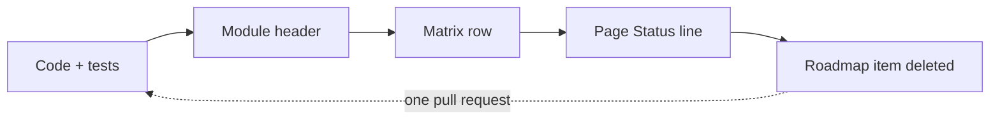

# Contributing to highuvlith

Thanks for helping. highuvlith is a lithography simulator whose central rule is that
**honesty is the product**: every capability is graded by what the code actually computes,
and the documentation never claims more. Most of this guide is about keeping it that way.

- [Build from source](#build-from-source)
- [Tests and lints](#tests-and-lints)
- [What CI checks and how to run it locally](#what-ci-checks-and-how-to-run-it-locally)
- [The honesty rules](#the-honesty-rules)
- [Scientific rigor](#scientific-rigor)
- [Documentation](#documentation)
- [GitHub-safe math](#github-safe-math)
- [Pull requests](#pull-requests)
- [Maintainers: releasing and GitHub Pages](#maintainers-releasing-and-github-pages)

Orientation: [docs/architecture.md](docs/architecture.md) maps the workspace,
[docs/extending.md](docs/extending.md) has step-by-step recipes for new source families,
optical systems and process modules, [docs/capability-matrix.md](docs/capability-matrix.md)
is the status ledger, and [docs/roadmap.md](docs/roadmap.md) lists what is planned.

## Build from source

The five-line build is in the README's [Quick start](README.md#quick-start) and is the same
on the [getting-started page](docs/getting-started.md) and in [examples/](examples/README.md):
a stable Rust toolchain ([rustup](https://rustup.rs)), Python 3.10 or newer (CI tests 3.12
and 3.13), `pip install maturin numpy`, then `maturin develop --release` inside an active
virtualenv. highuvlith is **not published on PyPI yet**. Notes for development:

- `maturin develop` (without `--release`) compiles faster but runs the physics much slower;
  use it for quick edit-test cycles. `maturin develop --extras dev` also installs the test and
  lint tools.
- `pip install ".[viz]"` from the checkout builds an optimized wheel through maturin (this
  still needs the Rust toolchain). The extras in `pyproject.toml` are `viz` (matplotlib),
  `interactive` (plotly, polars), `notebook` (ipywidgets), `hdf5` (h5py), `dev` (pytest,
  pytest-cov, pytest-timeout, ruff, mypy) and `all`.
- The CLI and the desktop GUI are plain Cargo binaries: `cargo build --release -p
  highuvlith-cli` (then `target/release/highuvlith --help` — simulate, sweep, deep, optimize,
  throughput, sources, materials) and `cargo run --release -p highuvlith-gui`.
- `highuvlith-core` has two default Cargo features: `parallel` (Rayon) and `image-export`
  (PNG/TIFF). Both are optional; CI also tests the crate with each of them switched off.

## Tests and lints

CI (`.github/workflows/ci.yml`) runs the following; run them before opening a pull request:

```bash
cargo fmt --check
cargo clippy -- -D warnings                          # library targets of every crate, GUI included
cargo test --workspace --exclude highuvlith-gui
cargo test -p highuvlith-core --no-default-features  # also: --features parallel / image-export
RUSTDOCFLAGS="-D warnings" cargo doc --workspace --no-deps --exclude highuvlith-gui

maturin develop && pytest tests/python/ -v --timeout=120
ruff check python/
mypy python/highuvlith/ --ignore-missing-imports
```

The example notebooks are executed headlessly in CI as well
(`pip install matplotlib jupyter nbconvert`, then for each notebook in
`examples/notebooks/`:
`MPLBACKEND=Agg jupyter nbconvert --to notebook --execute --stdout <notebook> > /dev/null`).

Benchmarks are Criterion benches: `cargo bench -p highuvlith-core` (reports land in
`target/criterion/`; the aerial-image bench is
`crates/highuvlith-core/benches/aerial_benchmark.rs`).

What the test tiers pin:

| Tier | Where | What it pins |
|---|---|---|
| Unit tests | `#[cfg(test)]` in every module | Constructors reject bad input; fixture values; invariants (weights sum to 1, symmetry, bounds) |
| Analytical validation | `crates/highuvlith-core/tests/analytical_validation.rs` | Closed forms: Fresnel/Brewster/quarter-wave, the coherent three-beam image through focus |
| Imaging validation | `crates/highuvlith-core/tests/imaging_validation.rs` | SOCS against an independent Abbe summation, resolution limits, focus behaviour, determinism |
| Vector imaging | `crates/highuvlith-core/tests/vector_pupil.rs`, `vector_imaging.rs` | TE/TM two-beam closed forms, energy statements, film entrance, engine-level vector images |
| Property-based | `crates/highuvlith-core/tests/proptest_physics.rs` | Physical bounds over random inputs |
| Python | `tests/python/` | Bindings, the `api` helpers, per-family source physics, error mapping |
| Stub drift | `tests/python/test_stub_drift.py` | `python/highuvlith/_native.pyi` lists every member of the compiled module |
| Docs examples | `tests/docs/test_site_examples.py` | Every verified Python example in `docs/` and `README.md` runs and prints its recorded output (numbers within a small tolerance) |
| Docs consistency | `tests/docs/test_rosetta.py`, `test_toml_keys.py`, `test_caption_badges.py` | The canonical run gives the same numbers in Python, the CLI and the reference page; every TOML key a page lists exists; every figure caption's `Model:` grade equals its matrix row |
| CLI examples | `crates/highuvlith-cli/tests/examples.rs` | Every `examples/*.toml` runs end to end through the CLI |

House rules for tests:

- Keep them fast: a Rust test should take well under ~3 s in a debug build and a Python
  test under ~5 s. Use small grids.
- A test that encodes a past bug (for example `test_default_photon_density_matches_source_trait`,
  which pins a former 1000× photon-density slip) is never weakened; if it must change,
  explain the history in a comment.
- Every new PyO3 class, function or method needs its entry in `_native.pyi`, or the stub
  drift test fails.
- `cargo clippy --all-targets` is not clean yet (a few lints in older test code); please do
  not add new ones. CI enforces clippy on library targets only.

`.pre-commit-config.yaml` wires rustfmt, clippy, `ruff` and `ruff format` into
`pre-commit` (`pip install pre-commit && pre-commit install`). CI does not enforce
`ruff format` yet.

## What CI checks and how to run it locally

Every documentation gate runs from the repository root. The docs toolchain lives in its own
virtualenv (`python -m venv .venv-docs && .venv-docs/bin/pip install -r docs/requirements-docs.txt`;
MkDocs stays on 1.x because MkDocs 2 drops the plugin and theme system the site is built on);
the figure checks import the figure modules, so they run with the project venv after
`pip install -r docs/figures/requirements-figures.txt`. `scripts/docs_gates.sh <checkout>
[--examples] [--qa]` runs the whole list and ends with `N failed gate(s)`.

| CI job · step | Command | What it enforces |
|---|---|---|
| docs-content · Status lines | `for f in $(find docs -name '*.md' ...); do grep -q '^\*\*Status:\*\*' "$f"; done` (the loop is in `ci.yml`) | every technical page outside the index, narrative, playground and infrastructure trees opens with a `**Status:**` line |
| docs-content · GitHub-safe math | `python scripts/check_docs_math.py docs/ README.md CONTRIBUTING.md` | display math in ```` ```math ```` fences, no backslash-punctuation inside `$…$`, no bare dollar signs |
| docs-content · badges and forms | `python scripts/check_docs_badges.py docs/ README.md` (`--strict --pages <your pages>` while you work) | grade glyphs only where the matrix says, Status-line form and matrix link, no `=== "tab"` syntax, mermaid fences only on allow-listed pages (`scripts/mermaid_allowlist.txt`), `<details markdown="1">` form under `docs/`, no silently unchecked example output |
| docs-content · linter tests | `python -m pytest scripts -q` | the math and badge linters' own fixtures |
| docs-content · links | `lychee --offline --include-fragments README.md CONTRIBUTING.md docs/` | every relative link and `#fragment` resolves (lychee 0.24) |
| docs-site · hooks | `python -m pytest docs/hooks -q` | the MkDocs hooks (status badges, page kit, repo links, pending nav) and `test_tokens.py` (the CSS token block equals `docs/figures/tokens.py --css`) |
| docs-site · JavaScript | `node --test docs/javascripts/tests/*.test.mjs` | the playground physics and the layout helpers |
| docs-site · strict build | `HUV_DOCS_STRICT_NAV=1 NO_MKDOCS_2_WARNING=true mkdocs build --strict` | any warning fails: a nav entry without a page, a missing image, an unresolved anchor |
| docs-site · visual QA | `python3 -m http.server 8793 --bind 127.0.0.1 --directory site &` then `node scripts/qa_site.mjs --site http://127.0.0.1:8793 --modes light,dark,print,phone --sample` | no horizontal scroll, no MathJax error, no broken image, one visible variant per light/dark pair, every clipped block has its overflow cue, every python fence has its marker (page-form findings warn until `HUV_QA_STRICT=1`) |
| docs-examples · verified examples | `maturin develop --release && cargo build --release -p highuvlith-cli && pytest tests/docs/test_site_examples.py -q` | every `<!-- verify-example -->` block in `docs/` and `README.md` runs and prints its recorded output |
| docs-examples · figure registry | `python docs/figures/sim/make_all.py --check` | both variants of every simulator figure exist within their size caps, every listed page embeds the canonical block, every caption's `Model:` label resolves to a matrix row with the matrix's glyph, the legend blocks and the matrix tile map match the matrix, the readiness CSV matches the matrix |
| docs-examples · assets | `python docs/figures/check_figures.py --check` | the same for the narrative, schematic and animated assets (`AssetSpec`): light/dark pairs, animated files with a still, pinned hashes of the GUI captures |
| docs-examples · legend, map, readiness | `python docs/figures/reference/make_legend.py --check && python docs/figures/reference/make_matrix_map.py --check && python docs/figures/future/check_readiness.py` | the generated legend counts, the tile map and the readiness ladder are regenerated from the matrix and compared |
| docs-examples · consistency | `pytest tests/docs/test_rosetta.py tests/docs/test_toml_keys.py tests/docs/test_caption_badges.py tests/docs/test_matrix_parse.py -q` | the canonical run across front ends, TOML keys, caption grades, the matrix grammar |
| docs-figures (nightly, non-blocking) | `python docs/figures/sim/make_all.py --verify --require cli`, then `python docs/figures/check_figures.py --platform-independent --regenerate && git diff --exit-code -- $(python docs/figures/check_figures.py --platform-independent)` | every figure's `compute()` and its physical asserts run (nothing drawn); the platform-independent SVGs, `presets.json` and the marker tables regenerate byte-identically |
| local only | `scripts/docs_gates.sh <checkout> --figures` | regenerates every figure on the figure machine and diffs `docs/assets/images` (PNG, APNG and GIF depend on font and library versions, so CI never renders them) |

## The honesty rules

Every capability carries one of four grades. [docs/capability-matrix.md](docs/capability-matrix.md)
is the single source of truth for them.

| Badge | Grade | Meaning |
|---|---|---|
| ✅ | Implemented | Computed by code, covered by tests, physics validated against analytical results |
| 🔶 | Simplified | Runs end-to-end with documented approximations or reduced dimensionality; the assumption is stated inline wherever the capability is described |
| 🧪 | Theoretical | Parameterized and runnable, but models speculative physics; outputs are research projections, not validated engineering |
| 🗺️ | Planned | Not in code; roadmap only; never described in prose as if it runs |

The grade shows up in four places, and they must agree:

1. the `//! # Model status` section of the module's header doc (every core module has one,
   next to `//! # Key equations`);
2. the row in [docs/capability-matrix.md](docs/capability-matrix.md);
3. the first line of the capability's documentation page:
   `**Status:** <badge> <Name> — <one-sentence justification>` (CI checks that every
   technical page has it; index pages, the capability matrix and the narrative site
   sections are exempt);
4. the "Model coverage" tables on source and process pages, where every struct field is
   tagged `live` (enters a computation), `stored (inert)` (carried and exposed, no consumer
   yet) or `planned` (not a field yet).

**Same-PR rule:** a change to what a module computes updates the module header, the
capability-matrix row and the page's Status line in the same pull request. When a roadmap
item lands, delete it from [docs/roadmap.md](docs/roadmap.md) in that pull request too.
Never describe a planned capability as if it runs, and never round a Simplified grade up to Implemented.

How a capability changes grade — one pull request, five places:



The same diagram sits on the [reference index](docs/reference/index.md) and on
[docs/extending.md](docs/extending.md). Figure captions carry the grade too: every `Model:`
clause names a matrix row, and `make_all.py --check` fails when its glyph differs from the
row's, so a regrade that forgets a caption does not build.

## Scientific rigor

- Use textbook or peer-reviewed physics, and write the key equations into the module header.
- Cite a reference only when you are certain of its details (authors, journal, volume,
  year). If you are not, describe the provenance generically ("standard 1D FEL theory",
  "Kramers' law"). A fabricated citation is the worst possible contribution.
- Every new formula gets a fixture test whose expected numbers were computed independently
  of the implementation (by hand, or with a separate NumPy/SciPy script you mention in the
  test), plus limit or scaling tests (for example "doubling γ quarters λ").
- Use CODATA constants; the shared ones live in
  `crates/highuvlith-core/src/source_models/physics.rs`.
- Prefer quantities derived from machine parameters over stored numbers. When a value is a
  projection or an assumption, say so in the code comment and in the docs.
- Units: lengths in nm unless the field name says otherwise (`_um`, `_mm`, `_m`), energies
  in eV or keV (the name says which), doses in mJ/cm², powers in W.

## Documentation

The site at <https://sonoransun.github.io/highuvlith/> is built with
[MkDocs](https://www.mkdocs.org/) and [Material for MkDocs](https://squidfunk.github.io/mkdocs-material/)
from the `docs/` folder; every page also reads as plain Markdown on github.com, and both
surfaces must look right. The toolchain is pinned in `docs/requirements-docs.txt`; use a
separate virtualenv:

```bash
python -m venv .venv-docs
.venv-docs/bin/pip install -r docs/requirements-docs.txt
.venv-docs/bin/mkdocs serve                   # live preview at http://127.0.0.1:8000
.venv-docs/bin/mkdocs build --strict          # what CI runs; any warning fails
```

- `HUV_DOCS_STRICT_NAV=1` turns nav entries whose page is missing into errors (CI sets
  it); without it the `docs/hooks/pending_nav.py` hook skips them with an INFO message.
  `NO_MKDOCS_2_WARNING=true` silences Material's MkDocs 2 notice.
- New pages need an entry in the `nav:` section of `mkdocs.yml`.
- Link between pages with relative links (`./pipeline.md`, `../sources/lpp.md`). Links to
  code or examples outside `docs/` (`../crates/highuvlith-core/src/aerial.rs`,
  `../../examples/sim.toml`) are rewritten to GitHub URLs on the site by
  `docs/hooks/repo_links.py`, and only when the target exists, so a typo fails the build.
- Never link `CLAUDE.md`; it is not documentation.
- The narrative sections (`docs/history/`, `docs/nodes/`, `docs/future/`) follow
  additional rules: every fact is verifiable and listed under "References", images are our
  own (SVG/PNG written by the scripts under `docs/figures/` — nothing is hand-drawn, see
  `docs/figures/README.md`) and must work in light and dark mode, and simulator examples are
  marked with a `<!-- verify-example -->` comment and run before they are committed.
- Pages that describe a capability link its capability-matrix grade and never imply the
  simulator does more (there is no mask-3D/EMF model, for example).

### Documentation page anatomy

Every page family has a fixed skeleton, identical on the site and on github.com:

1. `description:` front matter; the H1 is the nav title; no badge or parenthetical in any heading.
2. Technical pages open with `**Status:** <badge> <Name> — <justification> · [matrix](capability-matrix.md#<domain>)` (plain Markdown; the site hook styles it).
3. A short lead, then the hero figure or the Physics Strip (mechanism drawing · engine figure · "What is modeled" table · one "Same thing elsewhere" line).
4. Each claim paragraph is followed directly by the one figure that supports it; figures are `<figure markdown="span">` blocks pasted from `make_all.py --catalog`, with a light/dark pair (`#gh-light-mode-only` / `#gh-dark-mode-only`) and an HTML `<figcaption>` ending in `<em>Model: <matrix row> <glyph>; <approximations>.</em>`.
5. Display math in ```` ```math ```` fences, one idea per fence; at most one table per H2, no math in table cells.
6. One "Model coverage" table (Field · Unit · Consumed by · Status) on technical pages; a "Usage" section with sequential H3s (Python · CLI and TOML · Rust), never content tabs.
7. Long-but-necessary content (validation, full formulas, flowchart fallbacks, behaviour changes) goes in `<details markdown="1">`, `<summary>` on the next line, a blank line, the content at column 0, a blank line, `</details>` — the one collapsed-block device; `???+ success "Output"` / `??? success "Output"` is reserved for recorded outputs.
8. Every caveat that lives in an admonition is preceded by a bold one-sentence version, so github.com keeps it.
9. Grade glyphs appear at most once per sentence; glyph + word ("✅ Implemented") only in Status lines, at-a-glance tables, caption trailers and the legend.
10. Mermaid only for process loops, decision trees and `<details>` fallbacks, and only on the pages `scripts/mermaid_allowlist.txt` lists; everything else is a generated SVG or a table.
11. Section hue is a hairline, never a background: a colour is never readable as a grade.
12. Pages end with Key takeaways (narrative) and a plain-Markdown **Where next** line, then References.
13. README.md and this file are GitHub-only: `<picture>` for light/dark, bare `<details>`, GFM tables, no admonitions, no attr_list.
14. Animations rest on a designed still, respect `prefers-reduced-motion` and never autoplay sound or video.
15. The page kit (`docs/_kit.md`) shows every component; `scripts/qa_site.mjs` screenshots and asserts the rendered site.

### Verified examples

Every fenced `python` block in `docs/**/*.md` and `README.md` carries a comment on the line
directly above its fence, `<!-- verify-example -->` or `<!-- example-skip: reason -->`. CI
runs the verified ones in a fresh interpreter and compares their printed output with the
recorded one:

```bash
maturin develop --release                            # release build required, see below
pytest tests/docs/test_site_examples.py -q
python tests/docs/test_site_examples.py --update-outputs   # after an intended numeric change
```

- The recorded output is the next non-blank block after the fence. On docs pages it is a
  `???+ success "Output"` admonition (`???` when longer than six lines) holding an indented
  ```` ```text ```` fence; in `README.md` it is a bare ```` ```text ```` fence with no lead-in
  line. Nothing is ever placed between a fence and its output, and the rule holds inside
  `<details>` too.
- Build the extension in **release** mode: each example has a 60 s limit, and at least one
  (the volumetric-exposure example) takes longer than that in a debug build. To run them
  against a debug build anyway, raise the limit with `HUV_EXAMPLE_TIMEOUT=300`.
- Run `--update-outputs` only after a deliberate numeric or format change, and review the
  diff line by line; moving an example between pages moves marker, fence and output as one
  block.
- Every API member a page names must appear in a passing verified example or in a figure's
  `compute()`; otherwise the page says "Rust-only" or "not exposed".

### Figures

Every image under `docs/assets/images/` is written by a script under `docs/figures/` — the
simulator figures by `docs/figures/sim/fig_*.py` (`FigureSpec`: a `compute()` that calls
the engine and a `draw()`), the narrative, schematic and animated assets by the section
scripts (`AssetSpec`), the GUI media from real `--screenshot` captures composed by a Pillow
script. Nothing is hand-drawn and nothing is mocked. [docs/figures/README.md](docs/figures/README.md)
is the reference; the rules that matter when you touch a figure:

- `alt` and `caption` live in the spec and are canonical: pages embed the block that
  `make_all.py --catalog` prints, `--sync-embeds --pages <page>` rewrites existing embeds,
  and a hand-edited caption fails `make_all.py --check`. The `pages=` tuple is enforced:
  every listed page must embed the figure.
- Every figure is a light/dark pair rendered through `docs/figures/tokens.py` (one palette
  for CSS, SVG and matplotlib); docs pages use the `#gh-light-mode-only` /
  `#gh-dark-mode-only` idiom, README uses `<picture>`.
- The caption's `Model:` clause names a capability-matrix row (or maps to one through the
  spec's `extra["model_rows"]`); `--check` fails on a glyph that differs from the row's.
- Animations are two-layer animated SVGs (CSS keyframes, a reduced-motion rule inside the
  file) or APNGs written by the frame-list writer, always with a designed still; the README
  may use a GIF. Per-kind size caps and the per-page motion budget are enforced by
  `check_figures.py --check`.
- Regenerate with `python docs/figures/sim/make_all.py` (the extension built in release
  mode, the CLI built for the front-end figures) and the section scripts; the figure machine
  recorded in `docs/figures/README.md` is the renderer of record, and CI never regenerates a
  raster.

## GitHub-safe math

GitHub applies Markdown backslash-escape processing inside `$…$` and `$$…$$` before the
math is typeset: `\,` becomes `,`, `\{` becomes `{`, `\\` becomes `\`, and `\%` becomes
`%`, which TeX reads as a comment that swallows the rest of the line. The MkDocs site is
not affected, so these breakages only show on github.com. Therefore:

- **Display math** goes in a fenced block that opens with ```` ```math ```` and closes
  with ```` ``` ````. GitHub renders it verbatim, and the site renders it exactly like
  `$$…$$`.
- **Inline math** contains no backslash followed by punctuation: drop `\,` `\;` `\!`
  (use a space or nothing), write `\lbrace` / `\rbrace` instead of `\{` / `\}` and `\Vert`
  instead of `\|`, and never write `\%` — put the percent sign outside the math
  (for example `$0.6$ %`). Letter macros such as `\lambda`, `\frac`, `\sqrt` and
  `\mathrm` are fine.
- A literal dollar sign in prose is written `\$`, so it is not read as math.

The linter enforces this (CI runs it on `docs/`, `README.md` and this file and fails on any finding):

```bash
python scripts/check_docs_math.py docs/ README.md CONTRIBUTING.md   # report; exit 1 on findings
python scripts/check_docs_math.py --fix --fix-inline docs/my-page.md
```

`--fix` converts `$$` display blocks to `math` fences; `--fix-inline` applies the safe
inline rewrites. Anything else it reports (such as `\%`) is fixed by hand.

## Pull requests

- Branch from `main` and keep pull requests focused.
- In the description, say what changed and why, and give the validation evidence: the
  tests you added, the numbers they pin, and where the independent reference values came
  from.
- New source families, optical systems and process modules follow the recipes in
  [docs/extending.md](docs/extending.md) (model file, trait implementation, `SourceKind`
  wiring, Python factory and stub, CLI TOML, example config, docs page, matrix row, tests).
- Commit messages: a short imperative summary line, then a body that explains why.

Checklist before you open the pull request:

- [ ] the commands under [Tests and lints](#tests-and-lints) pass
- [ ] the same-PR honesty updates are done: module header, matrix row, page Status line, roadmap, captions
- [ ] `_native.pyi` covers new bindings
- [ ] new TOML keys are documented in [docs/configuration.md](docs/configuration.md) and on the family's page
- [ ] if you touched docs: the strict build, the math linter, `check_docs_badges.py`, lychee and the verified examples pass (`scripts/docs_gates.sh . --examples`)
- [ ] if you touched a figure: the generator and its outputs are committed together and `make_all.py --check` passes
- [ ] a corrected number goes to the matrix audit log

By contributing you agree that your contributions are licensed under the
[MIT License](LICENSE).

## Maintainers: releasing and GitHub Pages

<details>
<summary>Releasing</summary>

1. Bump `version` in `pyproject.toml` and in the four `crates/*/Cargo.toml` manifests
   together.
2. Tag the release commit `vX.Y.Z` and push the tag. `.github/workflows/release.yml` then
   builds optimized wheels with `PyO3/maturin-action` (x86_64 and aarch64 Linux manylinux,
   aarch64 and x86_64 macOS, x86_64 Windows; `--find-interpreter`, no sdist) and publishes
   them to PyPI with trusted publishing (`id-token: write`, no API token).
3. Before the first release, configure a trusted publisher for the `highuvlith` project on
   PyPI (repository `sonoransun/highuvlith`, workflow `release.yml`). The package has not
   been published yet.
4. Before tagging, check that the runner labels in `release.yml` are still offered by
   GitHub — notably `macos-13`, used for the x86_64 macOS wheel; GitHub retires older
   macOS runner images periodically.

The Rust crates are not published to crates.io.

</details>

<details>
<summary>GitHub Pages</summary>

The documentation site (history of lithography, process nodes, the future of the field,
playground, and the simulator docs) is published at
<https://sonoransun.github.io/highuvlith/> from the repository
<https://github.com/sonoransun/highuvlith>.

- `.github/workflows/pages.yml` runs on every push to `main` and on manual dispatch
  ("Run workflow"): it tests the MkDocs hooks and the playground physics, builds the site
  with `mkdocs build --strict` (missing nav pages are errors), and deploys it with
  `actions/deploy-pages`. Pull requests are checked by the `docs-site` job in
  `.github/workflows/ci.yml`.
- One-time setup: **Settings → Pages → Build and deployment → Source = GitHub Actions**.
- GitHub Pages on a **private** repository needs a paid GitHub plan (Pro, Team or
  Enterprise); on GitHub Free, Pages is available for public repositories only. While the
  repository is private, the site's "view/edit on GitHub" links and source links do not
  resolve for visitors.
- If the repository or its default branch is renamed, update `site_url`, `repo_url`,
  `repo_name` and `edit_uri` in `mkdocs.yml`; `docs/hooks/repo_links.py` derives its GitHub
  links from them.

</details>
