<p align="center"><picture>
  <source media="(prefers-color-scheme: dark)" srcset="docs/assets/brand/logo.svg">
  
</picture></p>
<h1 align="center">highuvlith</h1>
<p align="center">A lithography simulator that tells you exactly what it computes — 436 nm → 13.5 nm → X-ray.</p>
<p align="center"><a href="https://github.com/sonoransun/highuvlith/actions/workflows/ci.yml"></a> <a href="https://sonoransun.github.io/highuvlith/"></a> <a href="LICENSE"></a> <a href="docs/capability-matrix.md"></a></p>

<picture>
  <source media="(prefers-reduced-motion: reduce) and (prefers-color-scheme: dark)" srcset="docs/assets/images/diagrams/spectrum-strip-hero-still-dark.svg">
  <source media="(prefers-reduced-motion: reduce)" srcset="docs/assets/images/diagrams/spectrum-strip-hero-still-light.svg">
  <source media="(prefers-color-scheme: dark)" srcset="docs/assets/images/diagrams/spectrum-strip-hero-anim-dark.svg">
  
</picture>

*One axis of light: every exposure wavelength lithography has used, the optic each needed and the year its first tool appears in the data (86 tools, [`litho_tools.csv`](docs/figures/history/litho_tools.csv)).*

**[Documentation site](https://sonoransun.github.io/highuvlith/) · [Capability matrix](docs/capability-matrix.md) · [Quick start](#quick-start)**

## What it is

highuvlith is a Rust physics engine that images a mask through partially coherent projection optics — refractive, immersion, EUV mirrors, Schwarzschild or zone plate — from the mercury g-line to hard X-rays. It has four front ends: a Python package, a TOML-driven command line, an egui desktop app and six Jupyter notebooks, all running the same engine. The aerial image is carried into resist and development models, process-window analysis, stochastics and mask optimization, with deep-layer modules for LIGA, volumetric exposure, grayscale, interference and Talbot lithography.

<!-- huv-legend:start -->
<!-- huv-table: stack -->
| ✅ Implemented · 44 | 🔶 Simplified · 23 | 🧪 Theoretical · 7 | 🗺️ Planned · 1 |
|---|---|---|---|
| Computed by code, covered by tests, physics validated against analytical results | Runs end-to-end but with documented approximations or reduced dimensionality; the assumption is stated inline wherever the capability is described | Parameterized and runnable, but models speculative physics; outputs are research projections, not validated engineering | Not in code; roadmap only. Never described in prose as if it runs |
<!-- huv-legend:end -->

> [!NOTE]
> **Honesty is the product.** Every capability is graded in the [capability matrix](docs/capability-matrix.md); nothing in this README claims more than it.

## See it

<table>
<tr>
<td align="center" valign="top" width="33%">
<picture>
  <source media="(prefers-color-scheme: dark)" srcset="docs/assets/images/sim/imaging-illumination-shapes-dark.png">
  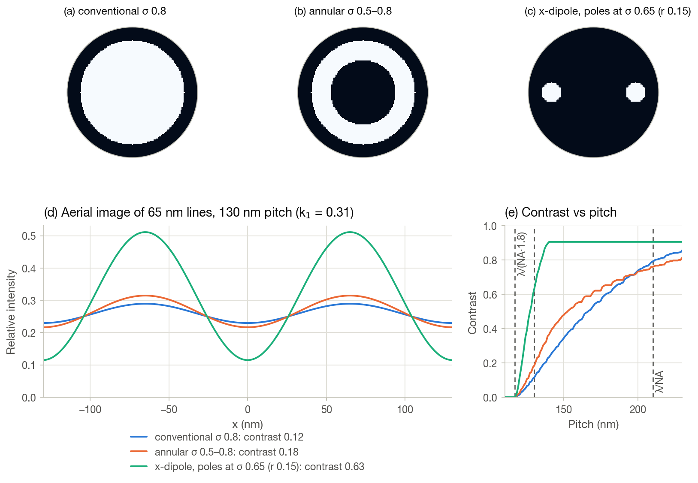
</picture>

Off-axis illumination below λ/NA: conventional, annular and dipole fills at k₁ ≈ 0.31 (Hopkins/SOCS ✅). <a href="docs/pipeline.md">→ details</a>
</td>
<td align="center" valign="top" width="33%">
<picture>
  <source media="(prefers-color-scheme: dark)" srcset="docs/assets/images/sim/talbot-carpet-dark.png">
  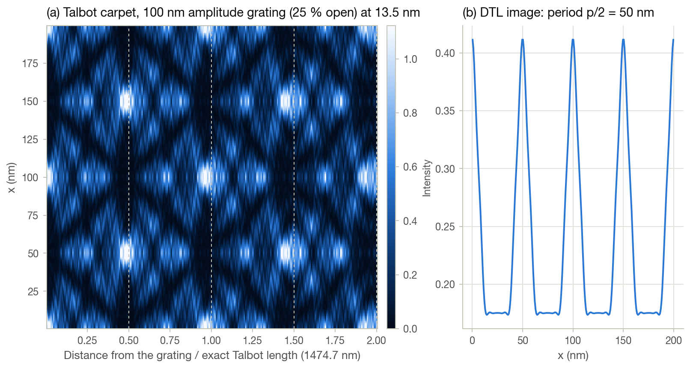
</picture>

Talbot carpet of a 100 nm grating at 13.5 nm and the half-period DTL image (Talbot/DTL 🔶). <a href="docs/processes/talbot.md">→ details</a>
</td>
<td align="center" valign="top" width="33%">
<picture>
  <source media="(prefers-color-scheme: dark)" srcset="docs/assets/images/sim/optim-ilt-contacts-dark.png">
  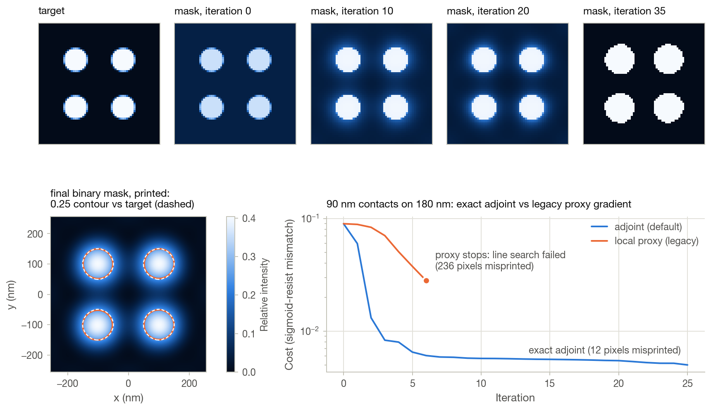
</picture>

Inverse lithography of a contact array with the exact adjoint gradient (ILT ✅). <a href="docs/research-modules.md">→ details</a>
</td>
</tr>
</table>

<picture>
  <source media="(prefers-color-scheme: dark)" srcset="docs/assets/images/sim/home-generations-dark.png">
  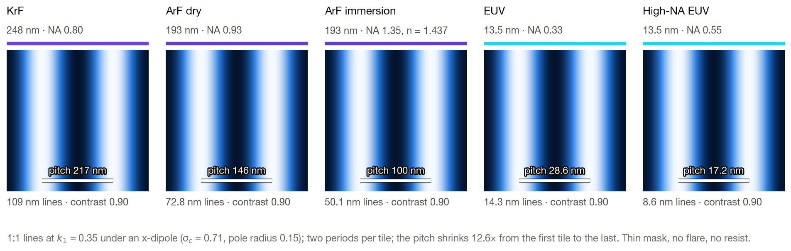
</picture>

*Five generations, one pattern: KrF, dry ArF, immersion ArF, EUV and High-NA EUV each printing equal lines and spaces at k₁ = 0.35, computed by the engine — 217 nm to 17.2 nm pitch, a 12.6× span, all at contrast 0.90. Hopkins imaging ✅; thin mask, no resist. The two EUV tiles are imaged through EUV projection optics 🔶 (isotropic pupil, assumed 0.2·NA obscuration at NA 0.55, no mask 3-D).*

<picture>
  <source media="(prefers-reduced-motion: reduce) and (prefers-color-scheme: dark)" srcset="docs/assets/images/sim/anim/through-focus-still-dark.png">
  <source media="(prefers-reduced-motion: reduce)" srcset="docs/assets/images/sim/anim/through-focus-still-light.png">
  <source media="(prefers-color-scheme: dark)" srcset="docs/assets/images/sim/anim/through-focus-anim-dark.gif">
  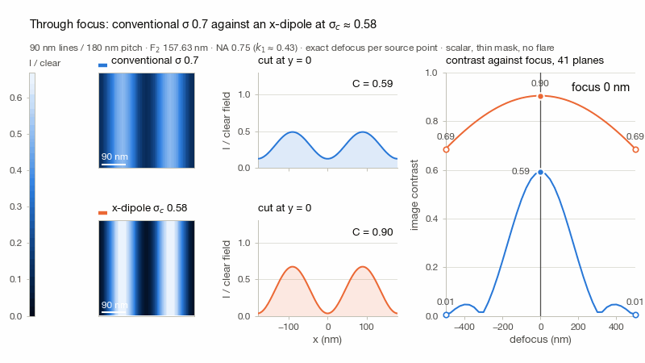
</picture>

*Through focus: conventional σ 0.7 against an x-dipole, 90 nm lines at 180 nm pitch (through-focus imaging ✅). A still frame is on the [getting-started page](docs/getting-started.md).*

## Quick start

highuvlith is not published on PyPI yet, so build it from source: a stable Rust toolchain ([rustup](https://rustup.rs)) and Python 3.10 or newer.

```bash
git clone https://github.com/sonoransun/highuvlith.git
cd highuvlith
python -m venv .venv && source .venv/bin/activate
pip install maturin numpy
maturin develop --release    # Rust core + Python package
```

Every snippet below was run against this repository in CI; the printed numbers are what it produced.

### 1. A first aerial image

<!-- verify-example -->
```python
import highuvlith as huv

result = huv.simulate_line_space(65.0, 180.0, na=0.75)
print(f"Contrast: {result.contrast:.3f}, NILS: {result.nils:.2f}")
```

```text
Contrast: 0.454, NILS: 0.65
```

<picture>
  <source media="(prefers-color-scheme: dark)" srcset="docs/assets/images/sim/start-first-image-dark.png">
  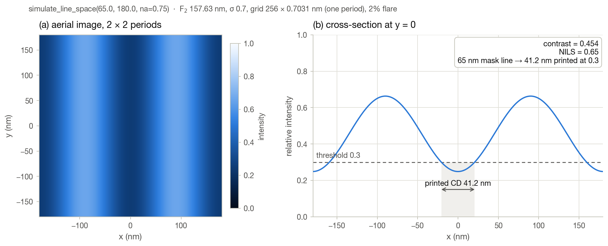
</picture>

*The numbers above, drawn: 65 nm lines on a 180 nm pitch, F₂ 157.63 nm, NA 0.75, σ 0.7 — the same run as [`examples/sim.toml`](examples/sim.toml) and the GUI's `--preset f2 --cd 65 --pitch 180` (Hopkins imaging ✅; thin mask, no resist).*

### 1b. Partial coherence

<!-- verify-example -->
```python
import highuvlith as huv

# 65 nm lines on a 180 nm pitch, F2 laser (157.63 nm), NA 0.75. The pitch is
# below lambda/NA = 210 nm, so only off-axis (partially coherent) light resolves it.
for sigma in (0.1, 0.7):
    r = huv.simulate_line_space(65.0, 180.0, na=0.75, sigma=sigma)
    nils = "n/a" if r.nils is None else f"{r.nils:.2f}"
    print(f"sigma {sigma}: contrast {r.contrast:.3f}, NILS {nils}")
```

```text
sigma 0.1: contrast 0.000, NILS n/a
sigma 0.7: contrast 0.454, NILS 0.65
```

<picture>
  <source media="(prefers-color-scheme: dark)" srcset="docs/assets/images/sim/imaging-resolution-vs-pitch-dark.png">
  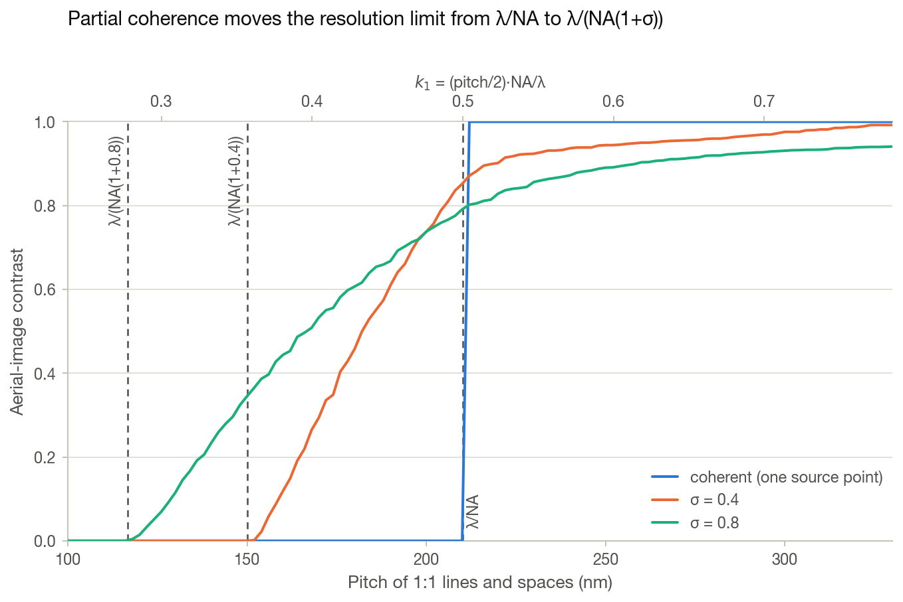
</picture>

The first diffraction orders of a 180 nm pitch fall outside the pupil for a
nearly coherent source; with σ = 0.7 the off-axis source points steer one of
them back in. The same case matches an independent Abbe reference (0.456).

<details>
<summary>2. Immersion: a pitch dry optics cannot print</summary>

<!-- verify-example -->
```python
import highuvlith as huv

# 45 nm lines on a 90 nm pitch with an ArF laser (193.4 nm): below the dry
# NA 0.93 limit lambda/((1 + sigma) NA) = 109 nm, resolved by water immersion.
source = huv.SourceConfig.arf_laser(sigma=0.9)
mask = huv.MaskConfig.line_space(cd_nm=45.0, pitch_nm=90.0)
grid = mask.commensurate_grid(256, 1.0)  # field = whole number of pitches

for optics in (huv.OpticsConfig(numerical_aperture=0.93), huv.OpticsConfig.immersion_193i()):
    engine = huv.SimulationEngine(source, optics, mask, grid=grid)
    images = engine.compute_through_focus([0.0, 50.0, 100.0])
    contrast = [round(image.image_contrast(), 3) for image in images]
    print(f"NA {optics.numerical_aperture:.2f}: contrast at 0/50/100 nm defocus {contrast}")
```

```text
NA 0.93: contrast at 0/50/100 nm defocus [0.0, 0.0, 0.0]
NA 1.35: contrast at 0/50/100 nm defocus [0.201, 0.177, 0.118]
```

<picture>
  <source media="(prefers-color-scheme: dark)" srcset="docs/assets/images/sim/imaging-immersion-193i-dark.png">
  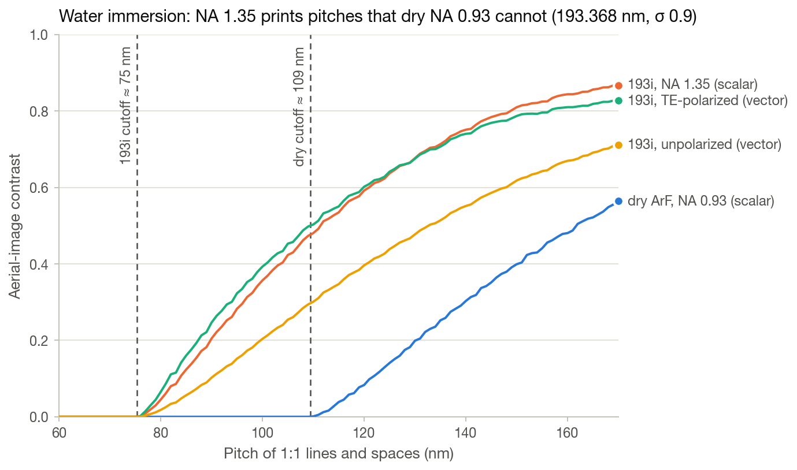
</picture>

*Dry NA 0.93 against water immersion at NA 1.35, both scalar (immersion lithography ✅). The two vector curves repeat the 193i sweep with unpolarized and TE-polarized light (vector high-NA imaging ✅).*

</details>

<details>
<summary>3. EUV at NA 0.33 and 0.55</summary>

<!-- verify-example -->
```python
import highuvlith as huv

# 9 nm lines on an 18 nm pitch at 13.5 nm (Sn laser-produced plasma): below the
# NA 0.33 limit, resolved at NA 0.55 (isotropic High-NA model, no anamorphic mask side).
source = huv.SourceConfig.lpp_sn_13nm5(sigma=0.9)
mask = huv.MaskConfig.line_space(cd_nm=9.0, pitch_nm=18.0)
grid = mask.commensurate_grid(128, 0.5)
for optics in (huv.OpticsConfig.euv_nxe(), huv.OpticsConfig.euv_high_na()):
    engine = huv.SimulationEngine(source, optics, mask, grid=grid)
    print(f"{optics.kind} NA {optics.numerical_aperture}: contrast {engine.image_contrast(0.0):.3f}")
```

```text
euv_projection NA 0.33: contrast 0.000
euv_projection NA 0.55: contrast 0.447
```

<picture>
  <source media="(prefers-color-scheme: dark)" srcset="docs/assets/images/sim/site/site-euv-nxe-vs-high-na-dark.png">
  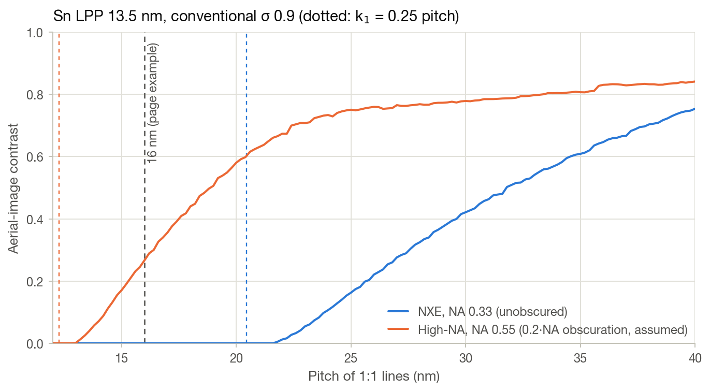
</picture>

*Contrast against pitch for NA 0.33 and NA 0.55 EUV optics (EUV scanner projection optics 🔶: isotropic, no anamorphic mask side).*

</details>

<details>
<summary>4. Polarization at high NA</summary>

<!-- verify-example -->
```python
import highuvlith as huv
from highuvlith import api

# Two-beam interference at NA 0.9: TE (y-polarized) keeps full contrast,
# TM (x-polarized) falls to |1 - 2 NA^2|, unpolarized light to 1 - NA^2.
for pol in ("y", "x", "unpolarized"):
    print(pol, round(api.vector_two_beam_contrast(0.9, pol), 3))

# The same physics in the imaging engine: vertical 64/128 nm lines at NA 0.9.
source = huv.SourceConfig.f2_laser(sigma=0.9)
optics = huv.OpticsConfig(numerical_aperture=0.9)
mask = huv.MaskConfig.line_space(cd_nm=64.0, pitch_nm=128.0)
grid = mask.commensurate_grid(64, 2.0)
print("scalar", round(huv.SimulationEngine(source, optics, mask, grid=grid).image_contrast(0.0), 3))
for pol in ("y", "x"):
    engine = huv.SimulationEngine(source, optics, mask, grid=grid,
                                  vector=api.VectorSettings(polarization=pol))
    print(pol, round(engine.image_contrast(0.0), 3))
```

```text
y 1.0
x 0.62
unpolarized 0.19
scalar 0.414
y 0.441
x 0.088
```

<picture>
  <source media="(prefers-color-scheme: dark)" srcset="docs/assets/images/sim/imaging-vector-te-tm-dark.png">
  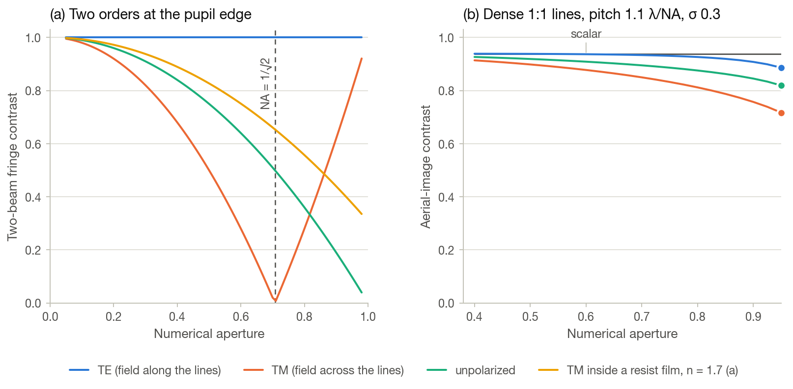
</picture>

*TE keeps its contrast, TM loses it at NA 1/√2 (vector high-NA imaging ✅).*

</details>

<details>
<summary>5. Source power and throughput</summary>

<!-- verify-example -->
```python
import highuvlith as huv

src = huv.SourceConfig.lpp_sn_13nm5()
print(f"{src.average_power_w:.0f} W in band at intermediate focus")
for name, value, unit, note in src.derived_quantities()[:3]:
    print(f"  {name} = {value:.4g} {unit}")
tp = src.wafer_throughput(dose_mj_cm2=30.0)  # illustrative EUV scanner defaults
print(f"{tp['wafers_per_hour']:.0f} wafers/h, {tp['power_at_wafer_w']:.2f} W at the wafer")
```

```text
250 W in band at intermediate focus
  photon_energy = 91.84 eV
  in_band_emission_2pi = 1290 W
  drive_laser_wavelength = 10.6 um
154 wafers/h, 4.59 W at the wafer
```

<picture>
  <source media="(prefers-color-scheme: dark)" srcset="docs/assets/images/sim/sources-throughput-dark.png">
  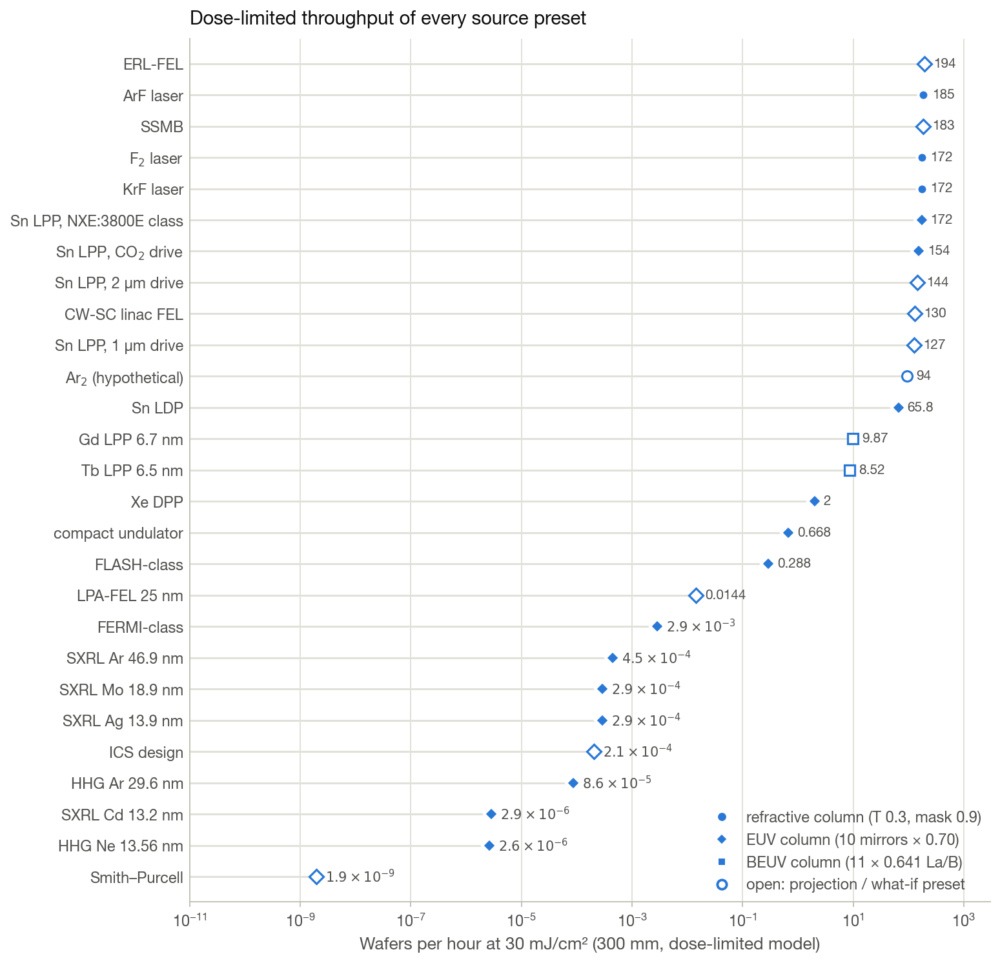
</picture>

*Wafers per hour for every source preset at 30 mJ/cm² (dose-limited wafer throughput 🔶: one optics-train transmission, lumped overheads, illustrative scanner parameters).*

</details>

<details>
<summary>6. LIGA deep X-ray</summary>

<!-- verify-example -->
```python
import highuvlith as huv

# 500 um of PMMA behind a 20 um Au mask, bending-magnet beamline 15 m from the
# source, 50 mm vertical scan: depth dose, beam hardening and exposure time.
bm = huv.SourceConfig.synchrotron_liga_bending_magnet()
liga = huv.simulate_liga(resist_thickness_um=500.0, source=bm, source_distance_m=15.0,
                         vertical_scan_mm=50.0, cd_nm=3200.0, pitch_nm=6400.0,
                         grid_size=128, pixel_nm=100.0)
print(f"top/bottom dose {liga.dose_ratio:.1f}, exposure {liga.exposure_time_s:.0f} s")
print(f"mean photon energy {liga.mean_energy_top_kev:.2f} keV (top) -> "
      f"{liga.mean_energy_bottom_kev:.2f} keV (bottom)")

# The same physics with a laboratory X-ray tube (W anode, 60 kV, 30 mA, 100 mm away)
tube = huv.SourceConfig.xray_tube("W")
flux = tube.spectral_flux_density(distance_mm=100.0)  # photons / s / mm^2 / keV
lab = huv.simulate_liga(resist_thickness_um=100.0, flux_density=flux, cd_nm=3200.0,
                        pitch_nm=6400.0, grid_size=128, pixel_nm=50.0)
print(f"X-ray tube, 100 um PMMA: exposure {lab.exposure_time_s / 3600:.1f} h")
```

```text
top/bottom dose 20.8, exposure 605 s
mean photon energy 2.85 keV (top) -> 7.57 keV (bottom)
X-ray tube, 100 um PMMA: exposure 39.5 h
```

<picture>
  <source media="(prefers-color-scheme: dark)" srcset="docs/assets/images/sim/liga-fresnel-edge-dark.png">
  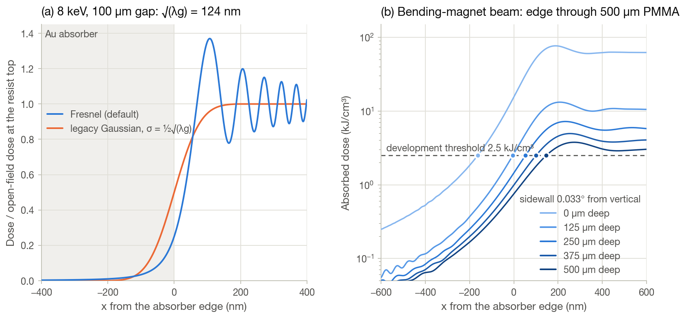
</picture>

*Fresnel knife-edge ringing against the legacy Gaussian blur, and the edge through 500 µm of PMMA (LIGA proximity diffraction ✅, with a thin-screen absorber as its documented simplification). The pixel resolves the Fresnel scale √(λ·gap). The tube's absolute flux rests on an empirical bremsstrahlung efficiency (🔶, about ±20 %).*

</details>

### Same run, three front ends

The command line and the desktop app run the same engine on the same case as example 1:

```bash
cargo build --release -p highuvlith-cli
target/release/highuvlith simulate --config examples/sim.toml --output aerial.png   # F2, 65/180 nm, NA 0.75
cargo run --release -p highuvlith-gui -- --preset f2 --cd 65 --pitch 180            # the same run, live
```

The CLI reports the numbers of example 1 on its 256-pixel grid, and [`examples/sim.toml`](examples/sim.toml) is the TOML behind them:

```text
Results:
  Contrast:  0.4545
  Printed CD (dark feature at I = 0.3000): 41.20 nm
  NILS:      0.654
```

[`tests/docs/test_rosetta.py`](tests/docs/test_rosetta.py) asserts that the Python, CLI and reference-page numbers agree.

## Four ways in

<table>
<tr>
<td align="center">
<picture>
  <source media="(prefers-color-scheme: dark)" srcset="docs/assets/images/gui/gui-strip-dark.png">
  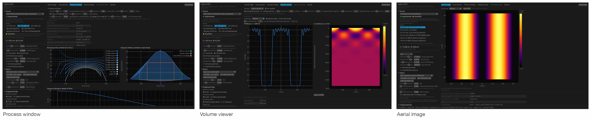
</picture>

The desktop app: process window, volume viewer and aerial image — real captures, dark theme, nothing mocked. <a href="docs/gui.md">→ GUI page</a>
</td>
</tr>
</table>

The CLI runs every example configuration end to end (its test suite runs each one):

```bash
cargo build --release -p highuvlith-cli
B=target/release/highuvlith

$B simulate --config examples/sim.toml --output aerial.png      # F2, 65/180 nm, NA 0.75
$B simulate --config examples/sim_lpp_sn.toml --output euv.png  # 13.5 nm Sn LPP
$B deep --config examples/liga.toml --output liga.png           # LIGA with an Al filter
$B deep --config examples/volumetric.toml --output profile.png  # bake + level-set develop
$B deep --config examples/talbot.toml --output talbot.png       # achromatic Talbot
$B optimize --config examples/optimize_opc.toml                 # fragment OPC
$B throughput --config examples/sim_lpp_sn.toml                 # dose-limited wafers/hour
$B sources                                                      # every preset, with badges
$B materials --wavelength 13.5                                  # CXRO-derived constants
```

Unknown or misspelled TOML keys are rejected with a suggestion; the schema is in [docs/configuration.md](docs/configuration.md). Six notebooks run in CI: [quickstart](examples/notebooks/01_quickstart_aerial.ipynb) · [source gallery](examples/notebooks/02_source_gallery.ipynb) · [deep lithography](examples/notebooks/03_deep_litho.ipynb) · [imaging physics](examples/notebooks/04_imaging_physics.ipynb) · [source physics](examples/notebooks/05_source_physics.ipynb) · [process and optimization](examples/notebooks/06_process_and_optimization.ipynb) — see [examples/](examples/README.md).

## What it computes

<picture>
  <source media="(prefers-color-scheme: dark)" srcset="docs/assets/images/reference/matrix-map-dark.png">
  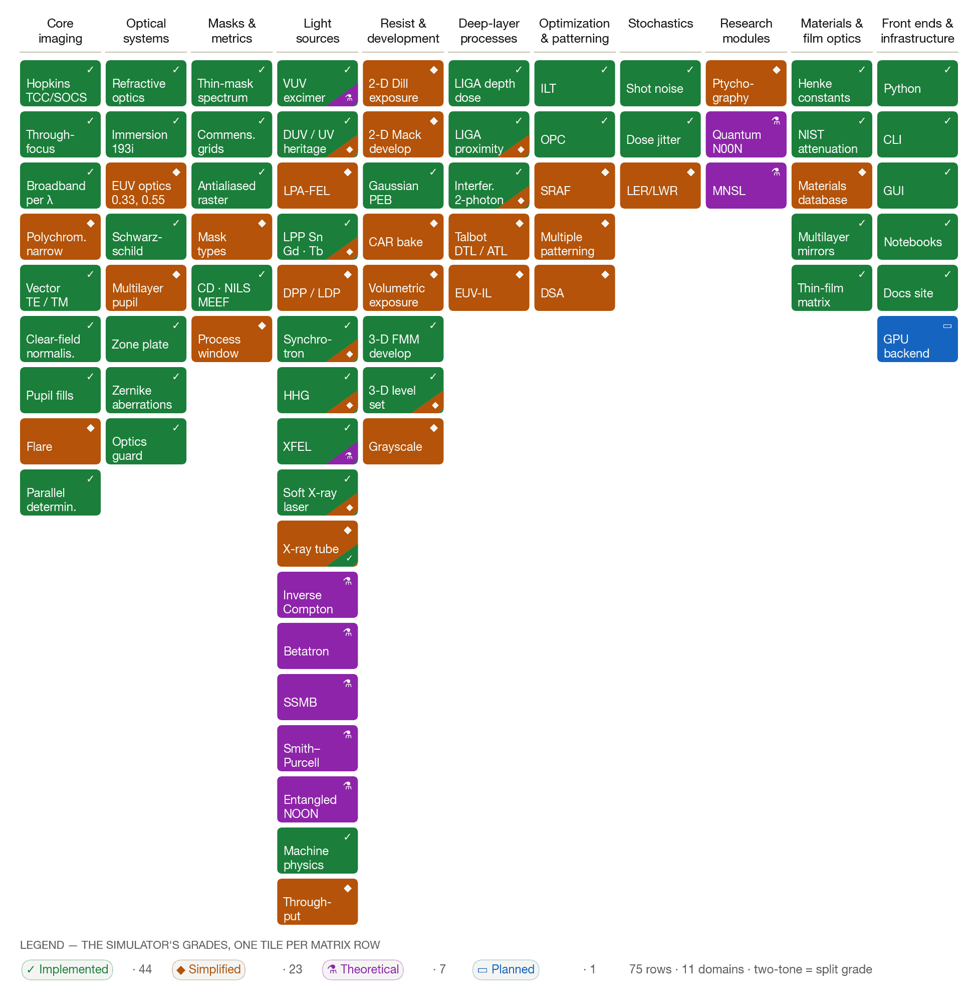
</picture>

*The [capability matrix](docs/capability-matrix.md) as a tile map, one tile per row, drawn from the matrix itself.*

Grades are copied row by row from the [capability matrix](docs/capability-matrix.md), split grades included: the headline badge comes first and the qualified part follows in parentheses with its own badge, so `✅ (🔶 coherence bound)` is an exact, tested capability whose coherence bound rests on a stated approximation.

| Area | What it computes | Grades |
|---|---|---|
| Imaging | Hopkins imaging, factorized TCC/SOCS ✅ · defocus / through-focus ✅ · vector (polarized) high-NA imaging ✅ · broadband per-wavelength imaging ✅ · narrow-band polychromatic shortcut 🔶 · illumination pupil fills ✅ · flare 🔶 | ✅ Implemented · 🔶 Simplified |
| Optics | refractive dry ✅ · 193 nm immersion ✅ · Schwarzschild ✅ · Fresnel zone plate ✅ · Zernike aberrations ✅ · EUV projection NA 0.33 / High-NA 0.55 🔶 · opt-in multilayer pupil 🔶 | ✅ Implemented · 🔶 Simplified |
| Masks and metrics | exact thin-mask spectrum ✅ · commensurate periodic grids ✅ · antialiased rasterization ✅ · CD / ILS / NILS / MEEF ✅ · mask model and types 🔶 · process window / ED analysis 🔶 | ✅ Implemented · 🔶 Simplified |
| Sources | VUV excimer ✅ (🧪 Ar₂ preset) · DUV/UV heritage ✅ (🔶 representative parameters) · Sn laser-produced plasma ✅ (🔶 CE defaults, étendue; 🧪 Gd/Tb power) · synchrotron ✅ (🔶 coherence bound) · XFEL ✅ (🧪 CW-SC and ERL presets) · high-harmonic generation ✅ (🔶 harmonic intensities) · soft-X-ray laser ✅ (🔶 assumed splits, no gain) · machine-parameter physics layer ✅ · X-ray tube 🔶 (✅ lines, edges, Duane–Hunt, Be window) · discharge plasma 🔶 · LPA-FEL 🔶 · dose-limited throughput 🔶 · inverse Compton 🧪 · betatron 🧪 · SSMB 🧪 · Smith–Purcell 🧪 · entangled-photon 🧪 | ✅ Implemented · 🔶 Simplified · 🧪 Theoretical |
| Resist | anisotropic Gaussian bake ✅ · 3D development by fast marching ✅ · 3D development by level set ✅ (🔶 first-order front) · 2D Dill exposure 🔶 · 2D Mack development 🔶 · chemically amplified bake 🔶 · volumetric exposure 🔶 · grayscale 🔶 | ✅ Implemented · 🔶 Simplified |
| Deep layers | LIGA depth dose and exposure time ✅ · LIGA proximity diffraction ✅ (🔶 thin-screen absorber) · multi-beam interference / two-photon ✅ (🔶 two-photon, scalar absorption) · Talbot / DTL / ATL 🔶 · two-grating EUV interference 🔶 | ✅ Implemented · 🔶 Simplified |
| Optimization and stochastics | ILT mask optimization ✅ · OPC ✅ · photon shot noise ✅ · dose jitter ✅ · SRAF insertion 🔶 · multiple patterning (LELE, SADP, SAQP) 🔶 · DSA 🔶 · LER/LWR Monte Carlo 🔶 | ✅ Implemented · 🔶 Simplified |
| Materials | CXRO/Henke optical constants ✅ · NIST X-ray attenuation ✅ · EUV/BEUV multilayer mirrors ✅ · thin-film transfer matrix ✅ · materials database 🔶 | ✅ Implemented · 🔶 Simplified |
| Research | ptychography (ePIE) 🔶 · quantum lithography (N-photon / N00N) 🧪 · MNSL moiré nanosphere emission 🧪 | 🔶 Simplified · 🧪 Theoretical |
| Roadmap | GPU compute backend 🗺️; depth-resolved vector imaging in the resist stack, a Jones-pupil lens model, the anamorphic High-NA mask side, a stochastic resist Monte Carlo and resist models inside OPC/ILT are listed in [docs/roadmap.md](docs/roadmap.md); rigorous mask 3D (EMF) is an explicit non-goal | 🗺️ Planned |

<picture>
  <source media="(prefers-color-scheme: dark)" srcset="docs/assets/images/sim/process-pipeline-strip-dark.png">
  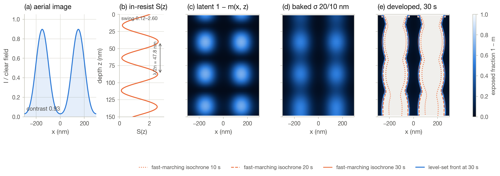
</picture>

*The process half of the pipeline on one exposure: aerial image → standing waves in the resist → latent image → bake → developed profile (3D development by fast marching ✅). The z-resolved exposure itself is simplified (volumetric exposure 🔶).*

<details>
<summary>Watch the development front</summary>

<picture>
  <source media="(prefers-reduced-motion: reduce) and (prefers-color-scheme: dark)" srcset="docs/assets/images/sim/anim/levelset-development-still-dark.png">
  <source media="(prefers-reduced-motion: reduce)" srcset="docs/assets/images/sim/anim/levelset-development-still-light.png">
  <source media="(prefers-color-scheme: dark)" srcset="docs/assets/images/sim/anim/levelset-development-anim-dark.gif">
  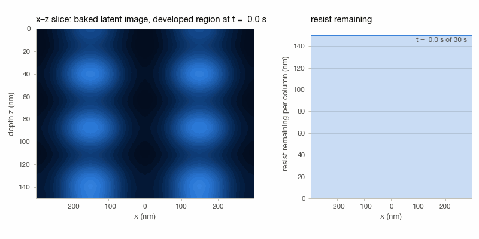
</picture>

*A level-set development front advancing through the baked latent image over 30 s — 3D development by level set ✅ (🔶 first-order front).*

</details>

## Architecture

<picture>
  <source media="(prefers-color-scheme: dark)" srcset="docs/assets/images/diagrams/architecture-layers-dark.svg">
  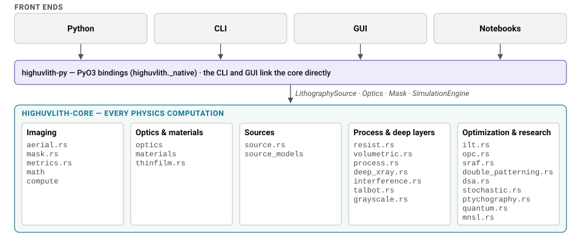
</picture>

<picture>
  <source media="(prefers-color-scheme: dark)" srcset="docs/assets/images/diagrams/pipeline-stages-dark.svg">
  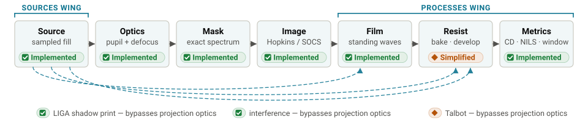
</picture>

All physics lives in one Rust crate, `highuvlith-core`; the Python package (PyO3, GIL-free compute, zero-copy NumPy results), the CLI and the GUI are thin adapters over it. An image passes through seven stages — source, optics, mask, aerial image, film, resist, metrics — with the deep-layer modules bypassing projection; [docs/architecture.md](docs/architecture.md) has the module map, the data flow and the validation layers.

<picture>
  <source media="(prefers-color-scheme: dark)" srcset="docs/assets/images/sim/imaging-socs-anatomy-dark.png">
  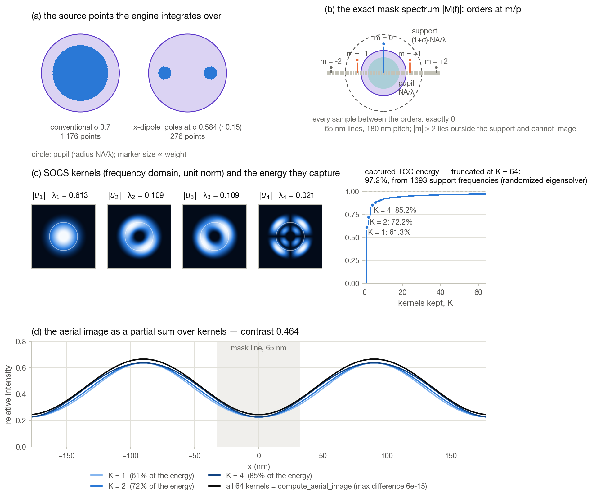
</picture>

*Inside the aerial-image stage: the sampled source points, the mask orders inside the pupil, the first SOCS kernels and the image converging as kernels are added (Hopkins imaging ✅).*

## Documentation

**[sonoransun.github.io/highuvlith](https://sonoransun.github.io/highuvlith/)** tells the story the simulator sits in — how chips have been printed, node by node, and what comes next — beside the simulator reference. The same pages live in [`docs/`](docs/) and read on GitHub.

<table>
<tr>
<td align="center" valign="top" width="33%">
<picture>
  <source media="(prefers-color-scheme: dark)" srcset="docs/assets/images/history/resolution-story-still-dark.svg">
  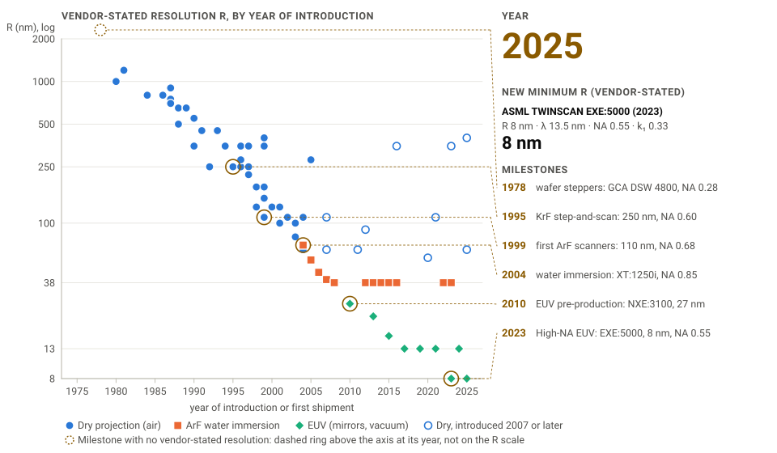
</picture>

<a href="https://sonoransun.github.io/highuvlith/history/"><b>History</b></a> — from Senefelder's stone to High-NA EUV, with the tool data behind every chart.
</td>
<td align="center" valign="top" width="33%">
<picture>
  <source media="(prefers-color-scheme: dark)" srcset="docs/assets/images/nodes/node-ladder-dark.svg">
  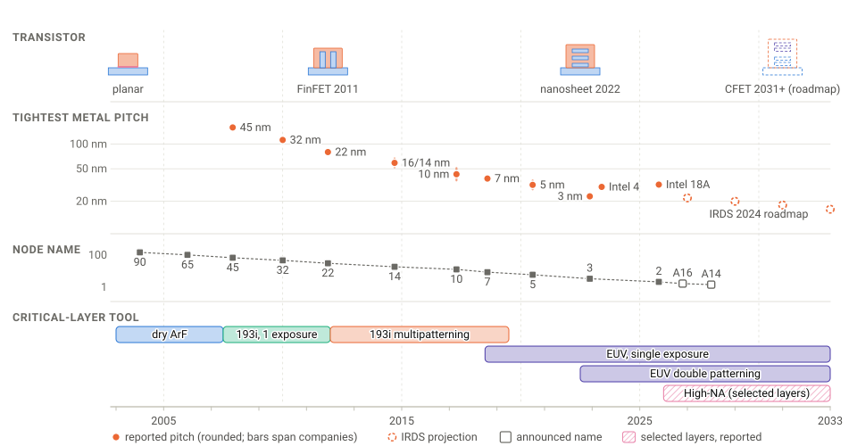
</picture>

<a href="https://sonoransun.github.io/highuvlith/nodes/"><b>Process Nodes</b></a> — 90 nm to the Ångström era: pitches, transistors, which layer needs which tool.
</td>
<td align="center" valign="top" width="33%">
<picture>
  <source media="(prefers-color-scheme: dark)" srcset="docs/assets/images/future/readiness-matrix-dark.svg">
  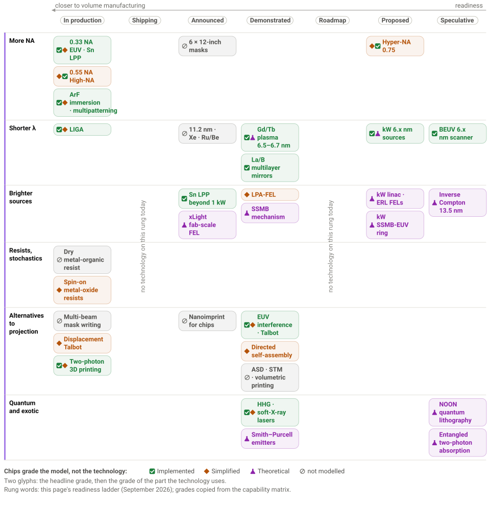
</picture>

<a href="https://sonoransun.github.io/highuvlith/future/"><b>The Future</b></a> — High-NA, beyond EUV, accelerator sources, stochastics and exotic ideas, each with its readiness and its model grade.
</td>
</tr>
</table>

| Section | Pages |
|---|---|
| Simulator | [Simulator index](https://sonoransun.github.io/highuvlith/simulator/) · [Getting started](https://sonoransun.github.io/highuvlith/getting-started/) · [Simulation pipeline](https://sonoransun.github.io/highuvlith/pipeline/) · [Optical systems](https://sonoransun.github.io/highuvlith/optics/) · [Vector imaging](https://sonoransun.github.io/highuvlith/vector-imaging/) · [Masks](https://sonoransun.github.io/highuvlith/masks/) · [Metrics and process window](https://sonoransun.github.io/highuvlith/metrics-and-process-window/) · [Materials](https://sonoransun.github.io/highuvlith/materials/) · [Research modules](https://sonoransun.github.io/highuvlith/research-modules/) · [Architecture](https://sonoransun.github.io/highuvlith/architecture/) |
| Sources | [Overview](https://sonoransun.github.io/highuvlith/sources/) · [DUV/UV heritage](https://sonoransun.github.io/highuvlith/sources/duv-heritage/) · [VUV excimer](https://sonoransun.github.io/highuvlith/sources/vuv-excimer/) · [Laser-produced plasma](https://sonoransun.github.io/highuvlith/sources/lpp/) · [Discharge-produced plasma](https://sonoransun.github.io/highuvlith/sources/dpp/) · [Synchrotron](https://sonoransun.github.io/highuvlith/sources/synchrotron/) · [XFEL](https://sonoransun.github.io/highuvlith/sources/xfel/) · [LPA-FEL](https://sonoransun.github.io/highuvlith/sources/lpa-fel/) · [SSMB](https://sonoransun.github.io/highuvlith/sources/ssmb/) · [Inverse Compton](https://sonoransun.github.io/highuvlith/sources/inverse-compton/) · [Smith–Purcell](https://sonoransun.github.io/highuvlith/sources/smith-purcell/) · [High-harmonic generation](https://sonoransun.github.io/highuvlith/sources/hhg/) · [Soft X-ray laser](https://sonoransun.github.io/highuvlith/sources/soft-xray-laser/) · [X-ray tube](https://sonoransun.github.io/highuvlith/sources/xray-tube/) · [Betatron](https://sonoransun.github.io/highuvlith/sources/betatron/) · [Entangled photons](https://sonoransun.github.io/highuvlith/sources/entangled-photon/) |
| Processes | [Overview](https://sonoransun.github.io/highuvlith/processes/) · [Thin film](https://sonoransun.github.io/highuvlith/processes/thin-film/) · [Resist models](https://sonoransun.github.io/highuvlith/processes/resist-models/) · [Volumetric exposure](https://sonoransun.github.io/highuvlith/processes/volumetric-exposure/) · [LIGA deep X-ray](https://sonoransun.github.io/highuvlith/processes/liga-deep-xray/) · [Grayscale](https://sonoransun.github.io/highuvlith/processes/grayscale/) · [Interference and two-photon](https://sonoransun.github.io/highuvlith/processes/interference-volumetric/) · [Talbot lithography](https://sonoransun.github.io/highuvlith/processes/talbot/) |
| Reference | [Reference index](https://sonoransun.github.io/highuvlith/reference/) · [Capability matrix](https://sonoransun.github.io/highuvlith/capability-matrix/) · [TOML configuration](https://sonoransun.github.io/highuvlith/configuration/) · [CLI](https://sonoransun.github.io/highuvlith/cli/) · [GUI](https://sonoransun.github.io/highuvlith/gui/) · [Python API](https://sonoransun.github.io/highuvlith/python-api/) |
| Develop and try | [Extending highuvlith](https://sonoransun.github.io/highuvlith/extending/) · [Roadmap](https://sonoransun.github.io/highuvlith/roadmap/) · [Playground](https://sonoransun.github.io/highuvlith/playground/) (in-browser calculators: teaching toys, not the engine) · [Contributing](CONTRIBUTING.md) |

<details>
<summary>Validation and performance</summary>

Validation is layered; every tier pins something the one above it cannot:

| Layer | Where | What it pins |
|---|---|---|
| Closed-form fixtures | `crates/highuvlith-core/tests/analytical_validation.rs` | Fresnel/Brewster/quarter-wave, the coherent three-beam image through focus, computed independently of the code |
| Analytical limits | `tests/vector_pupil.rs`, `vector_imaging.rs`, `imaging_validation.rs` | Two-beam TE/TM contrast, energy statements, resolution limits, a direct Abbe sum the SOCS engine matches to 1e-8 |
| Regression and property tests | unit tests in every module, `proptest_physics.rs` | Every corrected defect kept as a test; physical bounds over random inputs |
| CI matrix and docs | `.github/workflows/ci.yml` | Rust on Ubuntu/macOS/Windows, Python 3.12/3.13, the six notebooks, every verified example in `docs/` and this README, the figure registries, a strict site build |

<!-- TEST-COUNTS: final full test run on 2026-10-01. -->
| Suite | Count (2026-10-01) |
|---|---|
| Rust core unit tests | 708 passed |
| Rust core integration tests | 90 (analytical 8, imaging validation 18, source sampling 2, optics presets 13, vector pupil 26, vector imaging 8, MNSL 13, property-based 2) + 1 doctest |
| CLI tests | 107 unit + 35 end-to-end (every `examples/*.toml` included) |
| GUI tests | 63 |
| Python tests | 360 passed |
| Docs example tests | 99 site examples, 101 tests (`tests/docs/test_site_examples.py`, release build) |
| Docs tooling | 42 MkDocs-hook tests, 18 playground-physics tests (Node), 31 math-linter tests |
<!-- /TEST-COUNTS -->

Performance, measured with `cargo bench -p highuvlith-core` ([`benches/aerial_benchmark.rs`](crates/highuvlith-core/benches/aerial_benchmark.rs); criterion, release build, 20 SOCS kernels) on an Apple M3 Pro (11 cores) shared with other build jobs — treat the numbers as ±20 %. VUV = F₂, σ 0.7, NA 0.75, 2 nm pixels; EUV = 13.5 nm, σ 0.7, Schwarzschild NA 0.33, 1 nm pixels. Measured on 2026-09-30 when the exact engine was merged; later additions (clear-field normalization, vector and multilayer options) were not re-benchmarked.

| Operation | Time |
|---|---|
| Engine creation (source sampling + TCC decomposition), VUV 128² / 256² | 0.26 ms / 1.4 ms |
| Engine creation, EUV 128² / 256² | 2.9 ms / 21 ms |
| One aerial image, VUV 128² / 256² / 512² | 0.56 ms / 2.7 ms / 21 ms |
| One aerial image, EUV 256² | 3.0 ms |
| 21-plane focus sweep with exact defocus (kernels rebuilt per plane), VUV / EUV 256² | 34 ms / 307 ms |
| 21-plane sweep with the legacy kernel-phase defocus, VUV 256² | 28 ms |
| Exact per-wavelength imaging of a 5-line comb, EUV 128² / 256² | 11 ms / 97 ms |

Image computation parallelizes over kernels, focus planes and wavelengths with Rayon and is bit-reproducible regardless of thread count.

</details>

## Contributing · License

Build, test and documentation conventions — including the rule that a capability change updates the module header, the capability matrix and the page's Status line in the same PR — are in [CONTRIBUTING.md](CONTRIBUTING.md).
MIT — see [LICENSE](LICENSE).
