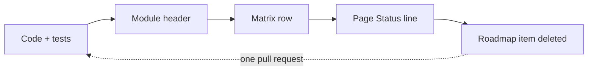

# Extending highuvlith

**Status:** ✅ Implemented — every recipe below references extension seams that exist in the code today; follow them and the type system, the stub drift guard and the test suite catch most wiring mistakes · [matrix](capability-matrix.md#frontends-and-infrastructure)

<p class="huv-lead">Three extension points cover most needs: a new <strong>light source</strong>, a new <strong>optical system</strong> or a new <strong>process module</strong>. Each touches one physics crate and three thin adapters, and each lands with its honesty paperwork in the same pull request. This page is for contributors; the build, test and lint commands live in <a href="https://github.com/sonoransun/highuvlith/blob/main/CONTRIBUTING.md">CONTRIBUTING.md</a>.</p>

**Same thing elsewhere:** architecture [where each trait sits](architecture.md) · matrix [the row you add](capability-matrix.md) · roadmap [what is already planned](roadmap.md) · physics [Sources](sources/index.md), [Optical systems](optics.md), [Processes](processes/index.md)

<!-- architecture-layers -> extending.md -->
<figure markdown="span">

<picture><source media="(max-width: 600px)" srcset="assets/images/diagrams/architecture-layers-narrow-light.svg"></picture>
<picture><source media="(max-width: 600px)" srcset="assets/images/diagrams/architecture-layers-narrow-dark.svg"></picture>

<figcaption><strong>One physics crate, thin adapters.</strong> Front ends call the bindings; the bindings call the core; nothing in a front end computes physics. <em>Schematic of the crate layout; no model badge.</em></figcaption>
</figure>

## Touch points

Every extension touches the same four places; the table is the map of the three recipes below.

<!-- huv-table: stack -->

| To add a … | Files | Tests | Docs |
|---|---|---|---|
| **source family** ([recipe a](#a-adding-a-source-family)) | `core/src/source_models/<family>.rs` + `mod.rs`; `core/src/source.rs` (`SourceKind` variant, macro arm, label, `From`, re-export); `py/src/py_config.rs` + `python/highuvlith/_native.pyi`; `cli/src/config.rs` (keys, `type` arm); `examples/sim_<family>.toml` | unit tests in the model file; the round trips in `source.rs`; the CLI build test; `tests/python/test_sources_physics.py`; `test_stub_drift.py` | `docs/sources/<family>.md` + nav + hub row; the matrix row; the page's Status line |
| **optical system** ([recipe b](#b-adding-an-optical-system)) | `core/src/optics/<name>.rs` + `optics/mod.rs`; `cli/src/config.rs` (`type` arm in `to_optics()`); `py/src/py_config.rs` (`PyOpticsInner` variant, factory) + `_native.pyi` | pupil, defocus and `clone_box` unit tests; `tests/imaging_optics_presets.rs`, `tests/imaging_validation.rs` | [Optical systems](optics.md) glance table; the matrix row |
| **process module** ([recipe c](#c-adding-a-process-module)) | `core/src/<name>.rs` + `lib.rs`; `crates/highuvlith-py` wrapper + `api.py` convenience + `_native.pyi`; optionally a `[deep] mode` or subcommand under `cli/src/commands/` + an example config | at least one closed-form analytical test; Python integration tests under `tests/python/` | `docs/processes/<page>.md` with its Status line; the matrix row |

Paths abbreviate `crates/highuvlith-core` as `core`, `crates/highuvlith-py` as `py` and `crates/highuvlith-cli` as `cli`. In all three cases the honesty rules apply, **in the same PR** as the code:

1. the module header carries a `//! # Key equations` block and a `//! # Model status` section that names every approximation where it matters;
2. [capability-matrix.md](./capability-matrix.md) gets the new or updated row (✅ Implemented · 🔶 Simplified · 🧪 Theoretical · 🗺️ Planned);
3. the capability's docs page carries a matching `**Status:**` line.

## (a) Adding a source family

The fourteen existing families are the templates — `VuvSource` (Hg g/h/i lamp lines, KrF, ArF, F₂ and the hypothetical Ar₂ preset) and LPA-FEL in [source.rs](../crates/highuvlith-core/src/source.rs), and LPP, synchrotron, HHG, XFEL, inverse Compton, SSMB, entangled NOON, X-ray tube, DPP, soft-X-ray laser, betatron and Smith–Purcell in [source_models/](../crates/highuvlith-core/src/source_models). A new *preset* of an existing family (another excimer line, another undulator) is only a constructor plus its factory, TOML example and tests; a new *family* follows the steps below. The pipeline consumes a source only through the `LithographySource` trait, so a new family never touches imaging or resist code.

### Core crate

1. **Model file.** Create `crates/highuvlith-core/src/source_models/<family>.rs` and add `pub mod <family>;` to [source_models/mod.rs](../crates/highuvlith-core/src/source_models/mod.rs) (alphabetical). Machine-parameter physics that more than one family could use (resonance conditions, flux formulas, FEL gain, Thomson yield, …) belongs in [source_models/physics.rs](../crates/highuvlith-core/src/source_models/physics.rs), which also holds the CODATA constants (`HC_EV_NM`, `ELECTRON_CHARGE_C`, …) — never retype a constant.
2. **Struct, presets and `validate()`.** Derive `Debug, Clone, Serialize, Deserialize`. Two fields are mandatory because `SourceKind::spectral_samples()` and `SourceKind::illumination()` read them directly: `spectral_samples: usize` and `illumination: IlluminationShape`. Document every field as `live` (enters a computation), `stored (inert)` or `planned`; mark fields added after the first release `#[serde(default)]` so old TOML/JSON still parses. Add a public `validate(&self) -> error::Result<()>` built from the crate helpers `validate_positive(name, value)` and `validate_sigma(sigma)`, and preset constructors that return `Result<Self>` and document where every number comes from (reference machine, projection, assumption).
3. **Trait implementation — the four required methods.** `wavelength_nm`, `bandwidth_pm`, `intensity_at`, `spectral_weights`. Reuse the helpers in [source.rs](../crates/highuvlith-core/src/source.rs) instead of re-deriving them: `evaluate_illumination(&self.illumination, fx, fy)` for `intensity_at` (conventional, annular, dipole, quadrupole and the graded `CoherentGaussian`); `evaluate_spectral_weights(λ, Δλ_pm, n, &shape)` for a single line (weights sum to 1; `SpectralShape::SincSquared` is the undulator line), `evaluate_multiline_weights` for combs — image those with `compute_multiwavelength`, which rebuilds the kernels per line; `compute_polychromatic` is only valid for Δλ/λ ≪ 1; `sigma_from_coherence(ζ, σ_core)` for high-coherence sources (pupil fill `IlluminationShape::CoherentGaussian`).
4. **Trait implementation — the wavelength.** Where the physics fixes it, **derive it** from machine parameters (synchrotron undulator resonance, Compton kinematics, Smith–Purcell dispersion, fixed atomic lasing lines) instead of storing a free set-point; store a set-point only when the real machine is tunable (XFEL gap tuning).
5. **Trait implementation — the defaulted methods.** Override only what the model genuinely tracks: `pulse_energy_j` / `rep_rate_hz` / `pulse_duration_s`; `average_power_w` (usable power delivered into the illuminator — in-band at intermediate focus for plasma sources; it is the input of `source_models::throughput`); `transverse_coherence`; `shot_to_shot_rms` (feeds the Gamma dose jitter of `StochasticParams::from_source` / `from_source_multi_pulse`); `photon_density_per_mj_cm2` when the trait wavelength is a spectral mean (the X-ray tube uses the mean photon energy).
6. **Trait implementation — the type-erased path.** `SourceKind` forwards every trait method, defaulted ones included (pinned by `test_source_kind_forwards_every_trait_method`). If you add a NEW defaulted method to the trait, add its forwarding arm to `impl LithographySource for SourceKind` as well, or family overrides are bypassed on the type-erased path used by Python, the CLI and the GUI.
7. **Derived quantities.** Implement `derived_quantities()` returning `Vec<DerivedQuantity>`, built with `DerivedQuantity::new(name, value, unit, note)` (`name` in snake_case, `unit` a string such as `"W"` or `"-"`, `note` a one-line provenance/caveat such as `"1D FEL theory; ignores emittance"`). These values are informational: `highuvlith simulate` prints them and writes them to its JSON (`"derived_quantities"`), Python exposes `SourceConfig.derived_quantities()` and `derived_quantity(name)`, the GUI tabulates them, and the imaging pipeline never reads them. Report the gap to a reference requirement where it is meaningful (e.g. the ratio to 250 W at IF for EUV sources).
8. **Wire `SourceKind`** in [source.rs](../crates/highuvlith-core/src/source.rs): the enum variant (its snake_case name is the serde `type` tag), one arm in the `for_each_source!` macro (every dispatched method then picks the family up), one arm in `kind_label()` returning the same tag, an `impl From<YourSource> for SourceKind`, and a `pub use crate::source_models::<family>::YourSource;` re-export so downstream code keeps the flat `source::*` namespace.

### Bindings, CLI and example

1. **Python factory.** Add a `#[staticmethod]` factory to `PySourceConfig` in [py_config.rs](../crates/highuvlith-py/src/py_config.rs) (pattern: parse/validate arguments → build the core struct, mapping errors with `src_value_error` / `src_core_error` → wrap in `SourceKind::<Variant>`), then add the stub to [`python/highuvlith/_native.pyi`](../python/highuvlith/_native.pyi). `tests/python/test_stub_drift.py` fails CI if a native member is missing from the stub.
2. **CLI.** In [config.rs](../crates/highuvlith-cli/src/config.rs) add the family's keys to `SourceConfig` (all `Option<T>`; the struct is `#[serde(default)]` and does **not** reject unknown keys, so a test must prove each key reaches the source), a `type = "<tag>"` arm in `SimConfig::to_source()`, and the tag in the `unknown source type` message. If the wavelength is derived, reject an explicit `wavelength_nm` that disagrees by more than 5 % (see the `"synchrotron"` arm). `SimConfig::validate()` calls `to_source()`, so family checks run before any simulation work. A family that can feed LIGA (`XraySpectrum`) is wired in [commands/deep.rs](../crates/highuvlith-cli/src/commands/deep.rs).
3. **Example config.** `examples/sim_<family>.toml` (see [examples/sim_lpp_sn.toml](../examples/sim_lpp_sn.toml)), listed in [examples/README.md](../examples/README.md); `crates/highuvlith-cli/tests/examples.rs` runs every example and its `every_example_is_covered` test fails when one is not listed.

### Tests

Fixture numbers must be computed independently of the implementation (by hand or with a short NumPy/SciPy/mpmath script), never copied from the code's own output.

1. unit tests in the new file: every formula against its fixture, limits and scaling laws (e.g. "doubling γ quarters λ"), spectral weights summing to 1, `validate()` rejecting bad input;
2. the family in the source-level TOML round trip and derived-quantity checks in `source.rs` (`test_new_source_families_toml_roundtrip`, `test_every_family_reports_derived_quantities`; the WP-D families use `test_lab_compact_families_toml_roundtrip`);
3. the tag in the CLI build test (`test_all_source_types_build_with_family_defaults` in `config.rs`) plus a test for each family-specific TOML key;
4. a Python test (see `tests/python/test_sources_physics.py`).

### Docs

1. a page `docs/sources/<family>.md` following the source-page template (Status line / lead / Physics Strip / How the light is made / Key equations / Real machines / What the model does with Model coverage tagged live · stored (inert) · planned / Derived quantities / Use it with its TOML keys / Validation / See also / References), a nav entry under *Simulator → Sources* in `mkdocs.yml`, a row in [sources/index.md](./sources/index.md), and the capability-matrix row. Cite only references you are certain of; describe a formula's provenance generically ("standard 1D FEL theory") otherwise.

### Skeleton

The minimum viable model file for a hypothetical `example` family, showing which pieces are shared and which are yours. Every helper, type and trait method it uses was checked against `crates/highuvlith-core/src/source.rs` and `source_models/physics.rs` on 2026-10-10 (there is no compile check of this snippet in CI; re-check it when the trait changes).

<details markdown="1">
<summary>The skeleton — `source_models/example.rs`, 105 lines</summary>

```rust
// crates/highuvlith-core/src/source_models/example.rs
//! Example source (hypothetical): one-paragraph physics summary.
//!
//! # Key equations
//!
//! ```text
//!   P_avg = E_pulse · f_rep
//! ```
//!
//! # Model status
//!
//! 🔶 Simplified: <every approximation, stated where it matters>.

use serde::{Deserialize, Serialize};

use super::physics;
use crate::source::{
    evaluate_illumination, evaluate_spectral_weights, validate_positive, validate_sigma,
    DerivedQuantity, IlluminationShape, LithographySource, SpectralShape,
};

#[derive(Debug, Clone, Serialize, Deserialize)]
pub struct ExampleSource {
    /// Center wavelength in nm (live: pupil scaling, photon energy).
    pub wavelength_nm: f64,
    /// Line FWHM in pm (live: spectral weights).
    pub bandwidth_pm: f64,
    /// Pulse energy in J (live: average power, throughput).
    pub pulse_energy_j: f64,
    /// Repetition rate in Hz (live: average power, throughput).
    pub rep_rate_hz: f64,
    /// Relative rms pulse-energy jitter (live: stochastic dose jitter).
    #[serde(default)]
    pub shot_to_shot_rms: f64,
    /// Spectral samples (required field: read by `SourceKind`).
    pub spectral_samples: usize,
    pub spectral_shape: SpectralShape,
    /// Pupil fill (required field: read by `SourceKind`).
    pub illumination: IlluminationShape,
}

impl ExampleSource {
    /// Reference-machine preset; document the provenance of every number.
    pub fn reference(sigma: f64) -> crate::error::Result<Self> {
        validate_sigma(sigma)?;
        let source = Self {
            wavelength_nm: 13.5,
            bandwidth_pm: 50.0,
            pulse_energy_j: 1e-3,
            rep_rate_hz: 1e4,
            shot_to_shot_rms: 0.02,
            spectral_samples: 5,
            spectral_shape: SpectralShape::Gaussian,
            illumination: IlluminationShape::Conventional { sigma },
        };
        source.validate()?;
        Ok(source)
    }

    pub fn validate(&self) -> crate::error::Result<()> {
        validate_positive("wavelength_nm", self.wavelength_nm)?;
        validate_positive("bandwidth_pm", self.bandwidth_pm)?;
        validate_positive("pulse_energy_j", self.pulse_energy_j)?;
        validate_positive("rep_rate_hz", self.rep_rate_hz)?;
        Ok(())
    }
}

impl LithographySource for ExampleSource {
    fn wavelength_nm(&self) -> f64 {
        self.wavelength_nm
    }
    fn bandwidth_pm(&self) -> f64 {
        self.bandwidth_pm
    }
    fn intensity_at(&self, fx: f64, fy: f64) -> f64 {
        evaluate_illumination(&self.illumination, fx, fy)
    }
    fn spectral_weights(&self) -> Vec<(f64, f64)> {
        evaluate_spectral_weights(
            self.wavelength_nm,
            self.bandwidth_pm,
            self.spectral_samples,
            &self.spectral_shape,
        )
    }
    // Override only what the model genuinely tracks.
    fn pulse_energy_j(&self) -> Option<f64> {
        Some(self.pulse_energy_j)
    }
    fn rep_rate_hz(&self) -> Option<f64> {
        Some(self.rep_rate_hz)
    }
    fn shot_to_shot_rms(&self) -> f64 {
        self.shot_to_shot_rms
    }
    fn derived_quantities(&self) -> Vec<DerivedQuantity> {
        vec![DerivedQuantity::new(
            "photon_energy",
            physics::HC_EV_NM / self.wavelength_nm,
            "eV",
            "hc / lambda",
        )]
    }
}
```

Then the wiring in [source.rs](../crates/highuvlith-core/src/source.rs): `Example(ExampleSource)` variant, `SourceKind::Example($s) => $body` macro arm, `SourceKind::Example(_) => "example"` label arm, `impl From<ExampleSource> for SourceKind`, and the `pub use` re-export.

</details>

## (b) Adding an optical system

### Core crate

1. **File.** `crates/highuvlith-core/src/optics/<name>.rs`, declared with `pub mod <name>;` in [optics/mod.rs](../crates/highuvlith-core/src/optics/mod.rs).
2. **Implement `OpticalSystem`.** Required: `pupil_function(fx_norm, fy_norm, defocus_nm, wavelength_nm) -> Complex64`, `na()`, `reduction()`, `flare_fraction()` and `clone_box()` (usually `Box::new(self.clone())`; the engine keeps its own boxed copy to rebuild kernels at new focus planes and wavelengths). The pupil contract the engine relies on: coordinates are normalized to `cutoff_frequency(λ)`, and the pupil is zero outside its support (including any central obscuration); magnitude = amplitude transmission/apodization, phase = aberrations + defocus; the pupil at wavelength λ must **not** contain a chromatic focus shift — override `chromatic_defocus(Δλ_pm)` instead (the engine adds it in `compute_polychromatic` and `compute_multiwavelength`).
3. **Defocus.** Evaluate it with the shared helpers — `optics::defocus_phase(defocus_nm, sin_theta, wavelength_nm, paraxial)` in vacuum (`sin_theta = NA·ρ`), or `optics::defocus_phase_in_medium(defocus_nm, na_rho, medium_index, wavelength_nm, paraxial)` for an image-space medium of index `n` — and carry a `#[serde(default)] pub paraxial_defocus: bool` field for the paraxial option, as the in-tree optics do. If the image space is not vacuum/air, override `immersion_index()` and apply that index in your own defocus phase: the engine does not modify the pupil, but it rejects `na() ≥ immersion_index()` and uses the index for vector imaging. Override `cutoff_frequency` (and `rayleigh_resolution`) when the cutoff is not `NA/λ` — the zone plate's `1/(2Δr_N)` is λ-independent. Use a fallible constructor returning `error::Result` (NA range, obscuration ratio, zone widths, …).
4. **Vector imaging comes for free.** With `ImagingModel::Vector`, the engine calls `optics::vector::field_columns(pupil, px, py, sx, sy, na_eff, &settings, out)` for every non-zero value of your scalar pupil, with `na_eff = cutoff_frequency(λ)·λ`. The optic supplies only the scalar pupil; TE/TM decomposition, the radiometric factor and film entrance live in [optics/vector.rs](../crates/highuvlith-core/src/optics/vector.rs). The engine copies `reduction()` into `VectorSettings::reduction` and requires `VectorSettings::image_index` to equal `immersion_index()` (inheriting it when left at 1), so `reduction()` and `immersion_index()` must be physically right ([vector-imaging.md](./vector-imaging.md)).

### Bindings and CLI

1. **CLI.** Add a `type = "<name>"` arm to `SimConfig::to_optics()` in [config.rs](../crates/highuvlith-cli/src/config.rs) (today: `refractive` with an optional `immersion_index`, `euv_projection`, `schwarzschild`, `zone_plate`); the CLI already carries optics as `Box<dyn OpticalSystem>`.
2. **Python.** `PyOpticsConfig` wraps the type-erased `PyOpticsInner` enum (`Refractive` / `Schwarzschild` / `ZonePlate` / `EuvProjection`) with `as_dyn()` and `kind_label()` ([py_config.rs](../crates/highuvlith-py/src/py_config.rs)). Add a variant, arms in both accessors, a `#[staticmethod]` factory (patterns: `immersion()`, `euv_projection()`, `schwarzschild()`, `zone_plate()`) and the `_native.pyi` stub.

### Tests

1. Pupil zero beyond the cutoff (and inside any obscuration); zero phase on axis in focus; defocus phase equal to the shared helper (see `test_defocus_matches_shared_formula` in the Schwarzschild module); `clone_box` preserving the pupil; the serde default of `paraxial_defocus`; one analytical anchor specific to the system (e.g. the zone plate's `test_cutoff_is_wavelength_independent`).
2. For imaging-level checks, mirror [tests/imaging_optics_presets.rs](../crates/highuvlith-core/tests/imaging_optics_presets.rs) (resolution gain of immersion and High-NA optics, defocus in the medium, dark field behind an obscuration) and the defocus-symmetry and SOCS-vs-Abbe tests in [tests/imaging_validation.rs](../crates/highuvlith-core/tests/imaging_validation.rs).

### Docs

1. A row in the glance table of [Optical systems](optics.md) and the capability-matrix row, both with the grade and the stated approximations; the GUI's optics panel ([gui.md](gui.md#optics)) lists kinds by hand, so add the kind there if the GUI should offer it.

## (c) Adding a process module

Process modules ([volumetric.rs](../crates/highuvlith-core/src/volumetric.rs), [deep_xray.rs](../crates/highuvlith-core/src/deep_xray.rs), [grayscale.rs](../crates/highuvlith-core/src/grayscale.rs), [interference.rs](../crates/highuvlith-core/src/interference.rs), [talbot.rs](../crates/highuvlith-core/src/talbot.rs)) are single files at the crate root.

### Core crate

1. **Create** `crates/highuvlith-core/src/<name>.rs` and register `pub mod <name>;` in [lib.rs](../crates/highuvlith-core/src/lib.rs) (alphabetical, as the existing entries).
2. **Consume the pipeline at the right altitude.** Take an `&AerialImageEngine` and call `compute()` / `compute_from_transmittance()` for lateral images (grayscale uses the latter for continuous-transmittance masks), or `compute_through_focus()` when you need several planes of one mask (the spectrum is computed once and the planes run in parallel — `process.rs` and `volumetric.rs` do this). Take a `&FilmStack` and call `intensity_profile()` for exact z-resolved standing waves; do **not** use the older `standing_wave()`, an approximation kept because MNSL depends on its numbers. Emit `Grid3D<f64>` photo-active-compound volumes if the module is 3D, so its output feeds the bake and development tiers in `volumetric.rs` (`apply_peb`, `develop_depth_map`, `develop_fast_marching`, `develop_level_set`), as `interference.rs` and `talbot.rs` do. If the process is not projection imaging at all, bypass the engine explicitly and say so in the header (as `deep_xray.rs` does for LIGA shadow printing and `talbot.rs` for free-space grating self-imaging).
3. **Write the module header first**: a one-paragraph physics summary, `# Key equations`, and `# Model status` naming every approximation at the site where it matters. The docs pages and the capability matrix quote these headers.

### Bindings and CLI

1. **Python.** Wrap the entry points in [crates/highuvlith-py](../crates/highuvlith-py) (a free function or a result class), release the GIL around long computations (`py.allow_threads`), add a convenience wrapper in `python/highuvlith/api.py` if useful, and update `_native.pyi`.
2. **CLI.** If the module warrants command-line exposure, add a `[deep] mode` or a subcommand under [crates/highuvlith-cli/src/commands/](../crates/highuvlith-cli/src/commands) with TOML keys validated before any work runs, and an example config in `examples/`.

### Tests

1. **Analytical tests are mandatory.** Every existing process module pins at least one closed form: volumetric the Beer–Lambert exposure (`test_closed_form_beer_lambert_exposure`), the 2D coupling scalar (`test_z_mean_matches_effective_coupling`) and an exact planar level-set front (`test_level_set_uniform_rate_planar_front_is_exact`); resist the CAR reaction without diffusion (`test_car_no_quencher_no_diffusion_exact_exponential`); deep_xray the monochromatic exponential depth dose (`test_monochromatic_depth_dose_exponential`) and the Fresnel knife edge (`test_knife_edge_intensity_fixtures`); grayscale its contrast curve (`test_gamma_fixture`, `test_contrast_curve_round_trip`); interference the two-beam fringe period and its resist-index invariance (`test_two_beam_period_and_index_invariance`); talbot the Talbot length and the DTL half-period image (`test_talbot_length_fixtures_and_limits`, `test_dtl_image_has_half_period_and_closed_form`). Match that bar.

### Docs

1. A page under `docs/processes/` in the process-page form (Status line, Physics Strip, How it works, Process regime, What the code provides, Model coverage, Usage with a verify-example, Limits), its nav entry, a row on [processes/index.md](processes/index.md) and the capability-matrix row.

## Testing conventions

| Tier | Location | What it pins |
|------|----------|--------------|
| Unit tests | inline `#[cfg(test)]` in each module | Constructors reject bad input; invariants (weights sum to 1, bounds, symmetry); fixtures computed independently of the code |
| Analytical validation | [tests/analytical_validation.rs](../crates/highuvlith-core/tests/analytical_validation.rs) | Fresnel reflectance, Brewster angle, quarter-wave AR, defocus symmetry, energy conservation, coherent three-beam image |
| Imaging validation | [tests/imaging_validation.rs](../crates/highuvlith-core/tests/imaging_validation.rs) | SOCS against an independent Abbe sum, resolution limits, depth of focus, per-λ imaging, determinism |
| Vector physics | [tests/vector_pupil.rs](../crates/highuvlith-core/tests/vector_pupil.rs), [tests/vector_imaging.rs](../crates/highuvlith-core/tests/vector_imaging.rs) | Two-beam TE/TM closed forms, obliquity energy statement, film entrance, engine-level vector contrast |
| Property-based | [tests/proptest_physics.rs](../crates/highuvlith-core/tests/proptest_physics.rs) | Reflectance ∈ [0, 1] over random stacks, monotonicity |
| Python integration | [tests/python/](../tests/python) | Binding round trips, API wrappers, error mapping (`conftest.py` fixtures) |
| Stub drift guard | `tests/python/test_stub_drift.py` | `_native.pyi` lists every member of the compiled extension |
| Docs examples | `tests/docs/test_site_examples.py` | every `<!-- verify-example -->` block on the site and in the README runs and its recorded output matches |

Keep tests fast: small grids, a Rust test well under ~3 s in a debug build, a Python test under ~5 s. Run the gauntlet before a PR (CI runs the same):

```bash
cargo fmt --check
cargo clippy --workspace --exclude highuvlith-gui -- -D warnings
cargo test --workspace --exclude highuvlith-gui
cargo check -p highuvlith-gui
RUSTDOCFLAGS="-D warnings" cargo doc --workspace --no-deps --exclude highuvlith-gui
maturin develop && pytest tests/python
ruff check python/
mypy python/highuvlith/ --ignore-missing-imports
```

Regression tests that encode past bugs (e.g. `test_default_photon_density_matches_source_trait`, which pins a 1000× photon-density slip) must never be weakened; add a comment explaining the history if you must touch one.

## Documentation conventions

- **Status line.** Every technical page starts with `**Status:** <badge> <Name> — <one-sentence justification> · [matrix](capability-matrix.md#<domain>)` (for example `**Status:** 🔶 Simplified — …`). CI greps for `^\*\*Status:\*\*` on every page except index pages, the capability matrix and the narrative site sections (history, nodes, future, playground) and site plumbing.
- **Model coverage.** Source and process pages tag each struct field as `live` (enters a computation), `stored (inert)` or `planned`.
- **Same-PR rule.** A capability change updates the module header's `# Model status`, the [capability matrix](./capability-matrix.md) row and the page's Status line together; a roadmap item that lands is deleted from [roadmap.md](./roadmap.md) in the same PR (the loop below).
- **Verified examples.** Every ```` ```python ```` fence on a docs page or in the README carries `<!-- verify-example -->` (or `<!-- example-skip: reason -->`) on the line above; `tests/docs/test_site_examples.py` runs each block in a fresh interpreter and compares the recorded output that follows it — `???+ success "Output"` on docs pages, a bare text fence in the README. Record outputs with `--update-outputs`, never by hand.
- **Figures.** Every image under `docs/assets/images/` is written by a script under `docs/figures/` and registered as a `FigureSpec` / `AssetSpec` with its `alt`, caption and `pages=`; `docs/figures/sim/make_all.py --check` verifies that every listed page embeds it with the registered caption, `--catalog` prints the embed to paste, and `--sync-embeds --pages <page>` rewrites it. Light/dark pairs use the `#gh-light-mode-only` / `#gh-dark-mode-only` idiom; animated SVGs are two-layer (`.anim` / `.still`) with a designed still and an in-file `prefers-reduced-motion` rule; raster animations are APNG with a still. Caption grammar: a bold lead sentence, ≤ 3 sentences, and a `<em>Model: <capability> <glyph> …</em>` trailer whose grades are the matrix rows' (the check fails on a glyph that differs from the row).
- **Math that renders on GitHub and on the site.** GitHub strips Markdown backslash escapes inside `$…$` and `$$…$$` before typesetting. Write display math in a ```` ```math ```` fenced block (rendered by arithmatex on the site), and keep inline `$…$` free of backslash + punctuation: no `\,` `\;` `\!` (use a space), `\lbrace` / `\rbrace` instead of `\{` / `\}`, `\Vert` instead of `\|`, and never `\%` (put the percent sign outside the math). Letter macros (`\lambda`, `\frac`, `\sqrt`, `\mathrm`) are fine. `python scripts/check_docs_math.py docs/` reports violations; `--fix` converts `$$` blocks to math fences and `--fix-inline` applies the safe inline rewrites.
- **Links.** Link other docs pages relatively (`./masks.md`, `../sources/lpp.md`) and code with repository-relative paths (`../crates/highuvlith-core/src/aerial.rs`). On the site, `docs/hooks/repo_links.py` rewrites links that leave `docs/` to GitHub URLs, but only when the target exists in the checkout, so a typo fails the strict build.
- **Build strictly.** `pip install -r docs/requirements-docs.txt` then `mkdocs build --strict` (or `mkdocs serve` while writing); new pages also need a nav entry in `mkdocs.yml`. Collapsed blocks are `<details markdown="1">` with a blank line after `</summary>`; mermaid is reserved for process loops and decision trees (`scripts/mermaid_allowlist.txt`); technical pages must stay readable on github.com, so no Material-only syntax carries a rule or caveat alone.
- **Honesty.** Never describe a 🗺️ planned capability as if it runs, and never cite a reference you have not verified.

### How a capability changes grade

A grade moves in one pull request, around this loop (the same diagram as [Reference → How a capability changes grade](reference/index.md#how-a-capability-changes-grade); CONTRIBUTING repeats it):



Four places must agree before a grade changes: the module's `# Model status` header, the matrix row, the page's `**Status:**` line and the roadmap. CI checks the mechanical half — every technical page carries a Status line, every Python example runs and its printed output is compared, every figure caption's `Model:` clause resolves against a matrix row, and the legend counts are regenerated from the matrix.

**Where next:** [Architecture](./architecture.md) — where each extension trait sits and how imaging data flows · [Capability matrix](./capability-matrix.md) — the row you must add or update · [Roadmap](./roadmap.md) — check whether your extension is already planned · [CONTRIBUTING.md](../CONTRIBUTING.md) — build, test, lint, docs and release workflow
