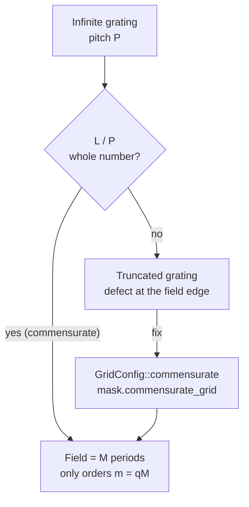

# Masks

**Status:** ✅ Implemented (🔶 mask model) — exact thin-mask spectra, commensurate grids and antialiased rasterization are validated against closed forms and quadrature; the Kirchhoff thin mask has no mask-3D and images an alternating PSM as binary · [matrix](capability-matrix.md#masks-metrics-and-process-window)

<p class="huv-lead">This page is the mask stage of the pipeline: how a pattern is described, why the simulation field must hold whole periods of it, how its spectrum is computed exactly, and how it is rasterized. It is for anyone who builds a <code>MaskConfig</code> or writes a <code>[mask]</code> table and wants to know what the engine images. What happens to the image afterwards — CD, NILS, MEEF and the process window — lives on <a href="metrics-and-process-window.md">Metrics &amp; process window</a>; the imaging engine itself on <a href="pipeline.md">Simulation pipeline</a>.</p>

<div class="huv-physics huv-physics--single" markdown>

<figure markdown="span">


<figcaption><strong>Three pupils, one rule.</strong> A conventional σ 0.7 fill still images at k₁ = 0.40 (the ±1 orders are inside the (1+σ)·NA/λ support circle); a dipole matched to the pitch images at k₁ = 0.30 with two beams; at k₁ = 0.25 pole and order sit on opposite rims and nothing below it prints in one exposure. The resting frame of the animation on the lithography-arithmetic page. <em>Closed form and geometry; not the engine. No model badge.</em></figcaption>
</figure>

<figure markdown="span">


<figcaption><strong>Mask primitives and their exact spectra.</strong> Rasterized transmittance from <code>MaskConfig.rasterize</code> for the canonical 65/180 nm grating on a two-period commensurate field, a 90/180 nm contact-hole array, a line with two overlapping hammerhead serifs (features painted in order) and the same serif line as an attenuated PSM (|t| = √0.06, phase 180°); each panel names the <code>spectrum_method</code> the engine uses. Below, |S| from <code>MaskConfig.spectrum</code>: the grating's off-harmonic orders are exactly zero and its first orders sit outside NA/λ but inside the (1+σ)NA/λ support of F<sub>2</sub> 157.63 nm, NA 0.75, σ 0.7, which is why the canonical run images them only through off-axis source points. <em>Model: exact thin-mask spectra ✅ · antialiased rasterization ✅ · mask model 🔶 (Kirchhoff thin mask; alternating-PSM phase regions not modelled).</em></figcaption>
</figure>

| What is modeled | Grade | Dominant approximation | Details |
|---|---|---|---|
| Exact thin-mask spectrum | ✅ Implemented | closed-form Fourier series of the clipped, periodized mask | [Exact spectrum](#exact-spectrum) |
| Commensurate periodic grids | ✅ Implemented | the field is one period; the frontends pick the pixel | [One unit cell](#the-simulation-field-is-one-unit-cell) |
| Antialiased rasterization | ✅ Implemented | exact area coverage; a 4 × 4 supersampled fallback for overlapping polygons | [Rasterization](#rasterization) |
| Mask model and types | 🔶 Simplified | Kirchhoff thin mask: no mask 3-D, alternating PSM imaged as binary | [Mask model](#mask-model) |

**Same thing elsewhere:** Python `MaskConfig.line_space(65.0, 180.0)` · CLI `highuvlith simulate --config examples/sim.toml` · TOML `[mask]`, `[grid]` · GUI Mask, grid, focus panel · physics → [Simulation pipeline](pipeline.md#stage-3--mask)

</div>

## Mask model

A `Mask` is an ordered list of features plus a mask type and a dark-/bright-field flag
([`mask.rs`](../crates/highuvlith-core/src/mask.rs)). It uses the thin-mask (Kirchhoff)
approximation: every feature is a region of constant complex amplitude.

| Feature | Geometry | Amplitude |
|---|---|---|
| `Rect { x, y, w, h }` | axis-aligned rectangle, centre and size | feature amplitude |
| `Polygon { vertices }` | even-odd filled polygon | feature amplitude |
| `GrayRect { x, y, w, h, transmittance }` | rectangle | its own $\sqrt{T}$, zero phase ([grayscale lithography](processes/grayscale.md)) |
| `LineSpace { cd, pitch, orientation, offset }` | infinite grating of lines of width `cd`; one line centred at `offset` along the periodic axis; `Vertical` (default) = lines along y | feature amplitude |
| `RectArray { w, h, pitch_x, pitch_y, offset_x, offset_y }` | infinite lattice of `w × h` rectangles | feature amplitude |

The feature amplitude and the background swap with `dark_field`: on a bright field
(`dark_field = false`) the background is clear (1) and the features are absorber; on a
dark field (`dark_field = true`) the background is absorber and the features are clear.
The absorber is 0 for `Binary`, $\sqrt{T} e^{i\varphi}$ for `AttenuatedPSM { transmission, phase_deg }`,
and 0 for `AlternatingPSM` (its phase regions are not modelled). Features are painted
in order, so where they overlap **the later feature wins**.

The two constructors build periodic primitives:

- `Mask::line_space(cd, pitch)` — bright field, **opaque lines of width `cd`**, one
  centred at x = 0, periodic over the whole field. `Mask::line_space_with` adds the
  orientation and offset.
- `Mask::contact_hole(d, px, py)` — dark field, clear `d × d` holes on a `px × py`
  lattice, one centred at the origin. `d` must be smaller than both pitches.

## The simulation field is one unit cell

An $N \times N$ grid of pixel $p$ covers the field $[-L/2, L/2)^2$ with $L = Np$, and
pixel $j$ is centred at $x_j = -L/2 + (j + \tfrac12)p$ — the `Grid2D` convention used by
every image the engine returns ([`types.rs`](../crates/highuvlith-core/src/types.rs)).
The imaging FFTs make this field **periodic**. The mask model states that explicitly:
geometry outside the field is clipped away, and the field is one period of an
infinitely repeated mask.

A grating is therefore imaged as the infinite grating only if the field holds a whole
number of its periods:

```math
L = M_x P_x = M_y P_y,\qquad M_x, M_y \in \{1, 2, \dots\}
```

Otherwise the FFT splices a truncated grating onto itself, producing one line or space
of the wrong width at the field edge.



<figure markdown="span">


<figcaption><strong>Commensurate versus incommensurate.</strong> Left, the canonical grating on the old 256 nm default field (1.42 periods): the FFT's periodic copy inserts a defect at the field edge, the spectrum leaks into every bin and the aerial image has the wrong period and contrast; right, the field <code>commensurate_grid(256, 1.0)</code> picks (0.703 nm pixel, one period) gives the harmonics only and the canonical run's contrast. The engine warns on the left-hand case and the CLI auto-adjusts, so it occurs only when a user opts out. <em>Model: commensurate grids ✅ · exact thin-mask spectra ✅ · Hopkins imaging ✅.</em></figcaption>
</figure>

### Commensurate grids

`GridConfig::commensurate(pitch_x, pitch_y, size, target_pixel)` keeps `size` and picks
the pixel:

1. The unit cell is the pitch, or the smallest common period of both pitches, found as
   the smallest $iP_x$ ($i \le 1000$) that is also a whole multiple of $P_y$ to $10^{-9}$.
   Pitches without one, such as $P_y/P_x = \sqrt2$, are an error: a square field cannot
   hold whole periods of both.
2. The field holds $M = \max(1, \lfloor N p_\mathrm{target} / \mathrm{cell} \rfloor)$
   cells, so the pixel $M\cdot\mathrm{cell}/N$ is **never coarser than the target**.
   The one exception is a grid too small to hold one cell at the target pixel, where
   the pixel coarsens to $\mathrm{cell}/N$.

For example, 180 nm on 256 px at 1 nm gives pixel 0.703125 nm (one period). 100 nm
gives 0.78125 nm (two periods). A 150 × 200 nm lattice has a 600 nm cell.

A periodic image is fully described by one period, so fewer periods at a finer pixel
lose nothing.

`Mask::periodicity()` returns the pitches the field must hold, as `(p1, p2)`.
`Mask::check_commensurate(grid)` returns an error naming the pitch, the fractional
period count and the exact fix (`GridConfig::commensurate(180, None, 256, 1) -> pixel
0.703125 nm, field 180 nm (1 period)`). `Mask::commensurate_grid(size, target)`
combines the two.

The frontends apply the rule automatically:

| Frontend | Behaviour |
|---|---|
| Python `simulate_line_space`, `simulate_contact_hole`, `sweep_focus` | pick `mask.commensurate_grid(grid_size, pixel_nm)`; the returned config records `pixel_nm` (used), `pixel_nm_requested`, `field_nm`, `periods_in_field` |
| Python `SimulationEngine`, `BatchSimulator` | run on the grid given (or the 512 × 1 nm default), but emit a `UserWarning` quoting the fix when it is incommensurate |
| CLI (`simulate`, `sweep`, `deep` volumetric/LIGA) | `[grid] commensurate = true` (default) adjusts `pixel_nm` and prints a `note:` line; `false` keeps the configured pixel |

<details markdown="1">
<summary>History — the v1 incommensurate-grid bug and how it was fixed</summary>

This was the largest silent error in the old model. `line_space` always laid down ten
periods regardless of the grid, so on the default 256 nm field a 180 nm pitch was
imaged as a 256 nm-period pattern with two unequal lines. (90, 190) and (100, 200)
gave bit-identical images, and `simulate_line_space(65, 180, na=0.75)` reported
contrast 0.854 and NILS 3.12. The correct partially coherent image of that grating
($\sigma = 0.7$, 2 % flare) has contrast 0.456 — an independent scalar Abbe
calculation. The old answer came from the spurious 256 nm period.

<figure markdown="span">


<figcaption><strong>What v1 got wrong and v2 fixed.</strong> Top: the intended 65 nm lines on a 180 nm pitch; middle: what v1 rasterized for <code>line_space(65, 180)</code> on the old 256 nm default field, re-drawn from the v1 source and not simulated — the absorber was the 115 nm space width and the FFT's one-period field made it a 256 nm pattern with a 12 nm sliver at the seam; bottom: v2 rasterizes one 180 nm unit cell on a commensurate grid (antialiased; imaging uses the exact analytic spectrum). <em>Model: exact thin-mask spectra ✅ · mask model 🔶 (Kirchhoff thin mask).</em></figcaption>
</figure>

The fix is recorded in the capability matrix's audit log ("Incommensurate masks").

</details>

## Exact spectrum

The engine images a mask through its spectrum, never through a sampled raster — the
Physics Strip above shows the canonical grating's spectrum with its off-harmonic orders
exactly zero. `Mask::spectrum(grid, fft)` returns

```math
S[k] = N^2\, c(m)\, e^{-i\pi (m_x + m_y)(N-1)/N},\qquad
c(m) = \frac{1}{L^2}\iint_\mathrm{field} t(x, y)\, e^{-2\pi i (m_x x + m_y y)/L}\,dx\,dy
```

with $m = k$ for $k < N/2$ and $m = k - N$ otherwise, the same order convention as the
engine's frequency loops. $c(m)$ is the exact Fourier-series coefficient of the
continuous (clipped, periodized) mask, and the phase factor places the samples on the
pixel centres. Three consequences:

- `IFFT(kernel ⊙ S)` evaluates the band-limited field exactly at the `Grid2D` pixel
  centres, so a feature centred at the origin images centred at the origin.
- A clear mask has $S[0,0] = N^2$ exactly.
- $S$ equals `fft.forward(rasterize(grid))` in the fine-pixel limit.

The building blocks are closed forms:

```math
\frac1L\int_a^b e^{-2\pi i m x/L}dx = \frac{b-a}{L}\,\mathrm{sinc}\frac{\pi m (b-a)}{L}\,e^{-i\pi m (a+b)/L},
\qquad
c_\mathrm{grating}(m) = \frac{w}{P}\,\mathrm{sinc}\frac{\pi q w}{P}\,e^{-2\pi i q x_0/P}\ \ (m = qM)
```

with $\mathrm{sinc}(u) = \sin u / u$. A grating on a field of $M$ periods has
**exactly zero** coefficients off its harmonics. Rectangles and gratings are separable,
so their 2D coefficient is a product of 1D ones.

Simple polygons are integrated edge by edge with the divergence theorem,

```math
\iint_P e^{-i\mathbf k\cdot\mathbf r}\,d^2r = \frac{i}{|\mathbf k|^2}\sum_\mathrm{edges}(k_x\Delta y - k_y\Delta x)\,\mathrm{sinc}\frac{\mathbf k\cdot\boldsymbol\Delta}{2}\,e^{-i\mathbf k\cdot\mathbf r_\mathrm{mid}}
```

for a counter-clockwise polygon (the sign flips for clockwise), after clipping to the
field. At $\mathbf k = 0$ the integral is the polygon area.

Overlapping rectangles and gratings are first resolved into disjoint cells with the
painter's rule, on the grid formed by all their edges, so overlaps stay exact.
`Mask::spectrum_method(grid)` reports which path a mask takes:

| Method | When | Accuracy |
|---|---|---|
| `Analytic` | rectangles, gray rectangles, gratings, simple polygons (overlaps resolved) | exact |
| `Mixed` | a self-intersecting polygon is present | exact except that polygon, which uses the raster path |
| `Raster` | a polygon overlaps another feature, or the analytic cost exceeds its budget ($2^{26}$ multiply-adds) | antialiased raster × pixel transfer |

The raster path multiplies the FFT of the exact-coverage raster by the pixel transfer
function $\mathrm{sinc}(\pi m_x/N) \cdot \mathrm{sinc}(\pi m_y/N)$. That is exact for
pixel-aligned edges. A sub-pixel edge leaves an error of first order in $p/L$ — the
first moment of the mask inside each edge pixel — about 0.4 % of DC at the second order
for 4 nm pixels on a 256 nm field.

## Rasterization

`Mask::rasterize(grid)` returns the **area-averaged complex amplitude** of each pixel,
blended by covered area: $t_j = t_\mathrm{bg} + \sum_f (t_f - t_\mathrm{bg}) A_{jf}/p^2$
over disjoint pieces. Coverage is exact for every feature type:

- rectangles and gratings, as products of 1D interval overlaps;
- polygons, by cutting them into bands at vertices, edge crossings, pixel rows and
  pixel-column crossings, where the trapezoid rule is exact.

The only approximate path is a 4 × 4 supersampled painter's fallback, used when a
polygon overlaps another feature.

The average amplitude is the right input for coherent imaging of a sampled map, but on
edge pixels $|\langle t\rangle|^2 \ne \langle |t|^2\rangle$. Geometric-shadow consumers
(proximity printing, [deep X-ray](processes/liga-deep-xray.md)) should use
`Mask::rasterize_intensity`, the area-averaged intensity transmittance. For a 10 nm
stripe on 4 nm pixels, an edge pixel has amplitude 0.25, so $|\langle t\rangle|^2 = 0.0625$,
while its intensity average is 0.25.

## Model coverage

| Field | Unit | Consumed by | Status |
|---|---|---|---|
| `Rect`, `GrayRect`, `Polygon`, `LineSpace`, `RectArray` geometry | nm | `spectrum`, `rasterize` | live |
| `GrayRect.transmittance` | intensity, clamped to [0, 1] | `rasterize` (amplitude $\sqrt{T}$) | live |
| `AttenuatedPSM.transmission`, `.phase_deg` | intensity, degrees | absorber amplitude | live |
| `AlternatingPSM` | — | stored (inert) — imaged as a binary mask | inert |
| mask topography (absorber height, sidewalls, mask-3D) | — | — | planned |

## Usage

### Python

<!-- verify-example -->
```python
import highuvlith as huv

mask = huv.MaskConfig.line_space(65.0, 180.0)               # opaque 65 nm lines, x = 0 centred
grid = mask.commensurate_grid(size=256, target_pixel_nm=1.0)  # pixel 0.703125 nm, field 180 nm
mask.check_commensurate(grid)                                 # raises ValueError with the fix if not
spec = mask.spectrum(grid)                                    # numpy.fft.fft2 layout and scale
assert mask.spectrum_method(grid) == "analytic"

holes = huv.MaskConfig.contact_hole(60.0, 150.0, 200.0)     # 600 nm common cell
custom = huv.MaskConfig.from_features(
    [{"type": "rect", "x": 0, "y": 0, "w": 40, "h": 200},
     {"type": "polygon", "vertices": [(30, -10), (60, -10), (45, 20)]}],
    dark_field=True,
)
g = huv.GridConfig.commensurate(150.0, 200.0, size=512, target_pixel_nm=1.0)

two = mask.commensurate_grid(size=512, target_pixel_nm=0.75)   # two periods, same 0.703 nm pixel
s2 = mask.spectrum(two)
print(f"pixel {grid.pixel_nm:.6f} nm, field {grid.size * grid.pixel_nm:.0f} nm, method {mask.spectrum_method(grid)}")
print(f"DC / N^2 = {spec[0, 0].real / grid.size**2:.4f}  (1 - 65/180 = {1 - 65/180:.4f})")
print(f"two periods: |S[0, 1]| = {abs(s2[0, 1]):.1f} (off-harmonic), |S[0, 2]| / N^2 = {abs(s2[0, 2]) / two.size**2:.4f}")
```

??? success "Output"

    ```text
    pixel 0.703125 nm, field 180 nm, method analytic
    DC / N^2 = 0.6389  (1 - 65/180 = 0.6389)
    two periods: |S[0, 1]| = 0.0 (off-harmonic), |S[0, 2]| / N^2 = 0.2885
    ```

On the two-period field the odd bins are exactly zero and bin 2 is the first harmonic,
$(w/P) \mathrm{sinc}(\pi w/P) = 0.2885$ — the spectrum drawn in the Physics Strip.

### CLI and TOML

```toml
[mask]
pattern = "line_space"
cd_nm = 65.0
pitch_nm = 180.0

[grid]
size = 256
pixel_nm = 1.0
commensurate = true   # default: pixel -> 0.703125 nm for a 180 nm pitch, with a note on stderr
```

The `[mask]` and `[grid]` keys are listed in [TOML configuration](configuration.md);
`examples/sim.toml` is the canonical run.

## Limits

- Thin-mask model only: no mask-3D effects (absorber height, shadowing, edge
  diffraction), and no alternating-PSM phase regions.
- Geometry outside the field is clipped, not wrapped. Place finite features inside
  the field, or use a periodic primitive on a commensurate grid.
- The raster fallback (overlapping polygons, oversize masks) is exact only for
  pixel-aligned edges.
- Gratings with more than $2^{20}$ periods in the field, i.e. far below the pixel,
  are replaced by their zeroth order (area-weighted mean amplitude).
- A square field holds whole periods of both lattice pitches only if their ratio is a
  small-integer fraction.
- On a commensurate field, a pitch between $\lambda/\mathrm{NA}$ and
  $\lambda/((1+\sigma)\mathrm{NA})$ is resolved only through partially coherent orders
  up to $(1+\sigma)\mathrm{NA}/\lambda$. The engine must keep those mask orders (see
  [Simulation pipeline](pipeline.md)).

<details markdown="1">
<summary>Validation — 9 checks of the exact spectrum</summary>

| Check | Result |
|---|---|
| sub-pixel rectangle vs brute-force quadrature (numpy, $2\times10^6$ points per axis) | 7 orders agree to $10^{-9}$ of DC |
| 65/180 grating on a 2-period field vs closed form (quadrature cross-check) | harmonics to $10^{-8}$; all non-harmonic orders exactly 0 |
| pixel-aligned rectangle: FFT(raster) × pixel transfer | equals the analytic spectrum to $10^{-12}$ at every order, Nyquist included |
| sub-pixel shift by $\delta = 0.37$ nm | spectrum multiplied by $e^{-2\pi i m_x\delta/L}$ to $10^{-9}$ (a raster cannot move by a tenth of a pixel) |
| centred rectangle, Gaussian-apodized inverse FFT | real and mirror-symmetric about $x = 0$, $y = 0$ to $10^{-12}$ |
| fine-pixel limit (256 nm field, 4 → 1 nm pixels) | FFT(raster) → spectrum, error shrinks ~4× (first order) and is < $5\times10^{-4}$ of DC at 1 nm |
| overlapping rectangles (line + serif) | equals the hand-made disjoint decomposition to $10^{-12}$; DC = union area |
| rectangle drawn as a polygon (either orientation), concave clipped L-shape | equals the rectangle spectrum to $10^{-11}$ |
| sub-pixel mask bias through the engine (100/300 L/S, NA 0.75, σ 0.7, 2.34 nm pixels) | MEEF identical for ±0.25, ±0.5 and ±1 nm biases (≈ 1.05); the old pixel-quantized raster gave 0, 0 and −3.5 |

</details>

<details markdown="1">
<summary>Changes</summary>

- The `LineSpace` and `RectArray` variants were added without renaming any existing
  ones, so serialized masks (TOML/JSON, external variant tag) from before this change
  still load. The new fields `orientation` and `offset*` default when omitted.
- The incommensurate-grid bug of v1 (the History block above) is logged in the
  [capability matrix](capability-matrix.md#audit-log) audit log under "Incommensurate masks".

</details>

## Metrics and process window

CD, ILS, NILS and MEEF, feature tone, and the dose-aware process window that reads the
aerial image this mask produces are described on
[Metrics &amp; process window](metrics-and-process-window.md).

**Read next:** [Metrics &amp; process window](metrics-and-process-window.md) · related: [Simulation pipeline](pipeline.md) · [Grayscale lithography](processes/grayscale.md) · [Python API](python-api.md) · [matrix rows](capability-matrix.md#masks-metrics-and-process-window)
