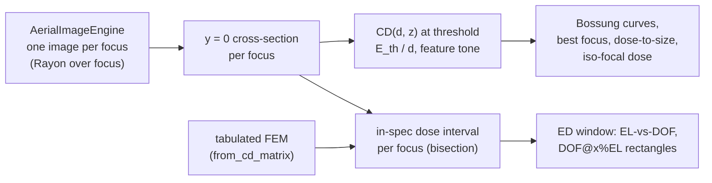

# Metrics & process window

**Status:** 🔶 Simplified (✅ CD / ILS / NILS / MEEF metrics) — the process window rests on a dose-aware constant-threshold resist with no blur, diffusion or development; the metrics beneath it find threshold crossings to sub-pixel accuracy and are validated against closed forms · [matrix](capability-matrix.md#masks-metrics-and-process-window)

<p class="huv-lead">This page is the last stage of the pipeline: how a CD, an image log-slope, a NILS or a MEEF is read off the aerial image, what "feature tone" means on a periodic field, and how a focus–exposure window is built from one image per focus with a constant-threshold resist. It is for anyone who reads the numbers <code>simulate</code> and <code>sweep</code> print or calls <code>process_window</code>. The mask that produces the image is on <a href="masks.md">Masks</a>; a developed resist profile is a different thing and lives under <a href="processes/resist-models.md">Resist models</a>.</p>

<div class="huv-physics huv-physics--single" markdown>

<figure markdown="span">


<figcaption><strong>The dose-aware process window of 65 nm lines on a 180 nm pitch.</strong> F<sub>2</sub> 157.63 nm, NA 0.75, σ 0.7, 2 % flare, from <code>BatchSimulator.process_window</code>: printed CD per (dose, focus) with a constant-threshold resist, Bossung curves around the dose-to-size, the continuous dose limits, the largest-DOF window at 5 % exposure latitude, the max-area rectangle and the EL–DOF curve. <em>Model: process window / ED analysis 🔶 (constant threshold; no resist blur, diffusion or development; CD on the y = 0 cut).</em></figcaption>
</figure>

| What is modeled | Grade | Dominant approximation | Details |
|---|---|---|---|
| CD / ILS / NILS / MEEF metrics | ✅ Implemented | threshold contour on the y = 0 cut; monotone-cubic crossings | [Sub-pixel crossings](#sub-pixel-threshold-crossings) |
| Process window / ED analysis | 🔶 Simplified | constant-threshold resist $E_\mathrm{th}/d$; inscribed rectangles only | [Process window](#process-window-and-ed-analysis) |
| Hopkins imaging (factorized TCC/SOCS) | ✅ Implemented | one scalar image per focus, thin mask | [Simulation pipeline](pipeline.md) |
| Exact thin-mask spectrum | ✅ Implemented | closed-form orders; sub-pixel mask bias is continuous | [Masks](masks.md#exact-spectrum) |

**Same thing elsewhere:** Python `api.process_window(65.0, 180.0, na=0.75)` · CLI `highuvlith sweep --config examples/sim.toml` · TOML `[process]` · GUI Process window tab · physics → [Simulation pipeline](pipeline.md#stage-7--metrics)

</div>

## Metrics

Implementation: [`crates/highuvlith-core/src/metrics.rs`](../crates/highuvlith-core/src/metrics.rs).
All metrics are image-plane quantities: a CD here is the width of an intensity
threshold contour on the y = 0 cross-section of the aerial image (a
constant-threshold resist), not a developed resist profile.

## Sub-pixel threshold crossings

Every CD, ILS and NILS function shares one crossing finder. Between the two samples
that bracket the threshold, the profile is interpolated by a cubic Hermite polynomial
whose node slopes come from the five-point central difference
$(-y_{k+2} + 8y_{k+1} - 8y_{k-1} + y_{k-2})/(12\Delta x)$, Fritsch–Carlson limited so
the cubic is monotone on the segment. The crossing is the unique root of that cubic,
and the edge slope $dI/dx$ is its derivative **at** the crossing (the previous code
used a one-sided secant between the bracketing samples).

For smooth (band-limited) images the crossing position is fourth-order and the slope
third-order accurate in the sample spacing. On the closed-form fixture below, the
worst case over 16 sub-pixel phases is:

| samples per 180 nm period | CD error (nm) | NILS error |
|---:|---:|---:|
| 20 (9 nm pixel) | 1.3 × 10⁻³ | 3.7 × 10⁻⁴ |
| 40 | 7.1 × 10⁻⁵ | 1.5 × 10⁻⁵ |
| 80 | 3.4 × 10⁻⁶ | 6.0 × 10⁻⁶ |
| 160 | 2.2 × 10⁻⁷ | 6.9 × 10⁻⁷ |

(NILS ≈ 2.32 on this fixture, $a = 0.5$, $b = 0.4$, $t = 0.27$.)

## Feature tone and periodic images

The imaging engine returns one period of a periodic image (the FFT's boundary
condition), so the recommended functions treat the profile as periodic — crossings
wrap around the field edge and a feature straddling it is measured whole — and take an
explicit `FeatureTone`:

- **Dark** — the feature is where $I <$ threshold (an opaque line on a bright-field
  mask; a resist line in positive resist).
- **Bright** — the feature is where $I \ge$ threshold (a space, or a contact hole on a
  dark-field mask). `FeatureTone::of_mask` picks Bright for dark-field masks, Dark
  otherwise.

| Function | Returns |
|---|---|
| `measure_cd_periodic(profile, x, t, tone)` | width of the `tone` feature whose centre is nearest the field centre |
| `periodic_features(profile, x, t, tone)` | every feature: edges, width, centre, edge slopes |
| `image_log_slope(profile, x, t, tone)` | ILS $= \lvert dI/dx\rvert / t$ (1/nm), mean of the two edges |
| `nils_periodic(profile, x, t, tone, width)` | NILS $= w \cdot$ ILS, $w$ = measured CD or a supplied nominal width |
| `meef(...)`, `meef_central(cd, δ, f)` | MEEF $= \partial CD_\mathrm{wafer}/\partial CD_\mathrm{mask}$ (both at wafer scale) |
| `centre_profile(image)` | y = 0 cross-section: four-row cubic midpoint rule $(-r_{-2}+9r_{-1}+9r_{+1}-r_{+2})/16$ |

The legacy open-profile functions `measure_cd`, `measure_cd_2d` and `nils` keep their
signatures and semantics — the width between the two consecutive crossings whose
midpoint is nearest the profile centre, whatever its tone — but now use the same
crossing finder, and `measure_cd_2d` reads the y = 0 profile instead of the row at
$y = +\Delta y/2$. Because they measure whichever feature straddles x = 0, the tone
they report depends on where the pattern's phase puts the origin; prefer the
tone-explicit functions.

### Closed-form checks

For $I(x) = a - b\cos(2\pi x/p)$ the dark feature centred on $x = 0$ has

```math
CD_\mathrm{dark}(t) = \frac{p}{\pi}\arccos\frac{a - t}{b},\qquad
\left.\frac{dI}{dx}\right|_\mathrm{edge} = b\,\frac{2\pi}{p}\,\sin\frac{\pi\,CD}{p},
```

e.g. $a = 0.5$, $b = 0.4$, $p = 180$ nm, $t = 0.3$: CD = 60 nm (bright: 120 nm), NILS =
2.418399 (bright: 4.836798). A two-beam image of an opaque line of width $w$,
$I = (1 - w/p) - 2M\sin(\pi w/p)/\pi\cdot\cos(2\pi x/p)$ with $M = 0.8$, $t = 0.3$, gives
CD(58 nm) = 28.9937 nm, CD(62 nm) = 37.7506 nm, so the central-difference MEEF at
60 nm is 2.1892 (analytic derivative 2.1621). These numbers are computed independently
with numpy and asserted in the unit tests.

## Process window and ED analysis

Implementation: [`crates/highuvlith-core/src/process.rs`](../crates/highuvlith-core/src/process.rs).
**The dose axis comes from a constant-threshold resist** — that is why this half of
the page is graded Simplified while the metrics above are Implemented. One aerial image
per focus is computed; every dose is read from the stored cross-sections, so dose is
continuous and focus is sampled.

<details markdown="1">
<summary>Flowchart — from engine images to the ED window</summary>



</details>

## Resist model and dose

`ThresholdResist { dose_to_clear_mj_cm2 }`: with the aerial image normalized to the
clear field ($I = 1$ for an open frame), a point receives dose $d \cdot I(x)$ and clears
where $d \cdot I(x) \ge E_\mathrm{th}$. At dose $d$ the printed edge is therefore the
intensity contour

```math
I(x_\mathrm{edge}; z) = E_\mathrm{th} / d .
```

A dark (opaque-line) feature narrows as dose rises; a bright (hole/space) feature
widens. The legacy `ProcessWindow::compute(engine, mask, doses, focuses, cd_threshold,
target, tol)` keeps its signature: `cd_threshold` is the intensity threshold at the
**nominal dose**, the median of `doses`, i.e. $E_\mathrm{th} = $ `cd_threshold` $\cdot
d_\mathrm{nom}$. Previously the dose was ignored and every row of the CD matrix was
identical. `compute_threshold_model` takes the resist explicitly; `from_profiles`
(precomputed cross-sections) and `from_cd_matrix` (tabulated or measured
focus–exposure matrices) are engine-free.

Only one aerial image per focus is computed. Every dose is evaluated on the stored
cross-sections, so dose is continuous: at each focus the measured feature is tracked
through its extreme-intensity sample, its CD is monotone in the threshold, and the
in-spec dose interval $[d_\mathrm{min}(z), d_\mathrm{max}(z)]$ for the spec
$CD_t(1 \mp \mathrm{tol})$ is found by bisection — exact model evaluation, so these
limits are not clipped to the swept dose range (the swept doses only set the rows of
`cd_matrix` and the nominal dose). `cd_matrix` holds NaN where the
feature does not print or has merged with its neighbours (it used to hold 0.0).

## Figures of merit

| Method | Definition |
|---|---|
| `nominal_dose()` | median of the swept doses |
| `best_focus()` | focus of $dCD/dz = 0$ on the Bossung curve at the dose-to-size (least-squares quadratic vertex through the 5 samples around the extremum); falls back to the centre of the in-spec focus interval |
| `dose_to_size()` | dose printing the target CD at best focus |
| `depth_of_focus()` | in-spec focus range around best focus at the dose-to-size (spec crossings interpolated between focus samples) |
| `exposure_latitude()` | EL at best focus, $\mathrm{EL} = (d_\mathrm{max} - d_\mathrm{min}) / \tfrac12(d_\mathrm{max} + d_\mathrm{min}) \times 100$ % |
| `iso_focal_dose()` | dose minimizing $\max_z CD - \min_z CD$ over the focus samples that print at every swept dose |
| `el_vs_dof(n)` | exposure–defocus curve: for each DOF, the largest EL of any in-window rectangle of that focus extent |
| `dof_at_el(el)` | largest-DOF rectangle with EL ≥ `el` (DOF@5 %EL = `dof_at_el(5.0)`) |
| `el_at_dof(dof)`, `max_area_rectangle()` | largest-EL rectangle of a given DOF; rectangle maximizing DOF × EL |

An ED rectangle $[z_1, z_2] \times [d_1, d_2]$ lies inside the window when
$d_1 \ge \max_{[z_1,z_2]} d_\mathrm{min}(z)$ and $d_2 \le \min_{[z_1,z_2]} d_\mathrm{max}(z)$;
the in-spec dose limits are interpolated linearly between focus samples and the
search runs on a 16× refined focus grid. EL(DOF) never increases with DOF (a longer
focus range only adds constraints), which `dof_at_el` exploits by bisection.

The same crossing finder that builds the window also measures how a mask error
propagates to the wafer — the MEEF, which rises steeply as k₁ falls:

<figure markdown="span">


<figcaption><strong>Mask error enhancement grows as k<sub>1</sub> falls.</strong> For 1:1 lines at three pitches (F<sub>2</sub> 157.63 nm, NA 0.75, σ 0.7, 2 % flare) the threshold is set so the nominal line prints on size; the mask line is then biased by ±25 nm (wafer scale) and the printed CD measured with the sub-pixel crossing finder. MEEF = dCD<sub>wafer</sub>/dCD<sub>mask</sub> rises well above 1 at 180 nm pitch. <em>Model: exact thin-mask spectra ✅ · Hopkins imaging ✅ · MEEF metrics ✅ · process window / ED analysis 🔶 (constant-threshold resist).</em></figcaption>
</figure>

## Model coverage

| Field | Unit | Consumed by | Status |
|---|---|---|---|
| `cd_threshold` / `dose_to_clear_mj_cm2` | intensity fraction / mJ/cm² | the printed-edge contour $E_\mathrm{th}/d$ | live |
| `doses`, `focuses` | mJ/cm², nm | rows of `cd_matrix`, the nominal dose; focus samples | live (dose continuous, focus sampled) |
| `cd_target_nm`, `cd_tolerance_pct` | nm, % | the in-spec interval $CD_t(1 \mp \mathrm{tol})$ | live |
| `FeatureTone` | — | every periodic metric | live |
| resist blur, diffusion, development, thickness | — | — | not modelled (see [Resist models](processes/resist-models.md)) |

## Usage

### Python

<!-- verify-example -->
```python
import highuvlith as huv
from highuvlith import api

result = huv.simulate_line_space(65.0, 180.0, na=0.75)       # the canonical run
print(f"Contrast {result.contrast:.3f}, NILS {result.nils:.2f}, CD {result.cd_nm:.2f} nm")

pw = api.process_window(65.0, 180.0, na=0.75, focuses_nm=[-200.0, -100.0, 0.0, 100.0, 200.0])
print(f"best focus {pw.best_focus():.1f} nm, dose-to-size {pw.dose_to_size():.2f} mJ/cm2")
print(f"DOF {pw.depth_of_focus():.0f} nm, EL {pw.exposure_latitude():.1f} %, "
      f"DOF at 5 % EL {pw.dof_at_el(5.0)['dof_nm']:.0f} nm")
print(pw.status, pw.notes[0])
```

??? success "Output"

    ```text
    Contrast 0.454, NILS 0.65, CD 41.20 nm
    best focus 0.0 nm, dose-to-size 30.00 mJ/cm2
    DOF 200 nm, EL 11.5 %, DOF at 5 % EL 213 nm
    🔶 constant-threshold resist: a point clears where dose x intensity >= E_th; no blur, diffusion or development
    ```

The coarse five-plane sweep is for the recorded output; the figure above uses the
default 17 planes over ±200 nm. `AerialImageResult.cd` / `.nils_periodic` /
`.image_log_slope` / `.features` expose the metrics on any image; the two
`BatchSimulator` methods take explicit dose and focus lists (see the
[Python API](python-api.md)).

### CLI and TOML

The `sweep` command reports dose-aware CDs and an ED summary (best focus, dose-to-size,
DOF, EL, DOF@5 %EL, iso-focal dose) with the config dose as nominal and 0.3 as its
intensity threshold:

```bash
highuvlith sweep --config examples/sim.toml --output pw.json                       # focus only
highuvlith sweep --config examples/sim_arf.toml --focus-range -150,150,7 --dose-range 20,40,5 --output ed.json
```

The `[process]` keys (dose, focus, threshold, CD target) are listed in
[TOML configuration](configuration.md); the [CLI reference](cli.md) shows the
transcript and the JSON keys the command writes.

## Limits

- Constant-threshold resist only: no acid diffusion or image blur, no development
  kinetics, no resist thickness, standing waves or mask-3D effects. The only dose
  dependence is the threshold shift $E_\mathrm{th}/d$.
- CD is measured on the y = 0 cross-section (the x-width of a line, or of a contact
  through its centre); no 2D contour metrics.
- Focus is sampled at the sweep points; DOF resolution is set by the focus step (dose
  resolution is not). Tabulated matrices are linear in dose between rows.
- The ED window uses inscribed rectangles only (no ellipse); EL is relative to the
  rectangle's centre dose.
- Frontends: Python `BatchSimulator.process_window` (legacy signature, dose-aware),
  `BatchSimulator.process_window_threshold`, `ProcessWindowResult.from_profiles` /
  `.from_cd_matrix`, `AerialImageResult.cd` / `.nils_periodic` / `.image_log_slope` /
  `.features`; the CLI `sweep` command; the GUI Process window tab.

<details markdown="1">
<summary>Validation — the closed-form window</summary>

For the synthetic window $I(x; z) = a - b(z)\cos(2\pi x/p)$,
$b(z) = b_0 e^{-((z - z_0)/s)^2}$ with $a = 0.5$, $b_0 = 0.45$, $z_0 = 40$ nm,
$s = 150$ nm, $p = 180$ nm, $E_\mathrm{th} = 9$ mJ/cm² and a 60 nm ± 10 % spec,
the in-spec condition is
$a - b(z)\cos(\pi CD_\mathrm{lo}/p) \le E_\mathrm{th}/d \le a - b(z)\cos(\pi CD_\mathrm{hi}/p)$,
which gives (numpy, asserted in the tests on a 10 nm focus grid):

| Quantity | Closed form | Tolerance in test |
|---|---:|---:|
| dose limits at $z_0$ | 28.3940 – 38.2171 mJ/cm² | 0.02 % |
| EL at best focus | 29.494 % | 0.2 % |
| best focus | 40 nm | 0.5 nm |
| dose-to-size | 32.7273 mJ/cm² ($t^* = a - b_0/2$) | 0.01 % |
| DOF at dose-to-size | 120.656 nm | 0.5 % |
| EL of the 100 nm-DOF rectangle | 18.493 % | 0.3 % |
| DOF @ 5 % EL / 10 % EL | 160.745 / 139.277 nm | 0.3 % |
| iso-focal dose | 18 mJ/cm² ($= E_\mathrm{th}/a$: CD = p/2 at every focus) | 0.01 % |

The metrics' closed-form checks (CD = 60 nm, NILS 2.418399, MEEF 2.1892 on the cosine
and two-beam fixtures above) are asserted in `metrics.rs`.

</details>

<details markdown="1">
<summary>Changes</summary>

- The crossing finder moved from a one-sided secant to a monotone cubic Hermite root;
  `measure_cd_2d` reads the y = 0 profile instead of the row at $y = +\Delta y/2$.
- The process window became dose-aware ("Dose-blind process window" in the
  [capability matrix](capability-matrix.md#audit-log) audit log): every dose row of the
  focus–exposure matrix used to be identical, and the row's grade was lowered from
  Implemented to Simplified because the dose axis is a constant-threshold resist. `cd_matrix` holds NaN, not 0.0,
  where the feature does not print.

</details>

**Read next:** [Materials](materials.md) · related: [Masks](masks.md) · [Simulation pipeline](pipeline.md) · [Resist models](processes/resist-models.md) · [Playground](playground/index.md) · [GUI](gui.md) · [Python API](python-api.md) · [matrix rows](capability-matrix.md#masks-metrics-and-process-window)
