# Simulation pipeline

**Status:** ✅ Implemented — exact scalar Hopkins imaging (factorized TCC, exact defocus inside the pupil, per-wavelength TCCs) validated against a direct Abbe sum; vector imaging ✅; flare and the resist stages 🔶 as each stage states · [matrix](capability-matrix.md#core-imaging)

<p class="huv-lead">Every highuvlith simulation runs the same seven stages: a source fills the pupil, an optic defines the transfer function, a mask supplies a complex transmittance, the Hopkins image is formed from a factorized TCC, the film stack modulates intensity in depth, resist chemistry turns dose into a latent image, and metrics quantify the result. This page is for anyone who wants to know what the engine computes at each stage and where it approximates. The optics, mask, film and resist models each have a page of their own; this page owns the imaging stage.</p>

<figure markdown="span">

<picture><source media="(max-width: 600px)" srcset="assets/images/diagrams/pipeline-stages-narrow-light.svg"></picture>
<picture><source media="(max-width: 600px)" srcset="assets/images/diagrams/pipeline-stages-narrow-dark.svg"></picture>

<figcaption><strong>Every simulation runs the same seven stages.</strong> Chips are the stage grades from the capability matrix; the bypass paths skip projection optics. <em>Chips copied from the matrix.</em></figcaption>
</figure>

The pipeline is generic over the [`LithographySource`](../crates/highuvlith-core/src/source.rs) and [`OpticalSystem`](../crates/highuvlith-core/src/optics/mod.rs) traits, so every source family and every optic goes through the identical imaging code.

```mermaid
graph LR
    A["Source<br/><i>wavelength, spectral weights,<br/>pupil fill intensity_at(fx,fy)</i>"] --> B["Optical System<br/><i>pupil_function P(f; z, lambda)<br/>refractive / zone plate / Schwarzschild</i>"]
    B --> C["Mask Spectrum<br/><i>rasterize to complex transmittance,<br/>2D FFT — Binary / AttPSM / GrayRect</i>"]
    C --> D["TCC Decomposition<br/><i>adaptive source samples,<br/>TCC = A·Aᴴ, Hermitian eigen / randomized SOCS</i>"]
    D --> E["Aerial Image<br/><i>eigenvalue-weighted sum of coherent<br/>kernel images per focus plane + flare</i>"]
    E --> F["Thin Film<br/><i>transfer matrix,<br/>exact intensity_profile(z)</i>"]
    F --> G["Resist Exposure<br/><i>Dill ABC latent image<br/>(2D depth-averaged or volumetric)</i>"]
    G --> H["PEB + Development<br/><i>Gaussian acid diffusion,<br/>Mack rate, vertical or FMM etch</i>"]
    H --> I["Metrics<br/><i>CD, NILS, contrast,<br/>DOF, EL, sidewall angle</i>"]
```

<details markdown="1">
<summary>Flowchart — the same seven stages with the quantity each one hands to the next</summary>



</details>

<div class="huv-physics huv-physics--single" markdown>

<figure markdown="span">


<figcaption><strong>Three pupils, one rule.</strong> A conventional σ 0.7 fill still images at k₁ = 0.40 (the ±1 orders are inside the (1+σ)·NA/λ support circle); a dipole matched to the pitch images at k₁ = 0.30 with two beams; at k₁ = 0.25 pole and order sit on opposite rims and nothing below it prints in one exposure. The resting frame of the animation on the lithography-arithmetic page. <em>Closed form and geometry; not the engine. No model badge.</em></figcaption>
</figure>

<figure markdown="span">


<figcaption><strong>How one image is built: source points, mask orders, SOCS kernels, partial sums.</strong> 65 nm lines on a 180 nm pitch, F<sub>2</sub> 157.63 nm, NA 0.75, σ 0.7 — the canonical run's scene without flare; kernels are unit-norm in the frequency domain and the staircase shows the truncation; the full sum reproduces <code>compute_aerial_image</code> to 1e-9. <em>Model: Hopkins imaging (factorized TCC/SOCS) ✅ · exact thin-mask spectrum ✅ · illumination pupil fills ✅; thin mask, no flare, no resist.</em></figcaption>
</figure>

<!-- huv-table: stack -->

| Stage | Grade | Dominant approximation | Details page |
|---|---|---|---|
| 1 · Source sampling | ✅ Implemented | adaptive rotated lattice (≤ 0.04 σ, ≳ 200 cells, area-weighted edges); residual contrast error ≲ 0.003 partially coherent, ≲ 0.02 at σ ≈ 0.05; Gaussian–Schell coherence → σ heuristic for beam sources | [Stage 1](#stage-1--source) · [Sources](sources/index.md) |
| 2 · Optics pupil | ✅ Implemented | scalar pupil; exact plane-wave defocus phase in the image-space medium (n = 1 dry, the immersion index otherwise) | [Stage 2](#stage-2--optics) · [Optical systems](optics.md) |
| 2 · EUV projection optics | 🔶 Simplified | isotropic wafer-side pupil, obscuration size assumed, no anamorphic magnification, no mask 3-D | [Optical systems](optics.md#euv-scanner-projection-optics) |
| 2 · Immersion optics | ✅ Implemented | scalar pupil with the medium's defocus phase; polarization via vector mode | [Immersion](optics.md#immersion) |
| 3 · Mask spectrum | ✅ Implemented (🔶 mask model) | exact closed-form thin-mask spectrum on a periodic, commensurate field; Kirchhoff, no mask 3-D | [Stage 3](#stage-3--mask) · [Masks](masks.md) |
| 4 · TCC / SOCS image | ✅ Implemented | exact factorized TCC; truncation reported as captured energy; randomized eigensolver above the dense limits | [Stage 4](#stage-4--aerial-image) |
| 4 · Defocus | ✅ Implemented | in the pupil per source point (`Exact`); the legacy `KernelPhase` 🔶 kept for comparison | [Defocus](#defocus--inside-the-pupil-per-source-point) |
| 4 · Per-wavelength imaging | ✅ Implemented | `compute_multiwavelength` rebuilds the TCC at every spectral sample | [Spectral imaging](#spectral-imaging) |
| 4 · Narrow-band polychromatic | 🔶 Simplified | `compute_polychromatic`: focus shift per sample, TCC at the centre λ | [Spectral imaging](#spectral-imaging) |
| 4 · Vector imaging | ✅ Implemented | engine plumbing over `optics::vector` (thin mask, ideal lens, no multiple film reflections) | [Vector imaging](vector-imaging.md) |
| 4 · Image normalization | ✅ Implemented | relative intensity (÷ exact clear field); absolute available; dark field stays absolute | [Normalization](#image-normalization-relative-intensity) |
| 4 · Flare | 🔶 Simplified | uniform zeroth-order fraction of the mean intensity | [Flare](#flare) |
| 5 · Thin film | ✅ Implemented | 1-D stratified transfer matrix; oblique-TM in-film intensity is the tangential field | [Thin film](processes/thin-film.md) |
| 6 · Resist (2-D) | 🔶 Simplified | depth-averaged dose; centre-row vertical develop | [Resist models](processes/resist-models.md) |
| 6 · Resist (volumetric) | 🔶 Simplified | separable I_aer × S(z); lateral-mean bleaching; 3-D development ✅ | [Volumetric exposure](processes/volumetric-exposure.md) |
| 7 · Metrics | ✅ Implemented | sub-pixel crossings; the process window 🔶 is a constant-threshold resist | [Metrics & process window](metrics-and-process-window.md) |

**Same thing elsewhere:** Python `SimulationEngine(source, optics, mask, grid=…)` · CLI `highuvlith simulate --config examples/sim.toml` · TOML `[source] [optics] [mask] [grid] [process]` · GUI Aerial tab · physics → [Optical systems](optics.md)

</div>

## Stage 1 — Source

**✅ Implemented** — the spectral and pupil model of every family; per-family caveats live on the [source pages](sources/index.md).

The pipeline consumes a deliberately small slice of each source: `wavelength_nm()`, `spectral_weights()` (normalized (λ, w) samples), the pupil fill `intensity_at(fx, fy)`, `bandwidth_pm()`, and the photon density `photon_density_per_mj_cm2()` used for shot noise. Pulse and coherence metadata flow only into the stochastic module: shot-to-shot RMS drives a **live** Gamma-distributed dose-jitter term, and pulse energy × rep rate is **live arithmetic** for `average_power_w`. Fields like electron energy on accelerator sources are stored (inert) or feed wavelength derivation at construction time — see each source page's model-coverage table.

Partial coherence enters through the pupil fill. `sample_source` in [aerial.rs](../crates/highuvlith-core/src/aerial.rs) samples `intensity_at` **adaptively** on a square lattice rotated by atan(1/φ) ≈ 31.7°, one point per cell, with exact area weights where a cell is cut by a source edge; a σ = 0.7 disk becomes ≈ 1 180 points, an x-dipole ≈ 260. The sampled points are inspectable (`AerialImageEngine::source_points`, Python `SimulationEngine.source_points()`) — panel (a) of the figure above shows them. Coherent-beam families map transverse coherence to a Gaussian pupil σ via the Gaussian–Schell heuristic `sigma_from_coherence` — an approximation, documented as such.

<details markdown="1">
<summary>Source sampling in depth — the lattice, the edge rule, the measured residual errors</summary>

The sampler probes σ ∈ [−2, 2]² on a 129² lattice (step 1/32 σ), zooms (129² lattices) onto the support bounding box (intensity > 10⁻⁴ of the peak, i.e. a Gaussian fill out to 4.3 σ_g) until the support spans ≥ 24 probe cells per axis, then integrates the fill over the cells of a square lattice of side `min(0.04, √(area/200))` σ, rotated by atan(1/φ) ≈ 31.7°:

- **Uniform or smoothly graded cell** → its midpoint, weighted by the local intensity (the midpoint rule, spectrally accurate for smooth fills).
- **Cell cut by a hard source edge** (disk, annulus or pole boundary) → the intensity centroid of the lit part, weighted by its integrated intensity on 8 × 8 sub-samples, i.e. exact area weights instead of an in/out decision at the cell centre.
- **Peaked fills** (Gaussian FEL/HHG/ICS fills): a graded cell carrying more than 1/200 of the total is split (up to 8 × 8, three levels), so no point carries much more than 1/200 of the intensity.
- **Symmetry:** the lattice is laid out in the box's fundamental domain (octant for a square symmetric box) and mirrored, so symmetric fills get exactly symmetric point sets; cells cut by a mirror line are clipped, each piece a point at its own centroid.

Why rotated: with an axis-aligned grid a whole column of points crosses a straight edge at once — the pupil cutoff of a diffraction order sweeping over the source as σ or the pitch changes, or the σ boundary itself — and results move in steps. On the rotated lattice no row of points is parallel to an axis or a diagonal, so edges pass the points one mirror pair at a time. Measured against fine-quadrature numpy Abbe references (`tests/imaging_source_sampling.rs`):

| Sweep | Largest contrast error, default sampling | Before (axis-aligned grid) |
|---|---|---|
| KrF 90/180 nm, NA 0.8, σ 0.60–0.85 (k₁ onset at σ 0.724) | 0.0031, monotone | 0.011 (blip at σ 0.74) |
| 13.5 nm, NA 0.33, Gaussian σ_g 0.05, pitch 36–42 nm | 0.019, monotone | 0.11 (stair steps) |
| 13.5 nm, NA 0.33, disk σ 0.05, pitch 36–42 nm | 0.019, monotone | 0.056 |

Point counts: σ = 0.7 disk ≈ 1180 points, σ = 1 ≈ 2250, annulus 0.5–0.9 ≈ 1310, x-dipole 0.7/0.15 ≈ 260, small disks ≈ 290, Gaussian σ_g ≤ 0.05 ≈ 760. The residual error is ordinary discretization error of either sign, not a bias that the rule removes everywhere: the line-end bias of a fragment-OPC run (F2, NA 0.75, σ 0.6) is 9.9 nm at default sampling, 10.2 nm with the old grid and 10.1 nm converged. `ImagingSettings::source_points_per_axis = Some(n)` replaces the lattice with a plain n × n midpoint grid over the box (weights = sampled intensity, no edge weighting) — use a large n for convergence checks; `Some(1)` = coherent. A source smaller than 10⁻³ of the mask-frequency step collapses to one coherent point at its intensity centroid.

</details>

## Stage 2 — Optics

**✅ Implemented** — scalar pupils with the exact defocus phase; the EUV projection optics are 🔶 Simplified.

The optic contributes a complex pupil `P(fx, fy; z, λ)`: magnitude is transmission (apodization, obscuration, mirror reflectivity), phase carries Zernike aberrations plus defocus. The defocus phase is the exact plane-wave (angular-spectrum) form $\Phi_z(\rho) = (2\pi n/\lambda) z (1 - \sqrt{1 - (\mathrm{NA}\rho/n)^2})$ in the image-space medium of index $n$ (1 dry; water $n$ = 1.437 for the 193i immersion preset, which allows NA 1.35) in every optic; the paraxial $\pi z \mathrm{NA}^2 \rho^2/(n\lambda)$ remains available via `paraxial_defocus = true`. EUV scanner projection optics (NA 0.33, and NA 0.55 with a central obscuration) are available alongside the Schwarzschild objective and the zone plate, and reflective optics can optionally carry an angle-dependent multilayer pupil, which under clear-field normalization appears as pupil apodization and phase rather than as a dose change. The engine keeps its own copy of the optics (`OpticalSystem::clone_box`) because it re-evaluates the pupil at every new focus plane and wavelength. The four implementations, the defocus-phase plot and the refractive-below-110-nm honesty rule are on the [optics page](optics.md).

## Stage 3 — Mask

**✅ Implemented** — exact thin-mask spectra on a periodic field; the mask model itself (Kirchhoff, no mask 3-D) is 🔶 Simplified.

[`Mask::rasterize`](../crates/highuvlith-core/src/mask.rs) paints geometric features onto the grid as a complex-amplitude transmittance map: `Binary` chrome is opaque, `AttenuatedPSM` carries `sqrt(T)·exp(iφ)`, alternating PSM is treated as opaque, and `GrayRect` features carry a continuous `sqrt(T)` amplitude for grayscale work. This is the thin-mask (Kirchhoff) approximation — no 3D mask electromagnetics. Coordinates are wafer-scale (post-reduction).

The engine consumes a mask only through its spectrum: `AerialImageEngine::compute(mask, z)` calls `Mask::spectrum(grid, fft)` — closed-form Fourier coefficients for the primitives, so the off-harmonic orders of a grating are exactly zero (panel (b) above) — and images it; **`compute_from_transmittance(&Array2<Complex64>, z)`** Fourier-transforms any raw complex transmittance map on the engine grid (grayscale masks, ILT-optimized maps, external patterns), and **`compute_from_spectrum`** takes a spectrum directly. The simulation field is periodic: a mask is imaged as one period of an infinite array, so periodic patterns must tile the field exactly (field = integer number of pitches) — the [masks page](masks.md) explains commensurate grids.

## Stage 4 — Aerial image

**✅ Implemented** — Hopkins imaging with an exactly factorized TCC, scalar and vector.

### Abbe / Hopkins imaging with a factorized TCC

For the sampled source (points $\mathbf s$ in units of $f_c = \mathrm{NA}/\lambda$, weights $w_s$, $\sum w_s = 1$) the image is the incoherent sum of coherent images (Abbe),

```math
I(\mathbf x) \;=\; \sum_{s} w_s \left| \mathcal{F}^{-1}\!\left[ P\!\left(\tfrac{\mathbf f}{f_c} + \mathbf s;\, z, \lambda\right) M(\mathbf f) \right](\mathbf x) \right|^2 ,
```

equivalently Hopkins' form with the Transmission Cross-Coefficient

```math
\mathrm{TCC}(\mathbf f_1, \mathbf f_2) \;=\; \sum_{s} w_s\, P(\mathbf f_1 + \mathbf s)\, P^{*}(\mathbf f_2 + \mathbf s) \;=\; (A A^{H})_{\mathbf f_1 \mathbf f_2},
\qquad A[\mathbf f, s] = \sqrt{w_s}\, P(\mathbf f + \mathbf s;\, z, \lambda).
```

The engine never forms the TCC entry by entry: it assembles the factor $A$ — one column per source point (in vector mode, `columns_per_source_point` columns per point, filled by `optics::vector::field_columns`) — in parallel, so `TCC = A·Aᴴ` holds exactly. The figure in the Physics Strip above shows every ingredient for the canonical run: the sampled source points, the exact mask orders, the first four kernels and the partial sums converging on the image.

**Mask-frequency support.** Rows of $A$ are all mask orders with $|\mathbf f| \le (1 + \sigma_{\max}) \mathrm{NA}/\lambda$ — an off-axis source point at σ steers orders up to $(1+\sigma)\mathrm{NA}/\lambda$ into the pupil — minus rows no source point steers inside the pupil. This is what lets partially coherent light image pitches between λ/(NA(1+σ)) and λ/NA: a 160 nm pitch at λ = 100 nm, NA 0.5, σ 0.7 images with contrast ≈ 0.48. Pointwise intensities are exact only when the grid Nyquist frequency covers the support, `pixel ≤ λ / (2·NA·(1+σ_max))`; `kernel_diagnostics(z, λ).support_exceeds_nyquist` flags violations. The three-pupil drawing in the Physics Strip is the geometry of the same rule.

<figure markdown="span">


<figcaption><strong>Partial coherence moves the resolution limit from λ/NA to λ/(NA(1+σ)).</strong> Simulated contrast of 1:1 line/space gratings versus pitch (F<sub>2</sub> 157.63 nm, NA 0.75, conventional illumination, no flare): a coherent point source stops imaging at λ/NA = 210 nm, a partially coherent fill of radius σ keeps imaging down to λ/(NA(1+σ)). <em>Model: Hopkins imaging (factorized TCC/SOCS) ✅; thin mask, no flare.</em></figcaption>
</figure>

Where the light sits inside the pupil matters as much as how much of it there is: moving it to the pupil edge in the direction of the grating puts more of it into two-beam (0, ±1) imaging.

<figure markdown="span">


<figcaption><strong>Off-axis illumination below λ/NA.</strong> F<sub>2</sub> 157.63 nm, NA 0.75, 1:1 lines on a 130 nm pitch (k<sub>1</sub> ≈ 0.31; λ/NA = 210 nm): (a–c) pupil fills of the source (circle = NA), all with outer σ ≤ 0.8 so they share the λ/(NA·1.8) ≈ 117 nm cutoff; (d) aerial-image cross-sections at best focus — moving the light to the pupil edge in the direction of the grating (annular, and most of all the x-dipole) puts more of it into two-beam (0, ±1) imaging and raises the contrast. (e) The same fills across pitch: the dipole gives the highest contrast here, but only for gratings of this orientation — the same pattern rotated by 90° does not get its off-axis benefit. <em>Model: Hopkins imaging (factorized TCC/SOCS) ✅ · illumination pupil fills ✅; no flare, thin mask, no resist.</em></figcaption>
</figure>

### SOCS eigendecomposition

$\mathrm{TCC} = \sum_k \lambda_k u_k u_k^H$ and $I(\mathbf x) = \sum_k \lambda_k |\mathcal F^{-1}[u_k M](\mathbf x)|^2$ (Sum Of Coherent Systems). With $n_f$ support frequencies and $n_c$ columns:

| Problem | Method (`DecompositionMethod`) |
|---|---|
| `min(n_f, n_c) ≤ 320`, or `≤ 1536` when `max_kernels + 16 ≥ min(n_f, n_c)/3` | **Dense**: Hermitian eigendecomposition of the smaller Gram matrix — the TCC itself as the Gram of the rows of $A$ when $n_f \le n_c$ (`DenseTcc`), else $G = A^H A$ ($n_c \times n_c$) with $u_k = A v_k/\sqrt{\lambda_k}$ (`DenseGram`) |
| larger | **Randomized** subspace iteration on $A$ (`Randomized`): Gaussian range finder with `max_kernels + 16` columns, 3 power iterations re-orthonormalized after every product, Rayleigh–Ritz; deterministic seed. Error of kernel k ≈ $(\lambda_{l+1}/\lambda_k)^{7}$ relative |

The dense Hermitian eigensolver ([math/linalg.rs](../crates/highuvlith-core/src/math/linalg.rs)) is Householder tridiagonalization, a diagonal phase transform to a real tridiagonal, and the implicit QL iteration; it reconstructs the TCC to ~1e-14.

Kernels are kept up to `max_kernels` (the `new(…, max_kernels)` argument; `ImagingSettings` default 48) or until they capture `kernel_energy_fraction` of $\mathrm{tr}(\mathrm{TCC}) = \lVert A \rVert_F^2$ (default 1.0 = no energy cut). A cut never splits a (near-)degenerate eigenspace — that would break the symmetry of symmetric sources — and eigenvalues below $10^{-12}\lambda_{\max}$ count as zero. Every kernel set reports its **captured energy fraction** $\sum_{k<K}\lambda_k / \mathrm{tr}(\mathrm{TCC})$. The fraction is a conservative proxy: on a 1.28 µm field (λ 100 nm, NA 0.5, σ 0.7, ≈ 370 support frequencies) 16 / 48 / 128 kernels capture 94 / 97 / 98.9 % of the trace with maximum image errors of 5e-3 / 2e-3 / 1.2e-3 (clear field = 1); the clear-field error is bounded by $\mathrm{tr}(\mathrm{TCC})\cdot(1 - \text{captured})$. Keeping all kernels reproduces the direct Abbe sum to ~1e-12.

**Memory guard.** $A$ holds $n_f \times n_c$ complex entries; above 1 GiB the constructor returns `LithographyError::PupilSamplingTooDense` (its `max` field is the largest support that fits for this source sampling). Coarsen the grid, shrink the field, or reduce `source_points_per_axis`.

### Defocus — inside the pupil, per source point

With `DefocusModel::Exact` (default) the focus plane enters $A$ through $P(\mathbf f + \mathbf s; z)$, i.e. the defocus phase depends on $|\mathbf f + \mathbf s|$, as it physically does. Kernel sets are therefore rebuilt per focus plane (and per wavelength) and kept in a bounded, thread-safe LRU cache keyed by (z, λ) (`kernel_cache_capacity`, default 32; builds run outside the lock so nested Rayon use never deadlocks, and results are bit-reproducible). `compute_through_focus(mask, &[z])` images many planes with one mask spectrum, planes in parallel. The animation below shows the kernels themselves changing with focus.

<figure markdown="span">

<picture><source media="(prefers-reduced-motion: reduce)" srcset="assets/images/sim/anim/socs-focus-still-light.png"></picture>
<picture><source media="(prefers-reduced-motion: reduce)" srcset="assets/images/sim/anim/socs-focus-still-dark.png"></picture>

<figcaption><strong>Focus changes the kernels, not just the image.</strong> 65 nm lines on a 180 nm pitch, F<sub>2</sub> 157.63 nm, NA 0.75, x-dipole (σ<sub>c</sub> ≈ 0.58), −400 to +400 nm: the exact model rebuilds the kernel set at every plane and the dipole keeps most of its contrast; the legacy KernelPhase model multiplies the in-focus kernels by one on-axis phase per mask frequency and its contrast collapses and revives (thin grey: conventional σ 0.7). <em>Model: defocus / through-focus imaging ✅ (exact phase in the pupil per source point; 🔶 legacy KernelPhase, kept for comparison).</em></figcaption>
</figure>

`DefocusModel::KernelPhase` keeps the fast approximation of the first engine — in-focus kernels times the on-axis paraxial phase $e^{i\pi z \lambda |\mathbf f|^2}$ of each mask frequency. It is exact only for coherent on-axis light; with off-axis illumination it cannot represent two-beam imaging: a symmetric dipole at $\sigma_c = \lambda/(2p \mathrm{NA})$ keeps its contrast through focus almost unchanged (0.89 → 0.88 at 300 nm; exactly for vanishing pole size for p = 150 nm, λ = 100 nm, NA 0.5) while conventional σ = 0.7 drops 0.37 → 0.15, but under `KernelPhase` the dipole contrast collapses to 0.15 already at 100 nm. Use it only for on-axis, near-coherent illumination.

<figure markdown="span">


<figcaption><strong>Why the defocus fix matters.</strong> Simulated 90 nm lines on a 180 nm pitch (F<sub>2</sub> 157.63 nm, NA 0.75, σ 0.7, no flare) through ±400 nm of focus: the exact model applies the defocus phase inside the pupil for every source point, while the legacy <code>kernel_phase</code> option multiplies each mask frequency by one on-axis phase and predicts Talbot-like contrast revivals that partially coherent illumination washes out. <em>Model: defocus / through-focus imaging ✅ (exact, the default; 🔶 legacy KernelPhase, kept for comparison only).</em></figcaption>
</figure>

The same through-focus sweep, run for a conventional fill and a matched dipole on 90 nm lines, is the animation on the [getting-started page](getting-started.md); its resting frame is below.

<figure markdown="span">


<figcaption><strong>Best focus, the resting frame of the through-focus animation.</strong> 90 nm lines on a 180 nm pitch at 157.63 nm, NA 0.75: conventional σ 0.7 above, an x-dipole at σ_c ≈ 0.58 below; the curves at right show how each loses contrast with defocus (the animation plays on the getting-started page). <em>Model: defocus / through-focus imaging ✅ · scalar, thin mask, no flare, no resist.</em></figcaption>
</figure>

### Spectral imaging

- **`compute_multiwavelength(mask, z) → Result`** — exact incoherent per-wavelength sum: at every spectral sample $\lambda_i$ the kernels are rebuilt with cutoff $\mathrm{NA}/\lambda_i$ (the optics' `cutoff_frequency(λ_i)`), source points at $\sigma \mathrm{NA}/\lambda_i$, the pupil evaluated at $\lambda_i$, and focus $z + $ `optics.chromatic_defocus(λ_i − λ₀)`; $I = \sum_i w_i I_i$, then flare. This is the honest path for broad or multi-line spectra (HHG harmonic combs, un-monochromatized beamlines). Two widely separated lines reproduce the weighted sum of two single-line engines to 1e-12.
- **`compute_polychromatic(mask, z, source, optics)`** — the narrow-band approximation 🔶, kept for compatibility: center-wavelength kernels, focus shifted by `chromatic_defocus` per sample. Valid for Δλ/λ ≪ 1 (excimer, FEL, monochromatized sources); for the F2 laser it agrees with the exact per-λ sum to < 1e-4.

<figure markdown="span">


<figcaption><strong>Honest comb imaging: the exact path images every harmonic, the narrow-band path only the centre one.</strong> A neon HHG source (800 nm driver) filtered to 12.8–14.4 nm keeps harmonics 57, 59 and 61, each with its own cutoff pitch λ<sub>q</sub>/(NA(1+σ)) (grey: each harmonic alone); the exact path rebuilds the TCC at every spectral sample, so the comb image is the weighted sum of the three harmonics' images (q 57 carries most of the filtered flux) and its contrast lies between the single-harmonic curves. The narrow-band path keeps the centre-λ kernels and only shifts focus — with reflective optics (no chromatic focus shift) it is identical to the centre harmonic alone; EUV projection optics NA 0.33, unobscured, no flare, near-coherent Gaussian fill (σ ≈ 0.05). <em>Model: broadband imaging (<code>compute_multiwavelength</code>) ✅ · narrow-band polychromatic (<code>compute_polychromatic</code>) 🔶 (valid for Δλ/λ ≪ 1) · high-harmonic generation ✅ (🔶 power: comb and cutoff exact, driver power assumed).</em></figcaption>
</figure>

### Image normalization (relative intensity)

Aerial images are reported as **relative intensity** by default (`ImageNormalization::ClearField`): the SOCS sum is divided by the exact clear-field intensity of the same illumination, optics, wavelength and focus plane,

```math
I_{\text{rel}}(\mathbf x) = \frac{I(\mathbf x)}{I_{\text{clear}}}, \qquad I_{\text{clear}} = \mathrm{TCC}(0,0) = \sum_s \sum_{\text{cols}} |A(\mathbf f = 0; s)|^2 ,
```

computed from the DC row of $A$ (so it is exact even when the SOCS sum is truncated). A clear mask therefore images to 1 before flare for every pupil — apodized, obscured (Schwarzschild, High-NA EUV), zone-plate efficiency $\eta$, or vector with the radiometric factor on (where the raw clear field is ≈ 1.29 for a dipole at NA 0.9). For unapodized, unobscured scalar pupils with every source point inside the pupil, $I_{\text{clear}} = 1$ and nothing changes. Absolute radiometry stays available: `clear_field_intensity(z)` returns $I_{\text{clear}}$ and `ImageNormalization::Absolute` skips the division. Spectral sums normalize by $\sum_i w_i I_{\text{clear},i}$ (brighter-transmitting wavelengths weigh more). Dark-field configurations — the pupil blocks the zero order for essentially the whole source, $I_{\text{clear}} < 1$ % of the pupil's peak $|P|^2$ (e.g. near-coherent on-axis light through an obscured pupil) — have no meaningful relative intensity; they stay absolute, `kernel_diagnostics(…).normalized` is `false`, and the CLI prints a warning. The [playground's aerial toy](playground/index.md) uses the same clear-field convention.

### Flare

Uniform stray light 🔶: the image is blended as $I \leftarrow (1-\phi) I + \phi \bar I$ with $\phi$ = the optic's `flare_fraction()` and $\bar I$ the mean intensity. This is a zeroth-order flare model (no point-spread flare kernel).

### Kernel access

`AerialImageEngine::kernels(z) → Arc<KernelSet>` (contract C1) returns the dense n×n frequency-domain kernels (`Fft2D::forward` layout, unit norm), eigenvalues (already divided by $I_{\text{clear}}$ in the default normalization), focus plane, wavelength, and captured energy; `compute(mask, z)` before flare equals $\sum_k \lambda_k |\mathrm{IFFT}(K_k \odot M)|^2$ with those kernels in either normalization mode (pinned by `kernels_reproduce_compute` and `absolute_mode_is_relative_times_clear_field`). Python exposes the same set as `SimulationEngine.kernels(focus_nm)` and `kernel_eigenvalues()`; panel (c) of the Physics-Strip figure is drawn from them.

<details markdown="1">
<summary>Performance — release-build timings of the imaging engine</summary>

`cargo bench -p highuvlith-core` (`benches/aerial_benchmark.rs`), 20 kernels, F2 157.63 nm / σ 0.7 / NA 0.75 on 2 nm pixels ("VUV") or 13.5 nm / σ 0.7 through the NA 0.33 Schwarzschild on 1 nm pixels ("EUV"); measured on a shared multi-core workstation, so treat as ±20 %:

| Operation | 128² | 256² | 512² |
|---|---|---|---|
| Engine creation, VUV (source sampling + in-focus kernels) | 0.60 ms | 1.9 ms | — |
| Engine creation, EUV (≈ 355 support frequencies × 1176 source points at 256²) | 3.6 ms | 24 ms | — |
| One image, cached kernels, VUV | 0.56 ms | 2.7 ms | 21 ms |
| One image, cached kernels, EUV | — | 3.0 ms | — |
| 21-plane focus sweep, exact defocus, kernels rebuilt per plane (VUV / EUV) | — | 34 ms / 307 ms | — |
| 21-plane focus sweep, legacy `KernelPhase` (VUV) | — | 28 ms | — |
| Exact per-λ imaging, 5-line comb, kernels rebuilt per line (EUV) | 11 ms | 97 ms | — |

The adaptive sampler costs ≈ 0.3 ms per engine; images from cached kernels are unaffected by the source-point count.

</details>

### Vector imaging

`ImagingModel::Vector(settings)` fills the columns of $A$ with the image-side field components of every mutually incoherent polarization state from [`optics::vector`](../crates/highuvlith-core/src/optics/vector.rs), so $A A^H$ sums $|E_x|^2 + |E_y|^2 + |E_z|^2$ over states; identically zero columns (the second TE/TM state at off-axis source points) are dropped before the decomposition. The engine copies `optics.reduction()` into `VectorSettings::reduction`, requires `image_index` to equal the optics' immersion index (inherited when left at 1.0; one medium for the defocus phase and the fields), and calls `VectorSettings::validate(NA)`. The engine side is plumbing (tested: unpolarized = mean of X and Y states; → scalar at NA 0.1; clear field = 1 with the radiometric factor on); the physics is that module's, graded ✅ Implemented in the matrix with its approximations stated on the [vector imaging page](vector-imaging.md): thin mask, ideal lens without a Jones pupil, no multiple film reflections.

## Stage 5 — Thin film

**✅ Implemented** — the Macleod transfer-matrix stack; details on the [thin-film page](processes/thin-film.md).

[`FilmStack`](../crates/highuvlith-core/src/thinfilm.rs) implements the 2×2 characteristic-matrix method for absorbing multilayers between superstrate and semi-infinite substrate: reflectance at arbitrary incidence for TE/TM/unpolarized light, and the **exact** in-film intensity `intensity_profile()` that propagates the tangential fields layer by layer — standing waves, absorption and every interface reflection (for oblique TM it returns the tangential-field intensity |U|², a documented approximation). The legacy `standing_wave()` combines only the stack-top reflection with single-layer propagation and is kept because the MNSL module depends on its numbers. Standing-wave minima are spaced λ/(2n). The figure below follows one exposure from the aerial image through the film into the resist and out of the developer.

<figure markdown="span">


<figcaption><strong>One exposure, five stages.</strong> 150 nm lines on a 300 nm pitch at 157.63 nm, NA 0.75, σ 0.7 in 150 nm of resist on Si, 24 mJ/cm²: (a) the aerial image; (b) the exposing intensity S(z) = (n<sub>r</sub>/n<sub>0</sub>)|E(z)|² with its λ/2n standing wave; (c) the banded latent image; (d) after the 20/10 nm Gaussian bake; (e) development at 30 s with surface inhibition (rate ratio 0.3, 15 nm) — fast-marching isochrones and the level-set front. The default resist is illustrative and low-contrast. <em>Model: Hopkins imaging ✅ · thin-film transfer matrix ✅ · volumetric exposure 🔶 · post-exposure bake ✅ · 3D development (fast marching) ✅ · 3D development (level set) ✅ (🔶 first-order front).</em></figcaption>
</figure>

## Stage 6 — Resist

**🔶 Simplified** — two exposure paths, depth-averaged and volumetric; the 3-D development solvers are ✅ Implemented.

The **depth-averaged 2-D path** ([resist models](processes/resist-models.md)) applies Dill exposure with a single Beer–Lambert coupling scalar (no z-resolved dose), separable-Gaussian PEB acid diffusion, and Mack (or threshold) development that etches only the centre row vertically — no lateral front, no sidewall profile:

```math
m(x,y) = e^{-C \cdot \mathrm{dose} \cdot I_{\mathrm{eff}}}, \qquad
R(m) = R_{\max}\frac{(a+1)(1-m)^n}{a + (1-m)^n} + R_{\min}, \quad a = \frac{n+1}{n-1}(1-m_{th})^n
```

(with an explicit n → 1 singularity guard falling back to linear interpolation). The **volumetric path** ([volumetric exposure](processes/volumetric-exposure.md)) builds the full (x, y, z) latent image under a separable approximation, $I(x,y,z) = I_{\mathrm{aer}}(x,y; d_0 + z/n_r) \times S(z)$, where the lateral aerial image is refocused paraxially into the resist and $S(z)$ is the exact transfer-matrix `intensity_profile` — so standing waves are counted once, exactly; bleaching is split-step Dill with the laterally averaged PAC, and development is a per-column threshold, a 3-D fast-marching etch front or a level-set moving boundary, each with a frozen rate field during develop.

## Stage 7 — Metrics

**✅ Implemented** — sub-pixel CD, ILS, NILS and MEEF; the dose-aware process window is 🔶 Simplified.

[metrics.rs](../crates/highuvlith-core/src/metrics.rs): threshold-crossing CD with sub-pixel interpolation (`measure_cd`, `measure_cd_2d`), `nils` (normalized image log-slope), `image_contrast`, `mtf_from_image`, and volumetric follow-ons `cd_at_z`, `sidewall_angle_deg`, `aspect_ratio`. [process.rs](../crates/highuvlith-core/src/process.rs) sweeps dose × focus for Bossung curves, DOF and exposure latitude with a constant-threshold resist. Both are documented on the [metrics and process-window page](metrics-and-process-window.md).

## Model coverage

The imaging engine's own settings (`ImagingSettings` in Rust; keyword arguments of `SimulationEngine` in Python):

| Field | Unit | Consumed by | Status |
|---|---|---|---|
| `max_kernels` | count | SOCS truncation (default 48; the Python wrappers pick fewer for small problems) | live |
| `kernel_energy_fraction` | 0–1 | energy cut on the eigenvalue sum (default 1.0 = none) | live |
| `source_points_per_axis` | count | plain n × n midpoint grid instead of the adaptive lattice; `1` = coherent | live |
| `defocus_model` | enum | `Exact` (default) or the legacy `KernelPhase` 🔶 | live |
| `imaging_model` | enum | `Scalar` or `Vector(VectorSettings)` | live |
| `kernel_cache_capacity` | count | LRU cache of kernel sets per (focus, λ), default 32 | live |
| `normalization` | enum | `ClearField` (default) or `Absolute` | live |

## Usage

### Python

The engine precomputes the kernels once; every focus plane, dose or mask afterwards reuses them.

<!-- verify-example -->
```python
import highuvlith as huv

source = huv.SourceConfig.f2_laser(0.7)
optics = huv.OpticsConfig(numerical_aperture=0.75)
mask = huv.MaskConfig.line_space(65.0, 180.0)
engine = huv.SimulationEngine(source, optics, mask, grid=mask.commensurate_grid(256))
d = engine.imaging_diagnostics()
image = engine.compute_aerial_image(focus_nm=0.0)
print(f"{d['num_kernels']} kernels capture {d['captured_energy_fraction']:.4f} of the TCC trace "
      f"from {d['num_source_points']} source points; contrast {image.image_contrast():.3f}")
```

???+ success "Output"

    ```text
    9 kernels capture 1.0000 of the TCC trace from 1176 source points; contrast 0.454
    ```

### CLI and TOML

`highuvlith simulate --config examples/sim.toml` runs the same stages from a TOML file; the `[source]`, `[optics]`, `[mask]`, `[grid]` and `[process]` tables map one-to-one onto the stages above, and `[imaging]` carries the engine settings of the coverage table (`max_kernels`, `kernel_energy_fraction`, `defocus_model`, the `[imaging.vector]` sub-table). Keys are documented on the [configuration page](configuration.md); the transcript of the canonical run is on the [CLI page](cli.md).

## Limits

- **Thin mask everywhere.** No mask 3-D / EMF: every order leaves the mask with the illumination's amplitude and phase.
- **Flare is a constant fraction** of the mean intensity, not a point-spread kernel.
- **Scalar imaging is 🔶 at NA ≳ 0.8** — switch to [vector mode](vector-imaging.md), which is exact for the thin mask and an ideal lens.
- **The field is periodic.** A mask is imaged as one period of an infinite array; incommensurate pitches alias.
- **Focus inside the resist** uses the volumetric path's paraxial z/n mapping, not the pupil's medium index.
- **Resist chemistry is simplified** on both paths: no z-resolved dose on the 2-D path, a separable latent image on the volumetric one, frozen rate fields during development.

<details markdown="1">
<summary>Validation — 29 tests pin the claims on this page</summary>

| Claim | Test | Tolerance |
|---|---|---|
| With every kernel kept, the SOCS image equals an independent direct Abbe summation (no support truncation, no eigendecomposition), in focus and defocused, for conventional (dense-TCC path), dipole (Gram path) and annular illumination with coma + spherical on an attenuated PSM | `socs_equals_abbe_*` ([imaging_validation.rs](../crates/highuvlith-core/tests/imaging_validation.rs)) | ≤ 1e-8 relative (measured 2e-16 – 7e-15) |
| Dense-TCC, Gram and randomized paths agree | `test_all_decomposition_paths_agree`, `test_truncated_randomized_matches_dense_leading_pairs` | randomized within its theoretical bound |
| σ = 0.7 resolves a pitch between λ/(NA(1+σ)) and λ/NA; coherent light and pitches below λ/(NA(1+σ)) give a uniform image | `partial_coherence_resolves_beyond_coherent_cutoff` | contrast ≈ 0.48 / < 1e-9 |
| Off-axis depth of focus: a matched dipole is focus-invariant, the legacy KernelPhase misstates it | `dipole_two_beam_imaging_is_focus_invariant`, `legacy_kernel_phase_misstates_off_axis_depth_of_focus` | — |
| Coherent grating image equals $\lvert c_0 + (c_1 e^{i2\pi x/p} + c_{-1} e^{-i2\pi x/p}) e^{i\Phi_z}\rvert^2$ with the exact defocus phase | `test_coherent_three_beam_image_closed_form` ([analytical_validation.rs](../crates/highuvlith-core/tests/analytical_validation.rs)) | 1e-12 pixel by pixel |
| Clear field is unity at any defocus; images are non-negative; symmetric mask and source give a symmetric image; defocus is symmetric for aberration-free optics; the non-paraxial phase reduces to the paraxial one at low NA | `clear_field_is_unity_at_any_defocus`, `images_are_non_negative`, `symmetric_mask_and_source_give_symmetric_image`, `defocus_is_symmetric_for_aberration_free_optics`, `nonparaxial_defocus_reduces_to_paraxial_at_low_na` | ≤ 3e-3 at NA 0.1 |
| Immersion resolves a 90 nm pitch at 193 nm that dry NA 0.93 cannot; the water defocus phase reproduces the closed-form coherent image; NA ≥ n is rejected; vector mode inherits the immersion index | `immersion_resolves_a_pitch_dry_optics_cannot`, `immersion_defocus_uses_the_medium_index`, `engine_rejects_na_above_the_medium_index`, `vector_imaging_inherits_the_immersion_index` ([imaging_optics_presets.rs](../crates/highuvlith-core/tests/imaging_optics_presets.rs)) | 1e-12 |
| NA 0.55 (obscured) resolves an 18 nm pitch NA 0.33 cannot; obscured pupil + on-axis light is dark field (absolute); clear field = 1 for apodized / Schwarzschild / obscured High-NA / zone-plate pupils with $I_{\text{clear}}$ matching an independent $\sum_s w_s\lvert P(s)\rvert^2$ | `high_na_resolves_a_pitch_below_the_nxe_limit`, `obscured_pupil_with_on_axis_light_is_dark_field`, `lossy_pupils_image_a_clear_field_to_exactly_one` | 1e-12 |
| The per-λ sum equals the weighted sum of single-line engines; narrow-band per-λ matches `compute_polychromatic` | `multiwavelength_equals_weighted_sum_of_single_line_engines`, `narrow_band_multiwavelength_matches_polychromatic` | 1e-12 / < 1e-4 |
| Contract C1: `compute` equals the kernel sum in both normalization modes | `kernels_reproduce_compute`, `absolute_mode_is_relative_times_clear_field` | 1e-12 |
| Through-focus batches equal single calls; concurrent use is deterministic; the 1 GiB memory guard fires | `through_focus_batch_matches_single_calls`, `concurrent_use_is_deterministic`, the `PupilSamplingTooDense` test | bit-identical |
| Source sampling error against fine-quadrature Abbe references over σ and pitch sweeps | [tests/imaging_source_sampling.rs](../crates/highuvlith-core/tests/imaging_source_sampling.rs) | ≤ 0.0031 (KrF σ sweep), ≤ 0.019 (σ ≈ 0.05 pitch sweeps), monotone |
| Gram/products vs naive; eigen-reconstruction on random, degenerate, diagonal, block-coupled and rank-deficient-with-noise matrices; randomized eigenpairs on a known decaying spectrum | [math/linalg.rs](../crates/highuvlith-core/src/math/linalg.rs) unit tests | ~1e-14 reconstruction |
| Standing-wave node spacing λ/(2n); Fresnel reflectance, Brewster angle, quarter-wave AR | `test_intensity_profile_standing_wave_period`, the analytical validation suite, property-based tests | analytic |

</details>

<details markdown="1">
<summary>Changes — behaviour that differs from the first engine, with the audit-log entries</summary>

Every item is recorded in the [capability matrix's change log](capability-matrix.md#audit-log).

- **Mask-frequency support.** Up to v1 the support stopped at NA/λ, which made the whole $k_1 < 0.5$ partial-coherence regime impossible: a 160 nm pitch at λ = 100 nm, NA 0.5, σ 0.7 imaged with contrast 0 and now images at ≈ 0.48.
- **Defocus.** The first engine applied one on-axis paraxial phase per mask frequency; it survives as the opt-in `DefocusModel::KernelPhase` (see the defocus figures above).
- **Eigensolver.** nalgebra 0.33's complex `SymmetricEigen` returned an orthonormal but wrong eigenbasis on defocused TCCs (reproducing the TCC only to ~1e-5) and is not used; the in-tree Hermitian solver reconstructs it to ~1e-14.
- **Source sampling.** The axis-aligned source grid produced a spurious +0.013 contrast blip at σ = 0.74 in a KrF σ sweep (reference 0.0035) and stair steps in near-coherent pitch sweeps; the rotated lattice removes them (table in "Source sampling in depth"). The rotated lattice costs ≈ 20 % more source points, so kernel builds are ≈ 20–25 % slower than before it; engine creation was 0.28 / 1.49 ms (VUV) and 2.9 / 20.0 ms (EUV) at 128² / 256² before the change.
- **Dipole.** `IlluminationShape::Dipole` rendered a single pole before 2026-09-30; dipole results computed before the fix used one pole.
- **The v1 engine** (31×31 source grid, in-pupil support only, deflated power iteration) took 0.06 / 1.7 ms to create and 0.61 / 6.2 ms per image at 128² / 256² (VUV) — faster to build at 128² only because it kept 5 mask frequencies where the physics needs 13; the per-image speed-up of the current engine comes from the batched, row-pruned FFT.

</details>

## References

- H. H. Hopkins, "On the diffraction theory of optical images," *Proc. R. Soc. Lond. A* **217**, 408–432 (1953).
- N. Cobb, "Fast optical and process proximity correction algorithms for integrated circuit manufacturing," PhD thesis, UC Berkeley (1998) — SOCS decomposition.
- N. Halko, P.-G. Martinsson, J. A. Tropp, "Finding structure with randomness: probabilistic algorithms for constructing approximate matrix decompositions," *SIAM Review* **53**(2), 217–288 (2011) — randomized range finder.
- F. H. Dill et al., "Characterization of positive photoresist," *IEEE Trans. Electron Devices* **22** (1975).
- C. A. Mack, "Development of positive photoresists," *J. Electrochem. Soc.* **134** (1987).
- H. A. Macleod, *Thin-Film Optical Filters*, 4th ed. — characteristic matrices.

**Read next:** [Optical systems](optics.md) · related: [Vector imaging](vector-imaging.md) · [Masks](masks.md) · [Processes](processes/index.md) · [matrix rows](capability-matrix.md#core-imaging)
