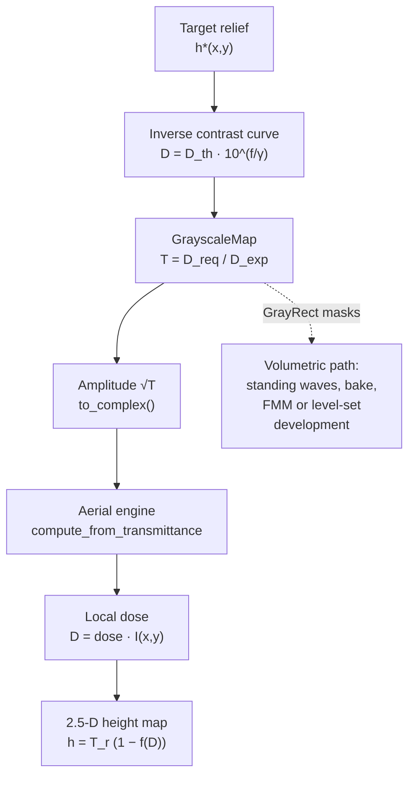

# Grayscale

**Status:** 🔶 Simplified — the fast 2.5-D height map is a closed-form per-pixel contrast curve with no standing waves, bake or lateral development; the volumetric path captures those · [matrix](../capability-matrix.md#resist-and-development)

<p class="huv-lead">Binary lithography prints edges; grayscale lithography prints surfaces: a continuous-transmittance mask varies the dose across the field and a positive resist clears to a depth that follows it. The transfer function is the contrast curve, fixed by the threshold and clearing doses; <code>grayscale.rs</code> provides that algebra with its exact inverse, mask synthesis through the real diffraction engine and a fast 2.5-D height map.</p>

<div class="huv-glance" markdown>

| Property | Value |
|---|---|
| Computes | contrast curve and inverse; the mask for a target relief; its aerial image; 2.5-D height map |
| Does not | standing waves, bake, lateral development, sidewalls; grayscale phase |
| Default scene | i-line 365 nm, NA 0.4, σ 0.7; D_th 10, D_clear 100, exposure 150 mJ/cm² |
| Grade | 🔶 Simplified |
| Compare with | [Masks](../masks.md) · [Volumetric exposure](volumetric-exposure.md) |

</div>

<div class="huv-physics" markdown>

<!-- grayscale-mechanism -> processes/grayscale.md -->
<figure markdown="span">


<figcaption><strong>Mechanism.</strong> A continuous-tone mask sets the local dose through the same diffraction engine that images binary masks; the log-linear contrast curve f(D) = clamp(γ·log₁₀(D/D_th), 0, 1) converts dose to removed depth, and the height map is h = T_r·(1 − f(D)). The 2.5-D path is per pixel: standing waves, bake and lateral development belong to the volumetric path. <em>Schematic, not to scale.</em></figcaption>
</figure>

<!-- grayscale-contrast-curve -> processes/grayscale.md -->
<figure markdown="span">


<figcaption><strong>The contrast curve is the whole resist model.</strong> (a) Remaining height against log dose for γ = 1, 2 and 3 at a 20 mJ/cm² threshold: the log-linear model curve with its clamps, no development dynamics; (b) a blazed-grating target and the continuous transmittance mask that prints it in one 100 mJ/cm² exposure (threshold 20, clearing 80 mJ/cm²); (c) the relief printed through i-line optics at NA 0.4 and 0.75, where the band-limited image rounds the sawtooth edges. The mask carries intensity transmittance only (zero phase). <em>Model: grayscale lithography 🔶 (log-linear contrast curve, 2.5-D height map, no standing waves or bake).</em></figcaption>
</figure>

<!-- huv-table: stack -->
| What is modeled | Grade | Dominant approximation | Details |
|---|---|---|---|
| Grayscale lithography | 🔶 Simplified | depth-independent contrast curve, per pixel | [The contrast curve](#the-contrast-curve-and-its-inverse) |
| Hopkins imaging (factorized TCC/SOCS) | ✅ Implemented | scalar, thin mask (the engine the mask goes through) | [Mask synthesis](#mask-synthesis) |
| Mask model and types | 🔶 Simplified | `GrayRect` is amplitude √T with zero phase | [Masks](../masks.md#mask-model) |
| Volumetric (z-resolved) exposure | 🔶 Simplified | the standing-wave-aware route for `GrayRect` masks | [Volumetric exposure](volumetric-exposure.md) |

**Same thing elsewhere:** Python `huv.simulate_grayscale(target, ...)` · CLI `deep --config examples/grayscale.toml` · TOML `[deep] target = "blazed"` · GUI — · physics → [masks](../masks.md)

</div>

## How it works

The chain inverts the forward model: a target relief gives the required dose through the inverse contrast curve, the dose gives the mask transmittance, the engine images the mask, and the local dose maps back to height.



The dashed branch is the standing-wave-aware route: [volumetric exposure](volumetric-exposure.md) with a `GrayRect` staircase mask.

### The contrast curve and its inverse

The log-linear contrast curve, its forward map, and its exact inverse:

```math
\gamma = \frac{1}{\log_{10}(D_{clear}/D_{th})}
```

```math
f(D) = \mathrm{clamp}\!\big(\gamma \log_{10}(D/D_{th}),\ 0,\ 1\big), \qquad h(D) = T_r\,\big(1 - f(D)\big)
```

```math
D(f) = D_{th}\, 10^{f/\gamma}
```

with $T_r$ the film thickness and $f$ the removed-depth fraction — panel (a) of the engine figure above for γ = 1, 2 and 3. `ContrastCurve::dose_for_depth` is the **exact inverse** of `depth_nm` over the open interval $(D_{th}, D_{clear})$ (pinned by a round-trip test); at the clamp boundaries, $f = 0$ maps to $D_{th}$ and $f = 1$ to $D_{clear}$. **The curve is depth-independent: it is the whole resist model of the fast path.**

### Mask synthesis

Mask synthesis inverts the whole chain: for a target height $h^*(x,y)$ the required removed depth is $T_r - h^*$, the required dose follows from $D(f)$, and the transmittance is $T = D_{req}/D_{exp}$ for a chosen exposure dose $D_{exp}$ — panel (b) above. Intensity transmittance becomes field amplitude as $\sqrt{T}$ (zero phase), which is what the diffraction engine propagates; the optics band-limit the relief and round the cusps between features, panel (c) above and the microlens array below.

<!-- grayscale-relief -> processes/grayscale.md -->
<figure markdown="span">


<figcaption><strong>A continuous-tone mask printed as relief.</strong> A 2 × 2 microlens array (300 nm sag in 500 nm resist) designed through the log-linear contrast curve (threshold 20, clearing 80 mJ/cm², 100 mJ/cm² exposure), imaged with F<sub>2</sub> 157.63 nm, NA 0.75, σ 0.7 and mapped back to remaining height; the optics band-limit the relief and round the cusps between lenses. <em>Model: grayscale lithography 🔶 (thin-film contrast-curve resist; no standing waves, bake or development dynamics).</em></figcaption>
</figure>

## Process regime

| Parameter | Typical value | Notes / citation |
|---|---|---|
| Resists | Thick positive DNQ-novolak (AZ 4562, AZ 9260, ma-P 1275); PMMA for e-beam grayscale | [1, 2] |
| Thickness | 2–50 µm (µ-optics); 100 nm–2 µm (diffractive optics) | [1, 2] |
| Contrast $\gamma$ | ~1–3 (low contrast preferred — wider gray window) | [1] |
| Doses | $D_{th}$ tens of mJ/cm², $D_{clear}$ hundreds of mJ/cm² (i-line/broadband) | [1, 3] |
| Gray levels | 8–256 (HEBS glass ~1000 gray shades) | [2] |
| Structures | Blazed gratings (µm-scale sawtooth), microlens arrays (10–500 µm pitch, 1–50 µm sag), staircase DOEs | [1, 2] |
| Post-process | Optional RIE transfer of the resist relief into Si/SiO₂ | [2] |

## What the code provides

All in [`crates/highuvlith-core/src/grayscale.rs`](../../crates/highuvlith-core/src/grayscale.rs):

- **`ContrastCurve`** — `ContrastCurve::new(d_th, d_clear)` (requires $0 < D_{th} < D_{clear}$; derives $\gamma$); `removed_depth_fraction`, `depth_nm`, `dose_for_depth`.
- **`GrayscaleMap`** — an `Array2<f64>` of intensity transmittance in [0, 1]. `to_complex()` yields the amplitude-$\sqrt{T}$ map consumed by [`AerialImageEngine::compute_from_transmittance`](../../crates/highuvlith-core/src/aerial.rs), so grayscale masks go through the **same Hopkins TCC/SOCS diffraction engine** as geometric masks. `from_target_height()` synthesizes the mask for a target relief and **errors when the exposure dose is infeasible** — if any pixel would need $T > 1$, it reports the maximum required dose so you can raise $D_{exp}$.
- **`MaskFeature::GrayRect`** — the geometric-mask counterpart ([masks](../masks.md#mask-model)): a rectangle carrying its own intensity transmittance, rasterized as amplitude $\sqrt{T}$ with zero phase, ignoring the mask type and dark-field flag; `staircase_mask()` tiles `GrayRect` steps into a discrete-level test mask.
- **Relief generators** — `blazed_grating(n, period_px, depth_nm, thickness_nm)` and `microlens_array(n, pitch_px, sag_nm, thickness_nm)`.
- **`height_map(aerial, dose, curve, thickness)`** — the fast **2.5D** path: per-pixel $h = T_r - \mathrm{depth}(D\cdot I(x,y))$.
- Python: `huv.simulate_grayscale`, `huv.grayscale_height_map`, `huv.grayscale_transmittance_for_target`, `huv.blazed_grating`, `huv.microlens_array` ([`python/highuvlith/api.py`](../../python/highuvlith/api.py)).

Two tiers, explicitly separated:

| Path | What it captures | What it ignores |
|---|---|---|
| 2.5D `height_map` | Closed-form dose→height per pixel; instant; exact for contrast-curve design | Standing waves, PEB diffusion, lateral development, sidewall angle — the contrast curve is depth-independent |
| Volumetric (`volumetric.rs`) | Exact TMM `intensity_profile` standing waves, split-step Dill bleaching, exact anisotropic Gaussian or chemically amplified PEB, fast-marching or level-set development (lateral etching, sidewall angle, surface inhibition, developer ageing/loading) | Vector in-film imaging; paraxial $z/n$ focus mapping; takes a geometric `Mask` (e.g. `GrayRect` steps), not an arbitrary per-pixel `GrayscaleMap` |

Both image the grayscale mask through the same diffraction engine; choose the tier by whether you need first-order relief design or a physical topography with sidewalls.

## Model coverage

| Field | Unit | Consumed by | Status |
|---|---|---|---|
| `ContrastCurve.gamma` | — | `removed_depth_fraction`, `dose_for_depth` | live (derived at construction) |
| `ContrastCurve.dose_threshold_mj_cm2` | mJ/cm² | forward and inverse maps | live |
| `ContrastCurve.dose_clear_mj_cm2` | mJ/cm² | fixes $\gamma$ at construction; not re-read afterward | live (constructor only) |
| `GrayscaleMap.transmittance` | [0, 1] | `to_complex` → aerial engine; feasibility check | live |
| `MaskFeature::GrayRect.transmittance` | [0, 1] | `Mask::rasterize` (amplitude $\sqrt{T}$) | live |
| Grayscale phase (non-zero-phase gray features) | rad | — | planned |
| Sub-pixel edges of gray features | — | `Mask::rasterize` (exact area coverage) and `Mask::spectrum` (closed form), shared with binary rectangles | live |

## Usage

### Python

The example designs a microlens array, images it through i-line optics and prints the height range of the printed relief:

<!-- verify-example -->
```python
import highuvlith as huv

target = huv.microlens_array(128, 32, 80.0, 200.0)   # (n, pitch_px, sag_nm, thickness_nm)
res = huv.simulate_grayscale(
    target, 200.0, d_th=10.0, d_clear=100.0, exposure_dose_mj_cm2=150.0,
    wavelength_nm=365.0, na=0.4, sigma=0.7, pixel_nm=100.0,
)
res.transmittance            # synthesized intensity-transmittance mask
res.height_map.values        # printed 2.5D relief (imaged through the aerial engine)

# Building blocks:
huv.blazed_grating(128, 32, 120.0, 200.0)            # (n, period_px, depth_nm, thickness_nm)
t = huv.grayscale_transmittance_for_target(target, 200.0, 10.0, 100.0, 150.0)
source = huv.SourceConfig.hg_i_line(sigma=0.7)
optics = huv.OpticsConfig(numerical_aperture=0.4)
grid = huv.GridConfig(size=128, pixel_nm=100.0)      # must match the target's shape
hm = huv.grayscale_height_map(source, optics, grid, t, 150.0, 10.0, 100.0, 200.0)
h = res.height_map.values
print(f"printed relief {h.min():.1f}–{h.max():.1f} nm for an 80 nm target sag; "
      f"mask transmittance {res.transmittance.min():.2f}–{res.transmittance.max():.2f}")
```

??? success "Output"

    ```text
    printed relief 118.6–200.0 nm for an 80 nm target sag; mask transmittance 0.07–0.17
    ```

### CLI and TOML

`highuvlith deep` with `[deep] mode = "grayscale"` ([`examples/grayscale.toml`](../../examples/grayscale.toml), [configuration](../configuration.md#deep)):

| Keys | Meaning |
|---|---|
| `target` = `blazed` \| `microlens` \| `staircase` | the relief generator |
| `period_px`, `pitch_px`, `n_levels`, `depth_nm`, `sag_nm`, `thickness_nm` | its geometry |
| `dose_mj_cm2`, `d_th`, `d_clear` | exposure dose and the contrast curve |

**The CLI grayscale mode does not image through the optics.** It synthesizes the transmittance for the target and re-prints it in the ideal 2.5-D model (local dose = exposure dose × transmittance), reporting γ, the target and achieved height ranges and the RMS error.

!!! warning "The CLI grayscale mode does not image through the optics"
    `highuvlith deep --config examples/grayscale.toml` is a self-consistency check of the contrast-curve inversion, with **no diffraction**. Imaging through the optics is available from Python (`simulate_grayscale`, `grayscale_height_map`) and Rust.

<details markdown="1">
<summary>Rust</summary>

```rust
use highuvlith_core::grayscale::{microlens_array, ContrastCurve, GrayscaleMap, height_map};
use highuvlith_core::aerial::AerialImageEngine;

// AZ-thick-resist-like curve: D_th = 10, D_clear = 100 mJ/cm^2 -> gamma = 1.
let curve = ContrastCurve::new(10.0, 100.0)?;
let thickness_nm = 5_000.0;

// Target: parabolic microlens array, 2 um sag.
let target = microlens_array(256, 64, 2_000.0, thickness_nm);

// Synthesize the mask; errors if 100 mJ/cm^2 cannot reach the deepest pixel.
let gray = GrayscaleMap::from_target_height(&target, thickness_nm, &curve, 100.0)?;

// Diffract it through the real imaging engine, then map dose to height.
let engine: AerialImageEngine = /* built from source/optics/grid as usual */;
let aerial = engine.compute_from_transmittance(&gray.to_complex(), 0.0);
let relief = height_map(&aerial, 100.0, &curve, thickness_nm); // 2.5D
```

For standing-wave-aware topography, build the grayscale mask from `MaskFeature::GrayRect` steps (e.g. `staircase_mask`) and run it through `volumetric::expose_volumetric` and the bake/development tiers like any other `Mask`. An arbitrary per-pixel `GrayscaleMap` has no volumetric entry point today; from Python, a latent volume computed elsewhere can be wrapped with `VolumetricResult.from_array` and developed.

</details>

## Limits

- **Per-pixel closed form.** The 2.5-D height map has no standing waves, no bake, no lateral development and no sidewall angle; the contrast curve is depth-independent.
- **Intensity transmittance only.** Gray features are amplitude $\sqrt{T}$ with zero phase; grayscale phase is a planned row and no figure on this page shows phase effects.
- **No per-pixel volumetric route.** The volumetric path takes a geometric `Mask` (`GrayRect` steps), not an arbitrary `GrayscaleMap`.
- **The CLI mode skips the optics** (above); it checks the inversion, not the print.
- **Development dynamics** (rate laws, developer depletion) are not part of the contrast-curve model.

<details markdown="1">
<summary>Behaviour changes</summary>

- No behaviour change is recorded for this module in the capability matrix audit log; its numbers (γ, the round-trip inverse, the generator envelopes) are closed forms pinned by the tests below.

</details>

<details markdown="1">
<summary>Validation — 13 tests</summary>

`#[test]` functions in [`grayscale.rs`](../../crates/highuvlith-core/src/grayscale.rs) unless noted:

| Test | What it pins | Tolerance |
|---|---|---|
| `test_gamma_fixture` | $D_{th}=10, D_{clear}=100 \Rightarrow \gamma = 1$ | exact |
| `test_contrast_curve_round_trip` | depth→dose is the exact inverse for doses strictly inside $(D_{th}, D_{clear})$ | — |
| `test_removed_fraction_bounds` | 0 at/below threshold, 1 at/above clearing, $f{=}0$ inverts to $D_{th}$ | — |
| `test_invalid_contrast_curve` | rejects $D_{th} \le 0$ and $D_{clear} \le D_{th}$ | — |
| `test_blazed_grating_min_max`, `test_microlens_sag_bounds` | generator envelopes are exact | — |
| `test_staircase_through_height_map` | end-to-end closed-form heights for four intensity levels | — |
| `test_from_target_height_errors_when_dose_insufficient` | the feasibility error fires; a sufficient dose yields $T \in [0,1]$ | — |
| `test_to_complex_amplitude_is_sqrt_t`, `test_staircase_mask_builds_gray_rects` | amplitude √T; `GrayRect` tiling | — |
| `aerial.rs`: `test_compute_uses_mask_spectrum` | `compute_from_transmittance` of the inverse transform of the exact mask spectrum reproduces `compute` | 1e-12 |
| `aerial.rs`: `test_compute_from_transmittance_close_to_raster` | the rasterized-transmittance path images the same geometry up to edge sampling | 0.05 |
| Python `test_grayscale_blazed_round_trip`, `test_grayscale_transmittance_helpers`; CLI `test_parse_grayscale_config` | printed relief correlates with the target (per-period slope correlation < −0.7); helpers; config parsing | — |

</details>

## References

1. C. M. Waits, A. Modafe, R. Ghodssi, "Investigation of gray-scale technology for large area 3D silicon MEMS structures," *J. Micromech. Microeng.* **13**, 170–177 (2003).
2. M. T. Gale, M. Rossi, J. Pedersen, H. Schütz, "Fabrication of continuous-relief micro-optical elements by direct laser writing in photoresists," *Opt. Eng.* **33**, 3556–3566 (1994).
3. F. H. Dill, W. P. Hornberger, P. S. Hauge, J. M. Shaw, "Characterization of positive photoresist," *IEEE Trans. Electron Devices* **22**, 445–452 (1975).
4. B. Wagner, H. J. Quenzer, W. Henke, W. Hoppe, W. Pilz, "Microfabrication of complex surface topographies using grey-tone lithography," *Sens. Actuators A* **46**, 89–94 (1995).
5. C. A. Mack, *Fundamental Principles of Optical Lithography*, Wiley (2007) — contrast-curve formalism.

**Part of Processes · see also:** [index](index.md) · [Masks](../masks.md#mask-model) · [Volumetric exposure](volumetric-exposure.md) · [configuration](../configuration.md#deep)
