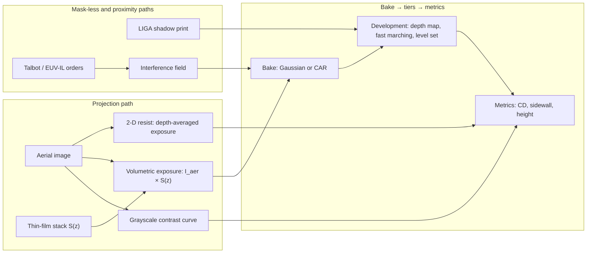
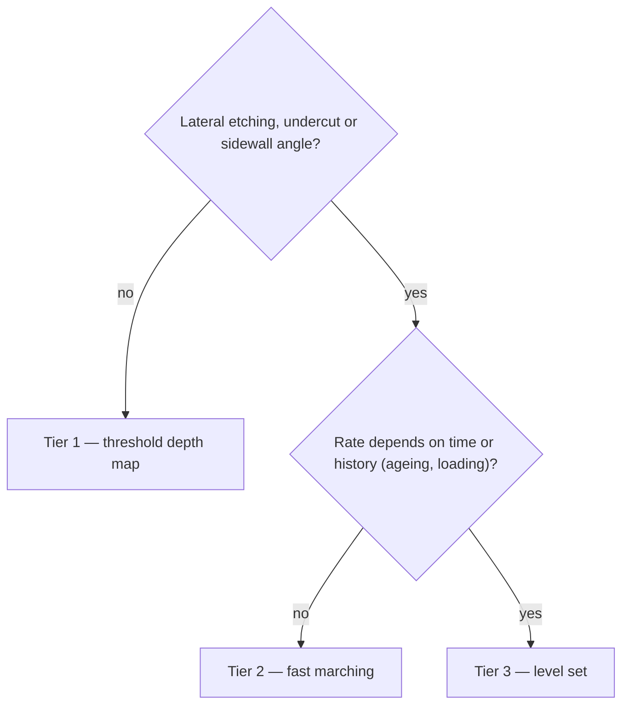

# Process Modules

**Status:** ✅ Implemented — this page is an index of process modules that exist in code; each linked page carries its own grade · [matrix](../capability-matrix.md#resist-and-development)

"Process" in highuvlith is everything between the patterned light arriving at the wafer and the pattern you measure: how the film stack redistributes intensity in depth, how the resist records dose, how the bake diffuses the latent image, how development turns it into topography, and how CD is read off the result. Seven pages cover it — three on the projection path (film stack, 2-D resist, volumetric resist) and four on modules that bypass the projection optics by physics, not by omission. Every page states what it computes, what it does not, and the grade the capability matrix gives it.

<!-- process-pipeline-strip -> processes/index.md -->
<figure markdown="span">

<figcaption><strong>One exposure, five stages.</strong> 150 nm lines on a 300 nm pitch at 157.63 nm, NA 0.75, σ 0.7 in 150 nm of resist on Si, 24 mJ/cm²: (a) the aerial image; (b) the exposing intensity S(z) = (nr/n0)|E(z)|² with its λ/2n standing wave; (c) the banded latent image; (d) after the 20/10 nm Gaussian bake; (e) development at 30 s with surface inhibition (rate ratio 0.3, 15 nm) — fast-marching isochrones and the level-set front. The default resist is illustrative and low-contrast. <em>Model: Hopkins imaging ✅ · thin-film transfer matrix ✅ · volumetric exposure 🔶 · post-exposure bake ✅ · 3D development (fast marching) ✅ · 3D development (level set) ✅ (🔶 first-order front).</em></figcaption>
</figure>

<!-- levelset-development -> processes/index.md -->
<figure markdown="span">

<picture><source media="(prefers-reduced-motion: reduce)" srcset="../assets/images/sim/anim/levelset-development-still-light.png"></picture>
<picture><source media="(prefers-reduced-motion: reduce)" srcset="../assets/images/sim/anim/levelset-development-still-dark.png"></picture>

<figcaption><strong>Development as a moving front.</strong> x–z slice of the baked latent image with the developed region and the level-set front at t = 0 … 30 s (F2 σ 0.7, NA 0.75, 150/300 nm lines, 150 nm resist on Si, 24 mJ/cm², Gaussian bake 20/10 nm, surface inhibition 15 nm, surface-rate ratio 0.3); right, resist remaining per column. The default resist is illustrative and low-contrast. <em>Model: volumetric exposure 🔶 (separable Iaer·S(z)) · anisotropic Gaussian bake ✅ · level-set development ✅ (🔶 first-order front, rate re-evaluated at the front).</em></figcaption>
</figure>

-   **Thin film**

    ---

    ✅ Implemented · Exact 2×2 transfer-matrix stack optics: reflectance, swing curves and the in-film standing wave S(z).

    [Thin film →](thin-film.md)

-   **Resist models**

    ---

    🔶 Simplified · Dill exposure, Gaussian or chemically amplified bake, Mack development on the depth-averaged 2-D path.

    [Resist models →](resist-models.md)

-   **Volumetric exposure**

    ---

    🔶 Simplified · The z-resolved latent image, the exact bake and three development tiers up to a level-set moving boundary.

    [Volumetric exposure →](volumetric-exposure.md)

-   **LIGA deep X-ray**

    ---

    ✅ Implemented (🔶 thin-screen absorber) · Spectral depth dose, absolute exposure time and Fresnel shadow printing through hundreds of µm of PMMA.

    [LIGA deep X-ray →](liga-deep-xray.md)

-   **Grayscale**

    ---

    🔶 Simplified · Contrast-curve relief from continuous-tone masks imaged through the real diffraction engine.

    [Grayscale →](grayscale.md)

-   **Interference & two-photon**

    ---

    ✅ Implemented (🔶 two-photon, scalar absorption) · Analytic N-beam lattices on a 3-D grid, with scalar absorption and a Gaussian two-photon voxel.

    [Interference & two-photon →](interference-volumetric.md)

-   **Talbot lithography**

    ---

    🔶 Simplified · Talbot carpets, displacement and achromatic Talbot images, two-grating EUV interference fringes.

    [Talbot lithography →](talbot.md)

## Start here

Pick the page by the question, not by the module name. Every row names the cheapest path that answers it; the grade is the page's own headline grade, copied from the matrix.

<!-- huv-table: stack -->
| I need … | Go to | Grade |
|---|---|---|
| CD, NILS, Bossung curves, a process window on thin resist | [Metrics & process window](../metrics-and-process-window.md) or [Resist models](resist-models.md) | 🔶 Simplified |
| Swing curves, BARC design, dose-to-clear vs thickness | [Thin film](thin-film.md) — reflectance and `intensity_profile` directly, no resist model | ✅ Implemented |
| Sidewall angle, standing-wave ripple, undercut, thick or bleaching resist, T-topping, developer loading | [Volumetric exposure](volumetric-exposure.md) with the anisotropic or CAR bake and a front solver | 🔶 Simplified |
| Blazed gratings and microlens relief | [Grayscale](grayscale.md) for first-order design; the volumetric path for standing-wave-aware verification | 🔶 Simplified |
| Hundreds of µm of PMMA, aspect ratios ≫ 10, exposure-time estimates | [LIGA deep X-ray](liga-deep-xray.md); the straight-edge tool for sidewall shape | ✅ Implemented (🔶 thin-screen absorber) |
| Periodic 1-D/2-D/3-D lattices without a mask | [Interference & two-photon](interference-volumetric.md) | ✅ Implemented (🔶 two-photon, scalar absorption) |
| Lens-less printing of periodic arrays from a grating at EUV or soft X-ray wavelengths | [Talbot lithography](talbot.md) | 🔶 Simplified |

## Where each page hooks into the pipeline

The projection modules consume the aerial image as a plain intensity grid on the periodic simulation field, so every model below works the same way for the F₂ excimer, a 13.5 nm plasma source or any other `LithographySource`. Four modules bypass part of that chain *by physics*: LIGA and interference lithography have no projection optic at all, Talbot lithography images a grating by free-space propagation, and grayscale replaces the resist stack by an analytic contrast curve.

<!-- pipeline-stages -> processes/index.md -->
<figure markdown="span">

<picture><source media="(max-width: 600px)" srcset="../assets/images/diagrams/pipeline-stages-narrow-light.svg"></picture>
<picture><source media="(max-width: 600px)" srcset="../assets/images/diagrams/pipeline-stages-narrow-dark.svg"></picture>

<figcaption><strong>Every simulation runs the same seven stages.</strong> Chips are the stage grades from the capability matrix; the bypass paths skip projection optics. <em>Chips copied from the matrix.</em></figcaption>
</figure>

Flowchart — the projection path and the mask-less paths, joining at the bake

Metrics are image-plane or developed-profile CD, NILS, contrast and MEEF from [`metrics.rs`](../../crates/highuvlith-core/src/metrics.rs); the mask stage is documented on [masks](../masks.md) and the image metrics on [metrics & process window](../metrics-and-process-window.md).

## What highuvlith models on these pages

Grades are copied from each page's own `**Status:**` line, which copies the matrix; every capability-changing PR must update that line, the module's `# Model status` header and the capability matrix together.

<!-- huv-table: stack -->
| Page | Grade | Computes | Does not |
|---|---|---|---|
| [Thin film](thin-film.md) | ✅ Implemented | TE/TM/unpolarized R, T, complex r, t at any angle; exact in-film intensity S(z) | Rough interfaces; oblique-TM in-film intensity beyond the tangential field |
| [Resist models](resist-models.md) | 🔶 Simplified | Dill exposure, Gaussian or CAR bake, Mack or threshold development on the depth-averaged 2-D path | z-resolved dose; lateral development fronts; sidewall angles |
| [Volumetric exposure](volumetric-exposure.md) | 🔶 Simplified | `(x, y, z)` latent image, split-step bleaching, anisotropic or CAR bake, three development tiers | Vector in-film imaging; developer transport; swelling |
| [LIGA deep X-ray](liga-deep-xray.md) | ✅ Implemented (🔶 thin-screen absorber) | Spectral depth dose, absolute exposure time, Fresnel proximity diffraction over gap and depth | Photoelectron transport, fluorescence, beam divergence, beamline mirrors |
| [Grayscale](grayscale.md) | 🔶 Simplified | Contrast-curve 2.5-D height map from continuous-transmittance masks; inverse mask synthesis | Standing waves, bake and lateral development (the volumetric path) |
| [Interference & two-photon](interference-volumetric.md) | ✅ Implemented (🔶 two-photon, scalar absorption) | Vector-component superposition of N plane waves on a 3-D grid; two-photon Gaussian voxel | Fresnel transmission, substrate reflection, vector focusing |
| [Talbot lithography](talbot.md) | 🔶 Simplified | Talbot carpet, DTL and ATL stationary images, two-grating EUV-IL fringes | Mask 3-D, partial coherence, resist Fresnel coefficients |

Image metrics and the dose-aware process window (🔶 Simplified for the constant-threshold resist) live on [metrics & process window](../metrics-and-process-window.md).

## The 2D-vs-volumetric split

highuvlith has two resist paths that share the Dill exposure and Mack/threshold development physics but differ in dimensionality.

**Depth-averaged 2D** ([resist-models.md](./resist-models.md)). The aerial image is scaled by the single Beer–Lambert coupling scalar $(1 - e^{-\alpha d})/(\alpha d)$ and exposed as one `(x, y)` plane; PEB is a 2D Gaussian blur (`resist::peb_diffuse`); development etches each column of the center row vertically. Fast and adequate for CD/Bossung work on thin resists, blind to standing waves and sidewalls.

**Volumetric** ([volumetric-exposure.md](./volumetric-exposure.md)). A full `(x, y, z)` latent image built as the separable product `I_aer(x, y; d₀ + z/n_r) · S(z)` of the aerial image, refocused paraxially to each depth, and the *exact* transfer-matrix intensity `S(z)` — standing waves, absorption and interface reflections included once. Bleaching is split-step Dill with the laterally averaged PAC per sublayer. The latent volume then goes through a bake and one of the development tiers below.

### Bake models

| Post-exposure bake | Function | Notes |
|---|---|---|
| 2D Gaussian (acid diffusion length) | `resist::peb_diffuse` | 2D path |
| 3D isotropic Gaussian | `volumetric::peb_diffuse_3d` | Exact spectral Gaussian per axis (legacy signature; reflecting lateral edges) |
| Anisotropic Gaussian: separate lateral and vertical diffusion lengths, optional depth-dependent vertical diffusivity | `resist::peb_diffuse_anisotropic`, `volumetric::apply_peb` with `PebModel::Gaussian` | Variance exactly σ² per axis |
| Chemically amplified resist: acid/quencher reaction–diffusion (exact local reaction, Strang splitting) | `resist::car_peb`, `resist::car_peb_2d`, `PebModel::ChemicallyAmplified` | Normalized to the PAG; no acid loss |

### Development tiers

| Development tier | Function | Captures |
|---|---|---|
| 1. Threshold depth map | `volumetric::develop_depth_map` | Per-column clearing depth; no lateral etching or undercut |
| 2. Fast marching | `volumetric::develop_fast_marching[_with]` | Eikonal arrival times (`‖∇T‖ = 1/R`) for a static rate field → sidewall angle, undercut |
| 3. Level set | `volumetric::develop_level_set` | Moving boundary with the rate re-evaluated at the front every step: surface inhibition (T-topping), developer ageing, global and local developer loading |

Surface inhibition is a static, depth-only rate factor, so the fast-marching tier accepts it too (`develop_fast_marching_with`); developer loading depends on the developed geometry's history and needs the level set. The decision is short:

The two resist paths are pinned to each other: the z-mean of the exact `S(z)` reproduces the 2D coupling scalar for an index-matched, non-bleaching resist (`test_z_mean_matches_effective_coupling` in [`volumetric.rs`](../../crates/highuvlith-core/src/volumetric.rs)).

## Shared data types and cross-model pins

All process modules exchange the plain grid types from [`types.rs`](../../crates/highuvlith-core/src/types.rs) (`Grid2D`, `Grid3D`) and the latent-image wrappers from [`resist.rs`](../../crates/highuvlith-core/src/resist.rs) and [`volumetric.rs`](../../crates/highuvlith-core/src/volumetric.rs):

| Type | Carries | Produced by | Consumed by |
|---|---|---|---|
| `Grid2D<f64>` | Aerial image, depth map, height map | Aerial engine, `develop_depth_map`, `height_map_from_times`, `grayscale::height_map` | Resist exposure, metrics, process window, visualization |
| `LatentImage` (2D PAC) | Depth-averaged `m(x, y)` | `resist::expose` | `resist::peb_diffuse`, `development_rate`, `develop` |
| `VolumetricLatentImage` (wraps a `Grid3D<f64>` PAC) | `m(x, y, z)` | `expose_volumetric`; `interference::expose` returns the `Grid3D` to wrap | `peb_diffuse_3d`, the development tiers, `metrics::cd_at_z` |
| `Grid3D<f64>` arrival times | Front arrival time `T(x, y, z)` in s | `develop_fast_marching`, the level set's `arrival_times` | `height_map_from_times`, sidewall metrics |

Because the interfaces are plain grids, cross-model consistency is tested directly rather than assumed:

- `test_z_mean_matches_effective_coupling` (`volumetric.rs`) — the volumetric `S(z)` averages to the 2D coupling scalar.
- `test_closed_form_beer_lambert_exposure` (`volumetric.rs`) — an index-matched, non-bleaching resist under a clear mask follows the closed form `m(z) = exp(−C·D·I₀·e^(−αz))`.
- `test_intensity_profile_standing_wave_period` and `test_absorbing_film_matches_airy_formula` (`thinfilm.rs`) — the λ/(2n) standing-wave period every downstream claim relies on, and the Airy formula for an absorbing film.
- `test_knife_edge_field_matches_fft_propagation_including_phase`, `test_fresnel_2d_matches_1d_periodic_profile` and `test_bending_magnet_absolute_fixture_independent_numpy` (`deep_xray.rs`) — the analytic Fresnel straight edge equals FFT propagation (phase included), the 2D and 1D Fresnel paths agree, and the absolute depth dose and exposure time match an independent NumPy implementation.
- `test_two_beam_period_and_index_invariance` (`interference.rs`), `test_gamma_fixture` / `test_contrast_curve_round_trip` (`grayscale.rs`) and `test_synthetic_ed_window_closed_form` (`process.rs`) — closed-form anchors of the interference, grayscale and process-window paths.
- `test_level_set_matches_fast_marching_for_static_rates` (`volumetric.rs`) (level set and fast marching agree within grid error for static rates), `test_car_reaction_only_matches_rk4_fixtures` and `test_car_strang_splitting_is_second_order` (CAR bake, `resist.rs`), `test_dtl_stationary_equals_brute_force_gap_average` and `test_volume_feeds_pac_and_development` (Talbot volumes through exposure and development, `talbot.rs`).

## Running the process modules

<!-- huv-table: stack -->
| Module | Python (`import highuvlith as huv`) | CLI (`highuvlith deep --config …`, `[deep] mode`) | GUI | Example config |
|---|---|---|---|---|
| Process window | `huv.BatchSimulator(...).process_window(...)` / `.process_window_threshold(...)` → `huv.ProcessWindowResult` | `highuvlith sweep --config … --dose-range …` | Process window view | [`sim.toml`](../../examples/sim.toml) |
| Thin film | `huv.FilmStackConfig().reflectance(...)`, `.intensity_profile(...)` | built by `deep` from `[deep] resist_thickness_nm` | — | [`volumetric.toml`](../../examples/volumetric.toml) |
| Volumetric | `huv.expose_volumetric`, `huv.develop_fast_marching`, `huv.height_map_from_times`, `huv.api.simulate_volumetric`, `huv.api.develop_level_set`, `huv.api.peb_gaussian`, `huv.api.peb_car` | `mode = "volumetric"` | Volume viewer (latent image, developed resist) | [`volumetric.toml`](../../examples/volumetric.toml) |
| LIGA | `huv.simulate_liga`, `huv.api.liga_edge_profile` | `mode = "liga"` | LIGA depth dose; volume viewer (absorbed dose) | [`liga.toml`](../../examples/liga.toml) |
| Grayscale | `huv.simulate_grayscale`, `huv.grayscale_height_map` | `mode = "grayscale"` | — | [`grayscale.toml`](../../examples/grayscale.toml) |
| Interference | `huv.simulate_interference` | `mode = "interference"` | — | [`interference.toml`](../../examples/interference.toml) |
| Talbot / EUV-IL | `huv.api.simulate_talbot`, `huv.api.simulate_euv_il` | `mode = "talbot"` | Volume viewer (Talbot carpet) | [`talbot.toml`](../../examples/talbot.toml) |

Configuration keys for every mode are in [configuration](../configuration.md#deep); the Python signatures are in [python-api.md](../python-api.md); the GUI views are described on [gui.md](../gui.md#views).

**Where next:** [Thin film](thin-film.md) → · [Simulation pipeline](../pipeline.md) · [Capability matrix](../capability-matrix.md#resist-and-development)
