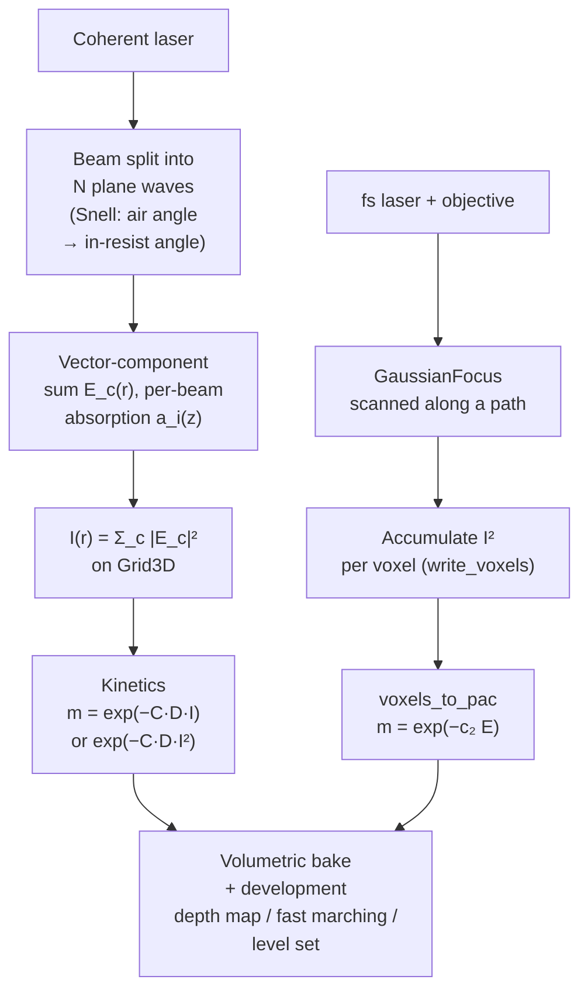

# Interference & two-photon

**Status:** ✅ Implemented (🔶 absorption, interfaces, two-photon focus) — analytic vector N-beam superposition; scalar absorption, no interface Fresnel coefficients or vector focusing · [matrix](../capability-matrix.md#deep-layer-and-non-projection-processes)

<p class="huv-lead">Interference lithography superposes a few coherent plane waves so their stationary lattice exposes a whole periodic structure in one shot; two-photon writing scans a femtosecond focus whose I² absorption confines a voxel below the diffraction limit. Both give volumetric latent images, so <code>interference.rs</code> evaluates fields on a <code>Grid3D</code> and emits PAC volumes for the z-resolved bake and development tiers.</p>

<div class="huv-glance" markdown>

| Property | Value |
|---|---|
| Computes | N polarized plane waves on a 3-D grid; one- and two-photon PAC; fill fraction; voxel writer |
| Does not | interface Fresnel transmission, substrate reflection, vector focusing, polymerization dynamics |
| Default scene | four-beam umbrella, 355 nm in n = 1.67, 40° air-side, 2 µm cube |
| Grade | ✅ Implemented (🔶 absorption, interfaces, two-photon focus) |
| Compare with | [Talbot lithography](talbot.md) · [Alternatives to projection](../future/alternative-patterning.md) |

</div>

<div class="huv-physics" markdown>

<!-- interference-beam-geometry -> processes/interference-volumetric.md -->
<figure markdown="span">


<figcaption><strong>Mechanism.</strong> Each beam is an infinite plane wave polarized perpendicular to its k-vector; two beams at ±θ write a 1-D grating whose period λ/(2·sin θ_air) survives refraction because the transverse wavevector is conserved across the interface, three beams at azimuths 0°, 120° and 240° write a hexagonal lattice, and a central beam plus a three-beam umbrella writes a 3-D lattice. Air-side half-angles 30°, 30° and 60° into n = 1.6, the engine figure's values. <em>Schematic, not to scale.</em></figcaption>
</figure>

<!-- interference-lattice -> processes/interference-volumetric.md -->
<figure markdown="span">


<figcaption><strong>Lattices written by interfering plane waves.</strong> Coherent 200 nm beams recorded in a resist of index 1.6 as a Dill latent image (exposed fraction shown): two beams write lines and three a hexagonal lattice (30° air-side half-angle, top slice); four beams in an umbrella (60°) write a 3-D lattice, here cut in x–z. <em>Model: multi-beam interference ✅ (🔶 per-beam scalar absorption; single-exposure Dill kinetics).</em></figcaption>
</figure>

<!-- huv-table: stack -->
| What is modeled | Grade | Dominant approximation | Details |
|---|---|---|---|
| Multi-beam interference / two-photon | ✅ Implemented (🔶 absorption, interfaces, focus) | ideal infinite plane waves; scalar per-beam decay | [The field](#the-field-and-its-period) |
| Post-exposure bake (anisotropic Gaussian) | ✅ Implemented | constant lateral D (optional on these volumes) | [Volumetric exposure](volumetric-exposure.md#post-exposure-bake) |
| 3D development (fast marching) | ✅ Implemented | static rate field | [Volumetric exposure](volumetric-exposure.md#development-tier-2-fast-marching) |
| Two-grating EUV interference lithography | 🔶 Simplified | ideal TE beams from thin-mask ±m orders | [Talbot](talbot.md#two-grating-euv-interference) |

**Same thing elsewhere:** Python `huv.simulate_interference(...)` · CLI `deep --config examples/interference.toml` · TOML `[deep] preset = "four_beam_umbrella"` · GUI volume viewer · physics → [volumetric exposure](volumetric-exposure.md)

</div>

## How it works



### The field and its period

Each beam is an ideal infinite plane wave with real unit polarization $\hat\varepsilon_i \perp \hat{\mathbf{k}}_i$. The field is summed per Cartesian component $c \in \lbrace x,y,z\rbrace$ — so polarization-mismatch contrast loss between non-coplanar beams *is* captured:

```math
E_c(\mathbf{r}) = \sum_i A_i\, a_i(z)\, \hat\varepsilon_{i,c}\, \exp\!\Big(i\big(\tfrac{2\pi n}{\lambda_{vac}}\, \hat{\mathbf{k}}_i \cdot \mathbf{r} + \phi_i\big)\Big), \qquad I(\mathbf{r}) = \sum_c |E_c(\mathbf{r})|^2,
```

with per-beam amplitude decay along each beam's own slanted path, $a_i(z) = e^{-\alpha z / (2\hat k_{z,i})}$ (intensity $e^{-\alpha z/\hat k_{z,i}}$; skipped for $\hat k_{z,i} \le 0$; z runs downward into the resist).

**Two-beam period is refraction-invariant.** The presets take the *air-side* half-angle $\theta_{air}$ and refract it into the resist via Snell's law, $n \sin\theta_{med} = \sin\theta_{air}$. The fringe period is set by the transverse wavevector inside the medium:

```math
\Lambda = \frac{\lambda_{vac}/n}{2\sin\theta_{med}} = \frac{\lambda_{vac}}{2\,n\sin\theta_{med}} = \frac{\lambda_{vac}}{2\sin\theta_{air}},
```

i.e. refraction bends the beams toward normal exactly as much as the in-medium wavelength shrinks, so the resist index drops out — the printed pitch depends only on the air-side geometry (the first panel of the mechanism schematic dimensions the conserved transverse wavevector). The *depth* structure of 3-D lattices does depend on $n$.

### Exposure kinetics

Exposure kinetics map intensity to normalized PAC ($m = 1$ unexposed, $m \to 0$ consumed):

```math
m = e^{-C\,D\,I} \ \text{(one-photon)}, \qquad m = e^{-C\,D\,I^2} \ \text{(two-photon)},
```

the quadratic dependence being what confines two-photon polymerization below the diffraction limit. `iso_surface_fill_fraction(pac, threshold)` — the fraction of voxels with $m <$ threshold — is the developed/written fill fraction of the lattice, the knob photonic-crystal design cares about; panel (a) of the figure below sweeps it against the dose scale for both kinetics.

### The two-photon voxel

The serial writer models the focus as a Gaussian beam,

```math
z_R = \frac{\pi w_0^2\, n}{\lambda_{vac}}, \qquad w(z) = w_0\sqrt{1 + (z/z_R)^2}, \qquad I(r,z) = \Big(\frac{w_0}{w(z)}\Big)^2 e^{-2r^2/w(z)^2},
```

accumulating $\propto I^2$ into every voxel for each point of the scan path. **The focus is scalar and paraxial — no high-NA vector focusing — and the voxel writer (`write_voxels`) is Rust-only.**

<!-- interference-fill-voxel -> processes/interference-volumetric.md -->
<figure markdown="span">


<figcaption><strong>Dose sets the fill; I² kinetics shrink the voxel.</strong> (a) Iso-surface fill fraction (m &lt; 0.5) of the four-beam umbrella lattice against the dose scale for one-photon and two-photon kinetics, each point a <code>simulate_interference</code> run (355 nm in n = 1.67, 40° air-side); (b) the scalar Gaussian focus I² for w₀ = 200 nm at 800 nm in n = 1.5 with its w(z) envelope; (c) on-axis I and I² in units of the Rayleigh length, the I² voxel shorter by √(√2 − 1). Panels (b) and (c) are closed-form Gaussian-beam formulas, no high-NA vector focusing, and the voxel writer itself is Rust-only. <em>Model: multi-beam interference ✅ (🔶 two-photon kinetics, per-beam scalar absorption).</em></figcaption>
</figure>

## Process regime

| Parameter | Typical value | Notes / citation |
|---|---|---|
| Resists | SU-8, thick negative epoxies (interference); acrylate/IP-series photopolymers (two-photon) | [1, 2] |
| Thickness | 0.5–100 µm films; mm-scale two-photon volumes | [1, 2] |
| Wavelengths | 325–532 nm CW/pulsed (interference); 780–800 nm fs (two-photon) | [1, 3] |
| Period | $\Lambda = \lambda/(2\sin\theta_{air})$, down to ~λ/2 | [4] |
| Two-photon voxel | ~100–200 nm lateral, elongated ~3× axially | [3] |
| Dose control | Fill fraction tuned by dose/threshold — sets photonic-crystal band structure | [1] |
| Post-process | Develop unexposed regions (negative tone); optional inversion (Si double templating) | [1] |

## What the code provides

All in [`crates/highuvlith-core/src/interference.rs`](../../crates/highuvlith-core/src/interference.rs):

- **`PlaneWave`** — `k_hat` (normalized; error on zero vector), `amplitude`, `phase_rad`, `polarization` (must be unit and orthogonal to `k_hat` within 1e-6, else rejected).
- **`InterferenceSetup`** — beams + `wavelength_vacuum_nm` + `medium_index` + `absorption_per_nm`; `intensity(&mut Grid3D)` evaluates $I(\mathbf{r})$ at every voxel. Presets (all take the **air-side** half-angle and apply Snell internally, absorption defaulting to 0): `two_beam` (two TE beams at $\pm\theta_{med}$ in the xz-plane: period $\lambda/(2\sin\theta_{air})$), `three_beam_hex` (azimuths 0°/120°/240°, azimuthal TE polarization: C₃-symmetric hexagonal lattice), `four_beam_umbrella` (central $+z$ beam, $\hat x$-polarized, plus the umbrella: FCC-like 3-D lattice [1]).
- **`ExposureKinetics` / `expose`** — Dill-style one- or two-photon PAC map on the intensity volume.
- **`GaussianFocus` / `write_voxels` / `voxels_to_pac`** — scanned two-photon voxel writer: per path point, every voxel accumulates `exposure_per_point * I(r, Δz)²`; then $m = e^{-c_2 E}$. Rust only.
- **`iso_surface_fill_fraction(pac, threshold)`**.
- Python: `huv.simulate_interference` (the three presets, returning a `VolumetricResult`; [`python/highuvlith/api.py`](../../python/highuvlith/api.py)).

The resulting PAC `Grid3D` feeds the volumetric tiers: an optional bake (`apply_peb` with `PebModel::Gaussian` or `PebModel::ChemicallyAmplified`), then `develop_depth_map`, `develop_fast_marching[_with]` or `develop_level_set` ([volumetric-exposure.md](./volumetric-exposure.md)). The lattice is not periodic over an arbitrary grid span, so develop with `lateral_boundary: Reflecting` (the `develop_fast_marching` default) unless the grid covers a whole number of lattice periods. **Two-grating EUV interference**: [`talbot::TwoGratingInterference::to_interference_setup`](../../crates/highuvlith-core/src/talbot.rs) returns an `InterferenceSetup` of two TE beams at $\pm\theta_{med}$ with $\sin\theta = m\lambda/p$ and amplitudes from the gratings' m-th-order efficiencies, so the fringe period $p/(2m)$ of transmission-grating EUV-IL is evaluated with this module's `intensity` and `expose` ([talbot.md](./talbot.md#two-grating-euv-interference)).

## Model coverage

| Field | Unit | Consumed by | Status |
|---|---|---|---|
| `PlaneWave.k_hat` | unit vector | phase term + absorption path length | live |
| `PlaneWave.amplitude` | — | field sum | live |
| `PlaneWave.phase_rad` | rad | carrier phase (lattice offset control) | live |
| `PlaneWave.polarization` | unit vector | per-component projection $\hat\varepsilon_{i,c}$ | live |
| `InterferenceSetup.wavelength_vacuum_nm` | nm | spatial frequency $2\pi n/\lambda$ | live |
| `InterferenceSetup.medium_index` | — | spatial frequency $2\pi n/\lambda$ in `intensity` (and Snell at preset construction) | live |
| `InterferenceSetup.absorption_per_nm` | 1/nm | per-beam decay $a_i(z)$ | live |
| `GaussianFocus.waist_nm` / `.wavelength_nm` / `.medium_index` | nm / nm / — | $w(z)$, $z_R$, `intensity_at` | live |
| Interface Fresnel coefficients, substrate reflection | — | — | planned |
| Polymerization threshold/diffusion kinetics | — | — | planned |

## Usage

### Python

The three presets through `highuvlith.simulate_interference`; the returned `VolumetricResult` feeds the bake and development functions of [volumetric-exposure.md](./volumetric-exposure.md#usage). The example prints the written fraction of the umbrella lattice and the earliest fast-marching arrival:

<!-- verify-example -->
```python
import highuvlith as huv

pac = huv.simulate_interference(
    "four_beam_umbrella", wavelength_nm=355.0, n_medium=1.67, half_angle_deg=40.0,
    nx=64, ny=64, nz=32, x_span_nm=2000.0, y_span_nm=2000.0, z_span_nm=2000.0,
    dose_scale=1.0, dill_c=0.5, two_photon=False,
)
fill = (pac.values < 0.5).mean()               # written fraction at threshold 0.5
times = huv.develop_fast_marching(pac, huv.ResistConfig(model="threshold"),
                                  pixel_xy_nm=2000.0 / 64, pixel_z_nm=2000.0 / 32)
print(f"written fraction {fill:.3f} at m < 0.5; earliest developer arrival {times.values.min():.3f} s")
```

??? success "Output"

    ```text
    written fraction 0.892 at m < 0.5; earliest developer arrival 0.031 s
    ```

### CLI and TOML

`highuvlith deep` with `[deep] mode = "interference"` ([`examples/interference.toml`](../../examples/interference.toml), [configuration](../configuration.md#deep)):

| Keys | Meaning |
|---|---|
| `preset` = `two_beam` \| `three_beam_hex` \| `four_beam_umbrella` | the geometry |
| `half_angle_deg`, `n_medium` | air-side half-angle, resist index (Snell applied) |
| `two_photon`, `dose_scale`, `dill_c`, `fill_threshold` | kinetics, dose and the fill threshold |
| `nz`, `z_span_nm` | the vertical grid; the wavelength comes from `[source]`, the lateral grid from `[grid]` |

It reports the fringe period $\lambda/(2\sin\theta_{air})$ (the pairwise reference scale for the hex/umbrella presets), the PAC range and the fill fraction; `--output foo.png` writes the mid-depth PAC slice.

<details markdown="1">
<summary>Rust</summary>

The full API, including the two-photon voxel writer and custom `PlaneWave` sets, which have no Python or CLI surface:

```rust
use highuvlith_core::interference::{
    expose, iso_surface_fill_fraction, ExposureKinetics, InterferenceSetup,
};
use highuvlith_core::types::Grid3D;

// Campbell-style FCC-like lattice: 355 nm in SU-8 (n = 1.67), 40 deg air-side.
let mut setup = InterferenceSetup::four_beam_umbrella(355.0, 1.67, 40.0)?;
setup.absorption_per_nm = 1e-5;

let mut grid = Grid3D::<f64>::new(
    128, 128, 64,
    (0.0, 2_000.0), (0.0, 2_000.0), (0.0, 5_000.0), // nm
)?;
setup.intensity(&mut grid);

let pac = expose(&grid, 1.0, 0.5, ExposureKinetics::OnePhoton);
let fill = iso_surface_fill_fraction(&pac, 0.5);
// `pac` feeds volumetric::develop_fast_marching / develop_level_set for the 3D etch front.
```

```rust
use highuvlith_core::interference::{voxels_to_pac, write_voxels, GaussianFocus};

// Two-photon writer: 800 nm fs focus, 200 nm waist, scanning a line of voxels.
let focus = GaussianFocus { waist_nm: 200.0, wavelength_nm: 800.0, medium_index: 1.5 };
let path: Vec<(f64, f64, f64)> = (0..10).map(|i| (i as f64 * 300.0, 0.0, 0.0)).collect();
write_voxels(&mut grid, &focus, &path, 10.0); // accumulates I^2
let pac = voxels_to_pac(&grid, 5.0);
```

</details>

## Limits

- **Ideal plane waves.** No beam envelope, pointing or phase jitter; every beam fills the whole grid.
- **Interfaces.** No Fresnel transmission coefficients at the air/resist interface and no substrate reflection (the real back-reflected wave adds an extra standing-wave term).
- **Absorption** is a scalar per-beam decay, not a self-consistent absorbing-medium solution.
- **Two-photon focus** is scalar and paraxial: the simulated voxel lacks the polarization-dependent asymmetry of real 1.4-NA writing; `write_voxels` is Rust-only.
- **Kinetics** are dose-integrated Dill forms with no polymerization threshold dynamics, diffusion or oxygen inhibition.

<details markdown="1">
<summary>Behaviour changes</summary>

- No behaviour change is recorded for this module in the capability matrix audit log; its closed forms (period, visibility, absorption decay, the Gaussian-beam voxel) are pinned by the tests below.

</details>

<details markdown="1">
<summary>Validation — 16 tests</summary>

`#[test]` functions in [`interference.rs`](../../crates/highuvlith-core/src/interference.rs):

| Test | What it pins | Tolerance |
|---|---|---|
| `test_two_beam_period_and_index_invariance` | fringe period = $\lambda/(2\sin\theta_{air}) = 200$ nm; identical for $n = 1.0$ and $n = 1.7$ | one pixel; 1e-9 relative |
| `test_two_beam_visibility_unity` | equal-amplitude TE beams give visibility 1 with a near-zero null | 1e-6 |
| `test_two_beam_absorption_decays_exponentially` | x-averaged intensity ratio = $e^{-\alpha \Delta z / \cos\theta}$ | exact |
| `test_three_beam_hex_c3_symmetry` | equal pairwise fringe wavevector magnitudes | — |
| `test_four_beam_umbrella_shape`, `test_intensity_non_negative` | lattice shape; positivity | — |
| `test_gaussian_focus_waist_and_two_photon_falloff` | $w(z_R) = w_0\sqrt{2}$, on-axis $I(z_R) = 1/2$, two-photon exposure falls 4× at $z_R$ | — |
| `test_write_voxels_peak_at_focus_and_fill_fraction` | exposure peaks at the focus voxel; fill fraction small and positive | — |
| `test_expose_two_photon_sharper_than_one_photon` | $m$ matches $e^{-CDI}$ / $e^{-CDI^2}$ | — |
| `test_planewave_zero_k_rejected`, `test_planewave_non_orthogonal_polarization_rejected`, `test_planewave_non_unit_polarization_rejected`, `test_planewave_normalizes_non_unit_k`, `test_invalid_preset_parameters` | constructor guards | — |
| Python `test_interference_two_beam_period`, `test_interference_two_photon_less_consumed`; CLI `test_parse_interference_config` | FFT-measured period 200 nm; two-photon consumes less; config parsing | — |

</details>

## References

1. M. Campbell, D. N. Sharp, M. T. Harrison, R. G. Denning, A. J. Turberfield, "Fabrication of photonic crystals for the visible spectrum by holographic lithography," *Nature* **404**, 53–56 (2000).
2. S. Maruo, J. T. Fourkas, "Recent progress in multiphoton microfabrication," *Laser Photonics Rev.* **2**, 100–111 (2008).
3. S. Kawata, H.-B. Sun, T. Tanaka, K. Takada, "Finer features for functional microdevices," *Nature* **412**, 697–698 (2001).
4. S. R. J. Brueck, "Optical and interferometric lithography — nanotechnology enablers," *Proc. IEEE* **93**, 1704–1721 (2005).
5. B. E. A. Saleh, M. C. Teich, *Fundamentals of Photonics*, Wiley — Gaussian-beam formulas ($w(z)$, $z_R$).

**Part of Processes · see also:** [index](index.md) · [Talbot lithography](talbot.md) · [Volumetric exposure](volumetric-exposure.md) · [LIGA deep X-ray](liga-deep-xray.md) · [Alternatives to projection](../future/alternative-patterning.md) · [GUI volume viewer](../gui.md#views) · [configuration](../configuration.md#deep)
