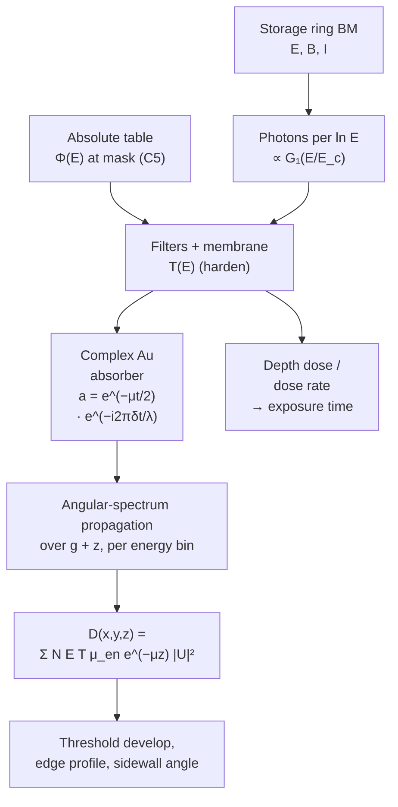

# LIGA deep X-ray

**Status:** ✅ Implemented (🔶 thin-screen absorber) — spectral depth dose, exposure time and Fresnel shadow printing; no electron transport, divergence or beamline mirrors · [matrix](../capability-matrix.md#deep-layer-and-non-projection-processes)

<p class="huv-lead">LIGA exposes 10–1000 µm of PMMA through a 1:1 proximity mask with a synchrotron white beam; hard X-rays barely diffract or scatter, so aspect ratios beyond 100:1 are routine. This is shadow printing, not projection: <code>deep_xray.rs</code> computes the hardened spectrum, the depth dose, the absolute exposure time and the Fresnel-diffracted dose at every edge, and stops at the developed resist.</p>

<div class="huv-glance" markdown>

| Property | Value |
|---|---|
| Computes | spectrum, depth dose (NIST μ, μ_en), exposure time, Fresnel shadow over gap + depth |
| Does not | electron or fluorescence transport; divergence; beamline mirrors; electroforming |
| Default scene | 500 µm PMMA, 20 µm Au on 2 µm Ti, 100 µm gap, 2.5 GeV bending magnet |
| Grade | ✅ Implemented (🔶 thin-screen absorber) |
| Compare with | [Synchrotron](../sources/synchrotron.md) · [X-ray tube](../sources/xray-tube.md) · [Betatron](../sources/betatron.md) |

</div>

<div class="huv-physics" markdown>

<!-- liga-geometry -> processes/liga-deep-xray.md -->
<figure markdown="span">


<figcaption><strong>Mechanism.</strong> A bending-magnet white beam passes a Be window and filters that harden its spectrum, then a Ti-membrane mask with Au absorbers casts a 1:1 shadow across a gap g into 10–1000 µm of PMMA while mask and substrate scan through the fan; there is no optic, and the dose at depth z is set by the hardened spectrum at d = g + z. Simulation ends at the developed resist: electroforming and molding are not modelled. <em>Schematic, not to scale.</em></figcaption>
</figure>

<!-- liga-depth-dose -> processes/liga-deep-xray.md -->
<figure markdown="span">


<figcaption><strong>A harder beam flattens the depth dose.</strong> 500 µm PMMA exposed through 20 µm Au on 2 µm Ti, every curve scaled so the bottom receives 3 kJ/cm³: a filtered beam keeps the top below the 20 kJ/cm³ damage ceiling at the price of exposure time, which is absolute (bending-magnet flux at 200 mA, 15 m, 50 mm scan). <em>Model: LIGA / deep X-ray depth dose and exposure time ✅ (NIST μ and μ<sub>en</sub>, bending-magnet photons per ln E; scan-averaged collimated beam, no beamline mirrors).</em></figcaption>
</figure>

<!-- huv-table: stack -->
| What is modeled | Grade | Dominant approximation | Details |
|---|---|---|---|
| LIGA / deep X-ray depth dose and exposure time | ✅ Implemented | scan-averaged collimated beam, no mirrors | [Depth dose](#depth-dose-and-exposure-time) |
| LIGA proximity diffraction | ✅ Implemented (🔶 thin-screen absorber, no electron transport) | scalar angular spectrum per energy bin | [Proximity diffraction](#proximity-diffraction) |
| Hard X-ray tube (W / Mo / Cu / Rh, 5–300 kV) | 🔶 Simplified | Kramers continuum, empirical line yields | [Spectrum](#spectrum-and-absolute-flux) |
| Laser-wakefield betatron X-rays | 🧪 Theoretical | relative synchrotron-like spectrum only | [Betatron](../sources/betatron.md) |

**Same thing elsewhere:** Python `api.liga_edge_profile(dx_nm=10.0)` · CLI `deep --config examples/liga.toml` · TOML `[[deep.filters]]` · GUI LIGA depth dose · physics → [pipeline](../pipeline.md)

</div>

## How it works



### Spectrum and absolute flux

The bending-magnet spectrum is characterized by its critical energy $E_c = 0.665 E^2[\mathrm{GeV}] B[\mathrm{T}]$ keV. The vertically integrated photon flux per unit horizontal angle is the standard synchrotron-radiation result [4]

```math
\frac{\mathrm{d}\dot N}{\mathrm{d}\theta} = 2.457\times10^{13}\,E[\mathrm{GeV}]\,I[\mathrm{A}]\,G_1(y)\ \ \mathrm{photons\,s^{-1}\,mrad^{-1}\,(0.1\%\,BW)^{-1}},\qquad G_1(y) = y\int_y^\infty K_{5/3}(x)\,\mathrm{d}x,\quad y = E/E_c ,
```

with the constant rebuilt from CODATA values (`bm_flux_constant`); the computation itself calls the source-model function `physics::bm_flux_per_mrad` (the same one `SynchrotronSource::bm_flux_per_mrad` uses on the [synchrotron page](../sources/synchrotron.md)). Because 0.1 % bandwidth is a fixed interval of $\ln E$, photons per **log-spaced** energy bin are proportional to $G_1$ — the spectrum is sampled on bins equally spaced in $\ln E$ over $[0.1, 8] E_c$. A scanner sweeps mask and substrate uniformly through the fan over a height $H$; at source distance $L$ one mrad covers $L$[m] mm, so the scan-averaged flux density at the mask is

```math
\Phi(E) = \frac{\mathrm{d}\dot N/(\mathrm{d}\theta\,\mathrm{d}E)}{L\,H}\ \ \mathrm{photons\,s^{-1}\,mm^{-2}\,keV^{-1}} .
```

Any other source can supply $\Phi(E)$ directly as an `(E_keV, value)` table (contract C5, `XraySpectrum::from_flux_density`): the [X-ray tube](../sources/xray-tube.md)'s `spectral_flux_density()` is absolute, the [betatron](../sources/betatron.md)'s synchrotron-like spectrum is relative. The tube spectrum the module receives is the one below.

<!-- sources-xray-tube-spectra -> processes/liga-deep-xray.md -->
<figure markdown="span">


<figcaption><strong>What a laboratory tube offers LIGA.</strong> (a) <code>spectral_flux_density(100 mm)</code> of the four anode presets: Kramers bremsstrahlung ending at each Duane–Hunt limit, K lines where the tube voltage exceeds the K edge (Mo, Cu, Rh) and only L lines for tungsten at 60 kV (K edge 69.5 keV), the soft end cut by the 250 µm Be window. (b) The window transmission, obtained from the engine as the filtered over the unfiltered spectrum. <em>Model: Hard X-ray tube (W / Mo / Cu / Rh, 5–300 kV) 🔶 (✅ line energies, edges, Duane–Hunt limit and Be filtration; the Kramers continuum, line yields and absolute flux are simplified: no anode self-absorption, heel effect or backscatter).</em></figcaption>
</figure>

### Depth dose and exposure time

Every layer the beam crosses transmits $e^{-\mu(E)t}$ with the total attenuation $\mu$; the energy deposited locally uses the **energy-absorption** coefficient $\mu_{en}$ (NIST tables, [materials](../materials.md)). With $N_j$ photons s⁻¹ mm⁻² in bin $j$:

```math
\dot D(z) = \sum_j N_j\,E_j\,T_{\mathrm{beam}}(E_j)\,\mu_{en,j}\,e^{-\mu_j z},\qquad T_{\mathrm{beam}} = e^{-\mu_{\mathrm{mem}}t_{\mathrm{mem}}}\prod_f e^{-\mu_f t_f},
```

in W mm⁻³ = kJ cm⁻³ s⁻¹, and the exposure time to reach the clearing dose is $t = D_{\mathrm{target}}/\dot D(T)$. Relative spectra use the same expression with normalized weights and are scaled so $D(T) = D_{\mathrm{target}}$. Because soft photons are absorbed preferentially near the surface, the local decay rate $-\mathrm{d}\ln D/\mathrm{d}z$ **falls with depth** (spectral hardening); upstream filters pre-harden the beam to reduce the top/bottom dose ratio. The $\mu$/$\mu_{en}$ distinction matters: in PMMA $\mu_{en}/\mu$ = 0.94 at 8 keV but 0.58 at 20 keV (Compton photons leave).

<!-- liga-hardening -> processes/liga-deep-xray.md -->
<figure markdown="span">


<figcaption><strong>Harder beam, flatter dose, longer exposure.</strong> The soft photons are absorbed first, so the mean photon energy rises with depth and with filtering; the filter buys a top dose under the ceiling at the price of exposure time (every curve scaled so the bottom receives 3 kJ/cm³; times absolute from the bending-magnet flux at 200 mA, 15 m, 50 mm scan). <em>Model: LIGA depth dose and exposure time ✅ (NIST μ/μ<sub>en</sub>, scan-averaged collimated beam, no beamline mirrors).</em></figcaption>
</figure>

The worked numbers the tests pin, for the default scene (2.5 GeV / 1.5 T / 200 mA, $L$ = 15 m, $H$ = 50 mm, 2 µm Ti, 500 µm PMMA, 3 kJ/cm³ bottom dose) — the two curves of the figure above:

| Filter | Top/bottom dose ratio | Top dose | Exposure | Mean photon energy top → bottom |
|---|---|---|---|---|
| none | **20.8** (top 62 kJ/cm³: damaged) | 62 kJ/cm³ | **605 s** | 6.0 → 8.7 keV |
| 20 µm Al | **2.86** | 8.6 kJ/cm³ | **996 s** (55 mA·h) | rises further with filtering |

### Proximity diffraction

Per energy bin the mask is a thin complex screen, $t_j(x,y) = m + (1-m) a_j$ with the open fraction $m$ and the Au absorber transmission

```math
a_j = e^{-\mu_{\mathrm{Au}} t/2}\,e^{-i\,2\pi\delta_{\mathrm{Au}} t/\lambda_j},
```

$\mu$ from NIST, $\delta$ from the Henke/CXRO $f_1$ tables ($\delta = r_e\lambda^2 n_a f_1/2\pi$; $f_1$ held at its 30 keV value above 30 keV). The field propagates by the exact scalar angular spectrum (dropping the common phase $e^{ikd}$)

```math
U_j(x,y;d) = \mathcal F^{-1}\!\left[\mathcal F[t_j]\;e^{\,i2\pi d\left(\sqrt{\lambda_j^{-2}-f^2}-\lambda_j^{-1}\right)}\right] = a_j + (1-a_j)\,\mathcal F^{-1}\!\left[\mathcal F[m]\,H_j\right],
```

and — because the resist index differs from 1 by only ~10⁻⁶ — it keeps diffracting inside the resist: depth $z$ sees $d = g + z$. The dose is $D(x,y,z) = s\sum_j W_j(z) |U_j(x,y;g+z)|^2$ with $W_j = N_jE_jT_j\mu_{en,j}e^{-\mu_j z}$. For a single straight edge the paraxial solution is analytic,

```math
U = a + (1-a)\,\tfrac{1-i}{2}\Big[\big(\tfrac12 + C(v)\big) + i\big(\tfrac12 + S(v)\big)\Big],\qquad v = x\sqrt{2/(\lambda d)},
```

with the Fresnel integrals $C$, $S$; for an opaque edge $|U|^2 = 1/4$ at the geometric edge and the first maximum is 1.3704 at $v = 1.2172$ [5]. The 10 %–90 % rise is $0.829\sqrt{\lambda d}$. The legacy **Gaussian** option blurs the partial-absorber intensity $T_{\mathrm{abs}} + (1-T_{\mathrm{abs}})m$ with $\sigma = \tfrac12\sqrt{\lambda g}$ at the gap only (10–90 % width $1.28\sqrt{\lambda g}$, ~1.5× wider, no overshoot, no growth with depth). An optional Grün-range Gaussian, $R_G[\mu\mathrm{m}] = 0.046 E^{1.75}[\mathrm{keV}]/\rho$ [6], stands in for photoelectron transport (off by default; a deliberately crude upper bound). PMMA develops with **no post-exposure bake** at the empirical rate $R = R_0(D/D_0)^q$ [3].

<!-- liga-fresnel-edge -> processes/liga-deep-xray.md -->
<figure markdown="span">


<figcaption><strong>Proximity diffraction at a LIGA absorber edge.</strong> (a) Monochromatic 8 keV straight edge, 100 µm gap: the default Fresnel (angular-spectrum) model gives the knife-edge pattern — 0.25 at the geometric edge, a 1.37 maximum and ringing — while the legacy <code>gaussian</code> option smooths the step with σ = ½√(λg); both curves are simulator output. (b) Polychromatic bending-magnet beam, no filter: absorbed dose across the edge at five depths and the developed edge at a 2.5 kJ/cm³ threshold. <em>Model: LIGA proximity diffraction ✅ (🔶 thin-screen absorber; no photo- or secondary-electron transport).</em></figcaption>
</figure>

## Process regime

| Parameter | Typical value | Notes / citation |
|---|---|---|
| Resist | PMMA (positive, scission); SU-8 (negative, crosslinking) | [2, 3] |
| Thickness | 10–1000 µm (PMMA); up to mm-scale SU-8 | [2, 3] |
| Aspect ratio | > 100:1 (e.g. 500 µm / 5 µm) | [2] |
| Bottom (clearing) dose, PMMA | 2–4 kJ/cm³ | GG developer window [3, 7] |
| Damage ceiling (top dose) | ~20 kJ/cm³ (foaming, T-topping) | [3, 7] |
| Spectrum | Bending-magnet white beam, $E_c$ = 2–10 keV | e.g. 2.5 GeV / 1.5 T → $E_c$ = 6.23 keV |
| Real beamlines (KIT/KARA) | 2.2–3.3 keV (X-ray mask making), 2.5–12.4 keV (deep XRL), 2.2–20 keV (ultra-deep) | [10] |
| Mask absorber | 10–25 µm electroplated Au | [2, 7] |
| Mask membrane | 1–3 µm Ti or 100–500 µm Be | [7] |
| Proximity gap | ~10–500 µm; semiconductor proximity XRL used "tens of µm, shrinking with feature size" (10–15 µm for 100 nm features, 40–50 µm in IBM's early stepper) [9] | Fresnel scale $\sqrt{\lambda g}$ ≈ 0.1–0.4 µm at 100 µm |
| Downstream | Ni/NiFe electroforming, injection molding | not simulated |

LIGA was developed at Kernforschungszentrum Karlsruhe in the early 1980s to mass-produce separation nozzles for uranium enrichment — first published by Becker et al. in 1982 [1] — and became the canonical route to metal and polymer microstructures with extreme aspect ratios [2]; KIT's Institute of Microstructure Technology runs three LIGA beamlines at the KARA storage ring and makes structures from a few µm to several mm tall [10]. Sidewall runout of < 0.1 µm over 500 µm of depth is routine [2, 3].

## What the code provides

Everything lives in [`crates/highuvlith-core/src/deep_xray.rs`](../../crates/highuvlith-core/src/deep_xray.rs); attenuation data in [`materials/attenuation.rs`](../../crates/highuvlith-core/src/materials/attenuation.rs) — NIST Hubbell–Seltzer μ/ρ and μ_en/ρ (1 keV–20 MeV, edges resolved) plus Henke photoabsorption below 1 keV [8].

- **`XraySpectrum`** — `Tabulated` (discrete lines), `BendingMagnet {critical_energy_kev}` (relative), `FluxDensity` (absolute table with Voronoi cells, `from_flux_density`), `BendingMagnetBeamline` (absolute, `from_synchrotron_beamline`); `sample()` normalized weights, `sample_absolute()` photons s⁻¹ mm⁻².
- **`BendingMagnetBeamline`** — ring energy, field, current, source distance, horizontal acceptance, vertical scan; `flux_density(E)`, `power_per_mrad_w()`, `incident_power_w()`, `field_width_mm()`, `warnings()`.
- **`BeamFilter`** — a `Compound` + thickness; `transmission(E)` and the complex `amplitude_transmission(E)`.
- **`DeepXrayConfig`** — spectrum, filters, absorber, membrane, resist, geometry, dose targets, `energy_bins`, `proximity_model` (`Fresnel` default / `Gaussian`), optional `energy_range_kev`; `pmma_default()`.
- **`depth_dose` / `expose_depth`** → **`LigaExposure`** — 128-sample profile scaled to the target, `exposure_time_estimate`, top/bottom dose rates, `resist_power_density_w_mm2`, `exposure_charge_ma_h`, dose-weighted mean energies, `window_power_fraction` (a warning below 0.99) and warnings.
- **`shadow_image` / `expose_volumetric`** — surface-dose-normalized shadow and the volumetric dose `Grid3D` in kJ/cm³ (Fresnel per bin and per slice, periodic over the field; Gaussian: legacy gap-only blur).
- **`fresnel_sampling`** — dose-weighted $\sqrt{\lambda g}$ at the top and $\sqrt{\lambda(g+T)}$ at the bottom, a `resolved` flag, a wrap-around check, `require_resolved()`; an unresolved grid converges to the pixel-averaged geometric shadow.
- **`fresnel_edge_profile_1d`** → **`EdgeProfile`** (`edge_positions_nm`, `sidewall_angle_deg`, `max_gradient_kj_cm3_nm`); **`fresnel_profile_1d`** (periodic 1-D masks); **`fresnel_integrals`, `knife_edge_field`, `knife_edge_intensity`** (the analytic reference).
- **Development and metrics** — `develop_depth`, `pmma_development_rate`, `dose_ratio`, `max_aspect_ratio`, `sidewall_dose_gradient`.
- Python: `huv.simulate_liga`, `huv.api.liga_edge_profile`.

## Model coverage

| Field | Unit | Consumed by | Status |
|---|---|---|---|
| `DeepXrayConfig.spectrum` | keV bins | `spectral_bins` → every dose path | live |
| `DeepXrayConfig.filters` | µm layers | beam transmission (hardening) | live |
| `DeepXrayConfig.absorber` | µm Au | complex transmission $a_j$ (Fresnel), $T_{\mathrm{abs}}$ (Gaussian) | live |
| `DeepXrayConfig.membrane` | µm Ti/Be | beam transmission | live |
| `DeepXrayConfig.resist` | `Compound` | $\mu$ (attenuation) and $\mu_{en}$ (deposition) | live |
| `DeepXrayConfig.resist_thickness_um` | µm | depth grid, propagation distance, aspect ratio | live |
| `DeepXrayConfig.proximity_gap_um` | µm | Fresnel distance $g+z$ / Gaussian σ | live |
| `DeepXrayConfig.target_bottom_dose_kj_cm3` | kJ/cm³ | dose scaling, exposure time | live |
| `DeepXrayConfig.damage_dose_kj_cm3` | kJ/cm³ | `exceeds_damage_ceiling` | live |
| `DeepXrayConfig.photoelectron_blur` | bool | Grün Gaussian (both models) | live |
| `DeepXrayConfig.energy_bins` | — | bending-magnet log bins (default 100; absorption edges make the bin sum first-order in the bin width — e.g. the betatron example's dose ratio is 4.589 at 100 bins, 4.559 at 1000, 4.566 from the 200-bin absolute table) | live |
| `DeepXrayConfig.proximity_model` | enum | lateral model selection | live |
| `DeepXrayConfig.energy_range_kev` | keV | sampling window override (clipping reported by `window_power_fraction`) | live |
| `BendingMagnetBeamline.*` | GeV, T, mA, m, mrad, mm | absolute flux, power, charge, warnings | live |
| `LigaExposure.exposure_time_estimate` | s | reported for absolute spectra | live |
| Multislice absorber, electron transport, mirrors, divergence | — | — | planned |

## Usage

### Python

<!-- verify-example -->
```python
import highuvlith as huv
from highuvlith import api

src = huv.SourceConfig.synchrotron_liga_bending_magnet()   # 2.5 GeV, 1.5 T, 200 mA
r = api.simulate_liga(source=src, source_distance_m=15.0, vertical_scan_mm=50.0,
                      filters=[("Al", 20.0)], grid_size=128, pixel_nm=200.0)
print(f"top/bottom {r.dose_ratio:.2f}, {r.exposure_time_s:.0f} s, {r.exposure_charge_ma_h:.1f} mA h")
print(r.warnings)  # here: the 200 nm pixel under-resolves the Fresnel scale

# Fine sidewall analysis at 10 nm sampling (exact straight-edge Fresnel solution)
p = api.liga_edge_profile(filters=[("Al", 20.0)], dx_nm=10.0)
print([round(x, 1) for x in p.edge_positions_nm(2.5)], f"{p.sidewall_angle_deg(2.5):.4f} deg")

# Absolute flux-density table at the mask (e.g. an X-ray tube; contract C5)
r2 = api.simulate_liga(flux_density=[(7.999, 2.5e14), (8.001, 2.5e14)],
                       resist_thickness_um=200.0, membrane_thickness_um=0.0)
```

???+ success "Output"

    ```text
    top/bottom 2.86, 996 s, 55.3 mA h
    ['pixel 200.0 nm under-resolves the Fresnel scale sqrt(lambda d) = 162.0 nm (dose-weighted, at the resist top): edge ringing and edge shape are not represented and the lateral dose tends to the pixel-averaged geometric shadow; use pixel <= 81.0 nm or fresnel_edge_profile_1d for sidewall analysis']
    [7.8, 42.4, 73.1, 104.2, 136.2] 0.0146 deg
    ```

### CLI and TOML

`[deep] mode = "liga"` ([`examples/liga.toml`](../../examples/liga.toml), [configuration](../configuration.md#deep)):

| Keys | Meaning |
|---|---|
| `diffraction`, `energy_bins`, `photoelectron_blur` | `fresnel` / `gaussian`; log-energy bins; the optional Grün Gaussian |
| `[[deep.filters]]`, `absorber`, `membrane` (+ thicknesses) | the hardening stack and the mask |
| dose targets | bottom (clearing) dose and damage ceiling, kJ/cm³ |
| `source_distance_m`, `vertical_scan_mm` (+ `horizontal_acceptance_mrad`) | makes an absolute `[source]` bending magnet |
| `flux_density = [[E, Φ], ...]` | an absolute table at the mask (contract C5) |
| `strict_sampling`, `edge_profile` (+ `edge_dx_nm`, `edge_half_width_nm`) | refuse an unresolved grid; the straight-edge tool |

```bash
highuvlith deep --config examples/liga.toml --output /tmp/liga.json
```

<details markdown="1">
<summary>Rust</summary>

```rust
use highuvlith_core::deep_xray::*;
use highuvlith_core::source_models::synchrotron::SynchrotronSource;

let spectrum = XraySpectrum::from_synchrotron_beamline(
    &SynchrotronSource::liga_bending_magnet(), 15.0, 5.0, 50.0).unwrap();
let config = DeepXrayConfig::pmma_default(spectrum);
let exposure = expose_depth(&config);            // exposure_time_estimate = Some(605.3 s)
let edge = fresnel_edge_profile_1d(&config, -2000.0, 2000.0, 10.0, &[0.0, 250.0, 500.0])?;
```

</details>

## Limits

- **Thin-screen absorber:** the 20 µm Au is a phase/amplitude screen; valid while its own Fresnel scale $\sqrt{\lambda t_{\mathrm{abs}}}$ (≈ 55 nm at 8 keV) is small against $\sqrt{\lambda g}$ (≈ 125 nm at 100 µm) — a ~10 % effect on the edge width is not captured (no multislice through the absorber).
- **Beam:** collimated, spatially coherent plane wave at normal incidence — no horizontal-fan runout, no source-size penumbra ($\sigma_s(g+z)/L$ is nm-scale for bending magnets), no beamline mirrors (emulate their high-energy cut-off with filters or a measured `FluxDensity` table).
- **Scan average:** uniform vertical scan taller than the beam (≈ L/γ); the vertical angular profile is not modelled (flagged when the scan is shorter than 2 L/γ).
- **Electrons and secondaries:** no photoelectron / Auger transport beyond the optional Grün Gaussian, no secondary electrons or fluorescence from the absorber, membrane or substrate (which blur the mask edge and dose the resist bottom [11]), no mask heating.
- **Resist:** no PEB (correct for PMMA); threshold development and a power-law rate only; the developed geometry can also be handed to the [volumetric depth map](volumetric-exposure.md#development-tier-1-threshold-depth-map).
- **Data:** $\mu_{en}$ of compounds by the mixture rule; $\delta$ above 30 keV from $f_1$(30 keV).

<details markdown="1">
<summary>Behaviour changes</summary>

**Corrections of 2026-09-30.** Three pre-existing errors shifted every LIGA number: (1) the bending-magnet spectrum weighted **equal-width** energy bins with $G_1$, which is the photon number per *relative* bandwidth — hard photons were over-weighted by a factor E (now: log-spaced bins with weight $G_1$, pinned by the closed-form moments $\int G_1 dy = 8\pi/(9\sqrt3)$, $\int G_1/y dy = 5\pi/3$, mean photon energy $8/(15\sqrt3)$ E_c); (2) the Au attenuation table was ~1.9× too transparent at 4–20 keV (the hand-transcribed table was replaced by the NIST Hubbell–Seltzer data); (3) the dose used μ instead of μ_en. The default 500 µm unfiltered stack went from a top/bottom ratio of ~7.4 (top ~22 kJ/cm³) to **20.8** (top 62 kJ/cm³). The attenuation data now reach 20 MeV, so tube and hard bending-magnet spectra are no longer clipped at 20 keV. Audit entry: the [capability matrix](../capability-matrix.md#audit-log) audit log.

</details>

<details markdown="1">
<summary>Validation — 40 tests</summary>

`#[test]` functions in [`deep_xray.rs`](../../crates/highuvlith-core/src/deep_xray.rs):

| Test | What it pins | Tolerance |
|---|---|---|
| `test_fresnel_integrals_fixture` | $C$, $S$ vs quadrature/tables | 1e-11 |
| `test_knife_edge_intensity_fixtures` | 0.25 at the edge, maximum 1.370443 at $v$ = 1.2172, minimum 0.778251 at 1.8725 | — |
| `test_knife_edge_field_matches_fft_propagation_including_phase` | FFT angular-spectrum propagation of a wide slit reproduces the complex analytic edge field (pins the absorber phase sign) | — |
| `test_edge_profile_opaque_monochromatic_matches_analytic`, `test_fresnel_edge_width_vs_gaussian_blur_scale`, `test_edge_blur_grows_with_depth_in_fresnel_volume` | the analytic edge; 10–90 %: 0.82878 $\sqrt{\lambda d}$ vs 1.28155 $\sqrt{\lambda g}$; blur ∝ $\sqrt{g+z}$ | — |
| `test_fresnel_2d_matches_1d_periodic_profile` | 2D FFT = 1D FFT | 1e-9 |
| `test_fresnel_propagation_conserves_mean_intensity`, `test_fresnel_open_field_is_unity_and_absorber_floor_exact`, `test_volumetric_fresnel_slices_match_shadow_image`, `test_photoelectron_blur_smooths_but_preserves_open_field`, `test_fresnel_sampling_check` | Parseval; open field 1 and absorber floor; slices ↔ shadow; Grün blur; the sampling diagnostic | — |
| `test_bm_flux_constant_fixture`, `test_bm_power_matches_radiated_power_formula` | 2.457e13; 14.08 E⁴I/ρ W/mrad | — |
| `test_bm_log_bins_are_photon_numbers` | photon normalization 5π/3, power normalization 8π/(9√3), mean photon energy 8/(15√3) E_c = 0.30792 E_c | — |
| `test_window_power_fraction_reports_clipping`, `test_flux_density_table_voronoi_weights` | clipping diagnostic; table weights | — |
| `test_flux_density_scaling_and_geometry` | independent formula and identity with `SynchrotronSource::bm_flux_per_mrad` | 1e-12 |
| `test_absolute_dose_rate_and_exposure_time_fixture` | hand calculation with NIST PMMA: 3755.7 s | — |
| `test_bending_magnet_absolute_fixture_independent_numpy` | ratio 20.777, 605.265 s; Al filter 2.85671, 995.933 s | — |
| `test_bending_magnet_exposure_time_scaling`, `test_absorber_amplitude_uses_henke_delta` | scaling with current and scan; Henke δ in the absorber phase | — |
| carried over: `test_monochromatic_depth_dose_exponential`, `test_spectral_hardening_decay_slows_with_depth`, `test_filter_hardens_beam_lowers_ratio`, `test_shadow_image_open_brighter_than_absorber`, `test_volumetric_open_column_hits_target`, `test_edge_profile_sidewall_metrics`, `test_sidewall_gradient_detects_edge`, `test_develop_depth_full_and_zero`, `test_max_aspect_ratio_sanity`, `test_grun_range_fixture`, `test_from_synchrotron_bending_magnet`, `test_sample_weights_sum_to_one`, `test_pmma_development_rate_power_law` | depth dose, hardening, filters, shadow, development and metrics semantics | — |

Python: `tests/python/test_liga.py` (models, strict sampling, filters, absolute bending-magnet and flux-density exposure times, straight-edge profile, materials bindings). CLI: `test_parse_liga_extended_options`, `test_liga_absolute_bending_magnet_exposure_time`, `test_liga_end_to_end_dose_ratio`.

</details>

## References

1. E. W. Becker et al., *Naturwissenschaften* **69**, 520–523 (1982), doi:10.1007/BF00463495 — first LIGA paper (separation nozzles for uranium enrichment).
2. E. W. Becker, W. Ehrfeld, P. Hagmann, A. Maner, D. Münchmeyer, "Fabrication of microstructures with high aspect ratios and great structural heights by synchrotron radiation lithography, galvanoforming, and plastic moulding (LIGA process)," *Microelectron. Eng.* **4**(1), 35–56 (1986), doi:10.1016/0167-9317(86)90004-3.
3. W. Ehrfeld, H. Lehr, "Deep X-ray lithography for the production of three-dimensional microstructures from metals, polymers and ceramics," *Radiat. Phys. Chem.* **45**, 349–365 (1995).
4. K.-J. Kim, "Characteristics of synchrotron radiation," in *X-Ray Data Booklet*, Lawrence Berkeley National Laboratory, section 2.1 — bending-magnet flux and $G_1$.
5. M. Born, E. Wolf, *Principles of Optics* — Fresnel diffraction at a straight edge; J. W. Goodman, *Introduction to Fourier Optics* — angular-spectrum propagation.
6. A. E. Grün, "Lumineszenz-photometrische Messungen der Energieabsorption im Strahlungsfeld von Elektronenquellen," *Z. Naturforsch.* **12a**, 89 (1957).
7. J. Mohr, W. Ehrfeld, D. Münchmeyer, "Requirements on resist layers in deep-etch synchrotron radiation lithography," *J. Vac. Sci. Technol. B* **6**, 2264 (1988).
8. J. H. Hubbell, S. M. Seltzer, *X-Ray Mass Attenuation Coefficients* (NIST, physics.nist.gov/PhysRefData/XrayMassCoef); B. L. Henke, E. M. Gullikson, J. C. Davis, *At. Data Nucl. Data Tables* **54**, 181 (1993) (CXRO, henke.lbl.gov).
9. H. I. Smith, M. L. Schattenburg, "X-ray lithography, from 500 to 30 nm: X-ray nanolithography," *IBM J. Res. Dev.* **37**(3), 319 (1993), doi:10.1147/rd.373.0319.
10. KIT Institute of Microstructure Technology, LIGA beamlines at KARA — https://www.imt.kit.edu/2330.php ; structure heights — https://www.imt.kit.edu/2332.php .
11. F. J. Pantenburg, J. Mohr, "Influence of secondary effects on the structure quality in deep X-ray lithography," *Nucl. Instrum. Methods B* **97**, 551–556 (1995).

**Part of Processes · see also:** [index](index.md) · [Synchrotron](../sources/synchrotron.md) · [X-ray tube](../sources/xray-tube.md) · [Betatron](../sources/betatron.md) · [Volumetric exposure — tier 1](volumetric-exposure.md#development-tier-1-threshold-depth-map) · [GUI volume viewer](../gui.md#views) · [configuration](../configuration.md#deep)
