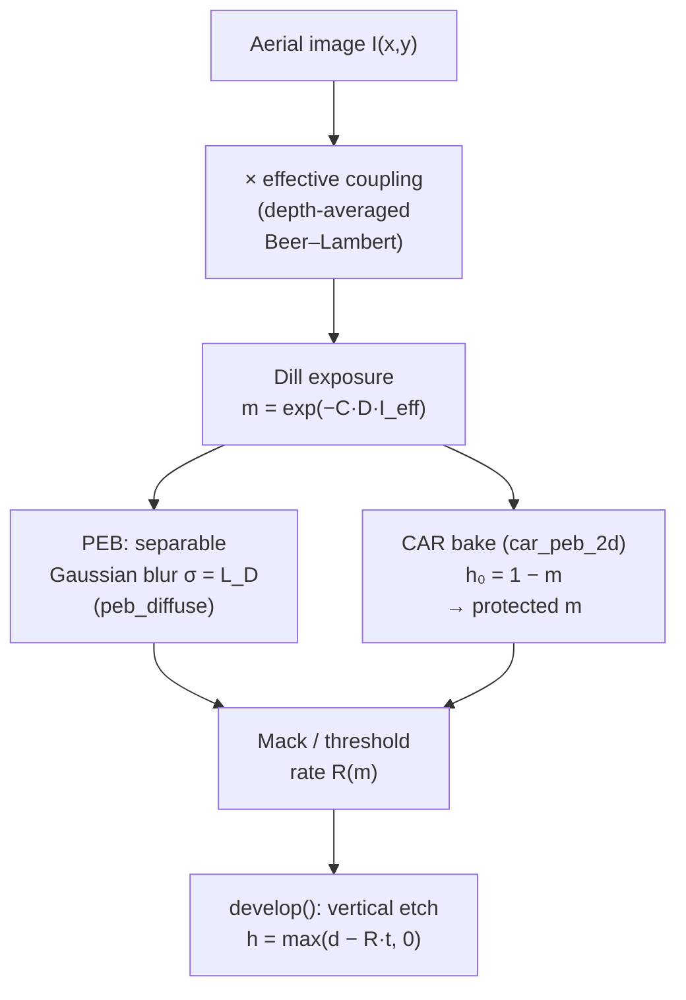
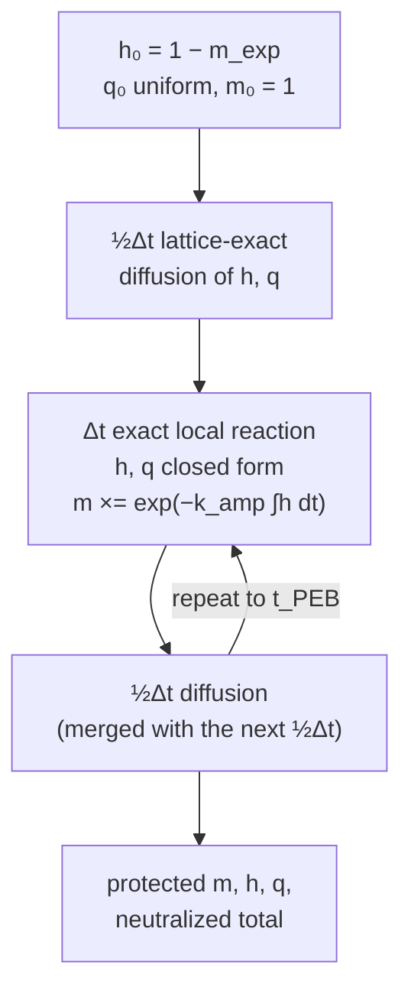

# Resist models

**Status:** 🔶 Simplified (✅ Gaussian bake) — depth-averaged 2-D Dill exposure and centre-row Mack development; the chemically amplified bake is standard but uncalibrated · [matrix](../capability-matrix.md#resist-and-development)

<p class="huv-lead">The resist model turns an aerial image into a developed profile and every dose-dependent quantity with it. This page documents Dill ABC exposure, the Gaussian and chemically amplified bakes and the Mack rate as <code>resist.rs</code> computes them on the 2-D path, where exposure collapses to one depth-averaged coupling scalar and development is a vertical etch of the centre row; the volumetric path reuses these bake solvers on full volumes.</p>

<div class="huv-glance" markdown>

| Property | Value |
|---|---|
| Computes | Dill latent image; Gaussian or acid–quencher bake; Mack rate; centre-row height |
| Does not | z-resolved dose, bleaching, lateral fronts, sidewalls, T-topping, stochastics |
| Defaults | `vuv_fluoropolymer` (150 nm, Mack n = 3); illustrative `CarParams` |
| Grade | 🔶 Simplified (✅ Gaussian bake) |
| Compare with | [Volumetric exposure](volumetric-exposure.md) · [Thin film](thin-film.md) · [Stochastic frontier](../future/stochastic-frontier.md) |

</div>

<div class="huv-physics" markdown>

<!-- resist-chain-schematic -> processes/resist-models.md -->
<figure markdown="span">


<figcaption><strong>Mechanism.</strong> One chemistry, two dimensionalities: photons decompose the photo-active compound or photo-acid generator (m = exp(−C·D·I)), the bake diffuses the latent image (a Gaussian blur, or the acid–quencher reaction–diffusion of a chemically amplified resist), and the Mack or threshold rate R(m) turns the protected fraction into dissolution. The 2-D path feeds it one depth-averaged coupling scalar and etches the centre row vertically; the volumetric path feeds it I_aer(x, y; d₀ + z/n_r)·S(z) and develops in three dimensions. <em>Schematic, not to scale.</em></figcaption>
</figure>

<!-- resist-2d-chain -> processes/resist-models.md -->
<figure markdown="span">


<figcaption><strong>The depth-averaged 2-D chain: exposure → bake → rate law → development.</strong> 150 nm lines on a 300 nm pitch at 157.63 nm, NA 0.75, σ 0.7, in the default 150 nm VUV resist: (a) the aerial image and the Dill latent image m(x) at 10, 30 and 50 mJ/cm²; (b) the same after the 30 nm Gaussian bake; (c) the Mack rate law with the default parameters for n = 1, 3 and 10, the threshold switch, and the engine's own rate on top of the n = 3 curve; (d) the developed centre-row profile at 20, 40 and 60 s. Panel (c) is a plotted rate law and the constants are illustrative, not a calibration of this code. <em>Model: 2-D exposure 🔶 (depth-averaged) · 2-D development 🔶 (centre row) · Gaussian PEB ✅.</em></figcaption>
</figure>

<!-- huv-table: stack -->
| What is modeled | Grade | Dominant approximation | Details |
|---|---|---|---|
| 2D resist exposure (Dill ABC) | 🔶 Simplified | one Beer–Lambert coupling scalar, no z-resolved dose | [Dill exposure kinetics](#dill-exposure-kinetics) |
| Post-exposure bake (anisotropic Gaussian) | ✅ Implemented | Fickian diffusion of m itself | [Post-exposure bake](#post-exposure-bake-2d-gaussian) |
| Chemically amplified bake (acid/quencher reaction–diffusion) | 🔶 Simplified | no acid loss, constant diffusivities, illustrative constants | [CAR bake](#chemically-amplified-resist-car-bake) |
| 2D development (Mack / threshold) | 🔶 Simplified | centre-row vertical etch, no lateral front | [Development](#development-on-the-centre-row) |

**Same thing elsewhere:** Python `ResistConfig.vuv_fluoropolymer()` · CLI `deep --config examples/volumetric.toml` · TOML `[deep] peb = "car"` · GUI volume viewer · physics → [pipeline](../pipeline.md)

</div>

## How it works

The 2-D path is one chain: the aerial image is scaled by a coupling scalar, exposed by Dill kinetics, blurred (or reacted) by the bake, converted to a rate and etched vertically on the centre row.



### Dill exposure kinetics

The normalized photo-active compound (PAC) concentration `m` (1 = unexposed, 0 = fully exposed) follows first-order Dill kinetics under dose $D$ (mJ/cm²):

```math
m(x,y) = \exp\left(-C \, D \, I_\mathrm{eff}(x,y)\right),
\qquad
I_\mathrm{eff} = I_\mathrm{aer} \cdot \frac{1 - e^{-\alpha d}}{\alpha d}
```

where $C$ (cm²/mJ) is the exposure rate constant and the second factor is the depth-average of Beer–Lambert decay through resist thickness $d$. The absorption coefficient combines bleachable ($A$) and non-bleachable ($B$) parts:

```math
\alpha(m) = A\,m + B \quad [\mu\mathrm{m}^{-1}]
```

(`ResistParams::absorption` converts to nm⁻¹ internally). The coupling factor `effective_coupling()` is evaluated once at $m = 1$ (unbleached), so **bleaching does not evolve during 2D exposure** — $A$ enters only through the initial $\alpha$. For an optically thin film ($\alpha d < 0.01$) the coupling short-circuits to 1. The split-step bleaching model that actually consumes $A$ dynamically is in the [volumetric path](./volumetric-exposure.md#split-step-dill-bleaching). For a chemically amplified resist the same Dill map describes photo-acid-generator (PAG) decomposition: $m$ is the remaining PAG fraction and $1 - m$ the photogenerated acid. Panel (a) of the engine figure above shows $m(x)$ at 10, 30 and 50 mJ/cm² for the default resist.

### Post-exposure bake (2D Gaussian)

`peb_diffuse` applies acid diffusion as a separable Gaussian blur of the latent image with standard deviation equal to the diffusion length $L_D$ (`peb_diffusion_nm`), converted to pixels as $\sigma = L_D / \mathrm{pixel_{nm}}$. The kernel is truncated at $3\sigma$, normalized to unit sum, and applied along x then y with clamped (replicate) boundaries. `peb_diffusion_nm = 0` is a no-op. This is isotropic Fickian diffusion of `m` itself (panel (b) above). It is what `SimulationEngine.compute_resist_profile` (Python) uses. The exact spectral and anisotropic diffusion helpers and the CAR reaction–diffusion bake below are separate entry points; on the 2D path the CAR bake is reached through `car_peb_2d` (Rust) or, from Python, `peb_car` on a single-slice `VolumetricResult`.

### Exact spectral diffusion helpers

Diffusion for a time $t$ is a Gaussian of standard deviation $\sigma = \sqrt{2Dt}$ per axis. The helpers apply it exactly in Fourier space, one axis at a time, on `(z, y, x)` arrays:

| Function | Transfer function | Properties |
|---|---|---|
| `gaussian_diffuse_axis(data, axis, sigma_nm, spacing_nm, boundary)` | $\hat c(f) \leftarrow \hat c(f) e^{-2\pi^2\sigma^2 f^2}$ | exact heat-equation solution for the band-limited (trigonometric) interpolant of the samples; mass-conserving |
| `lattice_diffuse_axis(...)` (same arguments) | $\hat c_k \leftarrow \hat c_k e^{-(\sigma/h)^2 (1 - \cos 2\pi k/N)}$ | exact solution of the three-point semi-discrete diffusion equation (kernel $e^{-t} I_n(t)$, $t = (\sigma/h)^2$); strictly positive, variance exactly σ² for any σ, O(h²) dispersion error on barely resolved frequencies |

`DiffusionBoundary::Periodic` uses the plain FFT (matching the periodic field of the FFT aerial engine); `DiffusionBoundary::Reflecting` is zero flux through the half-sample-symmetric even extension of length 2N (the DCT-II eigenbasis of the Neumann problem). **The band-limited continuous Gaussian has small negative side lobes on sharp data when σ is below ~1.5 samples; the CAR bake therefore uses the positivity-preserving lattice kernel.**

`peb_diffuse_anisotropic(data, [dz, dy, dx], &PebDiffusion)` combines them into a z-resolved bake with independent lateral (`lateral_nm`, `lateral_boundary`) and vertical (`vertical_nm`) lengths; z is always zero-flux (resist/air top, resist/substrate bottom). With `vertical_diffusivity_scale = Some(s)` the vertical diffusivity varies with depth, $D_z(z_k) = D_\mathrm{ref} s_k$ with $\sigma_z^2 = 2 D_\mathrm{ref} t$, and the z axis gets an exact-in-time propagator of the finite-volume operator $\partial_z s(z) \partial_z$. `PebDiffusion::with_exponential_depth_profile(nz, dz, r, δ)` builds $s(z) = 1 + (r - 1)e^{-z/\delta}$ ($r > 1$: enhanced acid mobility near the top; $r < 1$: a denser skin — a convenience parametrization, not a fitted law).

<details markdown="1">
<summary>Solver details — side lobes, the depth-dependent propagator, the CAR time integration</summary>

**Side lobes of the band-limited Gaussian.** A unit impulse undershoots by −1.8·10⁻² at σ = 0.5 sample, −1.6·10⁻⁴ at σ = 1, −2.3·10⁻⁷ at σ = 1.5, and −2.6·10⁻¹¹ at σ = 2; smooth, well-sampled fields are unaffected.

**Depth-dependent vertical diffusivity.** The z axis gets the exact-in-time propagator $\exp\big((\sigma_z^2/2) L_s\big)$ of the cell-centred finite-volume operator $L_s = \partial_z s(z) \partial_z$ (harmonic-mean face diffusivities, zero flux at both ends). It is computed by uniformization plus scaling and squaring — every term is entrywise non-negative, so the propagator preserves positivity and conserves mass to roundoff. The lateral operator (constant $D$) commutes with the vertical one, so the axis-by-axis split is exact.

**CAR time integration.** Strang operator splitting: half-step diffusion of $h$ and $q$ with the exact lattice kernel (`lattice_diffuse_axis`; lateral per `lateral_boundary`, z reflecting), a full-step **exact** local reaction, and another half-step of diffusion (consecutive half steps merged into one full step, which is exact because the diffusion propagators compose).



The local pair $\dot h = \dot q = -k_q h q$ conserves $c = h - q$ and has a closed form; with $a = |c|$, $F = 1 - e^{-k_q a \Delta t}$, $\phi = F/(k_q a \Delta t)$:

```math
c \ge 0:\quad h' = \frac{h}{1 + q\,k_q\Delta t\,\phi},\quad
q' = \frac{q\,e^{-k_q a\Delta t}}{1 + q\,k_q\Delta t\,\phi},\quad
\int h\,dt = a\,\Delta t + \frac{\ln(1 + q\,k_q\Delta t\,\phi)}{k_q}
```

```math
c < 0:\quad h' = \frac{h\,e^{-k_q a\Delta t}}{1 + h\,k_q\Delta t\,\phi},\quad
q' = \frac{q}{1 + h\,k_q\Delta t\,\phi},\quad
\int h\,dt = \frac{\ln(1 + h\,k_q\Delta t\,\phi)}{k_q}
```

and the deprotection over the same substep is exact: $m' = m \exp(-k_\mathrm{amp}\int h dt)$. These forms stay finite as $a \to 0$, $q_0 \to 0$, $h_0 \to 0$, or $k_q \to 0$. Both substeps are unconditionally stable, so the step limit is an **accuracy** limit on the $O(\Delta t^2)$ splitting error: the automatic step keeps the diffusion length per step at or below one sample on every diffused axis ($\Delta t \le h^2 / 2D_\mathrm{max}$), capped by `max_time_step_s`, with an integer number of steps ending exactly at `peb_time_s`; without diffusion a single exact step is taken, and a bake that would need more than 10⁶ steps is rejected. `CarPebResult` returns `protected`, `acid`, `quencher`, `neutralized_total` ($\sum h +$ `neutralized_total` $= \sum h_0$), `steps`, and `time_step_s`.

</details>

### Chemically amplified resist (CAR) bake

`car_peb(acid0, [dz, dy, dx], &CarParams)` solves the standard Mack/PROLITH-class CAR post-exposure bake, with all concentrations normalized to the initial PAG concentration (so the rate constants are in 1/s):

```math
\frac{\partial m}{\partial t} = -k_\mathrm{amp}\, m\, h, \qquad
\frac{\partial h}{\partial t} = D_h \nabla^2 h - k_q\, h\, q, \qquad
\frac{\partial q}{\partial t} = D_q \nabla^2 q - k_q\, h\, q,
```

$h$ = acid, $q$ = base quencher, $m$ = protected (blocked) site fraction; $h(0) = h_0 = 1 - m_\mathrm{exposure}$ (the decomposed PAG of the Dill latent image), $q(0) = q_0$ (`quencher_initial`, uniform), $m(0) = 1$. The lateral diffusivities are $D_h$, $D_q$; the vertical ones are scaled by `vertical_diffusivity_ratio` $= D_z/D_{xy}$. After the bake $m$ is what the Mack rate consumes (1 protected / slow, 0 deprotected / fast). The time integration is the Strang splitting described under Solver details above.

**2D connection.** `car_peb_2d(&mut latent, &params, pixel_nm)` treats the depth-averaged `LatentImage` as a single slice ($h_0 = 1 -$ `pac`, no vertical diffusion) and writes the protected fraction back into `latent.pac`, so `development_rate` / `develop` consume it unchanged — after the call `pac` holds the protected-site fraction, not the PAG.

**The CAR constants are illustrative, not a calibration of this code.** Concentrations are normalized to the initial PAG; deprotection is first order in acid; there is no acid evaporation or trapping loss; the diffusivities are constant (no deprotection- or free-volume-dependent diffusivity); the time integration carries the $O(\Delta t^2)$ splitting error. The `CarParams::default()` values (60 s bake, $k_\mathrm{amp}$ = 0.1 s⁻¹, $k_q$ = 10 s⁻¹, $q_0$ = 0.15, $D_h$ = 2 nm²/s i.e. $\sqrt{2D_h t}$ ≈ 15.5 nm, $D_q$ = 0.5 nm²/s) are not a fit to a specific resist.

<!-- resist-car-deprotection -> processes/resist-models.md -->
<figure markdown="span">


<figcaption><strong>The chemically amplified bake: acid, quencher, deprotection.</strong> Acid/quencher reaction–diffusion with default rates (60 s, k<sub>amp</sub> 0.1 s⁻¹, D<sub>acid</sub> 2 nm²/s): (a) a fixed 1-D acid profile baked with more quencher deprotects less and with a steeper edge; (b, c) a real volumetric latent image — F<sub>2</sub> 157.63 nm, NA 0.75, 150 nm lines on a 300 nm pitch, 150 nm resist on silicon, so standing waves band the acid — before and after the bake. <em>Model: volumetric exposure 🔶 · chemically amplified bake 🔶 (standard Mack/PROLITH-class equations; illustrative constants, no acid loss).</em></figcaption>
</figure>

### Mack development rate

`DevelopmentModel::Mack` implements the Mack "kinetic" rate (nm/s):

```math
R(m) = R_\mathrm{max}\,\frac{(a+1)(1-m)^n}{a + (1-m)^n} + R_\mathrm{min},
\qquad
a = \frac{n+1}{n-1}\,(1 - m_\mathrm{th})^n
```

with `m` clamped to $[0, 1]$ before evaluation — panel (c) of the engine figure for $n$ = 1, 3 and 10. The prefactor $a$ is singular at $n = 1$; the code guards $|n - 1| < 10^{-12}$ and falls back to the linear interpolation $R = R_\mathrm{max}(1 - m) + R_\mathrm{min}$ (pinned by `test_mack_n_near_one_no_panic`). `DevelopmentModel::Threshold` is the fast alternative: 1000 nm/s where $m < m_\mathrm{threshold}$, 0.01 nm/s otherwise. For a CAR, $m$ is the protected fraction after `car_peb` / `car_peb_2d`.

### Development on the centre row

`develop()` reads the rate on the **centre row only** (`ny / 2`) of the 2D rate image and etches each column straight down:

```math
h(x) = \max\big(d - R(m(x, y_c))\cdot t_\mathrm{dev},\; 0\big)
```

There is no lateral development front, no rate variation with depth, and no y-resolved profile — `ResistProfile` is a 1D cross-section (`x_nm`, `height_nm`), panel (d) above. This is honest for symmetric line/space cuts at best focus; for anything requiring sidewall angle, undercut, surface inhibition, or developer depletion use the fast-marching or level-set tiers in [volumetric-exposure.md](./volumetric-exposure.md#dissolution-rate-law).

## Process regime

Defaults model a VUV (157 nm) fluoropolymer resist; all parameters are user-settable.

| Quantity | Default (`ResistParams::vuv_fluoropolymer`) | Typical range modeled |
|---|---|---|
| Thickness | 150 nm | 50–400 nm (thin single layer; thick resists → volumetric/LIGA) |
| Dill A (bleachable) | 0.2 µm⁻¹ | 0.1–0.3 µm⁻¹ for VUV fluoropolymers (≪ DUV novolacs) |
| Dill B (non-bleachable) | 0.45 µm⁻¹ | 0.3–0.6 µm⁻¹ |
| Dill C | 0.02 cm²/mJ | resist-dependent |
| PEB diffusion length | 30 nm | 0–50 nm |
| Mack $R_\mathrm{max}$ / $R_\mathrm{min}$ / $m_\mathrm{th}$ / $n$ | 100 / 0.1 nm/s / 0.5 / 3 | — |
| Dose | 30 mJ/cm² (pipeline default) | 10–50 mJ/cm² |
| Aspect ratio | ≲ 3 (thin film, vertical etch only) | — |

### CAR bake defaults and a literature reference point

CAR bake (`CarParams::default()`, illustrative):

| Quantity | Default | Typical range modeled |
|---|---|---|
| Bake time | 60 s | 30–120 s |
| $k_\mathrm{amp}$ (deprotection) | 0.1 s⁻¹ | resist- and temperature-dependent |
| $k_q$ (neutralization) | 10 s⁻¹ | fast relative to the bake |
| Quencher loading $q_0$ | 0.15 of the PAG | 0.05–0.3 |
| Acid diffusivity $D_h$ | 2 nm²/s ($\sqrt{2D_h t}$ ≈ 15.5 nm at 60 s) | diffusion lengths 5–30 nm |
| Quencher diffusivity $D_q$ | 0.5 nm²/s | usually ≤ $D_h$ |
| Vertical ratio $D_z/D_{xy}$ | 1 | < 1 for interface-hindered vertical diffusion |

<details markdown="1">
<summary>Reported values for a calibrated EUV CAR model (not used as defaults, not a calibration of this code)</summary>

Representative values from the literature for a calibrated EUV CAR model (Bhattarai, Neureuther, Naulleau [4]):

| Quantity | Reported value | Mapping onto `CarParams` |
|---|---|---|
| PAG / quencher loading | 0.4 nm⁻³ / 0.04 nm⁻³ | `quencher_initial` ≈ 0.1 (quencher / PAG) |
| Acids per absorbed EUV photon | 2 (≈ 3 nm electron range) | sets $h_0$ scale; electron blur is outside this model |
| Measured deprotection blur | ≈ 2–3.5 nm at 90 °C PEB, 4.5–5.5 nm at 110 °C | first guess: $D_h \approx \sigma^2 / (2 t_\mathrm{PEB})$, e.g. σ = 3 nm over 60 s → 0.075 nm²/s |
| Organic CAR absorption at 13.5 nm | ≈ 4.8 µm⁻¹ (a 35 nm film absorbs ≈ 15 %) [5] | Dill absorption $A m + B$ in µm⁻¹ (exposure, not the bake) |

The default `CarParams` diffusion length (≈ 15.5 nm) is therefore long for an EUV CAR; set the diffusivities from the measured blur when modeling EUV. The model is a deterministic continuum: photon shot noise and acid/quencher counting statistics — which the same calibrated model attributes 46 %, 22 %, and 32 % of the LER budget to [4] — and the resolution–LER–sensitivity trade-off summarized by the Z-factor $Z = \mathrm{HP}^3 \cdot \mathrm{LER}^2 \cdot \mathrm{dose}$ [6] are outside it; see [the stochastic frontier](../future/stochastic-frontier.md).

</details>

## What the code provides

Everything lives in [`crates/highuvlith-core/src/resist.rs`](../../crates/highuvlith-core/src/resist.rs):

- **`ResistParams`** — thickness, Dill A/B/C, `peb_diffusion_nm`, `development` (`DevelopmentModel::Mack { r_max, r_min, m_th, n }` or `Threshold`); `vuv_fluoropolymer()` defaults; `absorption(m)`, `effective_coupling()`.
- **`expose(aerial, dose, &params)`** → `LatentImage` (2-D PAC `m`).
- **`peb_diffuse`** (2-D Gaussian, truncated kernel), **`gaussian_diffuse_axis`**, **`lattice_diffuse_axis`**, **`peb_diffuse_anisotropic`** (exact spectral, per axis).
- **`car_peb`, `car_peb_2d`, `CarParams`, `CarPebResult`** — the chemically amplified bake.
- **`development_rate`, `develop`** → `ResistProfile` (`x_nm`, `height_nm`).
- Python: `huv.ResistConfig` (`vuv_fluoropolymer()`), `SimulationEngine.compute_resist_profile`, and in `highuvlith.api` the volume-level `peb_gaussian` and `peb_car` (a 2-D latent image is a single-slice volume).

## Model coverage

`ResistParams`:

| Field | Unit | Consumed by | Status |
|---|---|---|---|
| `thickness_nm` | nm | `effective_coupling`, `develop` height clamp | live |
| `dill_a` | 1/µm | `absorption(m)` → coupling (at m = 1 here; dynamically in volumetric bleaching) | live |
| `dill_b` | 1/µm | `absorption(m)` → coupling | live |
| `dill_c` | cm²/mJ | `expose` exponent | live |
| `peb_diffusion_nm` | nm | `peb_diffuse` σ (passed by `SimulationEngine.compute_resist_profile`) | live |
| `development` | enum | `development_rate` → `develop` / FMM / level set | live |

`CarParams` (`car_peb`, `car_peb_2d`, `PebModel::ChemicallyAmplified`):

| Field | Unit | Consumed by | Status |
|---|---|---|---|
| `peb_time_s` | s | bake duration (step count) | live |
| `k_amp_per_s` | 1/s | deprotection $m' = m e^{-k_\mathrm{amp}\int h dt}$ | live |
| `k_quench_per_s` | 1/s | exact local neutralization | live |
| `quencher_initial` | fraction of PAG | uniform $q_0$ | live |
| `acid_diffusivity_nm2_s` | nm²/s | lattice diffusion of $h$ | live |
| `quencher_diffusivity_nm2_s` | nm²/s | lattice diffusion of $q$ | live |
| `vertical_diffusivity_ratio` | — | $D_z =$ ratio · $D_{xy}$ for both species | live |
| `lateral_boundary` | enum | periodic / reflecting x, y (z always zero-flux) | live |
| `max_time_step_s` | s | optional cap on the splitting step | live |
| Acid evaporation / trapping loss, deprotection-dependent diffusivity, higher reaction orders | — | — | planned |

`PebDiffusion` (`peb_diffuse_anisotropic`, `PebModel::Gaussian`):

| Field | Unit | Consumed by | Status |
|---|---|---|---|
| `lateral_nm` | nm | σ of the x and y passes | live |
| `vertical_nm` | nm | σ of the z pass (reference σ with a depth profile) | live |
| `vertical_diffusivity_scale` | — (length nz) | depth-dependent $D_z$ propagator | live |
| `lateral_boundary` | enum | periodic / reflecting x, y | live |
| Depth-dependent lateral diffusivity | — | — | planned |

## Usage

### Python

The 2-D chain end to end (real factory names from [`crates/highuvlith-py/src/py_config.rs`](../../crates/highuvlith-py/src/py_config.rs)); the example prints the developed centre-row profile's minimum remaining height:

<!-- verify-example -->
```python
import highuvlith as huv

resist = huv.ResistConfig(
    thickness_nm=150.0,
    dill_a=0.2, dill_b=0.45, dill_c=0.02,
    peb_diffusion_nm=30.0,
    model="mack",            # or "threshold"
)
# or: resist = huv.ResistConfig.vuv_fluoropolymer()

engine = huv.SimulationEngine(
    source=huv.SourceConfig.f2_laser(sigma=0.7),
    optics=huv.OpticsConfig(numerical_aperture=0.75),
    mask=huv.MaskConfig.line_space(cd_nm=65.0, pitch_nm=180.0),
    resist=resist,
)
profile = engine.compute_resist_profile(dose_mj_cm2=30.0, focus_nm=0.0, dev_time_s=60.0)
print(f"{len(profile.x_nm)} columns, remaining height "
      f"{profile.height_nm.min():.1f}–{profile.height_nm.max():.1f} nm of {profile.thickness_nm:.0f}")
```

??? success "Output"

    ```text
    512 columns, remaining height 0.0–13.8 nm of 150
    ```

The CAR bake and the anisotropic Gaussian bake are exposed in `highuvlith.api` for volumes (a 2D latent image is a single-slice volume); the example prints the protected fraction left on the exposed line and the neutralized acid:

<!-- verify-example -->
```python
import numpy as np
import highuvlith as huv
from highuvlith.api import peb_car, peb_gaussian

engine = huv.SimulationEngine(huv.SourceConfig.f2_laser(sigma=0.7),
                              huv.OpticsConfig(numerical_aperture=0.85),
                              huv.MaskConfig.line_space(cd_nm=64.0, pitch_nm=128.0),
                              grid=huv.GridConfig(size=256, pixel_nm=1.0))
intensity = engine.compute_aerial_image(focus_nm=0.0).intensity
m_exp = np.exp(-0.05 * 30.0 * intensity)  # Dill bleaching exp(-C E I): C = 0.05 cm²/mJ, 30 mJ/cm²
vol = huv.VolumetricResult.from_array(m_exp[None, :, :], (0.0, 256.0), (0.0, 256.0), (0.0, 1.0))
car = peb_car(vol, peb_time_s=60.0, k_amp=0.1, k_quench=10.0, quencher=0.15,
              acid_diffusivity_nm2_s=2.0, quencher_diffusivity_nm2_s=0.5)
protected = car.protected.values[0]          # feed to the development rate
acid_left, neutralized = car.acid.values, car.neutralized_total
blurred = peb_gaussian(vol, 20.0)                     # exact Gaussian (lateral only for nz = 1)
print(f"protected fraction {protected.min():.3f}–{protected.max():.3f}; "
      f"neutralized acid {neutralized:.0f} summed over the 256² pixels (PAG units)")
```

??? success "Output"

    ```text
    protected fraction 0.245–0.461; neutralized acid 9830 summed over the 256² pixels (PAG units)
    ```

### CLI and TOML

The CLI `simulate` command computes aerial images and metrics only and never runs this 2D resist path; `[process]` carries dose and focus (fields from [`crates/highuvlith-cli/src/config.rs`](../../crates/highuvlith-cli/src/config.rs)), and the 2D resist chemistry (Dill A/B/C, PEB, Mack) is **not** TOML-configurable today (use the Python or Rust API). The z-resolved path has a CLI surface — `highuvlith deep` with `[deep] mode = "volumetric"`, including the Gaussian or CAR bake (`peb`, `car_*` keys; see [volumetric-exposure.md](./volumetric-exposure.md#usage) and [configuration](../configuration.md#deep)):

| Keys | Meaning |
|---|---|
| `[process] dose_mj_cm2`, `focus_nm` | dose and focus of the aerial-image run (`simulate`, `sweep`) |
| `[deep] peb = "gaussian"` / `"car"`, `car_*` | the same bake solvers on the volumetric path |

```toml
[process]
dose_mj_cm2 = 30.0
focus_nm = 0.0
```

<details markdown="1">
<summary>Rust</summary>

```rust
use highuvlith_core::resist::{car_peb_2d, develop, expose, CarParams, ResistParams};

let params = ResistParams::default();
let mut latent = expose(&aerial.data, 30.0, &params);        // remaining PAG
let state = car_peb_2d(&mut latent, &CarParams::default(), pixel_nm)?;
// latent.pac now holds the protected fraction the Mack rate consumes.
let profile = develop(&latent, &params, 60.0, pixel_nm);
```

</details>

## Limits

- **One coupling scalar.** Exposure is depth-averaged through $(1 - e^{-\alpha d})/(\alpha d)$ evaluated at $m = 1$: no z-resolved dose, no standing waves, no bleaching during exposure.
- **Centre row, vertical etch.** `develop()` reads `ny / 2` only and etches straight down: no lateral front, no sidewall angle, undercut, surface inhibition or developer depletion — those are the [volumetric tiers](./volumetric-exposure.md#dissolution-rate-law).
- **CAR approximations.** No acid loss, constant diffusivities, first-order deprotection, $O(\Delta t^2)$ splitting; the default constants are illustrative.
- **Deterministic continuum.** No photon shot noise or acid counting statistics; LER is outside this page ([stochastic frontier](../future/stochastic-frontier.md)).
- **Planned rows** of the coverage tables (acid loss, deprotection-dependent diffusivity, depth-dependent lateral diffusivity) are not implemented.

<details markdown="1">
<summary>Behaviour changes</summary>

- No behaviour change is recorded for the 2-D path itself (`expose`, `peb_diffuse`, `develop`).
- The exact spectral bake solvers this page documents are shared with the volumetric path, where the historical isotropic `peb_diffuse_3d` became a wrapper over the exact kernel (it previously convolved with a sampled Gaussian truncated at 3σ with clamped boundaries; the exact kernel differs most for σ ≲ 1.5 pixels and within ~3σ of the field edges) — recorded on [volumetric-exposure.md](./volumetric-exposure.md#limits).

</details>

<details markdown="1">
<summary>Validation — 27 tests</summary>

`#[test]` functions in [`resist.rs`](../../crates/highuvlith-core/src/resist.rs) unless noted.

**2D path**

| Test | What it pins | Tolerance |
|---|---|---|
| `test_unexposed_pac_is_one`, `test_expose_zero_dose_pac_one` | Dill boundary conditions ($I = 0$ or $D = 0$ ⇒ $m = 1$) | exact |
| `test_high_dose_pac_near_zero`, `test_higher_dose_lower_pac` | exposure monotonicity | — |
| `test_beer_lambert_coupling` | coupling → 1 at zero absorption | — |
| `test_mack_development_rate` | $R(0) \to R_\mathrm{max}$, $R(1) \to R_\mathrm{min}$ | — |
| `test_mack_n_near_one_no_panic` | the $n \to 1$ singularity guard | — |
| `test_threshold_model_exposed` | threshold-model rate switching | — |
| `test_peb_diffusion_broadens` | Gaussian PEB reduces the peak of a delta latent image | — |
| `test_development_profile`, `test_develop_zero_time_full_thickness` | vertical develop behaviour | — |

**Spectral diffusion** (fixtures from independent numpy / power-series evaluations)

| Test | What it pins | Tolerance |
|---|---|---|
| `test_gaussian_diffuse_axis_fixture_periodic_and_reflecting` | periodic and reflecting kernels on every axis (incl. the −5.2·10⁻⁴ side lobe at σ = 1 sample) | 1e-14 |
| `test_lattice_kernel_matches_modified_bessel` | the lattice kernel equals $e^{-t}I_n(t)$ at $t$ = 1 and 2.25 and is non-negative | 1e-14 |
| `test_gaussian_variance_exact_per_axis` | anisotropic variances (16, 16, 36 nm²), periodic and reflecting | 1e-9 |
| `test_lattice_variance_exact_even_for_small_sigma` | variance exactly σ² at σ = 0.3 sample | 1e-12 |
| `test_peb_axes_independent_and_commuting` | lateral-only and vertical-only bakes leave the other axis' projections unchanged; the passes commute | — |
| `test_depth_profile_uniform_scale_matches_lattice_and_gaussian` | a uniform depth profile reproduces the reflecting lattice kernel and converges to the continuous Gaussian at second order (2.46·10⁻³ → 6.3·10⁻⁴ from dz = 4 to 2 nm) | 1e-12 |
| `test_depth_profile_conserves_mass_and_slows_low_d_region` | variance 36 nm² where $D = D_\mathrm{ref}$ and 3.6 nm² where $D$ is 10× lower; mass conserved; non-negative | — |
| `test_peb_zero_sigma_identity_and_invalid_params` | identity at σ = 0; invalid parameters rejected | — |

**CAR bake**

| Test | What it pins | Tolerance |
|---|---|---|
| `test_car_no_quencher_no_diffusion_exact_exponential` | $m = e^{-k_\mathrm{amp}h_0t}$ = $e^{-1.2}, e^{-3}, e^{-5.4}$, in one exact step or many | 1e-12 |
| `test_car_reaction_only_matches_rk4_fixtures` | four reaction-only cases (incl. a stiff $k_q$ = 50 s⁻¹ one) against an independent RK4 integration | 1e-10 |
| `test_car_pure_diffusion_variance_is_2dt` | variance $2Dt$ per axis (6, 6, 3 nm² with $D_z/D_{xy}$ = 0.5), periodic and reflecting | 1e-8 |
| `test_car_mass_balance` | $\sum(h - q)$ conserved and $\sum h$ + neutralized $= \sum h_0$ | 1e-12 |
| `test_car_quencher_reduces_deprotection_and_sharpens_edge` | raising $q_0$ from 0 to 0.3 lowers the mean deprotection (0.654 → 0.366) and raises the edge slope (0.042 → 0.077 nm⁻¹) monotonically; the unexposed line stays protected ($m$ > 0.999) | — |
| `test_car_strang_splitting_is_second_order` | halving Δt reduces the error ≈ 4× for $m$ and $h$ | — |
| `test_car_default_step_is_accuracy_limited`, `test_car_2d_writes_protected_fraction`, `test_car_zero_time_identity_and_invalid_params` | the automatic step; the 2-D call equals the single-slice 3-D call (the Mack rate then develops the exposed centre > 100× faster than the edges); guards | — |

Cross-model pins in [`volumetric.rs`](../../crates/highuvlith-core/src/volumetric.rs): `test_z_mean_matches_effective_coupling` shows the exact transfer-matrix `S(z)` averages to this page's coupling factor for a non-bleaching stack; `test_apply_peb_models` checks the CAR exact limit through the volumetric pipeline. Python: `test_peb_car_exact_limit_and_mass_balance`, `test_peb_gaussian_anisotropic_moments` in `tests/python/test_volumetric.py`.

</details>

## References

1. F. H. Dill, W. P. Hornberger, P. S. Hauge, J. M. Shaw, "Characterization of positive photoresist," *IEEE Trans. Electron Devices* **22**, 445 (1975).
2. C. A. Mack, "Development of positive photoresists," *J. Electrochem. Soc.* **134**, 148 (1987).
3. C. A. Mack, *Fundamental Principles of Optical Lithography*, Wiley (2007) — depth-averaged coupling, PEB diffusion length, and the chemically amplified resist reaction–diffusion model.
4. Bhattarai, Neureuther, Naulleau, *J. Vac. Sci. Technol. B* **35**, 061602 (2017), doi:10.1116/1.4991054, and Bhattarai, UC Berkeley thesis UCB/EECS-2017-125 — calibrated EUV CAR model parameters and measured deprotection blur.
5. Fallica et al., *J. Micro/Nanolithogr. MEMS MOEMS* **17**(2), 023505 (2018) — EUV resist absorption.
6. Wallow et al., *Proc. SPIE* **6921** (2008) — the Z-factor.

**Part of Processes · see also:** [index](index.md) · [Thin film](thin-film.md) · [Volumetric exposure](volumetric-exposure.md) · [The stochastic frontier](../future/stochastic-frontier.md) · [GUI volume viewer](../gui.md#views) · [configuration](../configuration.md#deep)
