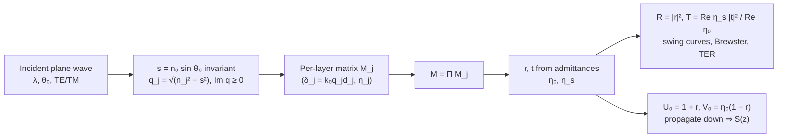

# Thin film

**Status:** ✅ Implemented — exact 2×2 characteristic-matrix stack optics (complex indices, any angle) and the exact in-film intensity; oblique-TM in-film intensity is the documented |U|² approximation · [matrix](../capability-matrix.md#materials-and-film-optics)

<p class="huv-lead">The resist sits in a stratified stack whose interface reflections superpose with the incident wave: the standing wave that ripples sidewalls and the swing curve that sets dose-to-clear stability. <code>thinfilm.rs</code> solves the stack exactly (Macleod characteristic matrix, absorbing layers, any angle) and hands the depth profile S(z) to the volumetric resist path.</p>

<div class="huv-glance" markdown>

| Property | Value |
|---|---|
| Computes | TE/TM/unpolarized R, T, complex r, t at any angle; the exact in-film S(z) |
| Does not | rough or graded interfaces; the longitudinal E-component of oblique TM |
| Default stack | 150 nm resist (1.65 + 0.015i) on Si at 157.63 nm — R = 0.258 |
| Grade | ✅ Implemented |
| Compare with | [Resist models](resist-models.md) · [Volumetric exposure](volumetric-exposure.md) · [Materials](../materials.md) |

</div>

<div class="huv-physics" markdown>

<!-- thinfilm-layer-stack -> processes/thin-film.md -->
<figure markdown="span">


<figcaption><strong>Mechanism.</strong> Each layer j carries a forward and a backward wave; its normal wavevector q_j = √(n_j² − s²) and tilted admittance η_j fill one 2×2 matrix M_j, and the ordered product M = Π M_j gives r and t from the superstrate and substrate admittances. The stack-top fields U₀ = 1 + r and V₀ = η₀(1 − r) propagated downward give the in-film intensity S(z), whose standing wave has period λ/2n in the resist. <em>Schematic, not to scale.</em></figcaption>
</figure>

<!-- thinfilm-standing-wave-swing -> processes/thin-film.md -->
<figure markdown="span">


<figcaption><strong>Standing waves, the swing curve and the Brewster zero from the transfer-matrix stack.</strong> (a) |E(z)|² through 150 nm of resist on silicon at 157.63 nm, bare and under a 60 nm ARC (1.8 + 0.3i, the test fixture's constants, not a product BARC), with the λ/2n spacing of the minima; (b) reflectance against resist thickness, the default stack and the ARC stack annotated at their computed values; (c) TE and TM reflectance of a lossless n = 1.5 substrate against incidence, the TM zero at Brewster's angle; (d) gold at 8 keV, total external reflection below the critical grazing angle √(2δ). The oblique-TM in-film intensity is the documented |U|² approximation. <em>Model: thin-film transfer matrix ✅.</em></figcaption>
</figure>

<!-- huv-table: stack -->
| What is modeled | Grade | Dominant approximation | Details |
|---|---|---|---|
| Thin-film transfer matrix | ✅ Implemented | flat, abrupt interfaces | [Layer matrix](#layer-matrix-and-admittances) |
| In-film intensity S(z) | ✅ Implemented | oblique TM: tangential field only | [The two field methods](#the-two-field-methods) |
| Materials database | 🔶 Simplified | VUV constants are approximate transcriptions | [Process regime](#process-regime) |
| Volumetric (z-resolved) exposure | 🔶 Simplified | separable I_aer·S(z) (consumer of this module) | [Volumetric exposure](volumetric-exposure.md) |

**Same thing elsewhere:** Python `FilmStackConfig().reflectance(157.63)` · CLI `deep --config examples/volumetric.toml` · TOML `[deep] resist_thickness_nm` · GUI volume viewer · physics → [pipeline](../pipeline.md)

</div>

## How it works

The stack is solved once per wavelength, angle and polarization: a Snell invariant, one 2×2 matrix per layer, their ordered product, and the amplitude coefficients from the outer admittances. The field methods then walk the same matrices downward to give the intensity at every depth.

<details markdown="1">
<summary>Flowchart — from the incident wave to R, T and S(z)</summary>



</details>

### Layer matrix and admittances

With the Snell invariant $s = n_0\sin\theta_0$, every medium $j$ (index $n_j = n + ik$, $k \ge 0$) has the normal wave-vector component, in units of $k_0 = 2\pi/\lambda$,

```math
\begin{aligned}
q_j &= \sqrt{n_j^2 - s^2}, \\
\operatorname{Im} q_j &\ge 0\ \ (\operatorname{Re} q_j \ge 0\ \text{if}\ \operatorname{Im} q_j = 0),
\end{aligned}
```

the branch on which the field decays (or propagates forward) into the medium. Writing everything with $q_j$ rather than $\cos\theta_j = \sqrt{1 - (s/n_j)^2}$ keeps the solution valid for absorbing media at any angle, including X-ray grazing incidence. The tilted admittances and layer matrices (physics convention, fields $e^{i(kz-\omega t)}$) are

```math
\begin{aligned}
\eta_j^{TE} &= q_j,\qquad \eta_j^{TM} = \frac{n_j^2}{q_j}, \\
M_j &= \begin{pmatrix} \cos\delta_j & -i\sin\delta_j/\eta_j \\ -i\,\eta_j \sin\delta_j & \cos\delta_j \end{pmatrix}, \\
\delta_j &= k_0\,q_j\,d_j .
\end{aligned}
```

This is the complex conjugate of Macleod's $e^{i(\omega t - kz)}$ form (which needs $N = n - ik$). The stack matrix is the ordered product $M = \prod_j M_j$ (top to bottom), and the amplitude coefficients follow from the superstrate/substrate admittances $\eta_0, \eta_s$ exactly as coded in `FilmStack::solve`:

```math
\begin{aligned}
r &= \frac{\eta_0 m_{00} + \eta_0\eta_s m_{01} - m_{10} - \eta_s m_{11}}
          {\eta_0 m_{00} + \eta_0\eta_s m_{01} + m_{10} + \eta_s m_{11}}, \\
t &= \frac{2\eta_0}{\text{(same denominator)}}, \\
T &= \frac{\operatorname{Re}\eta_s}{\operatorname{Re}\eta_0}\,|t|^2 .
\end{aligned}
```

`reflectance_at_angle` returns $|r|^2$ for TE or TM and `transmittance_at_angle` returns $T$; `Unpolarized` is the mean of the two (both for reflectance and for `intensity_profile`, pinned by `test_intensity_profile_unpolarized_is_te_tm_mean`). `amplitude_coefficients` returns the complex $(r, t)$ for TE or TM (the TM values are ratios of tangential E fields — the admittance convention, which differs by a sign from the Fresnel $r_p$; the reflectance is the same). TM reflectance vanishes at Brewster's angle $\theta_B = \arctan(n_s/n_0)$ for a lossless substrate (`test_brewster_angle`) — panel (c) of the engine figure above.

### Swing curves and standing waves

Sweeping resist thickness through `reflectance` traces the swing curve; the quarter-wave condition $d = \lambda/(4 n_f)$ with $n_f = \sqrt{n_s}$ is its antireflective minimum (`test_quarter_wave_ar`, `test_quarter_wave_is_minimum`) — panel (b) above, where the default stack and the ARC stack are annotated at their computed reflectances. Inside the resist, incident and substrate-reflected waves interfere with intensity period

```math
\Lambda_{sw} = \frac{\lambda}{2 n_\mathrm{resist}}
```

— about 47.6 nm for `n = 1.65` at 157 nm — pinned by `test_intensity_profile_standing_wave_period` and visible as the spacing of the minima in panel (a). The 60 nm ARC of panel (a) uses the interface-continuity test's constants (1.8 + 0.3i), not a product BARC; it suppresses the swing but does not remove the absorption gradient.

### The two field methods

The module deliberately ships **two** in-film intensity calculators:

<!-- huv-table: stack -->
| Method | What it does | Accuracy | Use it for |
|---|---|---|---|
| `FilmStack::intensity_profile` | Propagates the exact tangential fields: $U_0 = 1 + r$, $V_0 = \eta_0(1 - r)$ at the stack top, then downward through each layer with the **inverse** layer matrix (det = 1), plus a partial-thickness matrix inside the containing layer. Above the stack it returns the superstrate standing wave $\lvert e^{-ik_z z} + r e^{ik_z z}\rvert^2$; below it, $\lvert U_\mathrm{bottom}\rvert^2 e^{2 \mathrm{Im}(k_{z,s}) \Delta z}$ (substrate Beer–Lambert). | Exact for TE and for any polarization at normal incidence; oblique TM returns the tangential intensity $\lvert U\rvert^2$ (documented approximation — the longitudinal E-component is dropped). | Quantitative work: volumetric exposure, swing curves, dose coupling. |
| `FilmStack::standing_wave` | Combines only the stack-top reflection coefficient with single-layer plane-wave propagation, ignoring per-layer internal amplitudes. | Approximate; normal incidence, unpolarized only. | **MNSL only** — that module and its tests pin these exact numbers. Do not use for new work. |

Field continuity across interfaces (tangential E is continuous) is verified by `test_intensity_profile_continuous_at_interfaces`; `standing_wave` has only a smoke test (`test_standing_wave_not_empty`) by design.

### Sign convention and the 2026-09-30 correction

`FilmLayer.n` stores the physics-community convention `n + ik` with `k ≥ 0` meaning loss, for fields $e^{i(kz-\omega t)}$. The reflectance/transmittance path (`FilmStack::solve`) works directly in that convention with the conjugated matrix shown above, so `amplitude_coefficients` returns physics-convention amplitudes ($r = (1-n)/(1+n)$ for a bare substrate at normal incidence). The Macleod matrix formalism, whose downward field goes as $e^{-i\delta}$, needs $N = n - ik$; `intensity_profile_polarized` conjugates every index (and takes $Q = \bar q$) and works in the Macleod convention throughout. Reflectance agrees between the two only because *everything* is conjugated consistently. If you construct stacks directly, always supply `k ≥ 0`.

**Until 2026-09-30 the reflectance path was wrong for absorbing layers.** It inserted the stored $n + ik$ directly into Macleod's matrix, which is derived for $n - ik$; reflectance is invariant under complex conjugation only if the matrix is conjugated too, so lossless stacks and bare substrates were unaffected while every absorbing film was not. The numbers are in the Behaviour changes block below.

## Process regime

| Stack element | Typical values (VUV, 157 nm) |
|---|---|
| Superstrate | vacuum, `n = 1.0` (`FilmStack::new_vuv`) |
| Resist | 50–400 nm fluoropolymer, `n ≈ 1.65 + 0.015i` (default stack: 150 nm) |
| BARC / ARC | 30–80 nm, `n ≈ 1.8 + 0.3i` (as in the interface-continuity test) |
| Substrate | Si, `n ≈ 0.88 + 2.10i` at 157 nm — highly reflective, strong standing waves |
| Swing amplitude | tens of percent of coupled dose without an ARC; quarter-wave ARC suppresses it |

Optical constants for the 126–160 nm band come from the tabulated VUV materials database (approximate transcriptions); at EUV/BEUV/X-ray wavelengths use the Henke/CXRO-computed indices (`henke::Material`, `MaterialsDatabase` `*_euv`/`*_beuv`/`henke:<formula>` entries — see [materials](../materials.md)). For periodic EUV/BEUV mirrors with interface roughness use [`materials::multilayer`](../materials.md#multilayer-mirrors), whose Parratt recursion agrees with this module's characteristic matrix to ~10⁻¹² when the roughness is zero.

## What the code provides

Everything lives in [`crates/highuvlith-core/src/thinfilm.rs`](../../crates/highuvlith-core/src/thinfilm.rs):

- **`FilmLayer`** — `name`, `thickness_nm`, complex `n` (n + ik, k ≥ 0).
- **`FilmStack`** — `layers`, `substrate`, `superstrate`; constructors `new_vuv` (vacuum superstrate) and `default()` (150 nm resist on Si at 157 nm).
- **`reflectance`, `reflectance_at_angle`, `transmittance_at_angle`, `amplitude_coefficients`** — $R$, $T$, complex $(r, t)$ for TE, TM or unpolarized light at any angle.
- **`intensity_profile`, `intensity_profile_polarized`** — the exact $|E(z)|^2$ at given depths (unit incident field).
- **`standing_wave`** — the legacy single-reflection approximation kept for MNSL.
- Python: **`FilmStackConfig`** ([`crates/highuvlith-py/src/py_config.rs`](../../crates/highuvlith-py/src/py_config.rs)) with `add_layer`, `set_substrate`, `reflectance`, `transmittance`, `amplitude_coefficients`, `intensity_profile`; the stub `python/highuvlith/_native.pyi` that declares them is drift-tested.

## Model coverage

| Field | Unit | Consumed by | Status |
|---|---|---|---|
| `FilmLayer.thickness_nm` | nm | δ_j phase, layer lookup in `intensity_profile` | live |
| `FilmLayer.n` | — (complex, n + ik) | admittances, phases, substrate decay | live |
| `FilmLayer.name` | — | labels only (serialization, volumetric sublayer naming) | stored (inert) |
| `FilmStack.layers` | — | matrix product, field propagation | live |
| `FilmStack.substrate` | — (complex) | η_s, transmitted-field decay | live |
| `FilmStack.superstrate` | — (complex) | η₀, Snell invariant, above-stack standing wave | live |

## Usage

### Python

`FilmStackConfig` builds the stack and exposes the same queries as the Rust type: `reflectance(wavelength_nm, angle_deg=0.0, polarization="unpolarized")`, `transmittance(...)`, `amplitude_coefficients(...)` (complex `(r, t)`) and `intensity_profile(wavelength_nm, z_nm, angle_deg=0.0, polarization="te")` (exact |E(z)|² at the given depths). The same stack is what `huv.expose_volumetric` ([volumetric-exposure.md](./volumetric-exposure.md)) consumes, evaluating `intensity_profile` internally. The example prints the live reflectance of the ARC stack of panel (a):

<!-- verify-example -->
```python
import highuvlith as huv

stack = huv.FilmStackConfig()               # default: 150 nm resist on Si
stack.add_layer("arc", 60.0, 1.8, 0.3)      # name, thickness_nm, n_real, n_imag (k >= 0)
stack.set_substrate(0.88, 2.10)
print(f"R(157.63 nm, normal incidence, unpolarized) = {stack.reflectance(157.63):.4f}")
```

???+ success "Output"

    ```text
    R(157.63 nm, normal incidence, unpolarized) = 0.0423
    ```

### CLI and TOML

There is no `[film_stack]` TOML section in the CLI today. The `deep` subcommand's volumetric mode builds a resist-on-Si stack at the source wavelength from the materials database (`MaterialsDatabase::resist_on_silicon_stack`), with the resist thickness from `[deep] resist_thickness_nm` ([`commands/deep.rs`](../../crates/highuvlith-cli/src/commands/deep.rs), [configuration](../configuration.md#deep)):

| Wavelength | Stack the CLI builds |
|---|---|
| VUV tables' range (at 157.63 nm) | `VUV_resist` 1.65 + 0.015i on interpolated `Si` 0.8842 + 2.1042i |
| 0.0413–41.3 nm | the `EUV_resist` stand-in on Henke Si |
| other (e.g. 193 nm) | an error — the database has no resist entry; see the [materials range policy](../materials.md#range-policy-no-silent-extrapolation) |

`FilmStack::default()` and the Python `FilmStackConfig()` default keep the fixed 157 nm values.

<details markdown="1">
<summary>Rust</summary>

```rust
use highuvlith_core::thinfilm::{FilmLayer, FilmStack};
use highuvlith_core::types::{Complex64, Polarization};

let stack = FilmStack::new_vuv(
    vec![FilmLayer { name: "resist".into(), thickness_nm: 150.0,
                     n: Complex64::new(1.65, 0.015) }],
    Complex64::new(0.88, 2.10), // Si at 157 nm
);
let r = stack.reflectance(157.63, Polarization::Unpolarized);            // ~0.27
let (r_te, t_te) = stack.amplitude_coefficients(157.63, 0.3, Polarization::TE)?;
let t = stack.transmittance_at_angle(157.63, 0.3, Polarization::TM);
let z: Vec<f64> = (0..150).map(|k| k as f64).collect();
let s_z = stack.intensity_profile(157.63, 0.0, Polarization::Unpolarized, &z);
```

EUV/BEUV multilayer mirrors have their own Parratt solver, `highuvlith.api.MultilayerMirror` ([materials](../materials.md)).

</details>

## Limits

- **Flat, abrupt interfaces.** No roughness or graded indices; periodic mirrors with Névot–Croce roughness are the [multilayer module](../materials.md#multilayer-mirrors).
- **Oblique TM inside a film.** `intensity_profile` returns the tangential intensity $|U|^2$; the longitudinal E-component is dropped. Exact for TE at any angle and for every polarization at normal incidence.
- **The legacy `standing_wave`** ignores per-layer internal amplitudes and exists only to pin MNSL's numbers.
- **Optical constants are the database's.** VUV entries are approximate transcriptions; out-of-range lookups raise rather than extrapolate ([range policy](../materials.md#range-policy-no-silent-extrapolation)).

<details markdown="1">
<summary>Behaviour changes</summary>

- **2026-09-30 — absorbing-layer reflectance.** Until this date the reflectance path inserted the stored $n + ik$ directly into Macleod's matrix (derived for $n - ik$), so the result was wrong for **absorbing layers** (lossless stacks and bare substrates were unaffected): a 50 nm, $n = 1.65 + 0.3i$ film on Si at 157 nm gave $R = 2.75$ (unphysical) instead of the Airy value 0.135, and the default 150 nm resist ($k = 0.015$) on Si gave $R = 0.772$ instead of **0.258**. The legacy `standing_wave` (used by MNSL) takes its stack-top reflection coefficient from the same path, so MNSL's default near-field substrate factor changes from 0.745 to 1.346. `intensity_profile` already conjugated correctly and is numerically unchanged at normal incidence. Audit entry: the [capability matrix](../capability-matrix.md#audit-log) audit log.
- **2026-10-01 — the CLI's volumetric stack.** Until then `highuvlith deep` reused the fixed 157 nm constants of `FilmStack::default()` (Si 0.88 + 2.10i) at every wavelength; it now builds the stack from the materials database at the source wavelength. For `examples/volumetric.toml` (157.63 nm) the switch to the interpolated Si index moves the top latent CD from 264.8 to 265.5 nm; the developed CD (75.0 / 112.5 / 112.5 nm), developed sidewall (93.6°) and mean remaining height (98.1 nm) are unchanged.

</details>

<details markdown="1">
<summary>Validation — 17 tests</summary>

`#[test]` functions in [`thinfilm.rs`](../../crates/highuvlith-core/src/thinfilm.rs) unless noted:

| Test | What it pins | Tolerance |
|---|---|---|
| `test_bare_substrate_reflectance` | Fresnel $R = ((n_1-n_2)/(n_1+n_2))^2 = 0.04$ for n = 1.5 | exact |
| `test_quarter_wave_ar`, `test_quarter_wave_is_minimum` | quarter-wave AR null and swing minimum | — |
| `test_brewster_angle` | TM zero at $\arctan(n_s)$ | — |
| `test_intensity_profile_matches_fresnel_at_bare_interface` | $\lvert 1 + r\rvert^2$ continuity at z = 0 | — |
| `test_intensity_profile_beer_lambert_when_index_matched` | pure $e^{-\alpha z}$ with $\alpha = 4\pi k/\lambda$ when all indices match | — |
| `test_intensity_profile_standing_wave_period` | minima spacing $\lambda/(2n)$ over a Si reflector | — |
| `test_intensity_profile_continuous_at_interfaces` | tangential-field continuity across ARC/resist/Si boundaries | — |
| `test_intensity_profile_unpolarized_is_te_tm_mean` | polarization averaging | — |
| `test_standing_wave_not_empty` | smoke test for the legacy MNSL method | — |
| `test_absorbing_film_matches_airy_formula` | complex $r$ of an absorbing film on Si equals the Airy formula (the regression test for the 2026-09-30 correction) | 1e-12 |
| `test_default_stack_reflectance_regression` | $R = 0.258433$ for the default stack | — |
| `test_single_absorbing_interface_oblique_fresnel` | complex $r_s$ and $r_p$ of an absorbing substrate at 40° vs the Fresnel formulas | — |
| `test_lossless_energy_conservation_oblique` | $R + T = 1$ for a lossless 3-layer stack at 35° (TE, TM, unpolarized); $R + T < 1$ with absorption | 1e-12 |
| `test_xray_total_external_reflection` | Au at 8 keV: $R_s$ = 0.9116 / 0.4156 / 0.0047 at grazing 4 / 9.77 / 20 mrad (critical angle $\sqrt{2\delta}$ = 9.77 mrad) | — |
| `test_thick_absorbing_layer_hides_substrate` | a 2 µm, $k = 0.8$ layer reflects like the bare interface; TE = TM at normal incidence | — |
| `materials::multilayer::tests::test_parratt_matches_characteristic_matrix` | an independent Parratt recursion reproduces `amplitude_coefficients` for 40-period Mo/Si + Ru (0°, 10°, 25°; TE and TM) | 1e-10 |

</details>

## References

- H. A. Macleod, *Thin-Film Optical Filters*, 4th ed., CRC Press (2010) — characteristic matrices, tilted admittances, sign conventions.
- M. Born, E. Wolf, *Principles of Optics*, 7th ed., §1.6 — stratified media.
- L. G. Parratt, "Surface studies of solids by total reflection of X-rays," *Phys. Rev.* **95**, 359 (1954) — the recursion used by the multilayer module.
- T. A. Brunner, "Optimization of optical properties of resist processes," *Proc. SPIE* **1466**, 297 (1991) — swing curves and swing ratio.

**Part of Processes · see also:** [index](index.md) · [Resist models](resist-models.md) · [Volumetric exposure](volumetric-exposure.md) · [Materials](../materials.md) · [GUI volume viewer](../gui.md#views) · [configuration](../configuration.md#deep)
