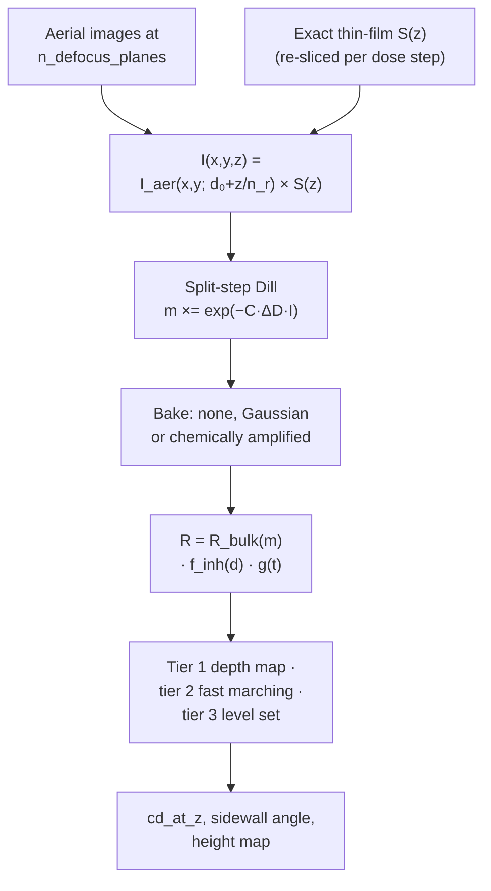
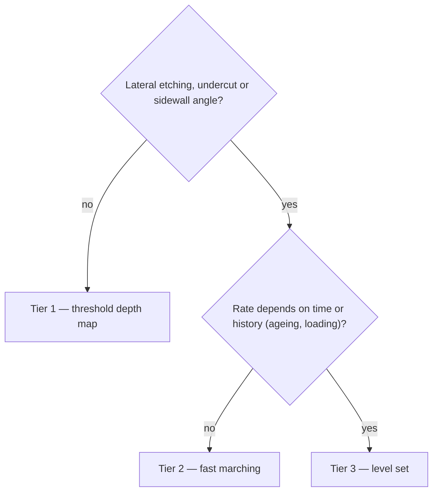

# Volumetric exposure

**Status:** 🔶 Simplified (✅ bake and fast marching) — separable I_aer·S(z) latent image, exact bake, three development tiers; first-order fronts and phenomenological rate modifiers · [matrix](../capability-matrix.md#resist-and-development)

<p class="huv-lead">The 2-D resist path collapses depth into one coupling scalar and cannot see standing-wave ripple, resist loss at depth, sidewall angle, undercut or T-topping. <code>volumetric.rs</code> provides the z-resolved path — exposure on a <code>Grid3D</code>, a post-exposure bake and three development tiers up to a moving-boundary solve — reusing the thin-film field and the resist chemistry, so no physics is re-derived, only re-dimensioned.</p>

<div class="huv-glance" markdown>

| Property | Value |
|---|---|
| Computes | `(x, y, z)` latent image; Gaussian or CAR bake; three development tiers; CD per slice |
| Does not | vector in-film imaging; developer transport; curvature-dependent rates; swelling |
| Default scene | `examples/volumetric.toml`: F₂, NA 0.75, 150 nm on Si, 24 mJ/cm² |
| Grade | 🔶 Simplified (✅ bake and fast marching) |
| Compare with | [Resist models](resist-models.md) · [Thin film](thin-film.md) · [LIGA](liga-deep-xray.md) |

</div>

<div class="huv-physics huv-physics--single" markdown>

<!-- volumetric-latent-xz -> processes/volumetric-exposure.md -->
<figure markdown="span">


<figcaption><strong>The separable model, seen.</strong> Latent image 1 − m(x, z) of 150 nm lines on a 300 nm pitch (157.63 nm, NA 0.75, σ 0.7, 24 mJ/cm²): (a) 150 nm resist on bare Si bands with the λ/2n standing wave, (a′) a 60 nm ARC (1.8 + 0.3i, the test fixture's constants) suppresses it; (b, b′) the bare-Si image after a 5 nm and a 20 nm vertical Gaussian bake, damped by exp(−2π²σ<sub>z</sub>²/P²) = 0.81 and 0.03; (c) the latent linewidth per slice, undefined at the nodes until the bake smooths them. The default resist is illustrative. <em>Model: volumetric exposure 🔶 (separable I<sub>aer</sub>·S(z)) · post-exposure bake ✅ · thin-film transfer matrix ✅.</em></figcaption>
</figure>

<!-- config-volumetric-dose-window -> processes/volumetric-exposure.md -->
<figure markdown="span">


<figcaption><strong>Why no single volumetric dose fits.</strong> The documented default stack (F<sub>2</sub> 157.63 nm, NA 0.75, 150/300 nm lines, 150 nm resist on Si, Gaussian bake 30 nm, fast-marching development for 60 s, 64 × 9.375 nm grid, nz 16) against dose: the spaces clear only above the open-frame dose-to-clear, the resist line then narrows with dose and the 30 mJ/cm² fallback leaves under 10 nm of resist; the dots are the rows of the dose table. <em>Model: volumetric exposure 🔶 · post-exposure bake ✅ · 3D development (fast marching) ✅; illustrative low-contrast resist; computed, not transcribed.</em></figcaption>
</figure>

<!-- huv-table: stack -->
| What is modeled | Grade | Dominant approximation | Details |
|---|---|---|---|
| Volumetric (z-resolved) exposure | 🔶 Simplified | separable I_aer·S(z), paraxial z/n_r, lateral-mean bleaching | [Separable exposure](#separable-exposure-model-no-double-counting) |
| Post-exposure bake (anisotropic Gaussian) | ✅ Implemented | constant lateral D; depth-dependent D_z only | [Post-exposure bake](#post-exposure-bake) |
| Chemically amplified bake (acid/quencher reaction–diffusion) | 🔶 Simplified | no acid loss, constant diffusivities | [Post-exposure bake](#post-exposure-bake) |
| 3D development (fast marching) | ✅ Implemented | static rate field, first-order upwind | [Tier 2](#development-tier-2-fast-marching) |
| 3D development (level set) | ✅ Implemented (🔶 phenomenological rate modifiers) | first-order front; separable rate factors | [Tier 3](#development-tier-3-level-set) |

**Same thing elsewhere:** Python `api.simulate_volumetric(...)` · CLI `deep --config examples/volumetric.toml` · TOML `[deep] develop = "level_set"` · GUI volume viewer · physics → [pipeline](../pipeline.md)

</div>

**Scope.** Four bold statements survive every surface:

- **The exposure is separable**: the in-air aerial image refocused paraxially to each depth, times the exact thin-film intensity $S(z)$ — nothing counted twice, no vector in-film imaging.
- **The bake is exact** for its model: a spectral Gaussian per axis, or the acid–quencher reaction–diffusion of a chemically amplified resist.
- **Development has three tiers**: a per-column threshold depth map, a fast-marching Eikonal front for static rates, and a level set whose rate is re-evaluated at the front.
- **The default resist is illustrative and low-contrast**; every number on this page is a model property, not a calibration.

## How it works



### Separable exposure model: no double counting

```math
I(x, y, z) = I_\mathrm{aer}\!\left(x, y;\; d_0 + z/n_r\right)\, \cdot\, S(z)
```

- $I_\mathrm{aer}$ is the **in-air** aerial image (Hopkins TCC/SOCS), refocused to depth `z` via the paraxial mapping $\Delta f = z / n_r$ ($n_r$ = real part of the resist index) added to `base_defocus_nm`.
- $S(z) = (n_r/n_0) |E(z)|^2$ is the exposing intensity relative to the incident intensity, where $|E(z)|^2$ is `FilmStack::intensity_profile` at **unit incident field**: standing waves, absorption, and every interface reflection, exactly ([thin-film.md](./thin-film.md)). The factor $n_r/n_0$ (real parts of the resist and superstrate indices) turns field intensity into energy flow: the absorbed power density is $\alpha n_r |E|^2$ per unit incident $n_0 |E_0|^2$, so a travelling wave just inside a lossless entrance has $S = T = 4 n_0 n_r/(n_0 + n_r)^2$, and the Dill $C$ (defined against intensity) sees the right dose.

Because the aerial image carries no film response and $S(z)$ carries no lateral pattern, nothing is counted twice. The trade-off is that lateral imaging and vertical film response are fully decoupled — there is no vector in-film imaging, and mask-diffracted orders all share the same normal-incidence $S(z)$. Panels (a) and (a′) of the Physics Strip show the consequence: bare Si bands the latent image with the λ/2n standing wave and a 60 nm ARC suppresses it.

**Standing waves stall development without a bake.** On the default bare-Si stack at 157 nm the in-resist $|E|^2$ swings between ≈ 0.12 and ≈ 1.7 of the incident value with period $\lambda/(2 n_r)$ ≈ 48 nm, and the nodes dissolve a hundred times slower than the antinodes.

!!! note "Standing waves stall development without a bake"
    With the default Mack resist (n = 3) at 30 mJ/cm² a node dissolves at only ≈ 0.3–0.8 nm/s against ≈ 70–90 nm/s at the antinodes, so with `PebModel::None` the dissolution front stops at the first node or two (≈ 110 nm of 300 nm after 60 s in the GUI's default scene). A Gaussian bake damps the standing-wave modulation by $\exp(-2\pi^2\sigma_z^2/P^2)$ (≈ 0.03 for $\sigma_z$ = 20 nm, 0.81 for 5 nm — panels (b, b′) above; measured on the figure the residuals are 0.05 and 0.80, the difference being the finite-thickness edges). The default resist is illustrative and low contrast, so the developed window is narrow: for the GUI's default F₂ 65/180 nm scene (image contrast ≈ 0.46, clear-field peak ≈ 0.66) at 150 nm, 15 mJ/cm², σ = 10/20 nm, the spaces reach the substrate between 20 and 30 s and the lines are gone by 60 s.

### Defocus planes and the per-plane imaging seam

`expose_volumetric` images the mask at `n_defocus_planes` focus planes. With fewer planes than slices (default 8, capped at `nz`), the planes are evenly spaced across the resist (`1` reuses the mid-thickness plane everywhere) and each of the `nz` slice centres interpolates linearly between its two bracketing planes, which bounds the imaging cost at the plane count, not the slice count. With `n_defocus_planes >= nz` every slice is imaged exactly at its own centre depth, $d_0 + z_k/n_r$ — no interpolation. All imaging goes through one internal helper, `aerial_through_focus`, which calls the engine's batched `compute_through_focus(mask, &planes)`: the mask spectrum is computed once (the engine's exact mask spectrum), the planes are imaged in parallel, and each focus gets its own cached focus-exact kernel set — identical to calling `engine.compute(mask, z)` per plane (`test_per_plane_imaging_uses_engine_focus`).

### Split-step Dill bleaching

The total dose is applied in `dose_steps` increments $\Delta D = D/\mathrm{steps}$. After each step, the resist layer is re-sliced into `nz` sublayers whose extinction follows the **laterally averaged** PAC of each slice:

```math
\bar{m}_k = \langle m(x,y,z_k) \rangle_{xy}, \qquad
\kappa_k = \frac{\alpha(\bar m_k)\,\lambda}{4\pi}, \qquad
\alpha(m) = A m + B
```

(`substack_with_sliced_resist`), the exact $S(z)$ is recomputed for the re-sliced stack, and every voxel updates $m \mathrel{*}= \exp(-C \Delta D I)$. As `dose_steps → ∞` this converges to the coupled Dill exposure PDE $\partial I/\partial z = -\alpha(m) I$, $\partial m/\partial D = -C I m$ — subject to the lateral-mean approximation, which exists because a 1D transfer matrix cannot carry laterally varying extinction. `dose_steps = 1` (static absorption) is fine for thin, weakly bleaching resists; use 5–20 for thick or strongly bleaching ones (`test_split_step_converges_toward_more_exposure_at_depth`).

### Post-exposure bake

`apply_peb(latent, &PebModel)` runs one of three bake models in place; sample spacings come from the latent grid's extents:

| `PebModel` | What it does | Solver |
|---|---|---|
| `None` | latent image goes straight to development | — |
| `Gaussian(PebDiffusion)` | Fickian diffusion of the latent image with separate lateral and vertical lengths $\sigma = \sqrt{2Dt}$, optional depth-dependent $D_z(z)$ | `resist::peb_diffuse_anisotropic` |
| `ChemicallyAmplified(CarParams)` | acid/quencher reaction–diffusion; the latent image is read as the remaining PAG and replaced by the protected-site fraction | `resist::car_peb` |

**Gaussian (z-anisotropic) bake.** Each axis gets the exact Gaussian transfer function (FFT; periodic or zero-flux even-extension boundaries), with $\sigma_{xy}$ = `lateral_nm` on x and y and $\sigma_z$ = `vertical_nm` on z. The top and bottom are always zero-flux; the lateral edges are periodic (default, matching the FFT aerial image) or reflecting. With `vertical_diffusivity_scale = Some(s)` the vertical diffusivity varies with depth and the bake solves $\partial_t c = \partial_z (D_z \partial_z c)$ exactly in time; `PebDiffusion::with_exponential_depth_profile` builds $s(z) = 1 + (r - 1)e^{-z/\delta}$. The solver, its side lobes and the depth-dependent propagator are documented on [resist-models.md](./resist-models.md#exact-spectral-diffusion-helpers). `peb_diffuse_3d_anisotropic(latent, &peb)` is the direct entry point; the historical isotropic `peb_diffuse_3d(latent, diffusion_nm, pixel_xy_nm, pixel_z_nm)` keeps its signature as a wrapper for $\sigma_{xy} = \sigma_z$ with reflecting lateral edges.

**Chemically amplified bake.** The standard Mack/PROLITH-class model, concentrations normalized to the initial PAG: $h(0) = 1 - m_\mathrm{exposure}$ (the Dill latent image is read as the remaining PAG), $q(0)$ = `quencher_initial`, $m(0) = 1$. After the bake `latent.pac` holds the **protected-site fraction** $m$, which the Mack rate consumes exactly as it consumes PAC; `apply_peb` returns the full `CarPebResult` (acid, quencher, neutralized total). The equations, the Strang-split time integration and its validation are on [resist-models.md](./resist-models.md#chemically-amplified-resist-car-bake).

### Dissolution-rate law

Tiers 2 and 3 dissolve the resist at

```math
R(\mathbf x, t) = R_\mathrm{bulk}\big(m(\mathbf x)\big)\cdot f_\mathrm{inh}(d)\cdot g(t),
\qquad
f_\mathrm{inh}(d) = 1 - (1 - r_s)\, e^{-d/\delta_\mathrm{inh}},
```

- $R_\mathrm{bulk}$ is the resist's Mack or threshold rate ([resist-models.md](./resist-models.md#mack-development-rate)) on the (baked) latent image.
- $f_\mathrm{inh}$ is **surface inhibition** (`SurfaceInhibition { surface_rate_ratio, depth_nm }`): the dissolution rate is reduced to $r_s R_\mathrm{bulk}$ at the top surface and recovers over the inhibition depth $\delta_\mathrm{inh}$. The depth $d$ is measured below the **original** top surface (slice $k$ sits at $d = (k + \tfrac12) dz$), so the factor is static and both solvers accept it. $r_s < 1$ models the slow-dissolving skin of DNQ/novolac and chemically amplified resists that produces T-topped and rounded profiles; $r_s = 1$ or $\delta_\mathrm{inh} = 0$ disables it.
- $g$ is the developer factor (`DeveloperDepletion`, level set only):

<!-- huv-table: stack -->
| Variant | *g* | Meaning |
|---|---|---|
| `None` | 1 | fresh developer throughout |
| `Exponential { time_constant_s }` | $e^{-t/\tau}$ | developer ageing (e.g. puddle exhaustion) |
| `Loading { capacity_nm }` | $\max(0,\ 1 - \bar h/h_\mathrm{cap})$ | developer consumed by dissolved resist; $\bar h$ = dissolved volume per unit area over the whole field |
| `LocalLoading { capacity_nm, length_nm }` | $\max(0,\ 1 - \tilde h(x,y)/h_\mathrm{cap})$ | as `Loading` with $\tilde h$ the per-column dissolved thickness Gaussian-smoothed over `length_nm` — dense open areas deplete their developer faster than isolated openings (micro-loading) |

**Surface inhibition uses the standard exponential inhibition-layer form; the ageing and loading factors are phenomenological first-order models with user-supplied constants, not fitted developer chemistry.** `development_rate_volume(latent, params, inhibition)` returns the static part $R_\mathrm{bulk} f_\mathrm{inh}$ as a volume (nm/s).

### Which solver when

<!-- huv-table: stack -->
| Tier | Captures | Cost (release, 128×128×32) | Use for |
|---|---|---|---|
| `develop_depth_map` | contiguous vertical clearing per column | one pass over the voxels (milliseconds) | LIGA / grayscale depth questions |
| Fast marching (`develop_fast_marching[_with]`) | lateral etching, undercut, sidewall angle, surface inhibition, standing-wave scallops; any development time from one solve | ≈ 40–50 ms | static rates — the fast default |
| Level set (`develop_level_set`) | everything FMM does, plus time- and history-dependent rates (developer ageing, global and local loading) | (number of CFL steps) × (narrow band); 0.11 s for 20 steps of a slow, surface-inhibited 60 s development | developer depletion / loading, or a moving-boundary cross-check |



For static rates both front solvers are first order and agree within grid error; FMM is the faster choice and gives the arrival time of every voxel in one solve.

<!-- volumetric-levelset-vs-fmm -> processes/volumetric-exposure.md -->
<figure markdown="span">


<figcaption><strong>Two solvers, one front.</strong> 3-D development of an exposed trench (PAC m = 1 − 0.9·exp(−x²/2·20²), uniform in depth; default Mack resist): the moving-boundary level set (thin line) and the static-rate fast-marching arrival time (thick line) agree to within a grid cell after 3 s, and surface inhibition (top-surface rate × 0.1, 10 nm decay) necks the opening just below the surface — the T-top. <em>Model: 3D development (fast marching) ✅ · 3D development (level set) ✅ (🔶 first order; phenomenological inhibition constants).</em></figcaption>
</figure>

### Development tier 1: threshold depth map

`develop_depth_map(latent, threshold)` scans each `(x, y)` column from the resist top and returns the depth of **contiguous** development — it stops at the first voxel with `PAC ≥ threshold`. No lateral etching, no undercut; adequate for LIGA-style and grayscale depth questions at per-column cost.

### Development tier 2: fast marching

The fast-marching tier solves the arrival-time Eikonal equation for the developer front:

```math
\lvert \nabla T(x,y,z) \rvert = \frac{1}{R(x,y,z)}, \qquad T\big|_\mathrm{top} \approx 0
```

Top voxels are seeded at $t_0 = \tfrac{1}{2} \mathrm{px}_z / R$ (half a cell of etching), then a min-heap Dijkstra-like sweep applies first-order **Godunov upwind** updates on the anisotropic grid, solving the sorted quadratic $\sum_a \max\big(0, (T - T_a)/h_a\big)^2 = 1/R^2$ per voxel with a one-sided fallback. The developed region after `t` seconds is $\lbrace T \le t\rbrace$ — including lateral etching and undercut. The rate field must be **static** (standard isotropic wet-etch assumption). Entry points: `develop_fast_marching` (mirror lateral edges, the original), `develop_fast_marching_with` (surface inhibition, periodic or reflecting edges), `fast_marching_times` (any static rate volume); `test_fmm_with_options_reproduces_legacy_solver` pins the three to each other bit for bit. `height_map_from_times(times, dev_time_s)` collapses the volume to a per-column remaining-height map (whole slices; undercut cannot survive that projection — read the 3D `times` directly for re-entrant profiles), and `developed_indicator(times, dev_time_s)` returns the 1/0 developed-region volume for `cd_at_z`.

### Development tier 3: level set

`develop_level_set(latent, params, &DevelopmentOptions, &LevelSetConfig)` evolves a level-set function $\varphi$ (≈ signed distance in nm, negative in the developed region):

```math
\varphi_t + R(\mathbf x, t)\,\lvert\nabla\varphi\rvert = 0, \qquad
\varphi(\mathbf x, 0) = \text{depth below the top surface},
```

with the rate re-evaluated at the front every step. `evolve_level_set` exposes the same solver for an arbitrary initial $\varphi_0$ and rate volume (e.g. a front growing from an interior seed). Outputs: `LevelSetResult { phi, arrival_times, dev_time_s, steps, reinitializations, dissolved_thickness_nm, final_rate_factor }`; `arrival_times` is directly comparable with fast-marching times; `height_map()` gives the remaining height; exceeding `max_steps` returns an error rather than a silently truncated development.

<!-- levelset-development -> processes/volumetric-exposure.md -->
<figure markdown="span">

<picture><source media="(prefers-reduced-motion: reduce)" srcset="../assets/images/sim/anim/levelset-development-still-light.png"></picture>
<picture><source media="(prefers-reduced-motion: reduce)" srcset="../assets/images/sim/anim/levelset-development-still-dark.png"></picture>

<figcaption><strong>Development as a moving front.</strong> x–z slice of the baked latent image with the developed region and the level-set front at t = 0 … 30 s (F<sub>2</sub> σ 0.7, NA 0.75, 150/300 nm lines, 150 nm resist on Si, 24 mJ/cm², Gaussian bake 20/10 nm, surface inhibition 15 nm, surface-rate ratio 0.3); right, resist remaining per column. The default resist is illustrative and low-contrast. <em>Model: volumetric exposure 🔶 (separable I<sub>aer</sub>·S(z)) · anisotropic Gaussian bake ✅ · level-set development ✅ (🔶 first-order front, rate re-evaluated at the front).</em></figcaption>
</figure>

**Honest scope.** Every rate factor implemented here is *separable* — a static spatial field times a time factor. The static and exponential-ageing cases are therefore also reachable with fast marching plus a time reparametrization (and the level set reproduces the static FMM fronts within grid error); the loading factors depend on the history of the developed geometry (and, for `LocalLoading`, vary laterally), and those need the moving boundary. The level-set machinery itself is general and ready for non-separable rates.

<details markdown="1">
<summary>Solver details — upwind gradient, time step, narrow band, extension speeds, the top reservoir, the developer factor</summary>

- **Upwind gradient.** First-order Godunov: $\lvert\nabla\varphi\rvert \approx \big[\sum_a \max(D^-_a\varphi,\ -D^+_a\varphi,\ 0)^2\big]^{1/2}$ (monotone, no speed-up at thin resist walls attacked from both sides).
- **Time step.** Forward Euler with $\Delta t = \mathrm{cfl} / \big(v_\mathrm{max}\sqrt{\textstyle\sum_a h_a^{-2}}\big)$, `cfl` ∈ (0, 1] (default 0.5). $v_\mathrm{max}$ is the largest speed *at the front* — developed band voxels and resist within one cell of the front; resist further ahead moves at most $v_\mathrm{max}$, so fast resist the front has not reached yet does not shrink the step.
- **Narrow band + reinitialization.** Only voxels within `band_cells` of the front are updated. Every `reinit_interval` steps $\varphi$ is rebuilt as a signed distance by unit-speed fast marching from the interface-adjacent voxels, whose values are kept frozen (re-estimating them from interpolated crossings each time shifts the front by O(h²·curvature) per reinitialization; freezing removed that drift). The band must be at least `reinit_interval · cfl + 2` cells wide.
- **Extension speeds.** Developed voxels near the front move with the rate of the resist across their nearest crossing (set when they develop and refreshed at every reinitialization), not with their own — possibly much faster — rate, so the zero level set moves at the rate of the resist being dissolved.
- **Top reservoir.** Developer always fills the space above the resist. On the top slice its vertical attack is combined with the in-grid Godunov gradient as an independent source ($\max$, the earlier arrival wins) rather than inside the quadratic sum — the same way fast marching seeds the top separately — which avoids a $\sqrt2$ kink speed-up of top-edge voxels attacked from above and from the side. The bottom (substrate) is impermeable.
- **Developer factor.** Exponential ageing is integrated exactly by stepping in the pseudo-time $\tau(t) = \tau_d (1 - e^{-t/\tau_d})$ and mapping arrival times back. Loading factors are recomputed from the dissolved thickness after every step and extrapolated to the step midpoint (second order, Adams–Bashforth).
- **Multilayer stacks, buried resist, memory.** The film stack may contain layers above and below the resist; `config.resist_layer` indexes which layer is the resist, layers above it shift the exposure window by `z_offset = Σ thickness(layers above)` and attenuate/reflect the field exactly through the transfer matrix (a top coat costs nothing extra); `resist_layer` out of range, `nz = 0`, `dose_steps = 0` and `n_defocus_planes = 0` are rejected up front. A `Grid3D<f64>` at 512 × 512 × 128 is 268 MB; fast marching holds the rate, arrival-time and accepted-flag volumes alongside it, the level set about five volume-sized buffers — prefer 256² lateral and `nz = 64` unless you need more.

</details>

### Metrics

From [`metrics.rs`](../../crates/highuvlith-core/src/metrics.rs): `cd_at_z(volume, threshold)` measures the center-row CD in every z-slice (one `Option<f64>` per slice, top to bottom) — the width between the two threshold crossings that straddle the field centre, i.e. whichever feature sits at the centre (for the default line/space mask, the resist line). Apply it to the latent image for latent CDs, or to `developed_indicator(times, t)` at threshold 0.5 for developed CDs. `sidewall_angle_deg(cd_top, cd_bottom, thickness)` $= \mathrm{atan2}(2d, CD_\mathrm{top} - CD_\mathrm{bot})$ in trench convention (90° vertical, < 90° narrowing, > 90° re-entrant); `aspect_ratio` is depth/width.

**Latent and developed CD measure the same feature but are different quantities and are not expected to agree.**

!!! question "Latent vs developed CD"
    Both numbers measure the feature straddling the field centre (the resist line for the line/space masks). The latent CD (JSON `cd_top_nm` …) is the width of the PAC $m$ = `develop_threshold` iso-contour, a dose-to-size proxy that ignores development time; the developed CD (`developed.cd_*_nm`) is where the development front stands after `dev_time_s`. In `examples/volumetric.toml` (24 mJ/cm², 20 s) the PAC dips only to $m$ ≈ 0.48 at the top of the space and stays above 0.5 deeper, so the latent CD is 265.5 nm at the top and n/a below, while the developer, at the Mack rates of the partially exposed resist, carries the edge to where $m$ ≈ 0.87–0.91 and leaves a 75 / 112.5 / 112.5 nm line. Use the developed CD for print predictions. The dose dependence of the developed CD and remaining height for the documented default stack is the engine figure of the Physics Strip (also on [configuration.md](../configuration.md#deep) with its table).

## Process regime

| Quantity | Typical |
|---|---|
| Resist thickness | 150 nm–several µm (beyond that, use [liga-deep-xray.md](./liga-deep-xray.md)) |
| `nz` | 32–128 slices (≥ 4 slices per standing-wave period λ/2n) |
| `n_defocus_planes` | 8 (default); 1 for thin resist well inside the DOF; `= nz` for exact per-slice focus |
| `dose_steps` | 1 (thin/weak bleaching) to 5–20 (thick/strong bleaching) |
| Dose | 10–100 mJ/cm² |
| PEB diffusion length | 5–30 nm lateral; vertical often shorter (interfaces, bake-plate gradients) |
| CAR bake | 60–90 s; quencher ≈ 0.1 of the PAG and measured EUV-CAR deprotection blur ≈ 2–5.5 nm reported for a calibrated model — see [resist-models.md](./resist-models.md#process-regime); the default $\sqrt{2D_h t}$ ≈ 15.5 nm is illustrative |
| Development | 10–60 s; Mack $R_\mathrm{max}$ ~ 100 nm/s |
| Surface inhibition | $r_s$ ≈ 0.1–0.5, $\delta_\mathrm{inh}$ ≈ 5–30 nm (illustrative) |
| Aspect ratios | up to ~10 with tier-2/3 development |

## What the code provides

Everything lives in [`crates/highuvlith-core/src/volumetric.rs`](../../crates/highuvlith-core/src/volumetric.rs):

- **`VolumetricExposureConfig`**, **`expose_volumetric(engine, mask, stack, resist, λ, &config)`** → `VolumetricLatentImage` (wraps a `Grid3D<f64>` PAC).
- **`PebModel`** (`None`, `Gaussian(PebDiffusion)`, `ChemicallyAmplified(CarParams)`), **`apply_peb`**, **`peb_diffuse_3d_anisotropic`**, the legacy **`peb_diffuse_3d`**.
- **`SurfaceInhibition`**, **`DevelopmentOptions`**, **`development_rate_volume`**; **`develop_depth_map`**, **`develop_fast_marching[_with]`**, **`fast_marching_times`**, **`height_map_from_times`**, **`developed_indicator`**; **`LevelSetConfig`**, **`DeveloperDepletion`**, **`develop_level_set`**, **`evolve_level_set`** → `LevelSetResult`.
- Python: `huv.expose_volumetric`, `huv.develop_fast_marching`, `huv.height_map_from_times`, `huv.VolumetricResult` (`from_array`, `depth_map`, `cd_at_z`) at package top level; `peb_gaussian`, `peb_car`, `development_rate`, `develop_level_set`, `simulate_volumetric` in `highuvlith.api` ([`crates/highuvlith-py/src/py_volumetric.rs`](../../crates/highuvlith-py/src/py_volumetric.rs)).

## Model coverage

`VolumetricExposureConfig` (consumed by `expose_volumetric`):

| Field | Unit | Consumed by | Status |
|---|---|---|---|
| `dose_mj_cm2` | mJ/cm² | split-step exposure (ΔD per step) | live |
| `nz` | — | slice count, sublayer re-slicing, `Grid3D` z-dim | live |
| `n_defocus_planes` | — | aerial-image plane count + interpolation (`>= nz`: one exact plane per slice) | live |
| `dose_steps` | — | bleaching update count | live |
| `base_defocus_nm` | nm | focus of the aerial image at the resist top | live |
| `resist_layer` | index | stack slicing, `z_offset`, $n_r$, thickness | live |

`PebDiffusion` and `CarParams` are documented on [resist-models.md](./resist-models.md#model-coverage) (every field live). Development:

<!-- huv-table: stack -->
| Field | Unit | Consumed by | Status |
|---|---|---|---|
| `SurfaceInhibition.surface_rate_ratio`, `.depth_nm` | —, nm | $r_s$ and $\delta_\mathrm{inh}$ in $f_\mathrm{inh}$ (FMM and level set) | live |
| `DevelopmentOptions.surface_inhibition`, `.lateral_boundary` | option, enum | rate volume and edges of both solvers (default periodic; the legacy `develop_fast_marching` is always mirror) | live |
| `LevelSetConfig.dev_time_s`, `.cfl`, `.reinit_interval`, `.band_cells`, `.max_steps` | s, —, steps, cells, — | end time, time step, reinitialization cadence, narrow-band half-width (≥ `reinit_interval·cfl + 2`), step budget | live |
| `DeveloperDepletion::Exponential.time_constant_s` | s | $\tau$ in $g = e^{-t/\tau}$ | live |
| `DeveloperDepletion::{Loading, LocalLoading}.capacity_nm`, `LocalLoading.length_nm` | nm | $h_\mathrm{cap}$; lateral smoothing σ of the dissolved-thickness map | live |
| Rate dependence on local front geometry (curvature, normal), developer transport in trenches | — | — | planned |

## Usage

### Python

`expose_volumetric`, `develop_fast_marching`, `height_map_from_times` and `VolumetricResult` are at package top level; the bake and level-set functions live in `highuvlith.api`. The example runs exposure → bake → fast marching → level set and the one-call `simulate_volumetric`, printing the mean remaining height of the one-call run and in how many slices the centre feature has a developed CD:

<!-- verify-example -->
```python
import highuvlith as huv
from highuvlith.api import (
    develop_level_set, development_rate, peb_car, peb_gaussian, simulate_volumetric,
)

resist = huv.ResistConfig(thickness_nm=150.0)
vol = huv.expose_volumetric(
    source=huv.SourceConfig.f2_laser(sigma=0.7),
    optics=huv.OpticsConfig(numerical_aperture=0.75),
    mask=huv.MaskConfig.line_space(cd_nm=64.0, pitch_nm=128.0),
    film_stack=huv.FilmStackConfig(),   # default: 150 nm resist on Si
    resist=resist,
    grid=huv.GridConfig(size=256, pixel_nm=1.0),
    dose_mj_cm2=30.0, nz=64, n_defocus_planes=8, dose_steps=5,
)
baked = peb_gaussian(vol, 20.0, vertical_nm=10.0)      # exact anisotropic Gaussian
# car = peb_car(vol, quencher=0.15); baked = car.protected   # CAR bake

# Static rate: fast marching (new keywords are optional; defaults = old behaviour).
times = huv.develop_fast_marching(
    baked, resist, pixel_xy_nm=1.0, pixel_z_nm=150.0 / 64,
    surface_rate_ratio=0.3, inhibition_depth_nm=15.0, lateral="periodic",
)
# Moving boundary with developer ageing.
ls = develop_level_set(
    baked, resist, dev_time_s=60.0, surface_rate_ratio=0.3, inhibition_depth_nm=15.0,
    depletion="exponential", depletion_time_constant_s=40.0,
)
height = ls.height_map()
developed_cds = ls.developed().cd_at_z(0.5)          # per slice, top to bottom
rate = development_rate(baked, resist, surface_rate_ratio=0.3, inhibition_depth_nm=15.0)

# One call: exposure -> bake -> development.
res = simulate_volumetric(
    huv.SourceConfig.f2_laser(sigma=0.7), huv.OpticsConfig(numerical_aperture=0.75),
    huv.MaskConfig.line_space(cd_nm=64.0, pitch_nm=128.0), huv.FilmStackConfig(),
    resist, huv.GridConfig(size=128, pixel_nm=2.0),
    peb="car", develop="level_set", dev_time_s=30.0,
    surface_rate_ratio=0.3, inhibition_depth_nm=15.0,
)
res.developed_cd_nm, res.height_map.values, res.arrival_times.values
h = res.height_map.values
print(f"mean remaining height {h.mean():.1f} nm; developed CD defined in "
      f"{sum(cd is not None for cd in res.developed_cd_nm)} of {len(res.developed_cd_nm)} slices")
```

??? success "Output"

    ```text
    mean remaining height 145.3 nm; developed CD defined in 0 of 32 slices
    ```

With the illustrative defaults the one-call CAR run (30 mJ/cm², 30 s) has barely begun to develop — 145 nm of 150 nm remain and no slice has a developed CD yet; the recorded number is the model's, not a calibration.

`huv.VolumetricResult.from_array(values, x_range_nm, y_range_nm, z_range_nm)` wraps any `(nz, ny, nx)` array for the bake and development functions; `develop_level_set` takes `depletion` = `"none"` / `"exponential"` (`depletion_time_constant_s`) / `"loading"` (`loading_capacity_nm`) / `"local_loading"` (+ `loading_length_nm`) and the solver controls `cfl`, `reinit_interval`, `band_cells`, `max_steps`; `peb_gaussian` accepts a depth profile as `vertical_scale` (length-nz array) or `vertical_surface_ratio` + `vertical_decay_nm`. Interference and Talbot PAC volumes ([interference-volumetric.md](./interference-volumetric.md), [talbot.md](./talbot.md)) feed the same tiers directly; grayscale masks built from `GrayRect` features ([grayscale.md](./grayscale.md)) run through `expose_volumetric` like any other mask.

### CLI and TOML

`highuvlith deep` with `[deep] mode = "volumetric"` ([`commands/deep.rs`](../../crates/highuvlith-cli/src/commands/deep.rs), [`examples/volumetric.toml`](../../examples/volumetric.toml), [configuration](../configuration.md#deep)):

| Keys | Meaning |
|---|---|
| `nz`, `n_defocus_planes`, `dose_steps`, `resist_thickness_nm`, `dose_mj_cm2`, `develop_threshold` | exposure (film stack = resist-on-Si from the materials database at the source wavelength, resized to `resist_thickness_nm`, default 150 nm; resist chemistry = `ResistParams::default()`) |
| `peb` = `none` \| `gaussian` \| `car` | bake model (default `gaussian` with the resist's `peb_diffusion_nm`, 30 nm on both axes, matching Python) |
| `peb_lateral_nm`, `peb_vertical_nm`, `peb_vertical_surface_ratio`, `peb_vertical_decay_nm` | Gaussian bake lengths and optional depth profile |
| `car_peb_time_s`, `car_k_amp`, `car_k_quench`, `car_quencher`, `car_acid_diffusivity_nm2_s`, `car_quencher_diffusivity_nm2_s`, `car_vertical_ratio` | CAR bake parameters (defaults = `CarParams::default()`) |
| `develop` = `threshold` \| `fmm` \| `level_set`, `dev_time_s` | development tier (default `threshold`: latent CDs only) and time (default 60 s) |
| `surface_rate_ratio`, `inhibition_depth_nm` | surface inhibition |
| `lateral_boundary` = `periodic` \| `reflecting` | lateral edges for the bake and development (default `periodic`) |
| `depletion` = `none` \| `exponential` \| `loading` \| `local_loading`, `depletion_time_constant_s`, `loading_capacity_nm`, `loading_length_nm` | developer factor (requires `develop = "level_set"`) |

It reports the latent-image CD (top/mid/bottom at `develop_threshold`) and its sidewall angle, and with `develop = "fmm"` or `"level_set"` also the developed CD of the feature straddling the field centre, the developed sidewall angle, the mean remaining height, and (level set) the step count, dissolved thickness and final developer factor. With `--output foo.png` the image is the x–z developed profile through the centre row (or the mid-depth latent slice when `develop = "threshold"`); otherwise a JSON summary. The GUI's [volume viewer](../gui.md#views) renders the same latent image and developed resist.

<details markdown="1">
<summary>Rust</summary>

```rust
use highuvlith_core::metrics::cd_at_z;
use highuvlith_core::resist::{CarParams, DiffusionBoundary, PebDiffusion};
use highuvlith_core::volumetric::{
    apply_peb, develop_fast_marching_with, develop_level_set, developed_indicator,
    expose_volumetric, DeveloperDepletion, DevelopmentOptions, LevelSetConfig, PebModel,
    SurfaceInhibition, VolumetricExposureConfig,
};

let config = VolumetricExposureConfig { dose_mj_cm2: 30.0, nz: 64, n_defocus_planes: 8,
                                        dose_steps: 5, base_defocus_nm: 0.0, resist_layer: 0 };
let mut latent = expose_volumetric(&engine, &mask, &stack, &resist, 157.63, &config)?;
apply_peb(&mut latent, &PebModel::Gaussian(PebDiffusion::anisotropic(20.0, 10.0)))?;
// or: apply_peb(&mut latent, &PebModel::ChemicallyAmplified(CarParams::default()))?;
let options = DevelopmentOptions { surface_inhibition: Some(SurfaceInhibition::new(0.3, 15.0)?),
                                   lateral_boundary: DiffusionBoundary::Periodic };
let times = develop_fast_marching_with(&latent, &resist, pixel_xy, pixel_z, &options)?;
let ls = develop_level_set(&latent, &resist, &options, &LevelSetConfig {
    depletion: DeveloperDepletion::Exponential { time_constant_s: 40.0 }, ..LevelSetConfig::new(60.0) })?;
let height = ls.height_map();
let developed_cd = cd_at_z(&developed_indicator(&ls.arrival_times, 60.0), 0.5);
```

</details>

## Limits

- **Separable exposure.** No vector in-film imaging; the lateral image is refocused paraxially ($z/n_r$) and every diffraction order shares the normal-incidence $S(z)$; bleaching uses the lateral-mean PAC per slice.
- **First-order fronts.** Both front solvers are first order in the grid spacing; arrival times near sharp rate contrasts can differ between them by up to the time to cross one cell, and a strongly curved front (radius of a few cells) lags by a fraction of a cell.
- **Phenomenological rate modifiers.** Surface inhibition, ageing and loading use user-supplied constants; there is no developer transport (diffusion into narrow trenches), no dependence of the rate on front curvature or orientation, and no swelling.
- **Bake.** Gaussian and CAR diffusivities are constant (the CAR diffusivity does not depend on deprotection); the lateral diffusivity cannot vary with depth.
- **Thin-film inheritance.** The oblique-TM in-film intensity is the stack model's $|U|^2$ approximation ([thin-film.md](./thin-film.md#limits)).

<details markdown="1">
<summary>Behaviour changes</summary>

- **2026-10-01 — exposing intensity.** Before this date the factor $n_r/n_0$ in $S(z)$ was missing and every resist with $n_r \ne n_0$ was under-exposed by $1/n_r$ (×0.61 for the default $n_r = 1.65$ in vacuum); `examples/volumetric.toml` moved from 40 to 24 mJ/cm² to keep its profile.
- **2026-10-01 — the CLI's film stack.** `highuvlith deep` builds the resist-on-Si stack from the materials database at the source wavelength instead of reusing the fixed 157 nm constants at every wavelength; for `examples/volumetric.toml` the top latent CD moved from 264.8 to 265.5 nm while the developed CD (75.0 / 112.5 / 112.5 nm), sidewall (93.6°) and mean remaining height (98.1 nm) are unchanged ([thin-film.md](./thin-film.md#usage)).
- **0.2.0 — CLI `[deep]` defaults.** `peb` defaults to `gaussian` (was `none`) and the resist to 150 nm (was 300 nm), matching Python and the core; with standing waves and no bake, development stalled at the first node.
- **`peb_diffuse_3d`** previously convolved with a sampled Gaussian truncated at 3σ and clamped (edge-replicated) boundaries; it is now a wrapper over the exact kernel with reflecting lateral edges. The exact kernel differs most for σ ≲ 1.5 pixels and within ~3σ of the field edges.

</details>

<details markdown="1">
<summary>Validation — 34 tests</summary>

`#[test]` functions in [`volumetric.rs`](../../crates/highuvlith-core/src/volumetric.rs) unless noted; fixtures from independent numpy evaluations.

| Test | What it pins | Tolerance |
|---|---|---|
| `test_closed_form_beer_lambert_exposure` | index-matched, non-bleaching resist under a uniform clear mask: $m(z) = \exp(-C D I_0 e^{-\alpha z})$ | — |
| `test_exposing_intensity_includes_resist_index` | vacuum over n = 1.65 + iκ resist on an index-matched substrate: $m(z) = \exp(-C D T e^{-\alpha z})$ with $T = n_r \lvert 2/(1 + n_r)\rvert^2$ = 0.939819, fixtures 0.570343 / 0.591635 / 0.612255 / 0.649026 at z = 4.69 / 79.7 / 154.7 / 295.3 nm; an index-matched superstrate gives $T = 1$ | 2e-3 |
| `test_z_mean_matches_effective_coupling` | the z-mean of the exact $S(z)$ equals the 2D path's coupling factor | — |
| `test_per_plane_imaging_uses_engine_focus` | slices exposed with the engine's own focus-exact images at `base_defocus_nm + z/n_r`, interpolated or one plane per slice | 1e-12 |
| `test_split_step_converges_toward_more_exposure_at_depth`, `test_dose_monotonicity_and_bounds`, `test_invalid_config_rejected`, `test_develop_depth_map_synthetic` | bleaching convergence, monotonicity, guards; tier-1 contiguous-depth semantics | — |

| `test_apply_peb_models` | `None` is the identity; vertical-only Gaussian leaves a z-uniform field unchanged and lateral diffusion conserves the mean; CAR without quencher or diffusion gives $m = \exp(-k_\mathrm{amp}(1 - m_\mathrm{exp})t)$ | 1e-12 |
| `test_peb_3d_anisotropic_axis_variances`, `test_peb_3d_reduces_variance_preserves_bounds` | an interior impulse spreads with $\sigma_z^2 = 9$ and $\sigma_{xy}^2 = 64$ nm² (the legacy isotropic entry point gives $\sigma^2$ on every axis); variance reduction, bounds | 1e-6 |
| `test_fmm_uniform_rate_front`, `test_fmm_blocked_column_stays_undeveloped`, `test_fmm_with_options_reproduces_legacy_solver` | planar front at $T = z/R$; unexposed columns only trickle-develop; the three FMM entry points agree bit for bit | exact |
| `test_surface_inhibition_factor_fixture` | $f_\mathrm{inh}(0) = r_s$, $f_\mathrm{inh}(\delta) = 1 - 0.8/e$ = 0.705696447… for $r_s = 0.2$, → 1 at depth | — |
| `test_level_set_uniform_rate_planar_front_is_exact` | slice $k$ arrives at $(k + \tfrac12) dz/R$ with periodic and reflecting edges; dissolved thickness $R t$ | 1e-9 (observed ~4e-16) |
| `test_level_set_matches_fast_marching_for_static_rates` | Gaussian exposure spot, with and without inhibition: median relative arrival-time difference < 5 %, 90th percentile < 8 % (1.8–3.8 % and ≤ 5.1 % measured); every voxel classified differently lies within one voxel of the FMM front | asserted bounds |
| `test_level_set_spherical_growth_from_a_seed` | front radius $r_0 + Rt$ from a 3-cell seed: max radial error ≤ 1 cell, mean ≤ ½ cell | — |
| `test_inhibited_planar_front_converges_to_analytic_integral` | $t(z) = (\delta/R)\ln[(e^{z/\delta} - a)/(1 - a)]$, $a = 1 - r_s$ (fixture 0.6311377 s at 40.25 nm): FMM 8.5 → 5.2 → 3.0 %, level set 8.0 → 5.5 → 2.8 % at dz = 2, 1, 0.5 nm | first order |
| `test_surface_inhibition_produces_t_top_in_both_solvers` | $r_s = 0.1$, $\delta = 10$ nm: the opening necks just below the surface (FMM 70.4 nm at 6 nm vs 73.5 nm at 34 nm; level set 70.5 vs 73.7 nm) | one 2 nm pixel |
| `test_exponential_ageing_is_exact_time_reparametrization` | planar arrivals equal $-\tau\ln(1 - \tau_k/\tau)$; slices beyond $R\tau(1 - e^{-t/\tau})$ never develop; aged arrivals equal the time-mapped static arrivals | 1e-9 |
| `test_global_loading_planar_front_matches_analytic` | arrival $-(h_\mathrm{cap}/R)\ln(1 - z/h_\mathrm{cap})$ (0.41 % observed); dissolved thickness within 0.5 nm of $h_\mathrm{cap}(1 - e^{-Rt/h_\mathrm{cap}})$ | 1 % |
| `test_local_loading_slows_openings_near_dense_areas` | a 20 nm trench next to a 100 nm opening develops shallower (70 vs 80 nm alone; $h_\mathrm{cap}$ = σ = 60 nm, 1 s); a 1 nm depletion length decouples them | — |
| `test_periodic_lateral_boundary_is_translation_invariant` | both solvers invariant under a whole-pixel roll with periodic edges; mirror edges are not | 1e-12 |
| `test_level_set_rejects_invalid_configuration`, `test_developed_indicator_matches_height_map`; `metrics.rs`: `test_cd_at_z_synthetic`, `test_sidewall_angle_conventions` | guards; indicator ↔ height map; per-slice CD; 90°/45°/re-entrant conventions | — |
| Python `tests/python/test_volumetric.py` (`test_volumetric_result_from_array_round_trip`, `test_level_set_planar_front_is_exact`, `test_level_set_agrees_with_fast_marching`, `test_surface_inhibition_rate_and_top_arrival`, `test_level_set_exponential_developer_ageing`, `test_peb_gaussian_anisotropic_moments`, `test_peb_car_exact_limit_and_mass_balance`, `test_simulate_volumetric_end_to_end`, the exposure tests); CLI `test_parse_volumetric_bake_and_development_keys`, `test_volumetric_bake_and_development_end_to_end` | the Python and CLI surfaces | — |

</details>

## References

- F. H. Dill, W. P. Hornberger, P. S. Hauge, J. M. Shaw, "Characterization of positive photoresist," *IEEE Trans. Electron Devices* **22**, 445 (1975) — exposure PDE that the split-step scheme discretizes.
- C. A. Mack, *Fundamental Principles of Optical Lithography*, Wiley (2007) — standing waves, PEB, chemically amplified resists, surface inhibition, development.
- J. A. Sethian, "A fast marching level set method for monotonically advancing fronts," *PNAS* **93**, 1591 (1996) — the Eikonal solver.
- S. Osher, J. A. Sethian, "Fronts propagating with curvature-dependent speed: algorithms based on Hamilton–Jacobi formulations," *J. Comput. Phys.* **79**, 12 (1988) — the level-set formulation.
- J. A. Sethian, *Level Set Methods and Fast Marching Methods*, 2nd ed., Cambridge University Press (1999) — upwind schemes, narrow bands, reinitialization, extension velocities.
- D. Adalsteinsson, J. A. Sethian, "The fast construction of extension velocities in level set methods," *J. Comput. Phys.* **148**, 2 (1999).

**Part of Processes · see also:** [index](index.md) · [Thin film](thin-film.md) · [Resist models](resist-models.md) · [Interference & two-photon](interference-volumetric.md) · [Talbot lithography](talbot.md) · [Grayscale](grayscale.md) · [GUI volume viewer](../gui.md#views) · [configuration](../configuration.md#deep)
