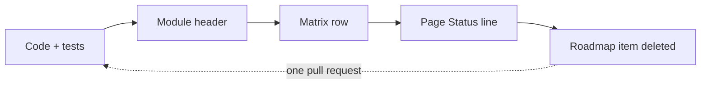

# Reference

The reference section is the part of this site that is checked rather than read: the capability matrix grades every model, the four front ends are documented against the code, and one canonical run threads them so their numbers can be compared. Start with the matrix, then the front end you use; nothing here claims more than a matrix row, and the matrix is parsed by the build, not retyped.

<figure markdown="span">

<figcaption><strong>One tile per matrix row; the row text is authoritative.</strong> Two-tone tiles are split grades (first colour = headline grade). <em>Drawn from the matrix itself.</em></figcaption>
</figure>

Every capability is graded in the [capability matrix](../capability-matrix.md#status-taxonomy) as ✅ Implemented, 🔶 Simplified, 🧪 Theoretical or 🗺️ Planned; the chips on the cards below are copied from its rows.

## Reading order

-   **Capability matrix**

    ---

    The single source of truth: one graded row per capability with its stated approximations and the code that implements it.

    [Check what is real →](../capability-matrix.md)

-   **TOML configuration**

    ---

    ✅ Implemented · every table and key the CLI reads, its default, its validation and the Python name beside it.

    [Every key →](../configuration.md)

-   **CLI**

    ---

    ✅ Implemented · seven subcommands with real transcripts and the files each one writes.

    [Command line →](../cli.md)

-   **GUI**

    ---

    ✅ Implemented · the desktop app, panel by panel, on genuine captures.

    [Desktop app →](../gui.md)

-   **Python API**

    ---

    ✅ Implemented · the package, class by class, with every example executed in CI.

    [Python →](../python-api.md)

-   **Research modules**

    ---

    Optimization, patterning, stochastics and research models, each graded row by row; none of them is the whole engine.

    [Research modules →](../research-modules.md)

-   **Extending highuvlith**

    ---

    Where a new source family, process or optic touches the code, with the same-PR rule.

    [Extend it →](../extending.md)

-   **Roadmap**

    ---

    🗺️ Planned · what is missing, what it would unblock, and what bounds it today.

    [Roadmap →](../roadmap.md)

## The Rosetta table

One run threads the README, [getting started](../getting-started.md), the [Python API](../python-api.md), the [CLI](../cli.md) and the [Simulator index](../simulator/index.md): 65 nm opaque lines on a 180 nm pitch, F₂ 157.63 nm, NA 0.75, conventional illumination σ 0.7, the 0.3 printing threshold — exactly [`examples/sim.toml`](../../examples/sim.toml). The numbers below are recorded outputs (the Python line from the executed getting-started example, the CLI line from the transcript on the CLI page); `tests/docs/test_rosetta.py` asserts that Python and the CLI agree within the example runner's tolerances and that this table quotes the same numbers.

<!-- rosetta:start -->
<!-- huv-table: stack -->
| Front end | The same run | Where the numbers appear | Contrast | Printed CD | NILS |
|---|---|---|---|---|---|
| Python | `huv.simulate_line_space(65.0, 180.0, na=0.75)` | [getting started, example 1](../getting-started.md) (printed to three decimals) | 0.454 | — | 0.65 |
| CLI | `highuvlith simulate --config examples/sim.toml` | [the `simulate` transcript](../cli.md) | 0.4545 | 41.20 nm | 0.654 |
| TOML | `[mask] cd_nm = 65.0`, `pitch_nm = 180.0` · `[optics] na = 0.75` · `[source] sigma = 0.7` | [`examples/sim.toml`](../../examples/sim.toml), the file the CLI line reads | same run | same run | same run |
| GUI | `cargo run --release -p highuvlith-gui -- --preset f2 --cd 65 --pitch 180` | the status bar of the [Aerial view](../gui.md) | same engine | same engine | same engine |
| Notebook | `examples/notebooks/01_quickstart_aerial.ipynb` | executed headlessly in CI | same call as Python | — | same call as Python |
<!-- rosetta:end -->

The Python wrapper and the CLI both snap the 1 nm pixel to 0.703125 nm so the 180 nm field holds one whole period (the CLI prints a note); the printed CD is the width of the dark feature at I = 0.3 on the y = 0 cut. The Python example prints its contrast to three decimals, which is why 0.454 and 0.4545 are the same number.

## Defaults by front end

The volumetric chain (z-resolved exposure, bake, development) is the one place where the front ends start from different defaults. This table is the single statement of them; [configuration](../configuration.md#mode-volumetric), the [CLI](../cli.md), the [GUI](../gui.md) and the [Python API](../python-api.md) link it rather than restate it. Values are read from `python/highuvlith/api.py` (`simulate_volumetric`), `crates/highuvlith-cli/src/commands/deep.rs` and `crates/highuvlith-gui/src/compute.rs` (`VolumetricParams`).

<!-- huv-table: stack -->
| Setting | Python `simulate_volumetric` | CLI `[deep] mode = "volumetric"` | GUI Volume tab |
|---|---|---|---|
| Dose | 30 mJ/cm² | `[process] dose_mj_cm2`, else 30 mJ/cm² | 15 mJ/cm² |
| Resist thickness | the `FilmStackConfig` you pass (default stack: 150 nm resist on Si) | 150 nm (`resist_thickness_nm`) | 150 nm |
| Depth slices `nz` · defocus planes | 32 · 4 | 64 · 8 | 32 · 8 |
| Post-exposure bake | Gaussian, σ = the resist `peb_diffusion_nm` (30 nm) on both axes | Gaussian, 30 nm on both axes (`peb = "gaussian"`; `"none"` turns it off) | Gaussian, σxy 10 nm / σz 20 nm |
| Development | fast marching (`develop="fmm"`) | per-slice threshold (`develop = "threshold"`); `fmm` / `level_set` opt in | fast marching (level set selectable) |
| Development time | 60 s | 60 s (`dev_time_s`, read by `fmm` / `level_set`) | 30 s |
| Surface inhibition | ratio 1.0, depth 0 nm (off) | off unless `surface_rate_ratio` / `inhibition_depth_nm` are set | off |

The three sets differ on purpose: the GUI's tuned set exists because the core's default resist is illustrative and low-contrast, so the default 30 mJ/cm² over-develops the default stack within 60 s — see [choosing the dose](../configuration.md#mode-volumetric) for the measured window. Before 2026-10-01 the CLI defaulted to no bake and 300 nm of resist; the [audit log](../capability-matrix.md#audit-log) records the change.

## How a capability changes grade

A grade is copied, never typed: a capability moves between the four grades only when the code, its tests, the module header, the matrix row, the page's Status line and the roadmap change together in one pull request. The same loop is drawn on [Extending highuvlith](../extending.md) and in [CONTRIBUTING.md](https://github.com/sonoransun/highuvlith/blob/main/CONTRIBUTING.md); the [roadmap](../roadmap.md) links it.

Four places must agree before a grade changes: the module's `# Model status` header, the matrix row, the page's `**Status:**` line and the roadmap. CI checks the mechanical half of this — every page outside the index and narrative trees carries a Status line, every Python example on the site runs and its printed output is compared, the figure captions' `Model:` clauses are resolved against matrix rows, and the legend counts are regenerated from the matrix.

**Where next:** [Capability matrix](../capability-matrix.md) · [TOML configuration](../configuration.md) · [Python API](../python-api.md) · [Simulator](../simulator/index.md)
