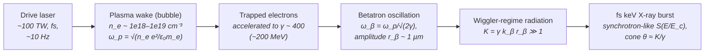

# Betatron

**Status:** 🧪 Theoretical — a planar-orbit, synchrotron-like model (ω_p, ω_β, K, E_c, photons per period, S(y)) that is textbook physics, fixture-tested; the source itself is a keV broadband ~10 Hz imaging source with 3.5 µW average X-ray power, not a lithography source · [matrix](../capability-matrix.md#light-sources)

<p class="huv-lead">In a laser-wakefield accelerator an intense short pulse drives a plasma wave; in the blow-out ("bubble") regime the electrons are expelled from behind the pulse, leaving a column of ions. Electrons trapped in that cavity reach hundreds of MeV over millimetres and, because the ion column pulls them back towards the axis with a linear force, they oscillate transversely — betatron oscillations. The plasma is thereby a µm-amplitude, mm-long wiggler, and the electrons radiate a femtosecond, synchrotron-like burst of keV X-rays from a µm-size source into a ~10 mrad cone (Rousse et al. 2004).</p>

<div class="huv-physics" markdown>

<figure markdown="span">


<figcaption><strong>Mechanism.</strong> X-ray tube: thermionic electrons accelerated through the kVp strike a thick anode where about 99 % of the power becomes heat and the rest the Kramers continuum up to E₀ = eV plus the K and L lines the anode's edges allow; the Be window removes the soft photons and the flux spreads as 1/(4πd²) to the LIGA mask. Betatron: a 100 TW pulse blows out a plasma bubble, trapped electrons reach γ ≈ 400 and oscillate in the ion cavity at ω_β = ω_p/√(2γ), radiating a synchrotron-like femtosecond keV burst. Both are shadow-printed: no projection pupil. <em>Schematic, not to scale; no model badge.</em></figcaption>
</figure>

<figure markdown="span">


<figcaption><strong>A synchrotron spectrum from a plasma wiggler.</strong> The preset's <code>spectral_flux_density(1000 mm)</code> on the log-energy bins of the [0.1, 8] E<sub>c</sub> window the LIGA module samples (E<sub>c</sub> = 8.07 keV, K = 8.3, 10 periods), with the universal S(y)/y shape continued outside it: the window holds 46 % of the photons and the mean photon energy is 0.308 E<sub>c</sub>, both evaluated from the K<sub>5/3</sub> integral and checked against the engine's bins. One electron energy, one amplitude, a flat-top cone of half-angle K/γ. <em>Model: Laser-wakefield betatron X-rays 🧪.</em></figcaption>
</figure>

<!-- huv-table: stack -->

| What is modeled | Grade | Dominant approximation | Details |
|---|---|---|---|
| Laser-wakefield betatron X-rays | 🧪 Theoretical | planar sinusoidal orbits, one electron energy and amplitude, constant γ, a flat-top cone of half-angle K/γ | [Key equations](#key-equations) |
| LIGA / deep X-ray depth dose and exposure time | ✅ Implemented | the beam feeds LIGA as `XraySpectrum::BendingMagnet { critical_energy_kev }`; absolute exposure only from an explicit flux density | [What the model does](#what-the-model-does) |
| Machine-parameter physics layer | ✅ Implemented | ω_p, ω_β, K, E_c, N_γ ≈ 3.31×10⁻² K and the S(y) spectrum, fixture-tested | [Derived quantities](#derived-quantities) |
| Illumination pupil fills | ✅ Implemented | not a projection source: `intensity_at()` is reached only if forced through projection imaging | [What the model does](#what-the-model-does) |

</div>

<p class="huv-lead">Betatron sources are compact and ultrafast, and their small source size gives excellent spatial resolution — they are used for phase-contrast imaging, not lithography. They deliver ~10⁸–10⁹ photons per shot at ≲ 10 Hz with 100-TW-class drivers, i.e. µW of average X-ray power; for lithography they are at most a curiosity for LIGA-style shadow printing, and `BetatronSource` exists to put numbers on that, deriving everything from the plasma density, electron energy, oscillation amplitude, interaction length and bunch charge. The betatron lane of the mechanism drawing is this page's; the tube lane has its own page.</p>

<div class="huv-glance" markdown>

| Property | Value |
|---|---|
| Wavelength | 0.499 nm at the mean photon energy 2.48 keV = 0.308 E_c (E_c = 8.07 keV for the preset) — bookkeeping, Δλ/λ = 1 |
| Band / class | lab white beam · synchrotron-like S(E/E_c) continuum from a plasma wiggler (K = 8.3), fs bursts at 10 Hz |
| Coherence → pupil | incoherent (ζ = 0; the 3.5×10⁻⁶ coherent fraction is reported, not used); shadow-printed, no projection pupil |
| Power | 3.5 µW **average X-ray power into the K/γ cone at the source** (0.35 µJ per shot × 10 Hz); ×7×10⁷ short of 250 W |
| Presets | `betatron()` = `lwfa_100tw` (200 MeV, 10¹⁹ cm⁻³, 1 µm, 3 mm, 50 pC, 10 Hz), any custom set of the six inputs |
| Grade | 🧪 Theoretical |
| Compare with | [X-ray tube](xray-tube.md) · [Synchrotron](synchrotron.md) (bending-magnet S(y)) · [LPA-FEL](lpa-fel.md) (the same accelerator driving an undulator) |

**Same thing elsewhere:** Python `SourceConfig.betatron()` · TOML `[source] type = "betatron"` · CLI `highuvlith sources --family betatron` · GUI Source panel

</div>

<details markdown="1">
<summary>How the light is made (flowchart)</summary>



</details>

## Key equations

Plasma frequency (practical form ω_p ≈ 5.64×10⁴ √n_e[cm⁻³] rad/s), the betatron frequency in the ion channel (γ ≫ 1) and the strength parameter (K ≈ 1.33×10⁻¹⁰ √(γ n_e[cm⁻³]) r_β[µm]):

```math
\omega_p = \sqrt{\frac{n_e e^2}{\varepsilon_0 m_e}}, \qquad \omega_\beta = \frac{\omega_p}{\sqrt{2\gamma}}, \qquad \lambda_\beta = \lambda_p\sqrt{2\gamma}, \qquad K = \gamma\, k_\beta\, r_\beta = \frac{\gamma\,\omega_\beta\, r_\beta}{c}
```

Critical energy in the wiggler regime (K ≫ 1), from the synchrotron result ω_c = (3/2)γ³c/ρ at the orbit's minimum radius of curvature 1/ρ = r_β k_β²:

```math
\hbar\omega_c = \frac{3}{2}\,\frac{\gamma^3\,\hbar\,\omega_\beta^2\, r_\beta}{c} = \frac{3}{2}\,K\gamma^2\,\hbar\omega_\beta
\;\approx\; 5.24\times10^{-24}\,\gamma^2\, n_e[\mathrm{cm^{-3}}]\, r_\beta[\mu\mathrm{m}]\ \ \mathrm{keV}
```

Note the γ³: the form (3/2)γ²ħω_β²r_β/c is dimensionally consistent but low by a factor γ. At fixed n_e and r_β, E_c ∝ γ²: doubling the electron energy quadruples the critical energy.

<figure markdown="span">


<figcaption><strong>Doubling the electron energy quadruples the critical energy.</strong> <code>betatron(electron_energy_mev=…, plasma_density_cm3=…)</code> at the preset's 1 µm amplitude: E<sub>c</sub> = (3/2) K γ² ħω<sub>β</sub> ∝ γ² n<sub>e</sub> r<sub>β</sub>, so the two densities are parallel lines a decade apart; the model accepts a point only in the wiggler regime K ≥ 1 and the dotted ends are the closed form where it refuses. <em>Model: Laser-wakefield betatron X-rays 🧪.</em></figcaption>
</figure>

**Photons per period — a planar-orbit result.** For a planar sinusoidal orbit the Larmor energy radiated per period is W = e²γ²K²ω_β/(6ε₀c); dividing by the mean photon energy of a synchrotron spectrum, ⟨ħω⟩ = (8/15√3) ħω_c = 0.3079 ħω_c, gives N_γ ≈ 3.31×10⁻² K photons per period per electron. Photons per shot = (Q/e)(L/λ_β)N_γ, and the photon spectrum follows the bending-magnet universal function S(y) = y∫_y^∞ K₅/₃ (shared with the [synchrotron](./synchrotron.md) family):

```math
N_\gamma = \frac{5\pi\sqrt3}{6}\,\alpha K, \qquad
\frac{dN}{dE} = N_\text{shot}\,\frac{S(E/E_c)}{E\,(5\pi/3)}, \qquad \int_0^\infty \frac{S(y)}{y}\,dy = \frac{5\pi}{3}
```

with divergence half-angle θ ≈ K/γ. A helical orbit of the same amplitude would radiate twice the energy and twice the photons per period; the model's round flat-top cone stands for an ensemble of randomly oriented orbit planes, not for helical orbits.

## Real machines

<!-- huv-table: stack -->

| Quantity | Typical range (Corde et al. 2013) | `lwfa_100tw` preset | provenance |
|---|---|---|---|
| Plasma density | 10¹⁸–10¹⁹ cm⁻³ | 1×10¹⁹ cm⁻³ | order of magnitude · illustrative |
| Electron energy | ~100 MeV to several hundred MeV | 200 MeV (γ = 392.4) | order of magnitude · illustrative |
| Betatron amplitude, interaction length | ~µm, ~mm | 1 µm, 3 mm (10.1 periods) | order of magnitude · illustrative |
| Critical energy | ~1 to tens of keV | 8.07 keV (derived) | reported · this model |
| Photons per shot | ~10⁸–10⁹ | 8.7×10⁸ (derived from 50 pC) | reported · this model |
| Divergence | ~10 mrad | 21.2 mrad = K/γ (derived) | reported · this model |
| Repetition rate, shot-to-shot rms | ≲ 10 Hz (100-TW class), tens of percent | 10 Hz, 30 % (assumed) | reported · assumed |

The preset is illustrative within the published ranges, not a specific machine; every derived column is computed by the code from the six inputs.

<figure markdown="span">


<figcaption><strong>Microwatts of keV X-rays, incoherent.</strong> 8.7 × 10⁸ photons per shot at a mean energy of 2.48 keV, ten times a second, give 3.5 µW; the K = 8.3 wiggler regime leaves a coherent fraction of 3.5 × 10⁻⁶. The preset is illustrative within published ranges, not a specific machine; it feeds LIGA as a synchrotron-like spectrum, not projection imaging. <em>Model: Laser-wakefield betatron X-rays 🧪.</em></figcaption>
</figure>

## What the model does

`BetatronSource` ([`source_models/betatron.rs`](../../crates/highuvlith-core/src/source_models/betatron.rs)) implements `LithographySource`:

- **Formula layer** — `plasma_frequency_rad_s`, `betatron_frequency_rad_s`, `betatron_strength`, `betatron_critical_energy_kev`, `photons_per_period_per_electron` are public free functions; the struct methods compose them (`strength_k()`, `critical_energy_kev()`, `num_periods()`, `photons_per_shot()`, `mean_photon_energy_kev()`, `xray_energy_per_shot_j()`, `divergence_mrad()`, `coherent_fraction()`).
- **Spectrum** — `photon_spectrum(n)` bins photons per shot on log-spaced energies over [0.1, 8] E_c, the window the LIGA module uses for a bending magnet (46 % of the photons; 53 % lie below 0.1 E_c); `spectral_flux_density(distance_mm, n_bins)` spreads each shot uniformly over the K/γ cone (assumption) and averages over the repetition rate.
- **LIGA coupling** — `xray_spectrum()` returns `XraySpectrum::BendingMagnet { critical_energy_kev }` (relative: no exposure time), so `highuvlith deep` accepts `[source] type = "betatron"` directly ([`examples/sim_betatron.toml`](../../examples/sim_betatron.toml), 100 µm PMMA: top/bottom dose ratio 4.59); pass `spectral_flux_density` as a flux-density table for an absolute exposure.
- **Trait mapping** — `wavelength_nm()` is hc/⟨E⟩ at the mean photon energy 0.3079 E_c (the photon-weighted mean *wavelength* of a synchrotron spectrum diverges); `bandwidth_pm()` is nominal Δλ/λ = 1; `spectral_weights()` the photon spectrum on 16 log bins; pulse metadata is live and `shot_to_shot_rms()` feeds the stochastic dose jitter; `transverse_coherence()` stays 0.
- **Validation** — `validate()` rejects K < 1 (undulator regime, whose narrow harmonics this model does not describe), energies below 10 MeV and overdense plasma (above the 1.74×10²¹ cm⁻³ critical density of a 0.8 µm driver).
- Assumptions: planar sinusoidal orbits randomly oriented across the bunch (helical orbits would double the photon count); a single electron energy and amplitude and constant γ over the interaction length (real spectra are ensemble averages fitted with an effective E_c — which is what this model provides); the photon count evaluated at the peak critical energy (the orbit-averaged spectrum is somewhat softer).

| Field | Unit | Consumed by | Status |
|---|---|---|---|
| `electron_energy_mev`, `plasma_density_cm3`, `betatron_amplitude_um` | MeV, cm⁻³, µm | γ, ω_p → ω_β, K, E_c, divergence, coherent fraction | live |
| `interaction_length_mm`, `bunch_charge_pc` | mm, pC | number of periods and electrons per bunch → photons per shot | live |
| `rep_rate_hz`, `pulse_duration_fs`, `shot_to_shot_rms` | Hz, fs, — | average power and flux density; `pulse_duration_s()`; stochastic dose jitter | live |
| `spectral_samples`, `illumination` | count, enum | bins of `spectral_weights()`; `intensity_at()` (not a projection source) | live |
| energy / amplitude distributions, γ evolution | — | — | planned |

## Derived quantities

`derived_quantities()` (Python `derived_quantity(name)`; printed by `highuvlith simulate`) for the `lwfa_100tw` preset:

| Name | Value | Unit | Meaning |
|---|---|---|---|
| `plasma_wavelength_um` | 10.56 | µm | λ_p = 2πc/ω_p (ω_p = 1.784×10¹⁴ rad/s) |
| `betatron_wavelength_um` | 295.8 | µm | λ_β = λ_p √(2γ) |
| `betatron_strength_k` | 8.34 | — | K = γ k_β r_β (≫ 1: wiggler regime) |
| `critical_energy_kev` | 8.07 | keV | (3/2) K γ² ħω_β |
| `photons_per_shot` | 8.7×10⁸ | photons | N_e × N_β × N_γ (0.276 per period per electron, 10.1 periods) |
| `mean_photon_energy_kev` | 2.48 | keV | 0.3079 E_c |
| `average_power_w` | 3.5×10⁻⁶ | W | 0.35 µJ per shot × 10 Hz |
| `coherent_fraction` | 3.5×10⁻⁶ | — | Kim's ε_r/(ε + ε_r) per plane, both planes |

<details markdown="1">
<summary>The other 6 derived quantities</summary>

`plasma_frequency_rad_s` 1.784×10¹⁴ · `photons_per_electron_per_period` 0.276 · `betatron_periods` 10.1 · `xray_energy_per_shot_uj` 0.348 · `divergence_half_angle_mrad` 21.2 (K/γ) · `hvm_power_gap` 7.2×10⁷ (context only: 250 W / the average X-ray power).

</details>

## Use it

### Python

<!-- verify-example -->
```python
import highuvlith as huv

src = huv.SourceConfig.betatron(
    electron_energy_mev=200.0, plasma_density_cm3=1e19, betatron_amplitude_um=1.0,
    interaction_length_mm=3.0, bunch_charge_pc=50.0, rep_rate_hz=10.0,
)
dq = {name: value for name, value, *_ in src.derived_quantities()}
print(f"{dq['betatron_strength_k']:.3g} {dq['critical_energy_kev']:.3g} keV {dq['photons_per_shot']:.3g}")
print(f"{src.wavelength_nm:.3g} nm {src.average_power_w:.3g} W")   # mean-energy wavelength, average power
spectrum = src.xray_spectrum(n_bins=64)                 # [(E_keV, photon fraction)] over [0.1, 8] E_c
flux = src.spectral_flux_density(1000.0, n_bins=64)     # on-axis photons/s/mm^2/keV at 1 m
```

???+ success "Output"

    ```text
    8.34 8.07 keV 8.73e+08
    0.499 nm 3.48e-06 W
    ```

### TOML keys

Example: [`examples/sim_betatron.toml`](../../examples/sim_betatron.toml) (`highuvlith deep --config examples/sim_betatron.toml` with `[deep] mode = "liga"`); an absolute exposure needs `[deep] source_distance_m` (point source, inverse square) — see [LIGA deep X-ray](../processes/liga-deep-xray.md).

| Key | Default | Units | Notes |
|---|---|---|---|
| `type` | — | — | `"betatron"` |
| `electron_energy_mev`, `plasma_density_cm3`, `betatron_amplitude_um`, `interaction_length_mm`, `bunch_charge_pc`, `rep_rate_hz` | 200, 1e19, 1.0, 3.0, 50, 10 | MeV, cm⁻³, µm, mm, pC, Hz | Derive the critical energy, photon number and wavelength; K < 1 is rejected. |
| `pulse_duration_fs` | preset | fs | |
| `wavelength_nm` | derived (hc / mean photon energy) | nm | Cross-check, 5 %. |
| `spectral_samples` | 16 | count | Log bins of `spectral_weights()`. |

<details markdown="1">
<summary>Validation — 12 tests</summary>

- [`betatron.rs`](../../crates/highuvlith-core/src/source_models/betatron.rs), fixtures from an independent NumPy evaluation (SI constants; K₅/₃ from its integral representation): `test_plasma_frequency_fixture` (ω_p(10¹⁹ cm⁻³) = 1.78399×10¹⁴ rad/s, λ_p = 10.5587 µm), `test_betatron_frequency_and_strength_fixture` (λ_β = 295.79 µm, K = 8.3352, 10.14 periods), `test_critical_energy_fixture_and_forms` (E_c = 8.0691 keV), `test_critical_energy_scaling_laws` (∝ γ², linear in n_e and r_β), `test_photon_yield_fixture` (N_γ = 0.27581, 8.7299×10⁸ photons per shot, 3.4752 µW), `test_spectrum_normalization_and_shape` (window fraction 0.462807), `test_derived_quantities_and_metadata` (coherent fraction 3.4815×10⁻⁶), `test_spectral_flux_density_scaling`, `test_trait_wavelength_is_mean_photon_energy`, `test_validation`.
- CLI: `test_betatron_undulator_regime_rejected` and the LIGA end-to-end test; Python: `tests/python/test_sources_new.py::TestBetatron`.

</details>

<details markdown="1">
<summary>Changes</summary>

No behaviour change is recorded for this family; the shared tube-and-betatron spectra chart that this page and the X-ray tube page used to embed is replaced by the per-family figures above. Dated entries, if any, live in the [capability matrix](../capability-matrix.md#audit-log) audit log.

</details>

## See also

[Synchrotron](synchrotron.md) (bending-magnet S(y) and critical energy) · [LPA-FEL](lpa-fel.md) (the same accelerator driving an undulator) · [X-ray tube](xray-tube.md) · [LIGA deep X-ray](../processes/liga-deep-xray.md) · [Accelerator light sources](../future/accelerator-light-sources.md) · [Beyond EUV](../future/beyond-euv.md) · [Sources index](index.md) · [TOML configuration](../configuration.md) · [`examples/sim_betatron.toml`](../../examples/sim_betatron.toml)

## References

1. S. Corde et al., "Femtosecond x rays from laser-plasma accelerators," *Rev. Mod. Phys.* **85**, 1 (2013).
2. A. Rousse et al., "Production of a keV X-ray beam from synchrotron radiation in relativistic laser-plasma interaction," *Phys. Rev. Lett.* **93**, 135005 (2004).
3. E. Esarey et al., "Synchrotron radiation from electron beams in plasma-focusing channels," *Phys. Rev. E* **65**, 056505 (2002).

**Where next:** ← [X-ray tube](xray-tube.md) · [Entangled photons](entangled-photon.md) → · [Sources](index.md) · [Accelerator light sources](../future/accelerator-light-sources.md)
