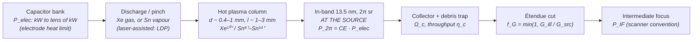

# Discharge-produced plasma

**Status:** 🔶 Simplified — the electrical → 2π-at-source → collected → intermediate-focus chain, in-band spectrum, pulse energy and jitter are live on reported anchors; conversion efficiencies, pinch size, collector and étendue are stated assumptions; 34 W at intermediate focus for Sn · [matrix](../capability-matrix.md#light-sources)

<p class="huv-lead">A discharge-produced plasma dumps the energy of a capacitor bank directly into a small gas or vapour column: the current pinches and heats it to tens of eV, and Xe¹⁰⁺ or Sn⁸⁺–Sn¹⁴⁺ ions radiate into the 2 % band at 13.5 nm that Mo/Si mirrors reflect. The laser-assisted variant (LDP) vaporises tin from a rotating electrode with a laser pulse to trigger and localise the discharge. With no multi-kilowatt drive laser, DPP was the leading low-cost alternative during EUV development, and a laser-assisted Sn source lit the pre-production ASML NXE:3100.</p>

<div class="huv-physics" markdown>

<figure markdown="span">


<figcaption><strong>Mechanism.</strong> LPP: a CO₂ (or 1–2 µm solid-state) drive laser hits 25–30 µm tin droplets 50 000 times a second, the Sn⁸⁺–Sn¹⁴⁺ plasma emits in band into 2π sr, and a normal-incidence Mo/Si collector brings the light to the intermediate focus where the model states its power. DPP/LDP: a capacitor bank pinches Xe gas or Sn vapour into a millimetre column, grazing shells with a debris trap collect it, and the étendue cut f_G = min(1, G_ill/G_src) decides what reaches IF. Both default to the spatially incoherent top-hat pupil (σ 0.9). <em>Schematic, not to scale; no model badge.</em></figcaption>
</figure>

<figure markdown="span">


<figcaption><strong>Where a discharge plasma's watts go.</strong> The two planes the literature quotes are both on the chart: the in-band emission into 2π sr at the source (the DPP convention, anchored on the TRINITI 360 W and Energetiq 10 W reports) and the power at intermediate focus after the collector and the étendue cut. The pinch size, collector solid angle and throughput and the illuminator étendue are assumptions, as is the optics train to the wafer. <em>Model: Discharge-produced plasma 🔶 · Dose-limited wafer throughput 🔶.</em></figcaption>
</figure>

<!-- huv-table: stack -->

| What is modeled | Grade | Dominant approximation | Details |
|---|---|---|---|
| The power chain P_elec → CE → collector → étendue cut → IF | 🔶 Simplified | CE reported order of magnitude (Xe ~0.5 %, Sn ~2 %); pinch size, collector and illuminator étendue assumed | [Key equations](#key-equations) |
| In-band spectrum and pupil fill | 🔶 Simplified | Gaussian line inside the mirror band; incoherent top-hat fill | [What the model does](#what-the-model-does) |
| Shot-to-shot dose jitter | ✅ Implemented | an assumed 5 % rms feeds the Gamma dose factor of the stochastic module | [What the model does](#what-the-model-does) |
| Wafers per hour from the IF power | 🔶 Simplified | ten 0.70 mirrors and a 0.65 mask, lumped overheads | [throughput](index.md#dose-limited-throughput) |
| Discharge dynamics, out-of-band emission, debris, electrode lifetime | not modelled | out of scope | [What the model does](#what-the-model-does) |

**Same thing elsewhere:** Python `SourceConfig.dpp_sn_13nm5(sigma=0.9)` · TOML `[source] type = "dpp"` · CLI `highuvlith sources --family dpp` · GUI Source panel · physics → [Pipeline](../pipeline.md#stage-1--source)

</div>

<p class="huv-lead">It lost the high-volume race on two counts this model makes explicit: nearly all the electrical input ends as electrode heat (conversion efficiency a few percent), capping the input at tens of kilowatts, and a sub-mm-to-mm pinch is far larger than a ~0.1 mm LPP plasma, so less of the collected light fits the illuminator's étendue. Discharge sources remain in use at lower power for actinic metrology, where brightness matters more than watts. <strong>Two power conventions:</strong> DPP outputs are customarily quoted into 2π sr at the source; scanner requirements are at intermediate focus (IF), several times lower; the model reports both and never mixes them.</p>

<div class="huv-glance" markdown>

| Property | Value |
|---|---|
| Wavelength | 13.5 nm (Xe DPP, Sn DPP/LDP) — the mirror band |
| Band / class | 2 % ≈ 270 pm Gaussian inside the Mo/Si band; capacitor-bank pinch, optionally laser-assisted |
| Coherence → pupil | incoherent plasma, trait default 0 → top-hat σ 0.9 |
| Power | Sn 360 W **into 2π sr at the source** (TRINITI anchor) → 34.4 W **at intermediate focus**; Xe 10 W into 2π → 0.70 W at IF |
| Presets | `dpp_sn_13nm5(sigma)`, `dpp_xe_13nm5(sigma)` |
| Grade | 🔶 Simplified |
| Compare with | [LPP](lpp.md) (the HVM winner) · [Synchrotron](synchrotron.md) · history: [The road to EUV](../history/euv.md#the-source-problem-20012013) |

</div>

<details markdown="1">
<summary>How the light is made (flowchart)</summary>



</details>

## Key equations

In-band power into the 2π half-space at the source, with CE the conversion efficiency from electrical input to in-band (2 % bandwidth at 13.5 nm) radiation, and the power collected by a collector subtending Ω_c with throughput η_c (mirror reflectivity × debris-mitigation transmission):

```math
P_{2\pi} = \mathrm{CE}\; P_\text{elec}, \qquad P_\text{coll} = P_{2\pi}\,\frac{\Omega_c}{2\pi}\,\eta_c
```

Source étendue of a cylindrical emitter of diameter d and length l, using the side-on projected area and the small-angle form G = AΩ (a conservative upper estimate for a large collection angle), the étendue-limited usable fraction and the power at intermediate focus:

```math
G_\text{src} = d\, l\, \Omega_c, \qquad f_G = \min\!\left(1, \frac{G_\text{ill}}{G_\text{src}}\right), \qquad P_\text{IF} = P_\text{coll}\, f_G
```

The metrology figure of merit is the in-band radiance:

```math
L = \frac{P_{2\pi}}{d\,l\;2\pi}\quad[\mathrm{W\,mm^{-2}\,sr^{-1}}]
```

## Real machines

Reported in-band 13.5 nm powers — note the plane of each number:

<!-- huv-table: stack -->

| Source | Fuel | In-band power | Plane / provenance | Year | Reference |
|---|---|---|---|---|---|
| Energetiq EQ-10 / EQ-10HP | Xe | 10 → 20 W | 2π sr at the source, product specification | — | [Energetiq](https://www.energetiq.com/euv-lithography-high-brightness-extreme-ultraviolet-light-source-electrodeless-z-pinch-eq-10hp) |
| EQ-10HP at the LBNL MET5 | Xe | 27 W | 2π sr at the source, measured | 2024 | [Miyakawa (2024)](https://euvlitho.com/2024/P13.pdf) |
| Fraunhofer ILT FS5440 | Xe | 20–40 W (2 % BW) | 2π sr at the source, reported | 2020 | [Vieker (2020)](https://euvlitho.com/2020/P32.pdf) |
| Philips Extreme UV lamp | Sn | 200 W continuous | 2π sr at the source, reported | 2005 | [Banine & Moors (2011)](https://www.euvlitho.com/2011/S8.pdf) |
| TRINITI rotating-disk-electrode DPP | Sn | 360 W continuous for ≥ 44 min (180 mJ × 2 kHz); 1 kW for 10 s at 63 kW electrical (CE ≈ 1.6 %) | 2π sr at the source, measured | 2010 | [Borisov et al. (2010)](https://euvlitho.com/2010/P1.pdf) |
| XTREME/Ushio laser-assisted DPP on the ASML NXE:3100 | Sn | "20 W at 90 % duty" (≈ 18 W time-averaged) | intermediate focus (exposure power), reported | 2011 | [Banine & Moors (2011)](https://www.euvlitho.com/2011/S8.pdf) |
| `dpp_xe_13nm5` preset | Xe | 2 kW (implied) × 0.5 % = 10 W into 2π; 1 × 3 mm pinch, 1.5 sr, η_c 0.4, G_src 4.5 mm²·sr, f_G 0.733 → 0.70 W at IF (×357 to 250 W) | this model, Energetiq class | — | — |
| `dpp_sn_13nm5` preset | Sn | 18 kW × 2 % = 360 W into 2π; 0.4 × 1 mm pinch, 1.5 sr, η_c 0.4, G_src 0.6 mm²·sr, f_G 1 → 34.4 W at IF (×7.3) | this model, TRINITI anchor | — | — |

For scale between the two planes, a 2013 LPP example quoted "720 W in 2π → 176 W raw at IF" (Cymer). The Sn preset's 34 W at IF is the same order as the ≈ 18–20 W the laser-assisted DPP delivered on the NXE:3100. Every preset number not in a reported row is an **assumption** labelled in the code; the default illuminator étendue of 3.3 mm²·sr is of the order of published EUV scanner budgets (the value the [LPP](lpp.md) model uses too) — set `illuminator_etendue_mm2_sr` for your illuminator.

## What the model does

`DppSource` in [`dpp.rs`](../../crates/highuvlith-core/src/source_models/dpp.rs) models Xe DPP and Sn DPP/LDP behind one struct selected by `DppFuel`.

- **Spectrum** — `wavelength_nm()` is the in-band centre and `bandwidth_pm()` the mirror-selected 2 % band (270 pm), sampled as a Gaussian by `spectral_weights()` (the [LPP](lpp.md) convention); the narrow band keeps per-sample-focus polychromatic imaging honest.
- **Power chain (live)** — `in_band_power_2pi_w()` (at the source), `collected_power_w()`, `source_etendue_mm2_sr()`, `etendue_usable_fraction()`, `power_at_if_w()` (at IF), `in_band_radiance_w_mm2_sr()`; `average_power_w()` reports the usable power at IF and `pulse_energy_j()` divides it by `rep_rate_hz`.
- **Stochastics** — `shot_to_shot_rms()` (default 5 %, an assumed few-percent pulse-to-pulse stability) feeds the Gamma dose-jitter term of the stochastic module, so DPP and LPP stability profiles can be compared there.
- **Pupil** — the plasma is spatially incoherent: `transverse_coherence() = 0` and the default pupil is `Conventional { sigma }` (σ validated in (0, 1]).
- **Presets** — `xe_13nm5(sigma)`, `sn_13nm5(sigma)`; `validate()` checks every field after overrides.
- **Not modelled** — discharge-circuit and pinch MHD dynamics, fuel spectra outside the mirror band (xenon's strongest EUV emission lies near 11 nm), debris, electrode erosion and lifetime, the exact étendue integral of an elongated emitter over a large collection angle.

<!-- huv-table: stack -->

| Field | Unit | Consumed by | Status |
|---|---|---|---|
| `fuel`, `laser_assisted` | enum, bool | preset selection; provenance of the preset parameters | stored (inert) |
| `wavelength_nm`, `bandwidth_pm` | nm, pm | imaging, photon energy, photon rate; `spectral_weights()` | live |
| `electrical_power_w`, `conversion_efficiency` | W, — | P_2π, heat load | live |
| `source_diameter_mm`, `source_length_mm` | mm | G_src, radiance | live |
| `collector_solid_angle_sr`, `collector_efficiency`, `illuminator_etendue_mm2_sr` | sr, —, mm²·sr | P_coll, G_src, f_G | live |
| `rep_rate_hz`, `shot_to_shot_rms` | Hz, — | `pulse_energy_j()`, energy per discharge; stochastic dose jitter | live |
| `spectral_samples`, `spectral_shape`, `illumination` | count, enum, enum | sampling density, line shape, `intensity_at()` pupil fill | live |
| out-of-band spectrum, debris, electrode lifetime | — | — | planned |

## Derived quantities

`derived_quantities()` (Python `SourceConfig.derived_quantities()` / `derived_quantity(name)`; printed by `highuvlith simulate`) reports the chain plane by plane — informational, never read by the imaging pipeline. Values for the two presets:

<!-- huv-table: stack -->

| Name | Unit | Meaning | Sn (LDP) | Xe |
|---|---|---|---|---|
| `in_band_power_2pi_w` | W | CE × P_elec, into 2π sr at the source | 360 | 10 |
| `collected_power_w` | W | P_2π × Ω_c/2π × η_c | 34.38 | 0.955 |
| `source_etendue_mm2_sr` | mm²·sr | d · l · Ω_c | 0.6 | 4.5 |
| `etendue_usable_fraction` | — | min(1, G_ill/G_src) | 1.0 | 0.733 |
| `power_at_if_w` | W | = `average_power_w()`, at intermediate focus | 34.38 | 0.700 |
| `in_band_radiance_w_mm2_sr` | W mm⁻² sr⁻¹ | P_2π / (d l 2π) | 143 | 0.53 |
| `in_band_pulse_energy_2pi_mj` | mJ | in-band energy per discharge into 2π sr | 180 | 5 |
| `hvm_power_gap` | — | 250 W / P_IF | 7.27 | 357 |

<details markdown="1">
<summary>The remaining rows</summary>

`photon_rate_at_if` (2.34 × 10¹⁸ photons/s at IF for Sn, 4.76 × 10¹⁶ for Xe) and `electrode_heat_load_w` (P_elec − P_2π: 17.6 kW for the Sn preset, 1.99 kW for Xe — the power-scaling limit). The 17.19 mJ per discharge at IF of the Sn fixture is `in_band_pulse_energy_2pi_mj` × P_IF/P_2π. Through the [throughput model](index.md#dose-limited-throughput) the Sn preset's 34 W at IF gives a few wafers per hour at 30 mJ/cm² — the model's way of saying what the HVM race decided.

</details>

## Use it

### Python

<!-- verify-example -->
```python
import highuvlith as huv

src = huv.SourceConfig.dpp_sn_13nm5(sigma=0.9)   # or .dpp_xe_13nm5()
dq = {name: value for name, value, *_ in src.derived_quantities()}
print(f"{dq['in_band_power_2pi_w']:.3g} W into 2 pi at the source, "
      f"{src.average_power_w:.3g} W at IF")
print(f"etendue fraction {dq['etendue_usable_fraction']:.3g}, "
      f"gap to 250 W: {dq['hvm_power_gap']:.3g} x")

optics = huv.OpticsConfig.schwarzschild(numerical_aperture=0.33)
mask = huv.MaskConfig.line_space(cd_nm=30.0, pitch_nm=90.0)
engine = huv.SimulationEngine(src, optics, mask, grid=mask.commensurate_grid(size=64, target_pixel_nm=2.0))
aerial = engine.compute_aerial_image(focus_nm=0.0)
```

???+ success "Output"

    ```text
    360 W into 2 pi at the source, 34.4 W at IF
    etendue fraction 1, gap to 250 W: 7.27 x
    ```

## TOML keys

The keys the CLI reads for `type = "dpp"` (`DPP_KEYS` in [`config.rs`](../../crates/highuvlith-cli/src/config.rs)); every field is optional and defaults to the fuel preset. Power at IF = P_elec × CE (2π) × collector × étendue cut.

| Key | Default | Units | Notes |
|---|---|---|---|
| `type` | — | — | `"dpp"` |
| `fuel` | `"sn"` | — | `sn` (laser-assisted) or `xe` |
| `sigma` | 0.9 | — | top-hat pupil radius, (0, 1]; not with `[illumination]` |
| `wavelength_nm`, `bandwidth_pm` | 13.5, 270 | nm, pm | the mirror band |
| `spectral_samples` | 5 | — | polychromatic samples |
| `electrical_power_w`, `conversion_efficiency` | preset | W, — | P_2π = CE × P_elec |
| `source_diameter_mm` (or `source_diameter_um`), `source_length_mm` | preset | mm, mm | pinch size (give the diameter once; 1 mm = 1000 µm) |
| `collection_solid_angle_sr` (alias `collector_solid_angle_sr`), `collector_efficiency` | preset | sr, — | the collector |
| `illuminator_etendue_mm2_sr` | 3.3 | mm²·sr | the étendue cut |
| `rep_rate_hz` | preset | Hz | energy per discharge |

```toml
[source]
type  = "dpp"
fuel  = "sn"                     # "sn" (DPP/LDP) | "xe"
sigma = 0.9
electrical_power_w         = 18000.0
conversion_efficiency      = 0.02
source_diameter_mm         = 0.4
source_length_mm           = 1.0
collector_solid_angle_sr   = 1.5
collector_efficiency       = 0.4
illuminator_etendue_mm2_sr = 3.3
rep_rate_hz                = 2000.0
```

Example: [`sim_dpp.toml`](../../examples/sim_dpp.toml).

<details markdown="1">
<summary>Validation — 8 tests</summary>

| Claim | Test | Tolerance |
|---|---|---|
| Xe: 10 W into 2π; 0.95493 W collected; G_src = 4.5 mm²·sr; f_G = 3.3/4.5; radiance 10/(6π) W mm⁻² sr⁻¹ | `dpp.rs::test_xe_power_chain_fixture` | 1e-6 |
| Sn: 360 W into 2π (180 mJ per discharge at 2 kHz); 34.3775 W at IF; gap 250/34.3775 = 7.2722; 17.19 mJ per discharge at IF | `test_sn_power_chain_fixture_and_hvm_gap` | 1e-4 |
| doubling the diameter doubles G_src and halves f_G when étendue-limited | `test_etendue_scaling` | exact |
| fuel ordering and the band; field validation; derived quantities finite | `test_fuel_ordering_and_band`, `test_validation`, `test_derived_quantities_finite` | — |
| CLI fuel and étendue overrides, the key aliases; Python `TestDpp` and the imaging smoke test | `config.rs::test_dpp_fuel_and_etendue_overrides`, `test_lab_compact_key_names_aliases_and_fallbacks`; `tests/python/test_sources_new.py::TestDpp` | — |

</details>

<details markdown="1">
<summary>Changes</summary>

- The two power planes (2π sr at the source; at intermediate focus) have been reported separately since the family was added; `average_power_w()` has always meant the IF value, the convention the [LPP](lpp.md) family later adopted (its change is recorded there).
- The `Dipole` illumination shape placed both poles at one point until 2026-09-30; the DPP presets never use it.

</details>

## See also

[Laser-produced plasma](lpp.md) (the HVM winner, same power-chain conventions) · [Synchrotron](synchrotron.md) and [XFEL](xfel.md) (the accelerator routes) · history: [The road to EUV](../history/euv.md) · [Throughput, stated once](index.md#dose-limited-throughput) · [configuration](../configuration.md) · [`examples/sim_dpp.toml`](../../examples/sim_dpp.toml)

## References

1. V. Bakshi (ed.), *EUV Sources for Lithography*, SPIE Press (2006) — DPP/LDP and LPP source technology of the HVM-candidate era.
2. Real-machine anchors (workshop presentations and product information, linked in the table above): Borisov et al. (2010); Banine & Moors (2011); Vieker (2020); Miyakawa (2024); Energetiq EQ-10 / EQ-10HP.

**Where next:** ← [Laser-produced plasma](lpp.md) · [Synchrotron](synchrotron.md) → · Related: [The road to EUV](../history/euv.md) · [Capability matrix](../capability-matrix.md#light-sources)
