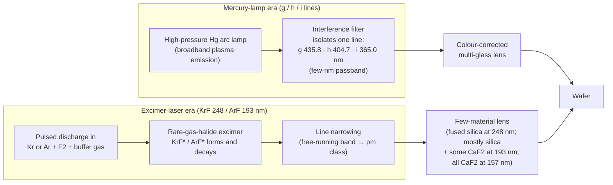

# DUV/UV heritage

**Status:** ✅ Implemented (🔶 parameters) — NIST Hg-line wavelengths, photon budgets and the line-shape / E95 arithmetic are exact and test-pinned; excimer bandwidths and pulse energy × rep rate are representative, not vendor data; lamp power is not modelled; ArF 90 W is laser output · [matrix](../capability-matrix.md#light-sources)

<p class="huv-lead">Every optical-lithography generation before EUV is a step down a wavelength ladder, and each step changed the light source: a filtered mercury arc for the g, h and i lines, then line-narrowed KrF and ArF excimer lasers whose picometre bandwidth let a lens be made from one material. In highuvlith these five are presets of the same <code>VuvSource</code> as the F₂ laser, so one struct carries 436 nm to 157 nm.</p>

<div class="huv-physics" markdown>

<figure markdown="span">


<figcaption><strong>Mechanism.</strong> The excimer-laser lane: a pulsed discharge in Kr, Ar or F₂ with a buffer gas forms the excimer, whose free-running band a prism-and-grating module narrows to the picometre-class E95 bandwidth the model parameterises before a silica or CaF₂ lens column. The mercury-lamp lane: a high-pressure arc and an interference filter isolate the g, h or i line as one 3 nm Gaussian sample. Both lanes end in the engine's default top-hat pupil (σ 0.7). <em>Schematic, not to scale; no model badge.</em></figcaption>
</figure>

<figure markdown="span">


<figcaption><strong>Why a vendor E95 is not the model's FWHM.</strong> (a) At equal FWHM the 95 %-energy interval is 1.66 FWHM for a Gaussian, 4.68 for the undulator sinc² and 12.7 for a Lorentzian — the ratios the derived quantity <code>e95_bandwidth</code> reports. (b, c) The spectral weights <code>spectrum()</code> hands the imaging engine: five samples over ±2.5 FWHM, each line sampled at its stated FWHM — the ArF preset's 0.2 pm Gaussian (σ = FWHM/2√(2 ln 2)) and the F₂ preset's 1.1 pm Lorentzian. Line shapes as parameterized in the model, not measured laser spectra. <em>Model: excimer sources ✅.</em></figcaption>
</figure>

<!-- huv-table: stack -->

| What is modeled | Grade | Dominant approximation | Details |
|---|---|---|---|
| Wavelengths, photon budgets, E95 arithmetic | ✅ Implemented (🔶 parameters) | NIST air wavelengths; laser bandwidth and pulse × rate representative | [Key equations](#key-equations) |
| Polychromatic imaging of the pm-class lines | ✅ Implemented | narrow-band path shifts focus per sample at Δλ/λ ≈ 10⁻⁶; Gaussian samples at the stated FWHM (sampler corrected 2026-10-10) | [What the model does](#what-the-model-does) |
| Wafers per hour from laser output | 🔶 Simplified | one refractive-column transmission, lumped overheads | [throughput](index.md#dose-limited-throughput) |
| Lamp output power, excimer dose jitter, lamp-era achromats | not modelled | out of scope (`average_power_w() = None`; `shot_to_shot_rms = 0`) | [Limits](#what-the-model-does) |

**Same thing elsewhere:** Python `SourceConfig.arf_laser(sigma=0.7)` · TOML `[source] type = "vuv"` + `preset = "arf"` · CLI `highuvlith sources --family vuv` · GUI Source panel · physics → [Pipeline](../pipeline.md#stage-1--source)

</div>

<p class="huv-lead">What the model gets right is the arithmetic: NIST wavelengths, photons per millijoule, the E95-to-FWHM conversion for each line shape. What it leaves representative is the lasers' bandwidth and pulse metadata, and what it does not model at all is lamp output power — the lamp presets report <code>None</code> rather than an invented wattage.</p>

<div class="huv-glance" markdown>

| Property | Value |
|---|---|
| Wavelength | 435.8328 / 404.6563 / 365.0153 nm (Hg g/h/i, NIST air); 248.3 nm (KrF); 193.368 nm (ArF) — fixed lines |
| Band / class | filtered mercury arc (CW, 3 nm Gaussian passband); line-narrowed excimer lasers (Gaussian, 0.6 / 0.2 pm FWHM) |
| Coherence → pupil | multimode, trait default 0 → top-hat σ (your choice; presets 0.5–0.7) |
| Power | ArF 15 mJ × 6 kHz = 90 W, KrF 10 mJ × 4 kHz = 40 W **laser output**; lamps `None` (not modelled) |
| Presets | `arf_laser()`, `krf_laser()`, `hg_i_line()`, `hg_h_line()`, `hg_g_line()` — presets of the VUV type |
| Grade | ✅ Implemented (🔶 parameters) |
| Compare with | [VUV excimer](vuv-excimer.md) · [LPP](lpp.md) · [history: excimer lasers and deep UV](../history/excimer-duv.md) |

</div>

<details markdown="1">
<summary>How the light is made (flowchart)</summary>



</details>

## Key equations

Photon energy and the photon budget follow from the wavelength alone, and they are what make the ladder matter for EUV: a given dose at ArF carries 14.3× more photons than at 13.5 nm, one reason EUV is so exposed to shot noise.

```math
E_\gamma = \frac{hc}{\lambda}, \qquad N_\text{photons/mJ} = \frac{1\ \text{mJ}}{E_\gamma}, \qquad \frac{n_\text{photons}(\lambda)}{n_\text{photons}(13.5\ \text{nm})} = \frac{\lambda}{13.5\ \text{nm}}
```

Lithography-laser vendors specify **E95**, the width holding the central 95 % of the line energy. The conversion depends on the line shape, and the model reports it as `e95_bandwidth`:

```math
\frac{E_{95}}{\mathrm{FWHM}} =
\begin{cases}
1.6646 & \text{Gaussian } (\pm 1.96\,\sigma) \\
12.706 & \text{Lorentzian } (\tan(0.95\,\pi/2)) \\
4.680 & \operatorname{sinc}^2 \text{ (undulator line)}
\end{cases}
```

A pure Lorentzian has such heavy tails that its E95 is 12.7× its FWHM, so the heritage laser presets use a **Gaussian** line (0.2 pm FWHM → E95 ≈ 0.33 pm); real line-narrowed spectra sit between the two shapes. **Bandwidth convention.** Every `bandwidth_pm` is a FWHM, in the E95 arithmetic and in the sampled spectrum alike: the Lorentzian sampler uses γ = FWHM/2, the Gaussian sampler σ = FWHM/(2√(2 ln 2)) ≈ FWHM/2.355, and the sinc² sampler puts its first zero at FWHM/0.886.

## Real machines

<!-- huv-table: stack -->

| Machine / milestone | Wavelength | What it set | Plane / provenance | Reference |
|---|---|---|---|---|
| GCA 4800 DSW (1978): first wafer stepper, 10:1, NA 0.28, Hg g-line | 436 nm | 1.5 µm minimum CD (1980) | reported | Bruning (2007) |
| Nikon NSR-1505EX (1988): first KrF excimer stepper, NA 0.42 | 248 nm | 0.5 µm, R&D use | reported | Nikon history |
| SVGL Micrascan III (1996–97): first excimer step-and-scan, NA 0.6 | 248 nm | CD 200 nm | reported | Bruning (2007) |
| ASML PAS 5500/900 (1998), Nikon NSR-S302A, Canon FPA-5000AS1 (1999) | 193 nm | first ArF tools | reported | lithography-history fact-check |
| ASML 1250i (2004), Nikon NSR-S609B (2005) | 193 nm in water | first immersion scanners, NA 0.85 / 1.07 | reported | lithography-history fact-check |
| Cymer ELS-4000F (1995) · Rokitski et al. (2013) | 248 / 193 nm | 6 W at 600 Hz · 120 W ArF immersion laser | reported, laser output | Rokitski (2013) |
| `krf_laser` · `arf_laser` presets | 248.3 / 193.368 nm | 10 mJ × 4 kHz = 40 W · 15 mJ × 6 kHz = 90 W | this model, representative laser output | — |

Bruning's turning points give the resolution ladder in numbers — 1.5 µm at 436 nm (1980), 1.0 µm at 436 nm (1985), 0.5 µm at 365 nm (1990), 0.25 µm at 248 nm (1993) — and the KrF-to-ArF transition, the chemically amplified resists it needed and the end of 157 nm are told on the [history pages](../history/excimer-duv.md) rather than here. The laser classes (KrF ~30–60 W; ArF immersion ~60–120 W) come from Cymer and Gigaphoton product specifications; the 3 nm lamp passband is the i-line figure Bruning quotes, applied to all three lines.

<figure markdown="span">


<figcaption><strong>Representative excimer outputs, one transmission factor.</strong> Pulse energy × repetition rate gives the laser output; the refractive column (optics 0.3 × mask 0.9, an assumption) the power on the wafer. The Hg g/h/i lamps carry no power model and are not drawn. <em>Model: DUV/UV heritage ✅ (🔶 parameters) · Dose-limited wafer throughput 🔶.</em></figcaption>
</figure>

## What the model does

All five presets are constructors of [`VuvSource`](../../crates/highuvlith-core/src/source.rs) (the struct gained no new fields) and serialize with the TOML tag `type = "vuv"`; the wavelengths are public constants and `e95_bandwidth_pm(shape, fwhm_pm)` implements the conversion.

- **`wavelength_nm()`** — the NIST air wavelength of the Hg line (vacuum values are ~0.1 nm longer, a 3 × 10⁻⁴ relative difference, immaterial for imaging) or the excimer line.
- **`spectral_weights()`** — five Gaussian samples for the lasers; **one** sample for the lamps (`spectral_samples = 1`), because the engine's default chromatic coefficient of 15 nm per pm is a CaF₂/157 nm figure and sampling a 3 nm lamp band through it would add tens of micrometres of spurious defocus. For multi-sample lamp imaging set `axial_chromatic_nm_per_pm = 0` on an achromat (`OpticsConfig.immersion(numerical_aperture=..., immersion_index=1.0)`, TOML `[optics] immersion_index = 1.0`).
- **`intensity_at()`** — the top-hat disk of radius σ: lamps and excimer lasers are spatially incoherent / multimode, so `transverse_coherence()` keeps the trait default 0.
- **`pulse_energy_j()` / `rep_rate_hz()` / `average_power_w()`** — live for the lasers (10 mJ × 4 kHz = 40 W; 15 mJ × 6 kHz = 90 W); a lamp preset sets `rep_rate_hz = 0`, the continuous-wave convention, under which all three return `None` and `wafer_throughput()` returns `None`.
- **Not modelled** — lamp output power and arc spectrum, excimer pulse-energy jitter and E95 stabilisation (`shot_to_shot_rms = 0`), colour-corrected lamp-era lens designs (an optics setting, not the source).

<!-- huv-table: stack -->

| Field | Unit | Consumed by | Status |
|---|---|---|---|
| `wavelength_nm` | nm | TCC pupil scaling, photon energy and density, derived photon budget | live |
| `bandwidth_pm` | pm FWHM | polychromatic sampling range; `relative_bandwidth`, `e95_bandwidth`, `coherence_length` | live |
| `spectral_samples` | count | polychromatic samples (1 for the lamp presets) | live |
| `spectral_shape` | enum | line weighting (Gaussian for the heritage presets); E95 conversion | live |
| `pulse_energy_mj`, `rep_rate_hz`, `illumination` | mJ, Hz, enum | `average_power_w()` → throughput, `rep_rate_hz = 0` marks a CW lamp; pupil `intensity_at()` during TCC construction | live |
| lamp power, laser jitter, lamp-era achromat | — | not modelled | planned |

## Derived quantities

`derived_quantities()` (Python `SourceConfig.derived_quantities()` / `derived_quantity(name)`; printed by `highuvlith simulate`) reports physics computed from the stored fields — informational, never read by the imaging pipeline.

<!-- huv-table: stack -->

| Name | Unit | Meaning | i-line | KrF | ArF |
|---|---|---|---|---|---|
| `photon_energy` | eV | hc/λ | 3.397 | 4.993 | 6.412 |
| `e95_bandwidth` | pm | 95 %-energy width of the configured shape | 4 994 | 0.999 | 0.333 |
| `coherence_length` | µm | λ²/Δλ | 44.4 | 102 755 | 186 956 |
| `photons_per_mj` | photons | 1 mJ / (hc/λ) | 1.838 × 10¹⁵ | 1.250 × 10¹⁵ | 9.734 × 10¹⁴ |
| `photon_density_per_dose` | photons/nm² per mJ/cm² | incident photons per nm² at 1 mJ/cm² | 18.38 | 12.50 | 9.734 |
| `photons_vs_13nm5` | — | photons per dose relative to 13.5 nm (λ/13.5 nm) | 27.04 | 18.39 | 14.32 |
| `average_power` | W | pulse energy × rep rate (laser output) | — | 40 | 90 |
| `continuous_wave` | bool | 1 for a CW lamp (no pulse metadata) | 1 | — | — |

<details markdown="1">
<summary>The remaining rows and the g/h lines</summary>

g-line / h-line: `photon_energy` 2.845 / 3.064 eV; `photons_per_mj` 2.194 × 10¹⁵ / 2.037 × 10¹⁵; `photon_density_per_dose` 21.94 / 20.37 photons/nm² per mJ/cm²; `photons_vs_13nm5` 32.28 / 29.97; `e95_bandwidth` 4 994 pm and `coherence_length` 63.3 / 54.6 µm. `relative_bandwidth` (FWHM/λ) 6.88 × 10⁻³ / 7.41 × 10⁻³ / 8.22 × 10⁻³ for g/h/i and 2.42 × 10⁻⁶ / 1.03 × 10⁻⁶ for KrF / ArF; `photons_per_pulse` 1.250 × 10¹⁶ / 1.460 × 10¹⁶ and `photon_rate` 5.00 × 10¹⁹ / 8.76 × 10¹⁹ photons/s for KrF / ArF. With refractive-tool settings at 30 mJ/cm² the [throughput model](index.md#dose-limited-throughput) puts 10.8 W (KrF) and 24.3 W (ArF) on the wafer — ≈ 172 and ≈ 185 wafers/h, overhead-dominated, with ≈ 23 and ≈ 15 pulses per exposure point; the dose-limited scan speeds (1.4 and 3.1 m/s) exceed real stages, so pass `max_scan_speed_mm_s` to cap them. The KrF row coincides with the F₂ row on the index because both presets are 40 W lasers.

</details>

## Use it

### Python

Factories in [`py_config.rs`](../../crates/highuvlith-py/src/py_config.rs):

<!-- verify-example -->
```python
import highuvlith as huv

arf = huv.SourceConfig.arf_laser(sigma=0.7)       # 193.368 nm, 90 W representative
krf = huv.SourceConfig.krf_laser(sigma=0.7)       # 248.3 nm, 40 W representative
i_line = huv.SourceConfig.hg_i_line(sigma=0.6)    # 365.0153 nm, CW lamp
print(f"ArF E95 {arf.derived_quantity('e95_bandwidth'):.3g} pm, "
      f"{arf.derived_quantity('photons_vs_13nm5'):.3g} x the photons of 13.5 nm per dose")
print(i_line.average_power_w, i_line.rep_rate_hz)   # CW lamp: power not modelled
tp = krf.wafer_throughput(dose_mj_cm2=30.0, optics_transmission=0.3,
                          mask_efficiency=0.9, slit_height_mm=8.0)
print(f"KrF {tp['wafers_per_hour']:.3g} wph, {tp['pulses_per_point']:.3g} pulses per point")
```

???+ success "Output"

    ```text
    ArF E95 0.333 pm, 14.3 x the photons of 13.5 nm per dose
    None 0.0
    KrF 172 wph, 23.1 pulses per point
    ```

`highuvlith simulate --config examples/sim_arf.toml` prints the derived quantities; the CLI's refractive optics accept NA ≤ 1, so the examples are dry systems.

## TOML keys

The keys the CLI reads for `type = "vuv"` (`VUV_KEYS` in [`config.rs`](../../crates/highuvlith-cli/src/config.rs); the same set serves the [F₂ and Ar₂ presets](vuv-excimer.md#toml-keys)). Without `preset` the legacy explicit-wavelength source is built (Lorentzian 1.1 pm, 10 mJ, 4 kHz).

| Key | Default | Units | Notes |
|---|---|---|---|
| `type` | `"vuv"` | — | optional: an absent tag also means `vuv` |
| `preset` | none (legacy source) | — | `arf`, `krf`, `hg_i` / `i_line`, `hg_h` / `h_line`, `hg_g` / `g_line`, `f2`, `ar2` |
| `sigma` | 0.7 | — | top-hat pupil radius, (0, 1]; not with `[illumination]` |
| `wavelength_nm` | preset (157.63 without one) | nm | overrides the preset line |
| `bandwidth_pm` | preset (1.1 without one) | pm FWHM | overrides the preset shape width |
| `rep_rate_hz` | preset (4000 without one) | Hz | overrides the preset rate; pulse energy stays the preset's |
| `spectral_samples` | preset (5; lamps 1) | — | polychromatic samples |

```toml
[source]
preset = "arf"     # type "vuv" implied; f2 | ar2 | arf | krf | hg_i | hg_h | hg_g
sigma  = 0.7
```

Examples: [`sim_arf.toml`](../../examples/sim_arf.toml) (dry ArF, NA 0.93), [`sim_krf.toml`](../../examples/sim_krf.toml) (NA 0.8), [`sim_hg_iline.toml`](../../examples/sim_hg_iline.toml) (NA 0.6, 350 nm lines), [`sim_hg_gline.toml`](../../examples/sim_hg_gline.toml) (NA 0.45, 700 nm lines).

<details markdown="1">
<summary>Validation — 9 tests</summary>

| Claim | Test | Tolerance |
|---|---|---|
| photon energies and photons per mJ of all five presets, NIST wavelengths, the λ/13.5 ratio, 90 W / 40 W budgets, σ validation; lamps are CW with one spectral sample, `average_power_w() = None`, `continuous_wave = 1`, E95 of the 3 nm passband | `source.rs::test_heritage_presets_photon_budget`, `test_hg_lamps_are_cw_single_sample` | mpmath fixtures |
| E95/FWHM 1.6646 / 12.706 / 4.680, a tabulated triangle, degenerate tables; derived quantities finite and documented for every family | `test_e95_bandwidth_conventions`, `test_vuv_derived_quantities`, `test_every_family_reports_derived_quantities` | fixtures |
| presets, aliases, explicit overrides, the legacy path, unknown preset rejected; the four heritage example TOMLs validate; absent `type` → VUV; wavelengths and photon energies through the bindings, a one-sample lamp images identically monochromatic and polychromatic | CLI `test_vuv_heritage_presets`, `test_family_example_tomls_validate`, `test_toml_back_compat_without_type_tag`; `tests/python/test_sources_physics.py::TestHeritage` | — |

</details>

<details markdown="1">
<summary>Changes</summary>

- Until 2026-10-10 the Gaussian line sampler used σ = FWHM/(2√ln 2), so every Gaussian-line preset's polychromatic samples were √2 wider than stated (the ArF 0.2 pm line sampled as 0.283 pm); `e95_bandwidth` and the Lorentzian / sinc² samples were always exact. Corrected; recorded in the [matrix audit log](../capability-matrix.md#audit-log).
- The `Dipole` illumination shape placed both poles at one point until 2026-09-30; the heritage presets never use it.

</details>

## See also

[VUV excimer](vuv-excimer.md) (the same struct, F₂ and the Ar₂ what-if) · [Laser-produced plasma](lpp.md) (13.5 nm, 14× fewer photons per dose) · history: [Excimer lasers and deep UV](../history/excimer-duv.md), [The 157 nm detour](../history/157nm-detour.md) · [Throughput, stated once](index.md#dose-limited-throughput) · [configuration](../configuration.md) · [`examples/sim_arf.toml`](../../examples/sim_arf.toml)

## References

1. NIST, *Handbook of Basic Atomic Spectroscopic Data* — Hg I strong lines, air wavelengths g 435.8328 nm, h 404.6563 nm, i 365.0153 nm: https://physics.nist.gov/PhysRefData/Handbook/Tables/mercurytable2.htm
2. J. H. Bruning, "Optical Lithography … 40 years and holding," *Proc. SPIE* **6520**, 652004 (2007).
3. ASML, "Light & lasers" (Lithography principles): https://www.asml.com/en/technology/lithography-principles/light-and-lasers
4. Ewing & Brau, *Appl. Phys. Lett.* **27**, 350 (1975) — KrF and XeCl lasers; Hoffman, Hays & Tisone, *Appl. Phys. Lett.* **28**, 538 (1976) — ArF; Jain, Willson & Lin, *IEEE Electron Device Lett.* **3**, 53 (1982), doi:10.1109/EDL.1982.25476 — excimer-laser lithography.
6. Rokitski et al., "High power 120W ArF immersion XLR laser system," *Proc. SPIE* **8683**, 86831H (2013), doi:10.1117/12.2012681.

**Where next:** ← [Sources](index.md) · [VUV excimer](vuv-excimer.md) → · Related: [Excimer lasers and deep UV](../history/excimer-duv.md) · [Capability matrix](../capability-matrix.md#light-sources)
