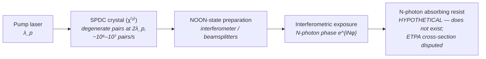

# Entangled photons

**Status:** 🧪 Theoretical — reports the physical λ and images classically; N-photon models are an explicit opt-in through the quantum module; no NOON sub-Rayleigh pattern has ever been recorded in a material; clearing 1 cm² takes ≥ 10¹⁶–10¹⁸ s at the independent ETPA bounds · [matrix](../capability-matrix.md#light-sources)

<p class="huv-lead">An N-photon path-entangled NOON state, (|N,0⟩ + |0,N⟩)/√2, accumulates interferometric phase N times faster than classical light: the N-photon amplitude acquires e^{iNφ} where a single photon acquires e^{iφ}. An interferometric exposure with such a state would write fringes at an effective wavelength λ/N, beating the classical limit by N without shortening the physical wavelength (Boto et al. 2000). The temptation is obvious: N = 2 at 157.63 nm would print like 78.8 nm light through F₂-compatible optics.</p>

<div class="huv-physics" markdown>

<figure markdown="span">


<figcaption><strong>Mechanism.</strong> A pump laser drives spontaneous parametric down-conversion in a χ⁽²⁾ crystal, emitting 10⁶–10⁷ degenerate pairs per second at 157.63 nm; an interferometer prepares the NOON state (|N,0⟩ + |0,N⟩)/√2, whose N-photon phase e^{iNφ} would write a fringe of period λ/(2N sin θ) into a resist that absorbs N photons as one event — a resist that does not exist. The pipeline images the source classically; the quantum module is an explicit opt-in. <em>Schematic, not to scale; no model badge.</em></figcaption>
</figure>

<figure markdown="span">


<figcaption><strong>Three exposures the engine keeps apart.</strong> A 50 nm / 100 nm grating under the F₂ preset (σ 0.5) through NA 0.75: the classical image (<code>compute_aerial_image</code>) is flat because the optics passes no ±1 order below the 140 nm cutoff, and squaring it (<code>n_photon_absorption_image</code>, classical two-photon absorption) sharpens nothing; only the idealized N00N limit (<code>compute_noon_ideal_image</code>: the same system imaged at λ/2) prints the pitch, and it presumes a state preparation and a resist that do not exist. <em>Model: Entangled-photon (NOON) source 🧪 · Quantum lithography (N-photon / N00N) 🧪.</em></figcaption>
</figure>

<!-- huv-table: stack -->

| What is modeled | Grade | Dominant approximation | Details |
|---|---|---|---|
| Entangled-photon (NOON) source | 🧪 Theoretical | the trait reports the physical λ; exposure times rest on N = 2 cross-sections measured on dyes in the visible/NIR, with p_clear = 0.1 assumed | [Key equations](#key-equations) |
| Quantum lithography (N-photon / N00N) | 🧪 Theoretical | classical N-photon absorption I^N keeps the classical period; the N00N fringe and λ/N image are an idealization with fidelity F | [What the model does](#what-the-model-does) |
| Illumination pupil fills | ✅ Implemented | a fully coherent `CoherentGaussian` fill, σ 0.05 | [What the model does](#what-the-model-does) |
| Dose-limited wafer throughput | 🔶 Simplified | not applicable: `average_power_w()` is `None` and `wafer_throughput()` returns `None` | [Derived quantities](#derived-quantities) |

</div>

<p class="huv-lead">The reasons this is 🧪 and not 🔶 are physical, and the model quantifies them: no entangled sub-Rayleigh pattern has ever been recorded in a material (every demonstration used coincidence detection; the one material-recorded sub-Rayleigh fringe used classical light in PMMA); no resist absorbs N photons coherently as one event at lithographic wavelengths; the entangled two-photon-absorption (ETPA) cross-section is tiny and disputed — early claims of 10⁻¹⁷–10⁻²¹ cm² against independent upper bounds of 10⁻²³–10⁻²⁵ cm² and several null results; pairs stop acting entangled above ~10¹³ photons/s, six orders of magnitude in power below what an HVM scanner delivers to the wafer; the photon budget is 9–13 orders short before absorption; and a χ⁽²⁾ medium pumped near 79 nm does not exist. `EntangledPhotonSource` is the illumination-side bridge to the quantum research module, kept honest by construction.</p>

<div class="huv-glance" markdown>

| Property | Value |
|---|---|
| Wavelength | 157.63 nm physical (what the pipeline images); λ/N = 78.8 nm is the ideal N00N fringe scale, never the trait wavelength |
| Band / class | quantum concept · N = 2 path-entangled NOON state, Δλ/λ = 10⁻⁶ (narrow Gaussian line), fully coherent |
| Coherence → pupil | coherent Gaussian σ 0.05 (ζ = 1: an interferometric setup) |
| Power | 2.5 pW **of photon power in the entangled beam** (10⁶ pairs/s × 2 × 7.9 eV); `average_power_w()` is `None`, so no throughput figure |
| Presets | `entangled_noon(wavelength_nm, n, fidelity, pair_rate_hz)` (defaults 157.63, 2, 1.0, 10⁶) |
| Grade | 🧪 Theoretical |
| Compare with | [VUV excimer](vuv-excimer.md) (the classical F₂ baseline at the same λ) · [HHG](hhg.md) · [Research modules — quantum](../research-modules.md) |

**Same thing elsewhere:** Python `SourceConfig.entangled_noon(n=2)` · TOML `[source] type = "entangled"` · CLI `highuvlith sources --family entangled` · GUI Source panel

</div>

<details markdown="1">
<summary>How the light is made (flowchart)</summary>



</details>

## Key equations

Phase super-resolution: a NOON state traversing an interferometer with phase φ gives p(φ) ∝ 1 + cos(Nφ), so the fringe period — and, in Boto et al.'s ideal limit, the printable pitch — shrinks by N:

```math
\lambda_\text{eff} = \frac{\lambda}{N}, \qquad
R_\text{quantum} = \frac{0.61\,\lambda}{N\,\mathrm{NA}} \quad \text{vs.} \quad R_\text{classical} = \frac{0.61\,\lambda}{\mathrm{NA}}
```

The [quantum module](../research-modules.md) keeps two physically different N-photon exposures apart — **classical N-photon absorption** of the classical aerial image, E = I^N (`n_photon_absorption_image`), which sharpens lines but keeps the classical period, and the **ideal N00N absorption** (`TwoBeamNPhoton` in closed form; `noon_ideal_image` for general masks: the same system at λ/N). Imperfect entanglement is a fidelity F, the share of the exposure from the ideal N00N component; the remainder is classical N-photon absorption, not linear absorption:

```math
E = F\,E_\mathrm{NOON} + (1 - F)\,E_\mathrm{cl} \quad \text{(two beams)}, \qquad
E = F\,I_{\lambda/N} + (1 - F)\,I_\lambda^{\,N} \quad \text{(general masks)}
```

**Exposure time from the pair rate.** Entangled two-photon absorption is linear in the pair flux Φ (each molecule reacts at the rate σ_E Φ), so with a fraction p_clear of molecules required to clear the resist, the pair fluence and the exposure time for an area A at a pair rate R_pairs are

```math
F_\text{clear} = \frac{p_\text{clear}}{\sigma_E}, \qquad
t = \frac{F_\text{clear}\,A}{R_\text{pairs}}
```

with p_clear = 0.1 (an optimistic, chemically-amplified-like assumption) and a 1 cm² reference area. Because the independent bounds are *upper* bounds on σ_E, the default-scenario fluences and times are **lower bounds**. The cross-section data come from visible/near-IR experiments on dyes — nothing exists at 157 nm and nothing at all for N ≥ 3, where the N = 2 numbers are used as optimistic stand-ins and every note says so.

<figure markdown="span">


<figcaption><strong>Exposure time from the pair rate: years at best, longer than the Universe at the bounds.</strong> <code>entangled_noon(pair_rate_hz=…).derived_quantities()</code> turns the pair rate into the time to clear 1 cm² with an assumed 10 % of molecules reacting; the two bound scenarios use independent <i>upper</i> bounds on the entangled two-photon cross-section, so their bars are lower bounds on the time (arrows), while the hollow bars rest on disputed early claims. The dashed line is the classical reference: a 30 mJ/cm² dose at the derived 0.67 W wafer power. <em>Model: Entangled-photon (NOON) source 🧪.</em></figcaption>
</figure>

<details markdown="1">
<summary>Full formulas — the flux budget</summary>

The flux side (`FluxBudget`) is derived from this source's constants with no free efficiency. Photon pairs behave as isolated, entangled pairs only below about one photon per spectral mode; the crossover flux is roughly the down-converted bandwidth in Hz, Φ_max ≈ Δν (Dayan et al. 2005, Eq. (1)): their broadband source (31 nm at 1064 nm) ran at ~10¹² pairs/s (0.3 µW) against a crossover of 8.2×10¹² photons/s (≈ 1.5 µW), and the model uses 10¹³ photons/s as the order of magnitude. At that ceiling the relative flux is ≈ 1.9×10⁻⁵ of the HVM wafer photon rate at 157.63 nm (an NXE:3400C at 170 wafers/hour and 20 mJ/cm² delivers ≈ 0.67 W to the wafer, derived). With σ_E at its loosest independent bound (10⁻²³ cm²) the N = 2 exposure takes at least 4.5×10¹⁰ times longer than a classical 30 mJ/cm² exposure at HVM wafer power — 4.5×10¹² at the tightest bound and still 4.5×10⁴ with the disputed 10⁻¹⁷ cm² claim; the ratio grows linearly with N. A classical 30 mJ/cm² dose at 157.63 nm is 2.4×10¹⁶ photons/cm², and a 40 W F₂ laser emits 3.2×10¹⁹ photons/s, against 10⁶–10⁷ pairs/s from SPDC sources.

</details>

## Real machines

There is no entangled-photon lithography machine. The table contrasts demonstrated quantum-optics hardware with what lithography would require.

<!-- huv-table: stack -->

| Quantity | Demonstrated | Required for lithography | provenance |
|---|---|---|---|
| Wavelength | visible/NIR SPDC (BBO, KTP, ppKTP) | 157 nm / 13.5 nm photons | measured [1, 2] |
| N | 2 (routine), 3–5 (heroic) | ≥ 2 | measured [2, 3] |
| Pair / N-tuple rate | ~10⁶–10⁷ s⁻¹ | a 30 mJ/cm² dose is 2.4×10¹⁶ photons/cm²; a 40 W F₂ laser emits 3.2×10¹⁹ photons/s — 10⁹–10¹³ short | derived (`classical_photons_30mj`, F₂ `photon_rate`) |
| ETPA cross-section | disputed: early claims 10⁻¹⁷–10⁻²¹ cm²; independent upper bounds 10⁻²³–10⁻²⁵ cm² plus null results (dyes, visible/NIR) | clearing 1 cm² in 1 s at 10⁶ pairs/s needs σ_E ≈ 10⁻⁷ cm² — ≥ 10¹⁰× the largest claim, ≥ 10¹⁶× the bound | reported, disputed [7]; derived |
| Entangled-regime flux | below ~one photon per spectral mode (crossover ≈ Δν): 8.2×10¹² photons/s (≈ 1.5 µW) for a 31 nm band at 1064 nm | an NXE:3400C delivers ≈ 0.67 W to the wafer (derived) — ~6 orders more | measured [4]; derived |
| Fringe-doubling proof | coincidence-detected 2-photon fringes at λ/2 (D'Angelo 2001; Kawabe 2007; Rosen 2012; Rozema 2014) | direct resist recording — **never achieved** with entangled light (Chang 2006 used classical light in PMMA) | measured [2, 6] |
| N-photon resist | none (coherent-N-photon, entangled regime) | essential | — |

<figure markdown="span">


<figcaption><strong>Picowatts against a 40 W laser.</strong> A million pairs per second of N = 2 photons at 157.63 nm is 2.5 pW; clearing 1 cm² in one second at the loosest independent ETPA cross-section bound (10⁻²³ cm²) would need 10²² pairs per second, drawn hollow because no such source exists. <em>Model: Entangled-photon (NOON) source 🧪.</em></figcaption>
</figure>

## What the model does

`EntangledPhotonSource` ([`source_models/entangled.rs`](../../crates/highuvlith-core/src/source_models/entangled.rs)) implements `LithographySource` with a deliberate honesty split:

- **The trait reports the physical wavelength.** `wavelength_nm()` returns 157.63, never λ/N, so the Hopkins TCC/SOCS pipeline, the thin-film stack and the resist models see ordinary classical light; nothing quantum happens implicitly anywhere.
- **N-photon models are explicit.** `quantum_params(na)` packages {N, λ, NA, fidelity} for the [quantum module](../research-modules.md); `n_photon_absorption_image` (and its deprecated alias `compute_quantum_aerial_image`, which ignores `fidelity`) returns I^N of a classical image; `TwoBeamNPhoton` and `noon_ideal_image` are the separate ideal-N00N calls; `effective_wavelength_nm()` and `quantum_resolution_nm()` are reference figures for that ideal limit.
- **Exposure-time estimates.** `derived_quantities()` turns `pair_rate_hz` into the clearing fluence and time for the DEFAULT bound scenario (10⁻²³ and 10⁻²⁵ cm²) and the OPTIMISTIC claims scenario (10⁻¹⁷ and 10⁻²¹ cm²); `clearing_time_s(sigma_cm2, area_cm2)` exposes the formula and the `ETPA_CROSS_SECTION_*` constants name the scenarios. Informational: nothing in the imaging pipeline reads them.
- `noon(wavelength_nm, n, fidelity)` rejects non-positive wavelengths, N < 2 and fidelity outside [0, 1]; the Python/CLI layers reject negative pair rates. Spectrum: a narrow Gaussian line (λ × 10⁻³ pm, 3 samples); pupil `CoherentGaussian { sigma: 0.05 }`, `transverse_coherence()` = 1.
- Not modeled: N-photon absorption statistics in the stochastic module (its Poisson counting assumes one-photon events); `average_power_w()` stays `None` (no meaningful exposure power, so `wafer_throughput()` returns `None` and `photon_power` reports the beam's optical power instead); SPDC generation physics, NOON preparation losses and the pump chain.

| Field | Unit | Consumed by | Status |
|---|---|---|---|
| `wavelength_nm` | nm | classical imaging (physical λ); `quantum_params()`; photon energy in the derived quantities | live |
| `num_entangled_photons` | count | quantum module only (I^N, N00N models, flux budget) via `quantum_params()` — never the classical pipeline; λ/N and the N ≥ 3 caveat | live |
| `fidelity` | [0, 1] | the quantum module's N00N mixture (the non-N00N share is classical N-photon absorption); ignored by the I^N alias | live |
| `pair_rate_hz` | Hz | derived exposure-time and fluence estimates; not the quantum module's flux budget (set by the entangled-regime ceiling) | live (derived quantities) |
| `bandwidth_pm`, `spectral_samples`, `illumination` | pm, count, enum | `spectral_weights()`; sampling density; `intensity_at()` | live |
| N-photon absorption statistics in the stochastic module | — | — | planned |

## Derived quantities

`derived_quantities()` (Python `derived_quantity(name)`; printed by `highuvlith simulate`) for the default `noon(157.63, 2, 1.0)` source at 10⁶ pairs/s:

| Name | Value | Unit | Meaning |
|---|---|---|---|
| `effective_wavelength` | 78.8 | nm | λ/N (ideal-limit fringe scale) |
| `photon_power` | 2.52×10⁻¹² | W | pair rate × N × photon energy |
| `exposure_time_bound` | 1×10¹⁶ | s | DEFAULT: time to clear 1 cm² at σ_E = 10⁻²³ cm² — a lower bound (≈ 3×10⁸ years) |
| `exposure_time_bound_tight` | 1×10¹⁸ | s | same at the tightest bound 10⁻²⁵ cm² (longer than the age of the Universe) |
| `exposure_time_claims_optimistic` | 1×10¹⁰ | s | OPTIMISTIC: the largest disputed claim 10⁻¹⁷ cm² (≈ 320 years) |
| `pair_rate_for_1s_bound` | 1×10²² | pairs/s | pair rate needed to clear 1 cm² in 1 s at the upper-bound σ_E |
| `hvm_rate_over_flux_ceiling` | 5.32×10⁴ | — | HVM wafer photon rate (0.67 W at 157.63 nm) / entangled-regime ceiling (10¹³ photons/s) |
| `classical_rate_gap` | 2.38×10¹⁰ | — | classical photons for 30 mJ/cm² per cm² per second / pair rate |

<details markdown="1">
<summary>The other 6 derived quantities</summary>

`clearing_fluence_bound` 1×10²² pairs/cm² (a lower bound) · `clearing_fluence_claims_optimistic` 1×10¹⁶ pairs/cm² · `exposure_time_claims_pessimistic` 1×10¹⁴ s (smallest early claim, 10⁻²¹ cm²) · `entangled_flux_ceiling` 1×10¹³ photons/s (scales with bandwidth) · `hvm_wafer_photon_rate` 5.32×10¹⁷ photons/s · `classical_photons_30mj` 2.38×10¹⁶ photons/cm². At 10⁹ pairs/s every time shrinks a thousandfold (≥ 10¹³ s at the bound; 116 days for the largest claim).

</details>

## Use it

### Python

The two-step form — classical image, then an explicit quantum post-step — mirrors the physics honestly. Factories from [`py_config.rs`](../../crates/highuvlith-py/src/py_config.rs); the post-step `highuvlith.quantum_aerial_image` lives in [`py_volumetric.rs`](../../crates/highuvlith-py/src/py_volumetric.rs).

<!-- verify-example -->
```python
import numpy as np
import highuvlith as huv

src = huv.SourceConfig.entangled_noon(wavelength_nm=157.63, n=2, fidelity=0.9,
                                      pair_rate_hz=1e6)
print(f"{src.derived_quantity('exposure_time_bound'):.3g} s")              # DEFAULT, a lower bound
print(f"{src.derived_quantity('exposure_time_bound_tight'):.3g} s")
print(f"{src.derived_quantity('exposure_time_claims_optimistic'):.3g} s")  # ~320 years for 1 cm^2
print(f"{src.derived_quantity('hvm_rate_over_flux_ceiling'):.3g}")

optics = huv.OpticsConfig(numerical_aperture=0.75)
mask = huv.MaskConfig.line_space(cd_nm=90.0, pitch_nm=180.0)
grid = mask.commensurate_grid(size=256, target_pixel_nm=1.0)  # whole periods in the field
engine = huv.SimulationEngine(src, optics, mask, grid=grid)
aerial = engine.compute_aerial_image()            # classical, at 157.63 nm
quantum = huv.quantum_aerial_image(               # explicit opt-in: classical I^N (fidelity ignored)
    np.asarray(aerial.intensity), n=2, wavelength_nm=157.63, na=0.75, fidelity=0.9,
)
```

???+ success "Output"

    ```text
    1e+16 s
    1e+18 s
    1e+10 s
    5.32e+04
    ```

### TOML keys

Field names from [`config.rs`](../../crates/highuvlith-cli/src/config.rs); the CLI runs the **classical** simulation only — there is no quantum post-step in `highuvlith simulate` — but prints the derived exposure-time estimates. Example: [`examples/sim_entangled.toml`](../../examples/sim_entangled.toml).

| Key | Default | Units | Notes |
|---|---|---|---|
| `type` | — | — | `"entangled"` |
| `wavelength_nm`, `num_photons`, `fidelity` | 157.63, 2, 1.0 | nm, —, — | The physical wavelength; N ≥ 2; fidelity in [0, 1]. |
| `pair_rate_hz` | 1e6 | Hz | ≥ 0; SPDC-class N-tuple rate → derived exposure-time estimates. |
| `spectral_samples` | 3 | count | Spectral sampling density. |

<details markdown="1">
<summary>Validation — 15 tests</summary>

- [`entangled.rs`](../../crates/highuvlith-core/src/source_models/entangled.rs): `test_n2_halves_effective_wavelength` (λ_eff = λ/2 while the trait reports the physical λ), `test_quantum_params_round_trip`, `test_invalid_parameters_rejected`, `test_exposure_time_range` (10²² pairs/cm², ≥ 10¹⁶ s and 10¹⁸ s at the bounds; 10¹⁰ s and 10¹⁴ s for the claims; inverse scaling with the pair rate; 2.38×10¹⁶ classical photons/cm², scipy fixture; zero pair rate → infinite time without NaN), `test_weights_sum_to_one`, `test_fully_coherent`.
- [`quantum.rs`](../../crates/highuvlith-core/src/quantum.rs): `test_quantum_sharpening`, `test_alias_is_classical_n_photon_absorption_for_any_fidelity`, `test_two_beam_noon_peaks_at_n_k_classical_keeps_k`, `test_noon_limit_resolves_what_n_photon_absorption_cannot` (100 nm pitch at 157.63 nm, NA 0.75, σ 0.5: classical and I² contrast 0, ideal λ/2 limit 0.73), `test_flux_budget_tied_to_entangled_source_constants` (relative flux 1.88×10⁻⁵; exposure-time ratios 4.47×10¹⁰ / 4.47×10¹² / 4.47×10⁴), `test_quantum_resolution_better`.
- CLI `config.rs`: `test_ics_ssmb_entangled_machine_fields` (`pair_rate_hz = 1e9` → `exposure_time_bound` = 10¹³ s; a negative rate is rejected), `test_family_example_tomls_validate`; Python: `tests/python/test_sources_physics.py::TestEntangled`, `tests/python/test_sources.py::TestEntangledSource`, the classical imaging smoke test at NA 0.75.

</details>

<details markdown="1">
<summary>Changes</summary>

**Reference corrected.** Earlier versions cited Dayan et al., *PRL* **93**, 023005 (2004) — a high-power two-photon-absorption experiment that does not give the crossover flux — for the entangled-regime ceiling; the number comes from the same authors' *PRL* **94**, 043602 (2005), Eq. (1). The exposure-time derived quantities and the DEFAULT / OPTIMISTIC scenario split were added with the ETPA bounds. Dated entries live in the [capability matrix](../capability-matrix.md#audit-log) audit log.

</details>

## See also

[VUV excimer](vuv-excimer.md) (the classical F₂ baseline at the same wavelength) · [Research modules — quantum](../research-modules.md) · [Quantum and exotic lithography](../future/quantum-and-exotic.md) (exposure time and the flux problem) · [Sources index](index.md) · [TOML configuration](../configuration.md) · [`examples/sim_entangled.toml`](../../examples/sim_entangled.toml)

## References

1. A. N. Boto, P. Kok, D. S. Abrams, S. L. Braunstein, C. P. Williams, and J. P. Dowling, "Quantum interferometric optical lithography: exploiting entanglement to beat the diffraction limit," *Phys. Rev. Lett.* **85**, 2733 (2000).
2. M. D'Angelo, M. V. Chekhova, and Y. Shih, "Two-photon diffraction and quantum lithography," *Phys. Rev. Lett.* **87**, 013602 (2001).
3. V. Giovannetti, S. Lloyd, and L. Maccone, "Quantum-enhanced measurements: beating the standard quantum limit," *Science* **306**, 1330 (2004).
4. B. Dayan, A. Pe'er, A. A. Friesem, Y. Silberberg, "Nonlinear interactions with an ultrahigh flux of broadband entangled photons," *Phys. Rev. Lett.* **94**, 043602 (2005), arXiv:quant-ph/0411023 — Eq. (1): crossover flux ≈ down-converted bandwidth.
5. Boyd &amp; Dowling, *Quantum Inf. Process.* (2012) — review of quantum lithography ("no compelling laboratory demonstrations").
6. Coincidence-detected sub-Rayleigh demonstrations (no material recording): D'Angelo et al. 2001 [2]; Kawabe et al. 2007; Rosen et al. 2012; Rozema et al. 2014. Classical-light sub-Rayleigh fringes recorded in PMMA: Chang et al. 2006.
7. ETPA cross-section literature: independent upper bounds — Parzuchowski et al. 2021 and 2025; He et al. 2024. Null results / artifact explanations — Landes et al. 2021 and 2024; Mikhaylov et al. 2022 (hot-band absorption); Corona-Aquino et al. 2022 (linear losses); Hickam et al. 2022 (scattering). Early claims of 10⁻¹⁷–10⁻²¹ cm² came from several groups; positive claims persist.

**Where next:** ← [Betatron](betatron.md) · [Processes](../processes/index.md) → · [Sources](index.md) · [Quantum and exotic lithography](../future/quantum-and-exotic.md)
