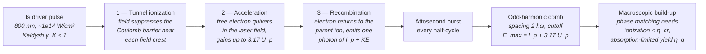

# High-harmonic generation

**Status:** ✅ Implemented (🔶 intensities) — comb spacing, cutoff law, Keldysh parameter and critical ionization exact; harmonic power = an assumed driver × an order-of-magnitude efficiency, checked against measured records (the Ne preset derives 0.90 µW (0.8995) at 13.5 nm; ~1 µW measured) · [matrix](../capability-matrix.md#light-sources)

<p class="huv-lead">HHG is the leading table-top route to laser-like coherent EUV. An intense femtosecond driver (800 nm Ti:Sapphire or 1030 nm Yb) focused into a noble-gas jet emits odd harmonics of the driver frequency, reaching into the EUV and soft-X-ray plateau. Flux is low (nJ–µJ per pulse), so HHG is not a wafer-exposure source; its lithographic relevance is actinic metrology — mask inspection, pellicle and resist characterization, coherent diffractive imaging at exactly 13.5 nm from a source that fits on an optical table. At 13.5 nm HHG has delivered ~60 nW (Drs et al. 2024), 0.43 µW (KMLabs / JILA 2017) and ~1 µW (University of Hyogo / RIKEN 2012); milliwatt-class single harmonics exist only at 21.7–26.5 eV with fiber-laser drivers. In highuvlith `HhgSource` is also the stress-test for the polychromatic imaging boundary: its comb is far wider than anything the centre-wavelength Hopkins engine can honestly image, and the model says so. The HHG lane of the mechanism drawing is this page's; the soft-X-ray-laser lane has its own page.</p>

<div class="huv-physics" markdown>

<figure markdown="span">


<figcaption><strong>Mechanism.</strong> HHG: a femtosecond driver at ~10¹⁴ W/cm² tunnel-ionises the gas near each field crest, the freed electron gains up to 3.17 U_p and recombines, emitting one photon of I_p + KE every half-cycle, so the spectrum is an odd-harmonic comb with spacing 2ħω and cutoff I_p + 3.17 U_p that phase matching and absorption limit. Soft-X-ray laser: a capillary discharge or picosecond pump makes a hot column of closed-shell-like ions, collisions invert a J = 0 level, and amplified spontaneous emission along the column yields a fixed atomic line. Both reach the engine as coherent-core pupils. <em>Schematic, not to scale; no model badge.</em></figcaption>
</figure>

<figure markdown="span">


<figcaption><strong>The harmonic comb the engine samples.</strong> Full-comb mode of the two HHG presets (<code>hhg(full_comb=True).spectrum()</code>, summed per harmonic): odd harmonics of the 800 nm driver from the first line above the ionization potential to the single-atom cutoff <i>I</i><sub>p</sub> + 3.17 <i>U</i><sub>p</sub>, flat on the plateau and rolling off above 0.9 of the cutoff. The band shows the 25–35 nm passband the page uses with the exact per-wavelength imaging path; the selected harmonics are the monochromatized presets with their derived powers. <em>Model: High-harmonic generation ✅ (🔶 intensities: line positions and the cutoff are exact, the relative intensities are an empirical envelope).</em></figcaption>
</figure>

| What is modeled | Grade | Dominant approximation | Details |
|---|---|---|---|
| High-harmonic generation | ✅ Implemented (🔶 intensities) | positions, cutoff, Keldysh and η_cr exact; power = assumed driver × an order-of-magnitude efficiency (λ⁻⁵·⁵ scaling, ±1 decade) | [Key equations](#key-equations) |
| Illumination pupil fills | ✅ Implemented | the graded `CoherentGaussian` fill from the σ_core/√ζ bridge | [What the model does](#what-the-model-does) |
| Dose-limited wafer throughput | 🔶 Simplified | 0.90 µW through the EUV-like optics train: ≈ 2.6×10⁻⁶ wafers per hour | [Use it](#use-it) |

</div>

<div class="huv-glance" markdown>

| Property | Value |
|---|---|
| Wavelength | 13.56 nm = 800 nm / 59 (Ne preset); 29.63 nm = 800 / 27 (Ar preset); every odd harmonic below the cutoff |
| Band / class | table-top coherent EUV · monochromatized single harmonic (15–30 pm); full-comb mode is spectral bookkeeping |
| Coherence → pupil | coherent Gaussian σ ≈ 0.05 from ζ = 0.9 through σ_core/√ζ |
| Power | 0.90 µW (0.8995) **in the harmonic at the source** from an assumed 20 W driver (Ne); 30 µW from 3 W (Ar) — never the milliwatt class, which exists only at 21.7–26.5 eV |
| Presets | `hhg_ne_13nm5()`, `hhg_ar_30nm()`, `hhg(...)` (own gas, intensity, harmonic, driver) |
| Grade | ✅ Implemented (🔶 intensities) |
| Compare with | [Soft X-ray laser](soft-xray-laser.md) · [Synchrotron](synchrotron.md) · [XFEL](xfel.md) |

**Same thing elsewhere:** Python `SourceConfig.hhg_ne_13nm5()` · TOML `[source] type = "hhg"` · CLI `highuvlith sources --family hhg` · GUI Source panel

</div>

<details markdown="1">
<summary>How the light is made (flowchart)</summary>



</details>

## Key equations

The semiclassical three-step model (Corkum 1993; Kulander, Schafer and Krause 1992). The ponderomotive energy sets the maximum return kinetic energy and the tunnelling picture applies when the Keldysh parameter is below one:

```math
U_p\,[\mathrm{eV}] = 9.33\times10^{-14}\; I\,[\mathrm{W/cm^2}]\; \lambda^2\,[\mathrm{\mu m^2}], \qquad E_{\max} = I_p + 3.17\,U_p, \qquad \gamma_K = \sqrt{\frac{I_p}{2\,U_p}} < 1
```

Because the process repeats every half-cycle with alternating sign, the spectrum is a comb of odd harmonics spaced by two driver photons; harmonics between I_p and ~0.9 E_max form a flat plateau and the last ~10 % roll off steeply (envelope g = exp[−(E − 0.9E_max)/(0.05E_max)]):

```math
\Delta E = 2\hbar\omega_{\mathrm{driver}}, \qquad \lambda_q = \frac{\lambda_{\mathrm{driver}}}{q}, \quad q = 1, 3, 5, \dots
```

Neutral-gas and free-electron dispersion cancel at the **critical ionization fraction** η_cr; above it no pressure restores phase matching, so the phase-matched cutoff lies below the single-atom one (the model reports η_cr, it does not compute ionization dynamics):

```math
\eta_{cr} = \frac{\Delta n}{\Delta n + N_\text{atm}\,r_e\,\lambda_L^2/(2\pi)}
```

The absolute yield has no closed form, so the model uses an explicitly labelled **order-of-magnitude estimate** — an assumed absorption-limited plateau efficiency per gas at 800 nm, the single-atom driver-wavelength scaling (measured exponents 5–6.5, midpoint used: a 1030 nm driver pays 0.249) and the cutoff envelope — and multiplies it by an **assumed** driver average power (5 W for `hhg()` and the CLI default, 3 W for the Ar preset, 20 W for the Ne preset); a measured `conversion_efficiency` can replace it:

```math
\eta_q = \eta_\text{gas}(800\ \text{nm})\,\left(\frac{\lambda_L}{800\ \text{nm}}\right)^{-5.5} g\!\left(\frac{E_q}{E_{\max}}\right), \qquad P_q = P_\text{driver}\,\eta_q
```

<details markdown="1">
<summary>Full formulas — gas data and the preset arithmetic</summary>

| Gas | I_p (eV) | n − 1 at STP | η_cr at 800 nm | η_cr at 1030 nm | Assumed plateau CE (800 nm) | Typical use |
|---|---|---|---|---|---|---|
| Helium | 24.587 | 3.5×10⁻⁵ | 0.45 % | 0.27 % | 1×10⁻⁸ | highest cutoff, lowest yield |
| Neon | 21.565 | 6.7×10⁻⁵ | 0.86 % | 0.52 % | 1×10⁻⁷ | 13.5 nm band at ≳ 4×10¹⁴ W/cm² |
| Argon | 15.760 | 2.81×10⁻⁴ | 3.5 % | 2.2 % | 1×10⁻⁵ | workhorse 30–50 nm, best yield/effort |
| Krypton | 14.000 | 4.27×10⁻⁴ | 5.2 % | 3.2 % | 2×10⁻⁵ | longer-wavelength XUV |
| Xenon | 12.130 | 7.02×10⁻⁴ | 8.3 % | 5.2 % | 3×10⁻⁵ | highest single-atom yield, lowest cutoff |

Ionization potentials are NIST values; refractivities the visible values at 0 °C and 1 atm (within ~1–2 % at 800–1030 nm); the plateau efficiencies are the model's assumptions (`HhgGas` in [`hhg.rs`](../../crates/highuvlith-core/src/source_models/hhg.rs)). **`ar_800nm_30nm()`** — Ar, 2×10¹⁴ W/cm², q = 27, 3 W at 100 kHz: U_p = 11.94 eV, E_max = 53.6 eV, E₂₇ = 41.8 eV (plateau), γ_K = 0.812, η₂₇ = 1×10⁻⁵ → 30 µW (0.3 nJ per pulse); 250 W in this harmonic would need 25 MW of driver; the record curve at 41.8 eV is 56 µW, so the preset sits at 0.54 of it. **`ne_800nm_13nm5()`** — Ne, 4×10¹⁴ W/cm², q = 59, 20 W at 10 kHz: U_p = 23.88 eV, E_max = 97.3 eV > E₅₉ = 91.4 eV, γ_K = 0.672; q = 59 sits in the roll-off (envelope 0.45), so η₅₉ ≈ 4.5×10⁻⁸ → 0.90 µW (0.8995 µW; 90 pJ per pulse), between the measured 0.43 µW and ~1 µW, and 250 W would need ≈ 5.6 GW of driver. At 2×10¹⁴ W/cm² in Ne (cutoff 59.4 eV) q = 59 is rejected by the guard.

</details>

## Real machines

<!-- huv-table: stack -->

| System class | Driver / gas | Output | In-band performance | provenance | Citation |
|---|---|---|---|---|---|
| Fiber-laser-driven, single harmonic | high-rep-rate fiber laser | 21.7 eV (57.1 nm) | 0.83 mW | measured | Klas et al., *Optica* **3**, 1167 (2016) |
| Fiber-laser-driven, single harmonic | high-rep-rate fiber laser | 26.5 eV (46.8 nm) | 12.9 mW | measured | Klas et al., *PhotoniX* **2**, 4 (2021) |
| Fiber-laser-driven | high-rep-rate fiber laser | 30 eV (41.3 nm) | 3×10¹³ photons/s ≈ 0.14 mW | measured | Hädrich et al., *Nat. Photonics* **8**, 779 (2014) |
| 13.5 nm, 59th harmonic | ~800 nm class | 13.5 nm | ~1 µW | reported | University of Hyogo / RIKEN, 2012 EUVL workshop |
| 13.5 nm (KMLabs / JILA) | — | 92 eV (13.48 nm) | 2.9×10¹⁰ photons/s ≈ 0.43 µW | reported | Kapteyn, Murnane et al., 2017 EUVL workshop |


<figure markdown="span">


<figcaption><strong>Where the presets sit against what HHG has delivered.</strong> The engine's <code>measured_power_record</code> curve is anchored on three cited records and log-interpolated between 30 and 92 eV, where the curated set holds no measurement; above 92 eV it is blank, so a derived power there is unanchored. The Ar and Ne presets (assumed 3 W and 20 W drivers times an order-of-magnitude efficiency) fall at 0.54 and 0.86 of the record; the same Ar harmonic from a 50 W driver would be 9× above it and is labelled a projection. <em>Model: High-harmonic generation ✅ (🔶 intensities: the conversion efficiency is an order-of-magnitude estimate).</em></figcaption>
</figure>

<figure markdown="span">


<figcaption><strong>An assumed driver, an order-of-magnitude efficiency, a measured record beside it.</strong> The harmonic power is driver power × conversion efficiency (±1 decade); the diamond is the best measured single-harmonic power at that photon energy, which both presets stay below; the band marks the 250 W a production source delivers at IF, nine decades up. <em>Model: High-harmonic generation ✅ (🔶 intensities).</em></figcaption>
</figure>

## What the model does

[`HhgSource`](../../crates/highuvlith-core/src/source_models/hhg.rs) stores the driver wavelength, gas, peak intensity, an optional `HarmonicSelection { harmonic, bandwidth_pm }` monochromator, pulse metadata, a pupil and three machine fields (`driver_average_power_w`, `conversion_efficiency`, `comb_passband_nm`):

- **Cutoff-rejection guard (live)** — `HhgSource::new` computes E_max through [`physics::hhg_cutoff_ev`](../../crates/highuvlith-core/src/source_models/physics.rs) and returns `Err(InvalidParameter)` for a harmonic beyond it, even or zero; every construction path (Rust, Python factory, CLI TOML) goes through it.
- `wavelength_nm()` — λ_driver/q in monochromatized mode; the median comb line in full-comb mode. `spectral_weights()` — a Gaussian of the post-monochromator bandwidth, or `comb_lines()` (every odd harmonic above I_p up to the cutoff, restricted to `comb_passband_nm`, flat plateau with the roll-off, 1 % linewidth per line).
- **Power** — with `driver_average_power_w` set (every constructor sets one) P_q = P_driver η_q is derived and `pulse_energy_j()` = P_q/f_rep: changing the repetition rate changes the pulse energy, not the power; with `None` the stored `pulse_energy_nj` × `rep_rate_hz` is used and the implied driver power is reported.
- **Pupil** — coherence 0.9 mapped to a tight `CoherentGaussian` fill via `sigma_from_coherence`; the pupil then spans many grid frequencies, and the engine's memory guard (`PupilSamplingTooDense`, see the [pipeline](../pipeline.md)) rejects a configuration whose factorized TCC would exceed ~1 GiB — coarsen the grid, shrink the field or reduce `source_points_per_axis`. Not modeled: HHG's strong intensity noise (`shot_to_shot_rms()` stays 0), ionization dynamics, focusing geometry, pressure.

**Monochromatized imaging is the honest default; full-comb results are bookkeeping unless imaged per wavelength.** A pm-scale single harmonic is handled correctly by the narrow-band path (`compute_polychromatic`, CLI `[imaging] spectrum = "narrow_band"`). Full-comb mode spans tens of nm — the Ar preset's comb has 12 lines from 72.7 to 24.2 nm — so through the monochromatic default or the narrow-band path its results are weights, bandwidth span and photon accounting, **not honest aerial images**. The exact per-wavelength path (`SimulationEngine.compute_multiwavelength()`, CLI `spectrum = "per_wavelength"`) rebuilds the kernels at every spectral sample and turns a comb into an incoherent sum of per-harmonic images; for that set `spectral_samples = 1` (one TCC per harmonic) and `comb_passband_nm` to the band the optics actually pass (e.g. `[25.0, 35.0]` keeps the Ar harmonics 23–31).

<figure markdown="span">


<figcaption><strong>Honest comb imaging: the exact path images every harmonic, the narrow-band path only the centre one.</strong> A neon HHG source (800 nm driver) filtered to 12.8–14.4 nm keeps harmonics 57, 59 and 61, each with its own cutoff pitch λ<sub>q</sub>/(NA(1+σ)) (grey: each harmonic alone); the exact path rebuilds the TCC at every spectral sample, so the comb image is the weighted sum of the three harmonics' images (q 57 carries most of the filtered flux) and its contrast lies between the single-harmonic curves. The narrow-band path keeps the centre-λ kernels and only shifts focus — with reflective optics (no chromatic focus shift) it is identical to the centre harmonic alone; EUV projection optics NA 0.33, unobscured, no flare, near-coherent Gaussian fill (σ ≈ 0.05). <em>Model: broadband imaging (<code>compute_multiwavelength</code>) ✅ · narrow-band polychromatic (<code>compute_polychromatic</code>) 🔶 (valid for Δλ/λ ≪ 1) · high-harmonic generation ✅ (🔶 power: comb and cutoff exact, driver power assumed).</em></figcaption>
</figure>

| Field | Unit | Consumed by | Status |
|---|---|---|---|
| `driver_wavelength_nm`, `gas`, `driver_intensity_w_cm2` | nm, —, W/cm² | λ_q, U_p and the cutoff guard, comb positions, Keldysh, η_cr, the λ⁻⁵·⁵ scaling, the efficiency anchor | live |
| `monochromator.harmonic`, `monochromator.bandwidth_pm`, `comb_passband_nm` | —, pm, nm | `wavelength_nm()`; `bandwidth_pm()` → spectral weights → chromatic focus loop; the comb filter | live |
| `driver_average_power_w`, `conversion_efficiency` | W, — | derived harmonic power → `average_power_w()`, `pulse_energy_j()`; the override replaces the estimate | live |
| `pulse_energy_nj`, `rep_rate_hz` | nJ, Hz | `pulse_energy_j()` × rate only when the driver power is `None`; derived pulse energy | live (fallback) |
| `transverse_coherence_fraction`, `spectral_samples`, `illumination` | —, count, enum | pupil σ at construction; samples per line; `intensity_at()` | live |
| HHG intensity noise → dose jitter; phase-matched cutoff from ionization dynamics | — | only η_cr is reported | planned |

## Derived quantities

`derived_quantities()` (Python `derived_quantity(name)`; printed by `highuvlith simulate`) for the two presets:

<!-- huv-table: stack -->

| Name | Unit | Meaning | Ar preset | Ne preset |
|---|---|---|---|---|
| `cutoff_energy` | eV | single-atom I_p + 3.17 U_p | 53.62 | 97.28 |
| `keldysh_parameter` | — | √(I_p / 2U_p) | 0.812 | 0.672 |
| `critical_ionization` | — | phase-matching limit η_cr | 0.0352 | 0.00861 |
| `conversion_efficiency` | — | estimate (or the override), ±1 decade | 1×10⁻⁵ | 4.5×10⁻⁸ |
| `derived_harmonic_power` | W | P_driver × η_q (= `average_power`) | 3.0×10⁻⁵ | 9.0×10⁻⁷ |
| `driver_power_for_hvm` | W | 250 W / η_q | 2.5×10⁷ | 5.6×10⁹ |
| `power_vs_measured_record` | — | average power / record; > 1 is labelled a projection | 0.54 | 0.86 |

<details markdown="1">
<summary>The other 6 derived quantities</summary>

`photon_energy` 41.84 / 91.44 eV · `ponderomotive_energy` 11.94 / 23.88 eV · `wavelength_scaling_factor` 1 (800 nm driver) · `implied_driver_power` (only without a driver power) · `measured_power_record` 5.57×10⁻⁵ / 1.05×10⁻⁶ W (the record curve at each photon energy) · `comb_line_count` 12 for the Ar comb (5 in the 25–35 nm passband) · `hvm_power_ratio` 1.2×10⁻⁷ / 3.6×10⁻⁹ (against 250 W at IF).

</details>

## Use it

### Python

Factories from [`py_config.rs`](../../crates/highuvlith-py/src/py_config.rs); `hhg()` raises `ValueError` for an even harmonic or one beyond the I_p + 3.17 U_p cutoff, and a driver power **derives** the harmonic power.

<!-- verify-example -->
```python
from highuvlith import SourceConfig

src = SourceConfig.hhg_ne_13nm5()                     # neon, harmonic 59 -> 13.56 nm
print(f"{src.derived_quantity('keldysh_parameter'):.3g}")        # tunnelling regime
print(f"{src.derived_quantity('critical_ionization'):.3g}")
print(f"{src.derived_quantity('driver_power_for_hvm'):.3g} W")   # for 250 W
print(f"{src.average_power_w:.3g} W")                             # assumed 20 W driver
print(f"{src.derived_quantity('power_vs_measured_record'):.3g}")  # within measured 13.5 nm HHG
ar = SourceConfig.hhg(driver_wavelength_nm=800.0, gas="argon", driver_intensity_w_cm2=2e14,
                      harmonic=27, monochromator_bandwidth_pm=30.0,
                      driver_average_power_w=50.0)    # 50 W x 1e-5 = 0.5 mW: a projection
print(f"{ar.wavelength_nm:.3g} nm", f"{ar.average_power_w:.3g} W",
      f"{ar.derived_quantity('power_vs_measured_record'):.3g}")
```

???+ success "Output"

    ```text
    0.672
    0.00861
    5.56e+09 W
    9e-07 W
    0.86
    29.6 nm 0.0005 W 8.97
    ```

### TOML keys

Field names from [`config.rs`](../../crates/highuvlith-cli/src/config.rs); `highuvlith simulate --config examples/sim_hhg.toml` prints the derived quantities in a "Derived source physics" block. Example: [`examples/sim_hhg.toml`](../../examples/sim_hhg.toml).

| Key | Default | Units | Notes |
|---|---|---|---|
| `type` | — | — | `"hhg"` |
| `gas` | `"neon"` | — | `helium`/`he`, `neon`/`ne`, `argon`/`ar`, `krypton`/`kr`, `xenon`/`xe`. |
| `driver_wavelength_nm`, `driver_intensity_w_cm2` | 800, 4e14 | nm, W/cm² | |
| `harmonic`, `monochromator_bandwidth_pm` | 59 (1 with `full_comb`), 15 | —, pm | Odd, inside the cutoff. |
| `full_comb`, `comb_passband_nm` | false, none | —, `[min_nm, max_nm]` | Image the whole comb, optionally filtered (bookkeeping unless imaged per wavelength). |
| `driver_average_power_w`, `conversion_efficiency` | 5 (assumed), gas/λ estimate | W, — | Derives the harmonic power (driver × efficiency); a measured efficiency in (0, 1] overrides the estimate. |
| `pulse_energy_nj`, `rep_rate_hz`, `pulse_duration_fs` | preset | nJ, Hz, fs | A pulse energy alone (no driver power) is used as stored. |
| `wavelength_nm`, `spectral_samples` | derived, preset | nm, count | A given wavelength is a cross-check (1 %, adjacent harmonics are only 2/q apart). |

<details markdown="1">
<summary>Validation — 22 tests</summary>

- [`hhg.rs`](../../crates/highuvlith-core/src/source_models/hhg.rs): `test_comb_spacing_is_two_driver_photons`, `test_cutoff_rejection` (Ar@2e14 rejects q = 59, Ne@4e14 accepts it), `test_even_harmonic_rejected`, `test_preset_wavelengths`, `test_weights_sum_to_one_in_both_modes`, `test_plateau_starts_above_ionization_potential`, `test_comb_passband_filter` (25–35 nm keeps q = 23–31), `test_pulse_metadata_live` (30 µW Ar; Ne between the 0.43 µW and 1 µW records), `test_power_anchored_to_measured_records` (presets and defaults ≤ the record; no default 800 nm configuration reaches 0.2 mW below 45 nm; a 50 W Ar driver is flagged), `test_keldysh_and_critical_ionization` (0.812 / 0.672; η_cr 3.5 % for Ar), `test_efficiency_estimate_and_scaling` (0.2491 at 1030 nm; the roll-off for Ne q = 59), `test_derived_power_from_driver`.
- [`physics.rs`](../../crates/highuvlith-core/src/source_models/physics.rs): `test_ponderomotive_and_cutoff_fixture` (U_p = 11.94 eV, cutoff 53.6 eV for Ar), `test_hhg_critical_ionization_and_keldysh` (independent scipy values); CLI: `test_hhg_cutoff_violation_rejected_from_config`, `test_toml_hhg_parsing`, `test_hhg_driver_power_and_passband`, `test_family_example_tomls_validate`; Python: `tests/python/test_sources.py::TestHhgSource`, `tests/python/test_sources_physics.py::TestHhg` (`test_phase_matching_and_efficiency`, `test_driver_power_derives_harmonic_power`, `test_default_powers_anchored_to_measured_records`, `test_comb_passband`).

</details>

<details markdown="1">
<summary>Changes</summary>

**Power is derived, not stored.** Earlier versions stored flat values — 1 mW for every `HhgSource::new` configuration, then 1 µW (Ne preset 1 µW, Ar preset 0.1 mW); every constructor now sets an assumed driver power and derives P_q = P_driver η_q, writing the value into `pulse_energy_nj` for reference. The GUI shows the Ne preset's derived power as 0.8995 µW, i.e. the 0.90 µW quoted here. Dated entries live in the [capability matrix](../capability-matrix.md#audit-log) audit log.

</details>

## See also

[Soft X-ray laser](soft-xray-laser.md) (the other table-top coherent EUV source) · [Synchrotron](synchrotron.md) · [Quantum and exotic lithography](../future/quantum-and-exotic.md) · [Alternatives to projection](../future/alternative-patterning.md) · [Pipeline — spectral imaging](../pipeline.md) · [Sources index](index.md) (trait contract, coherence → σ heuristic, throughput model) · [TOML configuration](../configuration.md) · [`examples/sim_hhg.toml`](../../examples/sim_hhg.toml)

## References

1. P. B. Corkum, *Phys. Rev. Lett.* **71**, 1994 (1993); J. L. Krause, K. J. Schafer, K. C. Kulander, *Phys. Rev. Lett.* **68**, 3535 (1992); M. Lewenstein et al., *Phys. Rev. A* **49**, 2117 (1994) — the three-step model; A. Rundquist et al., "Phase-matched generation of coherent soft X-rays," *Science* **280**, 1412 (1998); C. M. Heyl et al., *J. Phys. B* **50**, 013001 (2017) — macroscopic power scaling.
3. D. Gardner et al., "Subwavelength coherent imaging of periodic samples using a 13.5 nm tabletop high-harmonic light source," *Nat. Photon.* **11**, 259 (2017) — full spatial coherence at 13.5 nm shown by CDI.
4. R. Klas et al., *Optica* **3**, 1167 (2016) and *PhotoniX* **2**, 4 (2021), doi:10.1186/s43074-021-00028-y — 0.83 mW at 21.7 eV, 12.9 mW at 26.5 eV; S. Hädrich et al., *Nat. Photonics* **8**, 779 (2014), doi:10.1038/nphoton.2014.214 — 3×10¹³ photons/s at 30 eV.
5. Measured 13.5 nm HHG: ~1 µW, 59th harmonic (University of Hyogo / RIKEN), 2012 EUVL workshop, https://euvlitho.com/2012/P33.pdf; 0.43 µW at 92 eV (KMLabs / JILA), 2017 EUVL workshop, https://euvlitho.com/2017/P4.pdf; ~60 nW (Drs et al., 2024). Ionization potentials: NIST Atomic Spectra Database, https://www.nist.gov/pml/atomic-spectra-database.

**Where next:** ← [Smith–Purcell](smith-purcell.md) · [Soft X-ray laser](soft-xray-laser.md) → · [Sources](index.md) · [Quantum and exotic lithography](../future/quantum-and-exotic.md)
