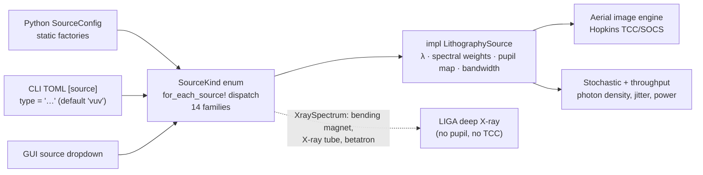

# Illumination sources

**Status:** ✅ Implemented — the `LithographySource` trait, the type-erased `SourceKind` dispatch and all fourteen families are in code; each family page carries its own grade, copied here from the matrix · [matrix](../capability-matrix.md#light-sources)

<p class="huv-lead">Every source reaches the image through four numbers: a wavelength, a set of spectral weights, a pupil map and a bandwidth. Everything else a source model computes — plasma power chains, FEL gain lengths, undulator flux — is reported as a derived quantity and never enters the image, which is why a 157 nm excimer laser and a 13.5 nm free-electron laser run through the same Hopkins code path. Read the ruler for where each preset sits, the cards for how each family is graded, and the throughput section for what its watts buy.</p>

<figure markdown="span">

<picture><source media="(max-width: 600px)" srcset="../assets/images/diagrams/spectrum-strip-ruler-narrow-light.svg"></picture>
<picture><source media="(max-width: 600px)" srcset="../assets/images/diagrams/spectrum-strip-ruler-narrow-dark.svg"></picture>

<figcaption><strong>Every source preset by wavelength.</strong> ◆ derived from machine parameters (moves with them), ● set-point, ▲ fixed line, ■ representative; bands are the optics each range needs; the log axis is expanded above 100 nm. <em>Chips copied from the matrix.</em></figcaption>
</figure>

## Fourteen families, six clusters

The clusters are the navigation's: fifteen pages for fourteen families (the DUV/UV heritage presets share the VUV source type). Grades are the capability-matrix rows in the one split form, headline first.

### Excimer and lamp lines

<div class="grid cards huv-cards" markdown>

-   **DUV/UV heritage**

    ---

    <span class="huv-swatch huv-swatch--arf"></span>✅ Implemented (🔶 parameters) · 436–193 nm · Hg g/h/i lamp lines and the KrF and ArF excimer presets: exact photon budgets, representative laser parameters, no lamp power model.

    [DUV/UV heritage →](duv-heritage.md)

-   **VUV excimer**

    ---

    <span class="huv-swatch huv-swatch--f2"></span>✅ Implemented (🧪 Ar₂) · 157.63 / 126 nm · The F₂ laser the framework was built around, and a 126 nm Ar₂ preset that is a what-if and says so.

    [VUV excimer →](vuv-excimer.md)

</div>

### Plasma EUV

<div class="grid cards huv-cards" markdown>

-   **Laser-produced plasma**

    ---

    <span class="huv-swatch huv-swatch--euv"></span>✅ Implemented (🔶 CE defaults, étendue; 🧪 Gd/Tb power) · 13.5 / 6.7 / 6.5 nm · The production EUV source: a calibrated drive → CE → intermediate-focus chain landing on 250 W.

    [Laser-produced plasma →](lpp.md)

-   **Discharge-produced plasma**

    ---

    <span class="huv-swatch huv-swatch--euv"></span>🔶 Simplified · 13.5 nm · Xe and Sn pinch sources on reported anchors, with the 2π-at-source and at-IF planes kept apart.

    [Discharge-produced plasma →](dpp.md)

</div>

### Accelerator EUV concepts

<div class="grid cards huv-cards" markdown>

-   **Synchrotron**

    ---

    <span class="huv-swatch huv-swatch--euv"></span>✅ Implemented (🔶 coherence bound) · derived · Undulator line, flux and coherence computed from the ring; the bending magnet is the LIGA white beam.

    [Synchrotron →](synchrotron.md)

-   **XFEL**

    ---

    <span class="huv-swatch huv-swatch--euv"></span>✅ Implemented (🧪 CW-SC and ERL presets) · 13.5 nm set-point · SASE statistics as live dose jitter; the kilowatt presets are design projections.

    [XFEL →](xfel.md)

-   **LPA-FEL**

    ---

    <span class="huv-swatch huv-swatch--euv"></span>🔶 Simplified · 25 nm set-point · A laser-plasma accelerator driving an undulator; the derived FEL physics says the illustrative beam does not lase at 25 nm.

    [LPA-FEL →](lpa-fel.md)

-   **SSMB**

    ---

    <span class="huv-swatch huv-swatch--euv"></span>🧪 Theoretical · 13.5 nm · Steady-state microbunching: 1 kW derived, at a bunching factor nobody has demonstrated.

    [SSMB →](ssmb.md)

-   **Inverse Compton**

    ---

    <span class="huv-swatch huv-swatch--euv"></span>🧪 Theoretical · derived · Exact kinematics, a derived yield of 71 µW in band — millions short of a scanner.

    [Inverse Compton →](inverse-compton.md)

-   **Smith–Purcell**

    ---

    <span class="huv-swatch huv-swatch--euv"></span>🧪 Theoretical · derived · A free-electron grating: exact dispersion, an assumed coupling, sub-nanowatt power.

    [Smith–Purcell →](smith-purcell.md)

</div>

### Table-top coherent EUV

<div class="grid cards huv-cards" markdown>

-   **High-harmonic generation**

    ---

    <span class="huv-swatch huv-swatch--euv"></span>✅ Implemented (🔶 intensities) · 800 nm / q · Exact comb positions and cutoff; harmonic power from an assumed driver, checked against measured records.

    [High-harmonic generation →](hhg.md)

-   **Soft X-ray laser**

    ---

    <span class="huv-swatch huv-swatch--euv"></span>✅ Implemented (🔶 output parameters) · fixed lines · Plasma lasers on fixed atomic lines (46.9, 18.9, 13.9, 13.2 nm) reproducing reported average powers.

    [Soft X-ray laser →](soft-xray-laser.md)

</div>

### Lab white-beam (LIGA)

<div class="grid cards huv-cards" markdown>

-   **X-ray tube**

    ---

    <span class="huv-swatch huv-swatch--xray"></span>🔶 Simplified (✅ lines, edges, Duane–Hunt, Be window) · 0.02–1.2 nm · Kramers continuum plus characteristic lines, as an absolute flux table for LIGA shadow printing.

    [X-ray tube →](xray-tube.md)

-   **Betatron**

    ---

    <span class="huv-swatch huv-swatch--xray"></span>🧪 Theoretical · derived · Laser-wakefield betatron X-rays: a textbook synchrotron-like spectrum at microwatts, not a lithography source.

    [Betatron →](betatron.md)

</div>

### Quantum

<div class="grid cards huv-cards" markdown>

-   **Entangled photons**

    ---

    <span class="huv-swatch huv-swatch--f2"></span>🧪 Theoretical · 157.63 nm · An SPDC NOON source whose sub-Rayleigh pattern has never been recorded in a material; the quantum module is an explicit opt-in.

    [Entangled photons →](entangled-photon.md)

</div>

## Every family in one table

"Power" is what each preset reports as `average_power_w()` — the usable output into the illuminator, which for plasma sources means in-band power at intermediate focus; every family page states the plane of every number in its glance strip. Wavelengths are **derived** when the machine fixes them (undulator resonance, Compton kinematics, betatron critical energy, Smith–Purcell dispersion; the CLI rejects an explicit `wavelength_nm` that disagrees by more than 5 %), **set-points** when the real machine is tunable (XFEL gap, LPA-FEL beam energy, a monochromator), and **fixed lines** when atomic or molecular physics sets them.

<!-- huv-table: stack -->

| Family | `type` | λ (nm) | Class | Grade | Page |
|---|---|---|---|---|---|
| DUV/UV heritage | `vuv` + `preset` | 435.83 / 404.66 / 365.02 lines; 248.3; 193.368 | filtered Hg arc (CW); line-narrowed excimer lasers | ✅ Implemented (🔶 parameters) | [duv-heritage](duv-heritage.md) |
| VUV excimer | `vuv` | 157.63 (F₂); 126.0 (Ar₂) | discharge-pumped excimer laser | ✅ Implemented (🧪 Ar₂) | [vuv-excimer](vuv-excimer.md) |
| Laser-produced plasma | `lpp` | 13.5 (Sn); 6.7 (Gd); 6.5 (Tb) | laser-driven plasma, mirror-band selected | ✅ Implemented (🔶 CE defaults, étendue; 🧪 Gd/Tb power) | [lpp](lpp.md) |
| Discharge-produced plasma | `dpp` | 13.5 (Xe, Sn) | pinch discharge, optionally laser-assisted | 🔶 Simplified | [dpp](dpp.md) |
| Synchrotron | `synchrotron` | derived: 13.51 (compact undulator); 0.2 selected on a white beam | storage-ring undulator / bending magnet | ✅ Implemented (🔶 coherence bound) | [synchrotron](synchrotron.md) |
| XFEL | `xfel` | 13.5 set-point | linac-driven FEL, SASE or seeded | ✅ Implemented (🧪 CW-SC and ERL presets) | [xfel](xfel.md) |
| LPA-FEL | `lpa_fel` | 25 set-point (420 demonstrated) | laser-plasma accelerator + undulator | 🔶 Simplified | [lpa-fel](lpa-fel.md) |
| High-harmonic generation | `hhg` | 29.6 (Ar, q 27); 13.56 (Ne, q 59) | table-top harmonic comb | ✅ Implemented (🔶 intensities) | [hhg](hhg.md) |
| Soft X-ray laser | `sxrl` | 46.9 / 18.9 / 13.9 / 13.2 fixed lines | capillary-discharge / collisional plasma laser | ✅ Implemented (🔶 output parameters) | [soft-xray-laser](soft-xray-laser.md) |
| Inverse Compton | `ics` | derived (13.5 needs ≈ 1.73 MeV electrons) | laser–electron backscatter | 🧪 Theoretical | [inverse-compton](inverse-compton.md) |
| SSMB | `ssmb` | 13.5 = 1053 / 78 | steady-state-microbunching ring | 🧪 Theoretical | [ssmb](ssmb.md) |
| Smith–Purcell | `smith_purcell` | derived from grating, β and angle | free-electron grating | 🧪 Theoretical | [smith-purcell](smith-purcell.md) |
| X-ray tube | `xray_tube` | 0.153 mean (W 60 kV); 0.021–1.24 span | bremsstrahlung + characteristic lines | 🔶 Simplified (✅ lines, edges, Duane–Hunt, Be window) | [xray-tube](xray-tube.md) |
| Betatron | `betatron` | derived: 0.499 = hc/⟨E⟩ | laser-wakefield betatron X-rays | 🧪 Theoretical | [betatron](betatron.md) |
| Entangled photons | `entangled` | 157.63 physical | SPDC NOON interferometry | 🧪 Theoretical | [entangled-photon](entangled-photon.md) |

## The `LithographySource` trait contract

Defined in [`source.rs`](../../crates/highuvlith-core/src/source.rs). The trait is `Send + Sync` and the core pipeline takes `impl LithographySource`, so there is no dynamic dispatch inside the imaging code.

<!-- huv-table: stack -->

| Method | Required / default | Consumed by |
|---|---|---|
| `wavelength_nm() -> f64` | **required** | pupil cutoff NA/λ, source-point scaling σ·NA/λ, defocus phase, photon energy and density, every downstream stage |
| `bandwidth_pm() -> f64` | **required** (FWHM) | the ±2.5 FWHM span that each family's `spectral_weights` samples; derived bandwidth figures; reporting (PyO3 `bandwidth_pm`) — the aerial engine reads only the weights |
| `intensity_at(fx_norm, fy_norm) -> f64` | **required** | pupil-fill sampling in `aerial::sample_source` (adaptive source grid) when the kernels are built |
| `spectral_weights() -> Vec<(f64, f64)>` | **required** (weights sum to 1) | `compute_polychromatic` (narrow band) and `compute_multiwavelength` (exact per-λ TCC); ignored by the monochromatic `compute` |
| `photon_energy_ev() -> f64` | default `1239.84193 / λ` | reporting |
| `photon_density_per_mj_cm2() -> f64` | default: photons/nm² at 1 mJ/cm² from hc/λ | `StochasticParams::from_source` (live shot-noise photon counts); the X-ray tube overrides it with its mean photon energy |
| `pulse_energy_j()`, `rep_rate_hz()`, `pulse_duration_s()` | default `None` | the default `average_power_w()` arithmetic; pulses per exposure point in the throughput model; the duration is reported only |
| `average_power_w() -> Option<f64>` | default `pulse_energy × rep_rate` when both are known | the dose-limited throughput model; PyO3 `average_power_w`; CW and machine-derived families override it |
| `transverse_coherence() -> f64` | default `0.0` (unknown / multimode) | reported (PyO3 `transverse_coherence_fraction`); the high-coherence families use it at construction to size their pupil through `sigma_from_coherence` |
| `shot_to_shot_rms() -> f64` | default `0.0` | `StochasticParams::from_source` (single-pulse rms as dose jitter) and `from_source_multi_pulse` (rms / √N) → Gamma-distributed dose factor in the LER/LWR Monte Carlo (live) |
| `derived_quantities() -> Vec<DerivedQuantity>` | default: empty | `highuvlith simulate` (stderr and the JSON output), Python `SourceConfig.derived_quantities()` / `derived_quantity(name)`; informational only |

A `DerivedQuantity` is `{ name, value, unit, note }` — a snake_case identifier, the number, its unit and a one-line provenance or caveat (`pierce_parameter_1d`, `in_band_power_at_if`, `hvm_power_ratio`, …). **Every trait method is forwarded through `SourceKind`**, the serde-tagged enum the Python, CLI and GUI layers carry (one variant per family; the TOML `type` tag equals `kind_label()`), so a per-family override such as the X-ray tube's photon density reaches `StochasticParams::from_source` from every front end (`test_source_kind_forwards_every_trait_method`). Dispatch is one line per method through the `for_each_source!` macro; a new family costs one enum variant, one macro arm, one `kind_label` arm and a `From` impl.

<details markdown="1">
<summary>How a source reaches the engine (flowchart)</summary>



</details>

## What the pipeline does with a source

| Stage | What happens | Where |
|---|---|---|
| Source sampling | `intensity_at` is sampled on an adaptive grid that zooms onto the illuminated part of the pupil; a tiny source or `source_points_per_axis = 1` collapses to one coherent point | `aerial::sample_source`; inspect with `imaging_diagnostics()` |
| Spectrum, three levels of honesty | `compute` images the centre wavelength; `compute_polychromatic` (`"narrow_band"`) shifts focus per spectral sample with the centre-λ kernels, valid for Δλ/λ ≪ 1; `compute_multiwavelength` (`"per_wavelength"`) rebuilds the TCC at every sample and sums incoherently — the honest path for an HHG comb | [pipeline](../pipeline.md); `[imaging] spectrum` |
| Scalar by default, vector on request | sources carry no polarization state; vector imaging is an imaging setting (`SimulationEngine(..., vector=VectorSettings(...))`) | [vector imaging](../vector-imaging.md) |
| Memory guard | a factorized TCC that would exceed 1 GiB of complex entries returns `LithographyError::PupilSamplingTooDense` instead of mis-sampling | the engine constructor |
| Pulse metadata | pulse energy × repetition rate → average power and `shot_to_shot_rms` → dose jitter are arithmetic; no time-domain pulse physics anywhere | `StochasticParams::from_source` |
| Illumination shapes | `Conventional`, `Annular`, `Quadrupole`, `Dipole` (two symmetric poles since 2026-09-30) and the graded `CoherentGaussian`; the presets never use `Dipole`, the optimization override does | `IlluminationShape` |

## From coherence to pupil fill

High-coherence sources fill only a small core of the pupil. The bridge from a transverse coherence fraction ζ to a partial-coherence pupil σ is a Gaussian–Schell mode-count heuristic, `sigma_from_coherence(ζ, 0.05)`:

```math
\begin{aligned}
\sigma_{\text{pupil}} &= \operatorname{clamp}\left(\frac{\sigma_{\text{core}}}{\sqrt{\zeta}},\ \sigma_{\text{core}},\ 1\right) \\
\zeta \le 0 &\Rightarrow \sigma_{\text{pupil}} = 1
\end{aligned}
```

A beam with coherence fraction ζ carries roughly M ≈ 1/ζ transverse modes, and far-field divergence — hence pupil fill — grows as √M. **This is approximate by design**: a bookkeeping bridge to partial-coherence imaging, not a coherent-mode decomposition, and the code says so. The resulting pupil is the graded `CoherentGaussian`, I(ρ) = exp(−ρ²/2σ²) for ρ ≤ 1. The undulator, HHG, XFEL, ICS, SSMB and SXRL families use the bridge; the entangled source fixes σ = 0.05; VUV, LPP, DPP, the bending magnet, the X-ray tube, the betatron, Smith–Purcell and the LPA-FEL keep top-hat fills (the LPA-FEL reports a coherence of 0.85–0.9 but keeps `Conventional`, because its `sigma` argument and the GUI slider mean a top-hat radius).

<figure markdown="span">


<figcaption><strong>From coherence to pupil fill.</strong> (a) The Gaussian–Schell mode-count heuristic σ = σ_core/√ζ — a bookkeeping bridge, not a coherent-mode decomposition — with every preset that uses it at its derived or stored ζ; (b) the fills the engine receives, from the F₂ and tin top-hats to the near-coherent cores; (c) what they do to imaging at 13.5 nm, NA 0.33: the coherent core cuts off at λ/NA, the disks at λ/(NA(1+σ)). <em>Model: Illumination pupil fills ✅ · Synchrotron (bending magnet / undulator) ✅ (🔶 coherence bound) · High-harmonic generation ✅ (🔶 intensities) · XFEL (SASE / seeded) ✅ (🧪 CW-SC and ERL presets) · Inverse Compton scattering 🧪 · SSMB storage ring 🧪 · Hopkins imaging (factorized TCC/SOCS) ✅.</em></figcaption>
</figure>

What six presets actually hand the engine — the sampled spectrum above the pupil fill — is drawn from their own `spectrum()` and `pupil_fill()`:

<figure markdown="span">


<figcaption><strong>What each source preset hands to the imaging engine.</strong> The spectral samples and weights (top; offset from the weighted mean wavelength) and the pupil fill (bottom; the circle is the NA). The excimer laser and the plasma source fill a disk (conventional σ); the undulator, FEL, HHG and ICS presets get a near-coherent Gaussian fill with σ derived from their transverse coherence; the filtered HHG comb is three harmonics (q 57, 59, 61), each sampled across its own linewidth. <em>From each preset's <code>spectrum()</code> and <code>pupil_fill()</code>; grades per family on each family page; no model badge.</em></figcaption>
</figure>

## Derived quantities and the physics layer

Every family reports `derived_quantities()`: physics computed from its machine parameters rather than stored as free numbers — the LPP power chain from drive power to IF, the synchrotron's harmonic factors and central-cone flux, the FEL Pierce parameter and Ming Xie gain length, the ICS Thomson yield, the SSMB bunching factor 1 kW would need, the NOON clearing times, the X-ray tube's bremsstrahlung efficiency, the betatron critical energy. Short-wavelength families also report their power relative to the 250 W at IF of production 13.5 nm sources (`hvm_power_ratio` or `hvm_power_gap`; reference `throughput::HVM_EUV_POWER_AT_IF_W`). The shared formulas live in [`source_models/physics.rs`](../../crates/highuvlith-core/src/source_models/physics.rs), each fixture-tested against independent scipy/mpmath evaluations: CODATA constants, Bessel functions, undulator harmonic factors, Kim's flux formulas, bending-magnet flux with the Kostroun S(y) integral, the emittance-limited coherent fraction, gap-tuned K, the 1D Pierce parameter and the Ming Xie fit (an empirical fit, ≈ 10–20 % inside its range), Thomson yield, the Keldysh parameter, coherent undulator power. `highuvlith simulate` prints the table to stderr and writes it into its JSON output; the GUI's Source view lists it.

<details markdown="1">
<summary>Example: every derived quantity of the FLASH-class XFEL preset</summary>

<!-- verify-example -->
```python
import highuvlith as huv

src = huv.SourceConfig.xfel_flash_13nm5()
for name, value, unit, note in src.derived_quantities():
    print(f"{name:32s} {value:12.4e} {unit}")
print(f"{src.derived_quantity('pierce_parameter_1d'):.3g}")
```

??? success "Output"

    ```text
    photon_energy                      9.1840e+01 eV
    average_power                      1.0000e-01 W
    photon_rate                        6.7961e+15 photons/s
    hvm_power_ratio                    4.0000e-04 -
    coherence_time                     9.7315e+00 fs
    longitudinal_modes                 3.0828e+00 -
    electron_gamma                     1.3317e+03 -
    undulator_k                        1.0247e+00 -
    pierce_parameter_1d                2.3137e-03 -
    beam_size_rms                      8.2208e+01 um
    gain_length_1d                     6.2353e-01 m
    ming_xie_lambda                    2.7405e-01 -
    gain_length_3d                     7.9441e-01 m
    energy_spread_over_rho             3.0255e-01 -
    emittance_over_photon_emittance    1.0485e+00 -
    beam_power_peak                    1.7013e+12 W
    saturation_power_1d                3.9362e+09 W
    saturation_power_3d                3.8799e+09 W
    saturation_pulse_energy_3d         1.1640e-04 J
    saturation_length_3d               1.7291e+01 m
    undulator_over_saturation_length   1.7343e+00 -
    sase_bandwidth_from_rho            6.2469e+01 pm
    pulse_energy_over_saturation       8.5913e-01 -
    beam_power_average                 5.1000e+01 W
    fel_efficiency                     1.9608e-03 -
    0.00231
    ```

</details>

## Dose-limited throughput

The throughput model is stated once, here; every family page links this section. [`source_models/throughput.rs`](../../crates/highuvlith-core/src/source_models/throughput.rs) turns any source's `average_power_w()` into wafers per hour for a step-and-scan tool — 🔶 Simplified: one optics-transmission factor, a dose-limited scan, two lumped overheads:

```math
\begin{aligned}
P_w &= P_\text{source} T_\text{optics} T_\text{mask} \\
v &= \frac{P_w}{D W} \\
\text{WPH} &= \frac{3600}{N_\text{fields}\left(\frac{H + h}{v} + t_\text{field}\right) + t_\text{wafer}} \\
N_p &= \frac{f_\text{rep} h}{v}
\end{aligned}
```

with dose D, slit length W across the scan, field length H, slit height h, and N_p the pulses per exposure point (which averages single-pulse jitter down by 1/√N_p; feed it to `StochasticParams::from_source_multi_pulse`). From Python:

<!-- verify-example -->
```python
import highuvlith as huv

r = huv.SourceConfig.lpp_sn_13nm5(sigma=0.9).wafer_throughput(dose_mj_cm2=30.0, cd_nm=16.0)
print(f"{r['wafers_per_hour']:.3g} wph, {r['power_at_wafer_w']:.3g} W at the wafer, "
      f"{r['pulses_per_point']:.3g} pulses per point")
```

???+ success "Output"

    ```text
    154 wph, 4.59 W at the wafer, 170 pulses per point
    ```

`wafer_throughput` returns `None` for sources without an average power (the bending magnet, the lamps, the entangled source). The method's EUV-like defaults at 30 mJ/cm² are **illustrative** assumptions, not vendor data: 10 mirrors of R = 0.70 between IF and wafer, mask efficiency 0.65, 300 mm wafers with 84 fields of 26 × 33 mm, 2 mm slit, 0.1 s per field and 10 s per wafer — overheads that cap the model near 196 wph however much power is supplied. Refractive-tool rows use `optics_transmission=0.3, mask_efficiency=0.9, slit_height_mm=8`.

<!-- huv-table: stack -->

| Preset | Source power (plane) | WPH | Note |
|---|---|---|---|
| `lpp_sn_13nm5` | 250 W at IF | 153.9 | 4.59 W at the wafer, ≈ 170 pulses per point |
| `lpp_sn_13nm5_500w` | 500 W at IF | 172.3 | increasingly overhead-limited |
| `xfel_erl_13nm5` · `ssmb_euv_13nm5` · `xfel_cw_sc_13nm5` | ≈ 10.5 kW · 1 kW · ≈ 135 W, FEL / ring output | 194 · 183 · 130 | design projections; the ERL sits at the overhead ceiling |
| `synchrotron_compact_euv` · `xfel_flash_13nm5` · `ics_compact_euv_13nm5` | 0.232 W · 0.1 W · 71 µW at the source | 0.67 · 0.29 · 2.1 × 10⁻⁴ | central-cone line power; measured-class FEL; derived ICS yield |
| `arf_laser` · `krf_laser` · `f2_laser` (refractive-like settings) | 90 W · 40 W · 40 W laser output | 185 · 172 · 172 | 15 · 23 · 23 pulses per point — the KrF and F₂ rows coincide because both presets are 40 W lasers through the same column |

At 13.5 nm and 30 mJ/cm² a (16 nm)² pixel receives about 5,200 photons — 1.4 % relative shot noise (`throughput::photons_per_square`, `relative_shot_noise`). For 6.x nm work `ThroughputParams::beuv_la_b_like` swaps in La/B multilayers at the record 64.1 % reflectance (0.641¹¹ ≈ 0.75 % of the IF power reaches the wafer); from Python pass `n_mirrors=10, mirror_reflectivity=0.641, mask_efficiency=0.641`.

<figure markdown="span">


<figcaption><strong>Dose-limited throughput of every preset.</strong> Each preset's <code>average_power_w</code> through <code>SourceConfig.wafer_throughput</code> at 30 mJ/cm² on 300 mm wafers (84 fields of 26 × 33 mm, 0.1 s per field and 10 s per wafer overhead, which caps the model near 196 wph). Columns: EUV 10 mirrors × 0.70 and mask 0.65 (1.8 % IF→wafer); BEUV 11 × 0.641 (record La/B); refractive transmission 0.3, mask 0.9. X-ray tubes, betatron and the NOON source are not projection-scanner sources and are omitted. <em>Model: Dose-limited wafer throughput 🔶 (illustrative overheads; no stage-acceleration or vendor calibration).</em></figcaption>
</figure>

### Where power is measured

The hardest honesty idea in this section is that "source power" is quoted at five different planes. A plasma emits into 2π sr at the source; a collector brings a fraction to the intermediate focus (IF), the hand-off to the scanner and the plane every HVM figure is quoted at; the illuminator, mask and projection optics pass a few percent of that to the wafer. Numbers on this site always say which plane they are in.

<figure markdown="span">

<picture><source media="(max-width: 600px)" srcset="../assets/images/diagrams/power-planes-narrow-light.svg"></picture>
<picture><source media="(max-width: 600px)" srcset="../assets/images/diagrams/power-planes-narrow-dark.svg"></picture>

<figcaption><strong>The same watt, five planes.</strong> Numbers on this site always say which plane they are in; factors are illustrative orders of magnitude, η is calibrated to a reported pair. <em>Schematic; no model badge.</em></figcaption>
</figure>

Every family's chain, drawn from its own `derived_quantities()` with the provenance of each factor marked, is on its page; the fifteen panels together show where each family's watts end up:

<figure markdown="span">


<figcaption><strong>Every source family's watts, from the machine to the plane the code reports.</strong> One waterfall per family, one bar per multiplicative factor of its <code>derived_quantities()</code>, filled where a value is anchored to a demonstrated machine, ringed where calibrated, hatched where assumed and hollow where projected; the family pages carry the same chain with every factor and plane labelled. Powers are stated at different planes (laser output, into 2π sr, at intermediate focus, on the wafer), so compare orders of magnitude, not percent. <em>Chips copied from the matrix.</em></figcaption>
</figure>

Against the published record, the presets sit where the literature puts their families:

<figure markdown="span">


<figcaption><strong>The source landscape: 51 published values beside every preset.</strong> Blue: measured or shipping = filled, projection or design = open, discharge plasmas into 2π at the source = squares, ranges as bars — each cited in <code>docs/figures/sim/data/source_power_vs_wavelength.csv</code>; orange diamonds: what the presets report as <code>average_power_w</code> (open = projection or what-if; X-ray tubes: 4π emission with their spectral span). In (b) published points sit 4 % left and presets 4 % right of their wavelength so both stay visible. Powers are defined at different planes (IF, laser output, source), so compare orders of magnitude, not percent. <em>Data chart from source_power_vs_wavelength.csv and the presets; grades per family on each family page; no model badge.</em></figcaption>
</figure>

## Sources for LIGA and proximity printing

LIGA shadow printing bypasses the projection pipeline and consumes an `XraySpectrum` directly ([liga-deep-xray](../processes/liga-deep-xray.md)):

- **Synchrotron bending magnet** (`synchrotron_liga_bending_magnet`, TOML `beamline = "bending_magnet"`): a relative white-beam spectrum from the critical energy, or an absolute one (dose rate and exposure time) when the beamline geometry is given (`source_distance_m`, `vertical_scan_mm`, horizontal acceptance).
- **X-ray tube**: `xray_spectrum()` gives a tabulated relative spectrum and `spectral_flux_density(distance_mm)` the absolute photons s⁻¹ mm⁻² keV⁻¹ at the mask plane, which the LIGA module accepts as an absolute flux-density table (Python `simulate_liga(flux_density=...)`, TOML `[deep] flux_density`).
- **Betatron**: a synchrotron-like spectrum characterized by its critical energy.

`highuvlith deep` (`[deep] mode = "liga"`) takes the spectrum from `[deep] flux_density`, from a bending-magnet `[source]`, from `[deep] critical_energy_kev`, or from an `xray_tube` / `betatron` `[source]`. From Python, `simulate_liga` accepts a bending-magnet `source=`, an absolute `flux_density=` table, or a relative `spectrum_table=`.

## Example configurations

One TOML per family preset lives in [`examples/`](../../examples); `highuvlith sources` lists every preset with λ, bandwidth, usable power and a headline derived quantity, and `highuvlith sources --family <type>` prints the `[source]` TOML of each preset. The per-family keys are on each family page under "TOML keys" (and in [configuration](../configuration.md)); the factory signatures are in [python-api](../python-api.md).

<details markdown="1">
<summary>The example files, one per preset</summary>

| File | `type` | Run with |
|---|---|---|
| [`sim.toml`](../../examples/sim.toml) | `vuv` (implicit, F₂) | `highuvlith simulate` |
| [`sim_arf.toml`](../../examples/sim_arf.toml), [`sim_krf.toml`](../../examples/sim_krf.toml), [`sim_hg_iline.toml`](../../examples/sim_hg_iline.toml), [`sim_hg_gline.toml`](../../examples/sim_hg_gline.toml) | `vuv` with a heritage `preset` | `highuvlith simulate` |
| [`sim_lpp_sn.toml`](../../examples/sim_lpp_sn.toml), [`sim_lpp_gd.toml`](../../examples/sim_lpp_gd.toml) | `lpp` | `highuvlith simulate` |
| [`sim_dpp.toml`](../../examples/sim_dpp.toml) | `dpp` | `highuvlith simulate` |
| [`sim_synchrotron.toml`](../../examples/sim_synchrotron.toml) | `synchrotron` (undulator) | `highuvlith simulate` |
| [`liga.toml`](../../examples/liga.toml) | `synchrotron` (bending magnet) | `highuvlith deep` |
| [`sim_xfel.toml`](../../examples/sim_xfel.toml), [`sim_xfel_cw_sc.toml`](../../examples/sim_xfel_cw_sc.toml), [`sim_xfel_erl.toml`](../../examples/sim_xfel_erl.toml) | `xfel` | `highuvlith simulate` |
| [`sim_lpa_fel.toml`](../../examples/sim_lpa_fel.toml) | `lpa_fel` | `highuvlith simulate` |
| [`sim_hhg.toml`](../../examples/sim_hhg.toml) | `hhg` | `highuvlith simulate` |
| [`sim_sxrl.toml`](../../examples/sim_sxrl.toml) | `sxrl` | `highuvlith simulate` |
| [`sim_ics.toml`](../../examples/sim_ics.toml) | `ics` | `highuvlith simulate` |
| [`sim_betatron.toml`](../../examples/sim_betatron.toml) | `betatron` | `highuvlith deep` |
| [`sim_ssmb.toml`](../../examples/sim_ssmb.toml) | `ssmb` | `highuvlith simulate` |
| [`sim_smith_purcell.toml`](../../examples/sim_smith_purcell.toml) | `smith_purcell` | `highuvlith simulate` |
| [`sim_xray_tube.toml`](../../examples/sim_xray_tube.toml) | `xray_tube` | `highuvlith deep` |
| [`sim_entangled.toml`](../../examples/sim_entangled.toml) | `entangled` | `highuvlith simulate` |

</details>

## Adding a source family

Create `source_models/<family>.rs`, implement the trait (reuse `evaluate_illumination`, `evaluate_spectral_weights` and the `physics.rs` helpers, derive the wavelength from machine parameters where the physics fixes it, and report `derived_quantities()`), add the `SourceKind` variant with its `for_each_source!` arm, `kind_label` arm and `From` impl, then wire the Python factory (with its `_native.pyi` stub), the CLI `type` tag, an example TOML, a family page and the capability-matrix row. The full recipe with the required tests is in [extending](../extending.md); build, test and documentation conventions are in [CONTRIBUTING.md](../../CONTRIBUTING.md).

**Where next:** [DUV/UV heritage](duv-heritage.md) → · [Laser-produced plasma](lpp.md) · [Processes](../processes/index.md) · [Capability matrix](../capability-matrix.md#light-sources)
