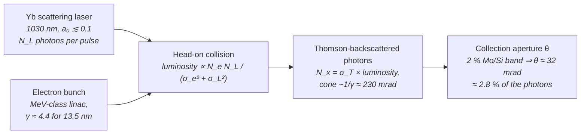

# Inverse Compton

**Status:** 🧪 Theoretical — kinematics exact; photon yield derived (Thomson luminosity × exact collection fraction); even the aggressive design point puts only ≈ 71 µW into the 2 % band at the source, 3.5 million times short of 250 W at IF · [matrix](../capability-matrix.md#light-sources)

<p class="huv-lead">Inverse Compton scattering collides a laser pulse head-on with a relativistic electron bunch; each scattered photon is upshifted by about 4γ². The selling point is compactness: because the upshift is quadratic in γ, MeV-class electrons turn an optical photon into EUV — 1.73 MeV reaches 13.5 nm from a 1030 nm Yb laser, a benchtop accelerator against hundreds of MeV for an FEL or a storage ring.</p>

<div class="huv-physics" markdown>

<figure markdown="span">


<figcaption><strong>Inverse Compton scattering, head-on.</strong> A 1030 nm laser on 1.72 MeV electrons (γ ≈ 4.4) gives 13.5 nm on axis inside a cone of half-angle 1/γ ≈ 13°, and the wavelength changes across the cone. <em>Schematic, not to scale.</em></figcaption>
</figure>

<figure markdown="span">


<figcaption><strong>Why only 2.8 % of the scattered photons are usable.</strong> (a) The exact collection fraction of the Thomson dipole pattern boosted to the lab (<code>ics(collection_half_angle_mrad=θ)</code>) for the 1.73 MeV electrons that reach 13.5 nm from a 1030 nm laser: half the photons lie inside 1/γ ≈ 228 mrad. (b) But a photon at angle θ is red-shifted by γ²θ², so staying inside the 2 % multilayer band caps the half-angle at 32.4 mrad and the fraction at 2.8 % — the number behind the design point's 71 µW. <em>Model: Inverse Compton scattering 🧪 (✅ exact kinematics; 🔶 quadrature bandwidth).</em></figcaption>
</figure>

<!-- huv-table: stack -->

| What is modeled | Grade | Dominant approximation | Details |
|---|---|---|---|
| Inverse Compton scattering | 🧪 Theoretical | linear Thomson regime, round Gaussian spots, head-on, no hourglass loss — every real effect lowers the yield | [Key equations](#key-equations) |
| Machine-parameter physics layer | ✅ Implemented | `ics_wavelength_nm`, Thomson yield and the exact boosted-dipole collection fraction, fixture-tested | [Derived quantities](#derived-quantities) |
| Illumination pupil fills | ✅ Implemented | the graded `CoherentGaussian` fill from the σ_core/√ζ bridge (a bookkeeping heuristic) | [What the model does](#what-the-model-does) |
| Dose-limited wafer throughput | 🔶 Simplified | 71 µW through the EUV-like optics train: ≈ 2×10⁻⁴ wafers per hour, about 200 days per wafer | [Use it](#use-it) |

</div>

<p class="huv-lead">The catch is flux, and the model derives it rather than storing it. The Thomson cross-section times the laser photon areal density gives ≈ 3×10⁻³ scattered photons per electron even for a 10 mJ pulse focused to 10 µm, and at MeV energies the 1/γ emission cone is ~230 mrad wide, so only a few percent of those photons stay inside the 2 % reflectance band of Mo/Si mirrors. `IcsSource` keeps the kinematics exact, derives the yield from the collision luminosity and reports the shortfall against HVM power as a derived quantity instead of hiding it.</p>

<div class="huv-glance" markdown>

| Property | Value |
|---|---|
| Wavelength | 13.5 nm derived from the Compton condition: 1030 nm laser on 1.726 MeV electrons (γ = 4.378, a₀ = 0.1) |
| Band / class | accelerator EUV concept · quadrature bandwidth 2.24 % (302 pm) when the whole 2 % band is collected |
| Coherence → pupil | coherent Gaussian σ ≈ 0.071 from ζ = 0.5 (assumed) through σ_core/√ζ |
| Power | 71 µW **in the 2 % band at the source** (collected inside 32.4 mrad), derived at 100 MHz; the legacy `for_wavelength` source stores 10 µW |
| Presets | `ics_compact_euv_13nm5()` (aggressive design point), `ics(...)` (own collision or stored yield) |
| Grade | 🧪 Theoretical |
| Compare with | [SSMB](ssmb.md) · [Sn LPP](lpp.md) (the 250 W benchmark) · [XFEL](xfel.md) |

**Same thing elsewhere:** Python `SourceConfig.ics_compact_euv_13nm5()` · TOML `[source] type = "ics"` · CLI `highuvlith sources --family ics` · GUI Source panel

</div>

<details markdown="1">
<summary>How the light is made (flowchart)</summary>



</details>

## Key equations

**Kinematics.** For a head-on collision observed at angle θ from the electron direction, with a₀ the normalized laser vector potential (a₀ ≪ 1: linear Compton; larger a₀ red-shifts the line) and γ = 1 + E_kin/m_ec²:

```math
\lambda_X = \lambda_L\,\frac{1 + a_0^2/2 + \gamma^2\theta^2}{4\gamma^2},
\qquad
\gamma = \sqrt{\frac{\lambda_L\,(1 + a_0^2/2)}{4\,\lambda_X}} = 4.378,\ \ E_\text{kin} = 1.726\ \text{MeV}
```

The `for_wavelength` constructor inverts the on-axis relation — the derived direction: machine parameters follow from the target. **Photon yield.** For round Gaussian electron and laser beams colliding head-on, the photons scattered per collision into all angles are

```math
N_x = \sigma_T\,\frac{N_e\,N_L}{2\pi\,(\sigma_e^2 + \sigma_L^2)},
\qquad N_e = \frac{Q}{e},\quad N_L = \frac{E_L}{hc/\lambda_L}
```

**Collection.** In the electron rest frame the azimuth-averaged scattering pattern is the dipole distribution (3/16π)(1 + cos²θ′); a lab cone of half-angle θ_c maps to the rest-frame cone cos θ′_c = u through the exact aberration formula, and a photon at angle θ is red-shifted by γ²θ²/(1 + a₀²/2), so staying inside a relative band BW requires θ ≤ θ_bw:

```math
f(\theta_c) = \frac{3}{8}\left[(1 - u) + \frac{1 - u^3}{3}\right],
\quad u = \frac{\cos\theta_c - \beta}{1 - \beta\cos\theta_c};
\qquad
\theta_\text{bw} = \frac{\sqrt{\mathrm{BW}\,(1 + a_0^2/2)}}{\gamma} = 32.4\ \text{mrad},\ \ f(\theta_\text{bw}) = 2.83\ \%
```

For γ ≫ 1 exactly half the photons fall inside θ = 1/γ.

<details markdown="1">
<summary>Full formulas</summary>

Assumptions stated in the code: linear Thomson regime (a₀ ≪ 1; the recoil parameter 4γE_L/m_ec² ≈ 4×10⁻⁵ is negligible), round Gaussian spots, head-on geometry with no crossing angle, laser Rayleigh range and electron β* much longer than pulse and bunch (no hourglass loss). The collection fraction is implemented in a cancellation-free form and its fixture was confirmed by direct lab-frame quadrature of the boosted pattern. The relative bandwidth is a quadrature sum of the collection-angle spread and the electron energy spread (laser bandwidth neglected) — a documented approximation, since the angular term is really a one-sided red tail:

```math
\frac{\Delta\lambda}{\lambda} = \sqrt{\left(\frac{\gamma^2\theta^2}{1 + a_0^2/2}\right)^2 + \left(2\,\frac{\Delta E}{E}\right)^2}
```

</details>

## Real machines

No EUV ICS lithography source exists, and no production-scale EUV-lithography ICS proposal is known. Operating compact ICS machines are hard X-ray imaging sources delivering ~10¹⁰ photons/s (µW class); the model's EUV rows are design points.

<!-- huv-table: stack -->

| Machine / concept | Electron beam | Photon output | Average flux / power | provenance | Citation |
|---|---|---|---|---|---|
| Munich Compact Light Source (Lyncean ring + laser cavity, TU Munich) | compact storage ring | hard X-rays | 1–3×10¹⁰ photons/s (µW class) | measured | Eggl et al., *J. Synchrotron Rad.* **23**, 1137 (2016) |
| ThomX | compact storage ring | 45 keV | ~10¹⁰ photons/s (≈ 70 µW, derived) | reported | ThomX |
| Waseda 6.7 nm ICS designs | — | 6.7 nm, per 2 % bandwidth | 1.28×10⁻⁵ W (100 kHz) to 1×10⁻³ W (100 MHz) | design | Sakaue et al., 2011 EUVL workshop |
| Burst-mode compact ICS concept | linac, tens of MeV | keV-class X-rays | design study | design | Graves et al., *PRSTAB* **17**, 120701 (2014) |
| `for_wavelength(13.5, 1030, 0.1)` (legacy placeholder) | 1.726 MeV (derived) | 13.5 nm | stored 1 nJ × 10 kHz = 10 µW | this model (stored) | this module |
| `compact_euv_13nm5()` (aggressive design point) | 1.726 MeV, 100 pC at 100 MHz (10 mA) | 13.5 nm, 2 % band | 71 µW in band from a 10 mJ / ~1 MW cavity collision with 10 µm spots | this model (derived) | this module |

**Flux reality check.** The design point scatters 1.71×10⁶ photons per collision; 4.84×10⁴ of them (2.83 %) fall in the 2 % Mo/Si band, i.e. 0.712 pJ per collision and 71 µW at 100 MHz — 3.5×10⁶ times short of the 250 W at intermediate focus of a production [Sn LPP source](./lpp.md). Reaching it needs 10 mA of 1.73 MeV electrons (17.3 kW of beam power) and a megawatt of circulating laser power. The model's 71 µW is ~14× below the Waseda 100 MHz design, which targets 6.7 nm with its own unmodeled beam and laser assumptions — the same order of shortfall either way: kW-class EUV from Compton scattering is on no published roadmap.

<figure markdown="span">


<figcaption><strong>Two large inputs, one small output.</strong> The Thomson luminosity of the design point yields 1.7 × 10⁶ photons per collision, 2.8 % of them inside the 2 % Mo/Si band; at 100 MHz that is 71 µW. The beam and cavity numbers are the design point's own assumptions; no operating Compton source has produced EUV. <em>Model: Inverse Compton scattering 🧪.</em></figcaption>
</figure>

## What the model does

`IcsSource` ([`source_models/ics.rs`](../../crates/highuvlith-core/src/source_models/ics.rs); shared formulas in [`physics.rs`](../../crates/highuvlith-core/src/source_models/physics.rs)) implements `LithographySource`:

- **Derived wavelength** — `wavelength_nm()` evaluates `physics::ics_wavelength_nm(laser_wavelength_nm, gamma(), laser_a0, 0.0)` on axis; there is no stored output wavelength to fall out of sync.
- **Derived yield** — with an `IcsCollision { bunch_charge_pc, laser_pulse_energy_mj, electron_spot_um, laser_spot_um }` attached, `photons_per_collision()`, `collected_fraction()` and `pulse_energy_j()` (collected photons × on-axis photon energy, a ≤ 2 % overestimate inside the band) feed `average_power_w()` = pulse energy × `rep_rate_hz`; without a collision model the stored `pulse_energy_nj` is used.
- **Constructors** — `for_wavelength(target, laser, a0)` solves for the electron energy, rejects impossible upshifts (laser shorter than the target) and keeps the legacy stored behaviour (1 mrad, 1 nJ, 10 kHz); `compact_euv_13nm5()` adds the 2 % band aperture (32.4 mrad), 100 MHz and `IcsCollision::high_average_power_design()` (100 pC, 10 mJ, 10 µm, 10 µm).
- `bandwidth_pm()` applies the quadrature model; `spectral_weights()` samples a Gaussian line at 5 points.
- `transverse_coherence()` reports 0.5 and the pupil is `CoherentGaussian` with σ from `sigma_from_coherence(0.5, 0.05)` ≈ 0.071; the trait-default 0.0 jitter adds no dose-jitter term.
- Not modeled: multiple scattering, crossing angles, ponderomotive broadening beyond the 1 + a₀²/2 shift (`laser_a0` is not cross-checked against pulse energy and spot), laser bandwidth, emittance beyond the spot size, electron recoil.

| Field | Unit | Consumed by | Status |
|---|---|---|---|
| `electron_energy_mev` | MeV | `gamma()` → derived `wavelength_nm()`, bandwidth, collection fraction, beam power | live |
| `laser_wavelength_nm`, `laser_a0` | nm, — | wavelength derivation, photon count N_L; nonlinear red-shift, in-band half-angle | live |
| `collection_half_angle_mrad`, `electron_energy_spread_rel` | mrad, — | angular and energy terms of `relative_bandwidth()`; the collected fraction with a collision model | live |
| `pulse_energy_nj`, `rep_rate_hz` | nJ, Hz | stored pulse energy without a collision model; `average_power_w()`, beam current, laser power | live |
| `collision` (`bunch_charge_pc`, `laser_pulse_energy_mj`, `electron_spot_um`, `laser_spot_um`) | pC, mJ, µm, µm | Thomson yield → `pulse_energy_j()` → `average_power_w()` | live (optional) |
| `transverse_coherence_fraction`, `spectral_samples`, `illumination` | —, count, enum | pupil σ at construction; sampling density; `intensity_at()` | live |
| laser a₀ ↔ pulse energy / spot consistency | — | — | planned |

## Derived quantities

`derived_quantities()` (Python `derived_quantity(name)`; printed by `highuvlith simulate`) for the `compact_euv_13nm5()` design point; the legacy `for_wavelength` source reports the kinematic rows, a 1 mrad `collected_fraction` of 2.8×10⁻⁵ and a stored 10 µW (gap 2.5×10⁷):

| Name | Value | Unit | Meaning |
|---|---|---|---|
| `electron_gamma` | 4.378 | — | Lorentz factor derived from the target wavelength |
| `relative_bandwidth` | 0.0224 | — | quadrature bandwidth model |
| `in_band_half_angle` | 32.4 | mrad | half-angle keeping the red shift inside the 2 % band |
| `collected_fraction` | 0.0283 | — | fraction of scattered photons inside the collection half-angle |
| `photons_per_collision` | 1.713×10⁶ | photons | Thomson luminosity yield, all angles |
| `electron_beam_power` | 1.73×10⁴ | W | what the accelerator must supply (10 mA × 1.73 MeV) |
| `average_power` | 7.12×10⁻⁵ | W | derived collected power |
| `hvm_power_gap` | 3.51×10⁶ | — | factor short of 250 W |

<details markdown="1">
<summary>The other 7 derived quantities</summary>

`photon_energy` 91.84 eV · `in_band_fraction_max` 0.0283 · `collected_photons_per_collision` 4.84×10⁴ · `electron_beam_current` 0.01 A · `laser_average_power` 1×10⁶ W (circulating) · `photon_rate` 4.84×10¹² photons/s · `hvm_power_ratio` 2.85×10⁻⁷.

</details>

## Use it

### Python

Factories from [`py_config.rs`](../../crates/highuvlith-py/src/py_config.rs): `ics()` without collision arguments keeps the stored 1 nJ × 10 kHz; with any collision argument `collection_half_angle_mrad` defaults to the 2 % band; an impossible upshift (laser shorter than the target) raises.

<!-- verify-example -->
```python
import highuvlith as huv

src = huv.SourceConfig.ics_compact_euv_13nm5()    # derived yield, 2 % band, 100 MHz
print(src.wavelength_nm, f"{src.electron_energy_mev:.3g} MeV")   # both from kinematics
print(f"{src.average_power_w:.3g} W in band")
print(f"{src.derived_quantity('hvm_power_gap'):.3g}")
tight = huv.SourceConfig.ics(                      # halving both spots quadruples the yield
    target_wavelength_nm=13.5, laser_wavelength_nm=1030.0, laser_a0=0.1,
    bunch_charge_pc=100.0, laser_pulse_energy_mj=10.0,
    electron_spot_um=5.0, laser_spot_um=5.0, rep_rate_hz=1e8,
)
print(f"{tight.average_power_w:.3g} W")
print(f"{src.wafer_throughput(dose_mj_cm2=30.0)['wafers_per_hour']:.3g} wph")
```

???+ success "Output"

    ```text
    13.5 1.73 MeV
    7.12e-05 W in band
    3.51e+06
    0.000285 W
    0.000205 wph
    ```

### TOML keys

Field names from [`config.rs`](../../crates/highuvlith-cli/src/config.rs); `wavelength_nm` is the *target* and the electron energy is derived from it. Example: [`examples/sim_ics.toml`](../../examples/sim_ics.toml).

| Key | Default | Units | Notes |
|---|---|---|---|
| `type` | — | — | `"ics"` |
| `wavelength_nm` | 13.5 | nm | Target; the electron energy is derived from the Compton condition. |
| `laser_wavelength_nm`, `laser_a0` | 1030, 0.1 | nm, — | |
| `electron_energy_mev` | derived | MeV | If given, must satisfy the Compton condition within 5 %. |
| `bunch_charge_pc`, `laser_pulse_energy_mj`, `electron_spot_um`, `laser_spot_um` | high-average-power design point | pC, mJ, µm, µm | Any of them derives the yield (Thomson luminosity × collection). |
| `collection_half_angle_mrad` | the 2 % Mo/Si band (collision mode) | mrad | |
| `electron_energy_spread_rel`, `pulse_energy_nj`, `rep_rate_hz` | preset | —, nJ, Hz | `pulse_energy_nj` is used only without collision fields. |
| `spectral_samples` | 5 | count | Spectral sampling density. |

<details markdown="1">
<summary>Validation — 18 tests</summary>

- [`ics.rs`](../../crates/highuvlith-core/src/source_models/ics.rs): `test_wavelength_derived_from_kinematics` (1030 nm + a₀ = 0.1 → exactly 13.5 nm), `test_derived_yield_fixture` (γ = 4.3783; 1.713×10⁶ photons/collision; 2.825 %; 0.712 pJ and 71.2 µW, scipy fixtures; 10 mA and 17.3 kW), `test_old_constructor_keeps_stored_yield`, `test_yield_scaling` (double the laser energy → double the power; double both spots → a quarter; 1 mrad collects ~1000× less than the band), `test_bandwidth_monotone_in_collection_angle`, `test_nonlinear_redshift`, `test_weights_sum_to_one`, `test_invalid_targets_rejected`.
- [`physics.rs`](../../crates/highuvlith-core/src/source_models/physics.rs): `test_ics_wavelength_fixture`, `test_thomson_yield_fixture`, `test_thomson_collection_fraction_fixture` (32.38 mrad, 2.825 % confirmed by lab-frame quadrature, 2.8×10⁻⁵ at 1 mrad, half inside 1/γ).
- CLI `config.rs`: `test_ics_electron_energy_cross_check`, `test_ics_ssmb_entangled_machine_fields` (collision fields → 71.2 µW), `test_legacy_family_tomls_unchanged_by_new_fields`, `test_family_example_tomls_validate`; Python: `tests/python/test_sources_physics.py::TestIcs` and `::TestThroughput`, `tests/python/test_sources.py::TestIcsSource`.

</details>

<details markdown="1">
<summary>Changes</summary>

**The design point collects the whole band.** `compact_euv_13nm5()` now collects the 2 % band (half-angle 32.4 mrad instead of 1 mrad), so its relative bandwidth rose from ≈ 1.0 % (135 pm) to ≈ 2.24 % (302 pm) and polychromatic imaging samples a wider line; it runs at 100 MHz with the **derived** yield, so `average_power_w` changed from the stored 10 µW to the derived 71 µW. `for_wavelength()` and `SourceConfig.ics()` without collision arguments are unchanged. Dated entries live in the [capability matrix](../capability-matrix.md#audit-log) audit log.

</details>

## See also

[SSMB](ssmb.md) (the other compact-EUV accelerator concept) · [Sn LPP](lpp.md) (the 250 W benchmark) · [Smith–Purcell](smith-purcell.md) · [Accelerator light sources](../future/accelerator-light-sources.md) · [Sources index](index.md) (trait contract, coherence → σ heuristic, throughput model) · [TOML configuration](../configuration.md) · [`examples/sim_ics.toml`](../../examples/sim_ics.toml)

## References

1. G. A. Krafft and G. Priebe, "Compton sources of electromagnetic radiation," *Rev. Accel. Sci. Technol.* **3**, 147 (2010).
2. E. Eggl et al., *J. Synchrotron Rad.* **23**, 1137–1142 (2016) — Munich Compact Light Source performance.
3. W. S. Graves et al., "Compact x-ray source based on burst-mode inverse Compton scattering," *Phys. Rev. ST Accel. Beams* **17**, 120701 (2014).
4. Sakaue et al., 6.7 nm inverse-Compton source designs, 2011 International Workshop on EUV Lithography (euvlitho.com, 2011/P30).

**Where next:** ← [SSMB](ssmb.md) · [Smith–Purcell](smith-purcell.md) → · [Sources](index.md) · [Accelerator light sources](../future/accelerator-light-sources.md)
