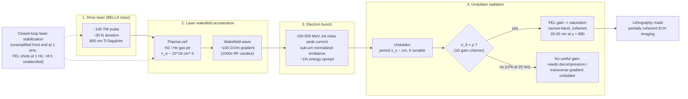

# LPA-FEL

**Status:** 🔶 Simplified — resonance, Ming-Xie gain and the 2ρλ bandwidth derived from optional machine parameters; the imaging λ stays a stored set-point; the 25 nm / 1 kHz preset is a design projection (BELLA demonstrated 420 nm at 1 Hz) · [matrix](../capability-matrix.md#light-sources)

<p class="huv-lead">A laser-plasma accelerator reaches hundreds of MeV in millimetres; send that bunch through an undulator and it can lase. LBNL's BELLA has done so at 420 nm from 100 MeV, at 1 Hz, for more than 8 hours unattended (Kohrell et al. 2026); other groups have lased at 27 nm and 269 nm. No LPA-FEL has lased at 13.5 nm, and the 25 nm / 500 MeV / 1 kHz machine this page centres on is a study point, not a published plan.</p>

<div class="huv-physics" markdown>

<figure markdown="span">


<figcaption><strong>Mechanism.</strong> Synchrotron: the ring's electrons radiate a broad bending-magnet spectrum (the LIGA white beam) or, in an undulator of N periods, the sinc² line at λ_n with first zeros at ±λ/(nN); the emittances against λ/4π give the coherent fraction that becomes a coherent-core pupil. LPA-FEL: a 100 TW-class pulse drives a wakefield, the 100–500 MeV bunch enters an undulator and lases (SASE) only while σ_δ &lt; ρ. Smith–Purcell: an electron skimming a grating of period a radiates in phase at λ = (a/m)(1/β − cos θ). <em>Schematic, not to scale; no model badge.</em></figcaption>
</figure>

<figure markdown="span">


<figcaption><strong>Can it lase?</strong> 1-D theory plus the Ming-Xie fit for the two illustrative beams: at 25 nm the preset's 1 % energy spread is 1.9 ρ, Λ = 49 and saturation would need 186 m of undulator instead of 4 m — no practical gain — while 0.1 % restores 5.5 m; the 100 MeV / 420 nm beam at 1 % (Λ = 6, 11 m) is marginal but lasing-capable. Λ ≳ 5 only means no practical gain; the beams are illustrative LPA-class values, not BELLA's. <em>Model: LPA-FEL 🔶.</em></figcaption>
</figure>

<!-- huv-table: stack -->

| What is modeled | Grade | Dominant approximation | Details |
|---|---|---|---|
| LPA-FEL | 🔶 Simplified | stored λ and pulse energy; resonance, ρ, L_g, Λ and 2ρλ derived from an illustrative machine | [Key equations](#key-equations) |
| Machine-parameter physics layer | ✅ Implemented | 1D FEL theory + the Ming-Xie fit (≈ 10–20 %), fixture-tested | [Derived quantities](#derived-quantities) |
| Dose-limited wafer throughput | 🔶 Simplified | the stored 5 mW through the EUV-like optics train: 0.014 wafers per hour | [Use it](#use-it) |

</div>

<p class="huv-lead">The model derives the resonance, the Pierce parameter, the gain lengths and the SASE bandwidth from the machine, and its central result is negative: with a percent-level energy spread the illustrative 25 nm beam cannot lase. 2ρλ is the bandwidth of a lasing FEL, while the illustrative beam's 1 % energy spread violates σ_δ &lt; ρ at 25 nm (no practical gain), so that bandwidth is self-consistent bookkeeping, not a prediction; the imaging wavelength stays a stored set-point. The LPA-FEL lane of the mechanism drawing is this page's; the other two lanes have pages of their own.</p>

<div class="huv-glance" markdown>

| Property | Value |
|---|---|
| Wavelength | 25 nm (stored set-point, resonance cross-checked to 5 %); 420 nm demonstrated |
| Band / class | accelerator EUV concept · SASE, Δλ = 2ρλ = 266 pm (1.06 %) when a beam is attached |
| Coherence → pupil | top-hat σ 0.7 (coherence 0.9 reported, not coupled to the pupil) |
| Power | 5 mW stored (5 µJ × 1 kHz, assumed) **at the FEL exit**; Ming-Xie saturation of the same beam: 17 µW |
| Presets | `lpa_fel_bella_25nm(sigma)` (projection), `lpa_fel(...)` (custom machine) |
| Grade | 🔶 Simplified |
| Compare with | [XFEL](xfel.md) · [Synchrotron](synchrotron.md) · [Betatron](betatron.md) |

**Same thing elsewhere:** Python `SourceConfig.lpa_fel_bella_25nm(sigma=0.7)` · TOML `[source] type = "lpa_fel"` · CLI `highuvlith sources --family lpa_fel` · GUI Source panel

</div>

<details markdown="1">
<summary>How the light is made (flowchart)</summary>



</details>

## Key equations

The on-axis undulator fundamental is

```math
\lambda_r = \frac{\lambda_u}{2\gamma^2}\left(1 + \frac{K^2}{2}\right),
\qquad \gamma = 1 + \frac{E_\mathrm{kin}}{m_ec^2},
\qquad K = 0.09337\,B_0[\mathrm{T}]\,\lambda_u[\mathrm{mm}]
```

so doubling the electron energy quarters the wavelength: the demonstrated 100 MeV machine lases near 420 nm, the projected 500 MeV point lands near 25 nm (with a different K). Standard 1D FEL theory gives the Pierce parameter and the gain and saturation lengths (planar undulator, $[JJ] = J_0(\xi) - J_1(\xi)$, $\xi = K^2/(4+2K^2)$, $I_A = 17045$ A):

```math
\rho = \left[\frac{1}{16}\,\frac{I}{I_A}\,\frac{K^2[JJ]^2}{\gamma^3\sigma_x^2k_u^2}\right]^{1/3},
\qquad L_{g} = \frac{\lambda_u}{4\pi\sqrt3\,\rho},
\qquad L_\mathrm{sat} \approx \frac{\lambda_u}{\rho},
\qquad \frac{\Delta\lambda}{\lambda} \approx 2\rho
```

Diffraction, emittance and energy spread lengthen the gain length by the empirical Ming Xie fit (its 19 coefficients are listed on the [XFEL page](./xfel.md#key-equations)):

```math
L_{g,3D} = L_g\,(1+\Lambda(\eta_d,\eta_\varepsilon,\eta_\gamma)),
\qquad \eta_\gamma = 4\pi\,\frac{L_g}{\lambda_u}\,\frac{\sigma_\gamma}{\gamma},
\qquad P_\mathrm{sat,3D} \approx 1.6\,\rho\left(\frac{L_g}{L_{g,3D}}\right)^2 P_\mathrm{beam}
```

Two criteria decide whether the beam lases: the **energy spread** $\sigma_\gamma/\gamma < \rho$ (at equality $\eta_\gamma = 1/\sqrt3$ and $\Lambda \approx 1$ already) and the **emittance** $\varepsilon \lesssim \lambda/4\pi$ for a transversely coherent mode. Beam size $\sigma_x = \sqrt{\varepsilon_n\beta/\gamma}$, beam power $P_\mathrm{beam} = \gamma m_ec^2 I/e$, saturation length $L_\mathrm{sat,3D} = (\lambda_u/\rho)(1+\Lambda)$. The SASE samples span ±2.5 FWHM, i.e. ±2.7 % of λ at 25 nm, so use `compute_multiwavelength` (kernels rebuilt per sample) when the band matters.

## Real machines

<!-- huv-table: stack -->

| Property | BELLA LPA-FEL (2026) | 25 nm preset | F₂ excimer (for scale) | provenance |
|---|---|---|---|---|
| Wavelength | 420 nm (SASE) | 25 nm | 157.63 nm | measured · projection · set-point |
| Electron energy | 100 MeV | ~500 MeV | — | measured · projection |
| FEL repetition rate | **1 Hz** (laser front end 1 kHz) | 1 kHz | 4 kHz | measured · assumed · representative |
| Pulse energy | 1 µJ (baseline preset) | 5 µJ | ~10 mJ | assumed · assumed · representative |
| Relative bandwidth | SASE | 1.06 % = 2ρ (266 pm) | ~7×10⁻⁶ | — · this model · representative |

BELLA ran > 8 h and ~15,000 shots without an operator (some lay coverage reported "1,000 bunches per second"; the FEL ran at 1 Hz). Other LPA-FEL results: 27 nm with ≤ 150 nJ per shot at ≤ 1 Hz (Wang et al. 2021), seeded lasing at 269 nm (2023), gain > 1000 at 420 nm (2025) — and **none at 13.5 nm**. The presets' undulator and beam parameters are illustrative, LPA-class assumptions, not BELLA machine specifications.

<figure markdown="span">


<figcaption><strong>The gain physics and the stored number disagree at 25 nm.</strong> With σ_δ = 1.9 ρ the Ming-Xie fit gives Λ = 49 (no practical gain): saturation would come at 1.7 MW, i.e. 17 µW average at 10 fs × 1 kHz, while the preset stores 5 µJ × 1 kHz = 5 mW by assumption; the 420 nm beam (Λ = 6) is marginal but lasing-capable, consistent with BELLA's demonstration. Both beams are illustrative LPA-class values, not BELLA's. <em>Model: LPA-FEL 🔶.</em></figcaption>
</figure>

## What the model does

`LpaFelSource` ([`source.rs`](../../crates/highuvlith-core/src/source.rs)) satisfies `LithographySource` as follows:

- `wavelength_nm()` — the **stored set-point**; `with_machine()` derives the resonance and rejects a K that misses it by more than 5 % (`resonant_wavelength_nm()`, `check_resonance()`, `fel_estimate()` expose the derivation).
- `bandwidth_pm()` — `bandwidth_override_pm` if set, else the derived 2ρλ when undulator and beam are attached, else the stored value (0.1 % of λ from `new`); the `bandwidth_fwhm` derived quantity says which.
- `spectral_weights()` / `intensity_at()` — the shared Gaussian line and `evaluate_illumination`; the default pupil stays `Conventional { sigma }` because the factories' `sigma` is a top-hat radius; opt in with `CoherentGaussian { sigma: sigma_from_coherence(0.9, 0.05) }`.
- `pulse_energy_j() × rep_rate_hz()` → `average_power_w()` — live arithmetic on the **stored** 5 µJ, not the saturation estimate.
- `shot_to_shot_rms()` → `StochasticParams::from_source` — the assumed 3 % widens the simulated linewidth distribution (÷ √N for N-pulse exposures).
- Not modeled: the spontaneous line a non-lasing beam would really emit, start-up noise, slippage, chirp and pointing jitter; the imaging λ is never substituted by the resonance.

| Field | Unit | Consumed by | Status |
|---|---|---|---|
| `wavelength_nm` | nm | Hopkins TCC, resist exposure, photon derivations; the 5 % resonance cross-check | live |
| `bandwidth_pm` / `bandwidth_override_pm` | pm FWHM | spectral sampling when there is no FEL estimate; an override always wins | live |
| `electron_energy_mev` | MeV | γ → resonance, 5 % rule, FEL estimate (never the imaging wavelength) | live (derived quantities) |
| `rep_rate_hz`, `pulse_energy_uj`, `pulse_duration_fs` | Hz, µJ, fs | `average_power_w()`; saturation pulse energy; no time-domain physics | live |
| `shot_to_shot_stability` | fraction | Gamma dose jitter in the LER/LWR Monte Carlo | live |
| `undulator` (`period_mm`, `k`, `num_periods`) | mm, —, count | resonance, field, length, FEL estimate | live (derived quantities) |
| `electron_beam` (`peak_current_a`, `norm_emittance_um`, `energy_spread_rel`, `beta_m`) | A, µm, —, m | ρ, gain lengths, Ming Xie, saturation, the two criteria | live (derived quantities) |
| FEL-derived pulse energy replacing the stored value | — | — | planned |

## Derived quantities

`derived_quantities()` (Python `derived_quantity(name)`, printed by `highuvlith simulate`) for `lpa_fel_bella_25nm`; informational, never read by the imaging pipeline:

<!-- huv-table: stack -->

| Name | Unit | Meaning | Value |
|---|---|---|---|
| `resonant_wavelength` | nm | λ_u(1+K²/2)/(2γ²), from the undulator | 25.0 |
| `bandwidth_fwhm` | pm | the width in use (here the derived 2ρλ) | 266 |
| `pierce_parameter_1d` | — | 1D ρ | 5.32×10⁻³ |
| `energy_spread_over_rho` | — | σ_γ/(γρ); must be < 1 | **1.88** |
| `ming_xie_lambda` | — | 3D degradation Λ (≳ 5: no practical gain) | **48.6** |
| `gain_length_3d` | m | L_g(1+Λ) | 8.56 |
| `saturation_length_3d` | m | (λ_u/ρ)(1+Λ) against a 4 m undulator | **186** |

<details markdown="1">
<summary>The other 16 derived quantities</summary>

`photon_energy` 49.59 eV · `photons_per_pulse` 6.29×10¹¹ · `hvm_power_ratio` 2×10⁻⁵ (against 250 W at IF) · `electron_gamma` 979.5 · `resonance_mismatch` ~0 (rejected above 0.05) · `undulator_field` 0.896 T · `undulator_length` 4.0 m · `beam_size_rms` 22.6 µm · `gain_length_1d` 0.173 m · `emittance_over_photon_emittance` 0.257 · `beam_power_peak` 5.0×10¹¹ W · `saturation_power_1d` 2.66×10⁹ W · `saturation_power_3d` 1.73×10⁶ W · `saturation_pulse_energy_3d` 1.7×10⁻⁸ J · `undulator_over_saturation_length` 0.021 · `sase_bandwidth_from_rho` 266 pm.

</details>

**The energy-spread punchline.** For the illustrative 25 nm beam the 1 % spread is 1.9 ρ: Λ ≈ 49 stretches the 3D gain length to 8.6 m and saturation would need ~186 m of undulator instead of 4 m. The same beam at 100 MeV / 420 nm has ρ ≈ 1.24×10⁻², σ_δ/ρ ≈ 0.80, Λ ≈ 6 and L_sat,3D ≈ 11 m — marginal but lasing-capable, consistent with LPA-FELs having lased at 420 nm. Because ρ ∝ γ^(−2/3) at fixed emittance, β and current, a spread tolerable at 420 nm is fatal at 25 nm; cutting it to 0.1 % restores σ_δ/ρ ≈ 0.19, Λ ≈ 0.45 and L_sat,3D ≈ 5.5 m, which is why LPA-FEL schemes rely on beam decompression or transverse-gradient undulators.

## Use it

### Python

Factory names from [`py_config.rs`](../../crates/highuvlith-py/src/py_config.rs); a custom machine's K must put the resonance within 5 % of the set-point (K = 1.6724 at 20 mm and 500 MeV resonates at 25 nm) or `ValueError` is raised, and missing beam fields take the illustrative LPA defaults (1 kA, 0.5 µm, 1 %, β = 1 m).

<!-- verify-example -->
```python
import highuvlith as huv

fel = huv.SourceConfig.lpa_fel_bella_25nm(sigma=0.7)   # 500 MeV design projection
print(fel.kind, fel.wavelength_nm, f"{fel.bandwidth_pm:.3g} pm")   # 2 rho lambda
print(f"{fel.average_power_w:.3g} W", f"{fel.shot_to_shot_rms:.3g}")
print(f"{fel.derived_quantity('energy_spread_over_rho'):.3g}")      # > 1: no gain
print(f"{fel.derived_quantity('saturation_length_3d'):.3g} m")      # vs a 4 m undulator

cool = huv.SourceConfig.lpa_fel(25.0, sigma=0.6, electron_energy_mev=500.0,   # 0.1 % spread
                                undulator_period_mm=20.0, undulator_k=1.6724,
                                num_periods=200, energy_spread_rel=1e-3)
print(f"{cool.derived_quantity('energy_spread_over_rho'):.3g}")
print(f"{fel.wafer_throughput(dose_mj_cm2=30.0)['wafers_per_hour']:.3g} wph")
```

???+ success "Output"

    ```text
    lpa_fel 25.0 266 pm
    0.005 W 0.03
    1.88
    186 m
    0.188
    0.0144 wph
    ```

### TOML keys

Field names from [`highuvlith-cli/src/config.rs`](../../crates/highuvlith-cli/src/config.rs); the example file is [`examples/sim_lpa_fel.toml`](../../examples/sim_lpa_fel.toml) and `highuvlith simulate` prints the derived quantities. Giving only one of `period_mm` / `undulator_k` is a config error; an explicit `bandwidth_pm` (Python `bandwidth_pm=`) pins any other line width.

| Key | Default | Units | Notes |
|---|---|---|---|
| `type` | — | — | `"lpa_fel"` |
| `wavelength_nm` | 25.0 | nm | With an undulator: must match the derived resonance within 5 %. |
| `sigma`, `spectral_samples` | 0.7, preset | —, count | Top-hat pupil radius (0, 1]; polychromatic sample count. |
| `period_mm`, `undulator_k` | — | mm, — | Give both or neither. |
| `num_periods` | 200 | — | Needs the undulator. |
| `peak_current_a`, `norm_emittance_um`, `electron_energy_spread_rel`, `beta_m` | 1000, 0.5, 0.01, 1.0 | A, µm, —, m | Beam; derive ρ, gain length and the bandwidth 2ρλ. |
| `bandwidth_pm` | derived 2ρλ (with undulator) / preset | pm | An explicit value overrides the derived SASE bandwidth. |
| `electron_energy_mev`, `pulse_duration_fs`, `rep_rate_hz`, `pulse_energy_uj` | preset | MeV, fs, Hz, µJ | The 25 nm / 1 kHz preset is a design projection. |

<details markdown="1">
<summary>Validation — 25 tests</summary>

- `source.rs`: `test_lpa_fel_wavelength_in_target_range`, `test_lpa_fel_photon_energy_at_25nm` (~49.6 eV), `test_lpa_fel_spectral_weights_sum_to_one`, `test_lpa_fel_narrow_bandwidth_finite`, `test_lpa_fel_new_default_bandwidth_is_sase_class`, `test_lpa_fel_bandwidth_follows_beam` (2ρλ = 266.2 pm at 25 nm, ~10.4 nm at 420 nm, ρ ∝ I^(1/3), override wins, pre-override TOML parses), `test_lpa_fel_invalid_sigma_rejected`, `test_pulse_metadata_live_through_trait` (5 µJ × 1 kHz → 5 mW), `test_lpa_fel_machine_derivation` (K = 1.6724, ρ = 5.32×10⁻³, L_g = 0.173 m against scipy fixtures; σ_δ/ρ > 1.8 and Λ > 40 at 1 %; Λ < 5 at 0.1 %), `test_lpa_fel_resonance_five_percent_rule` (4 % accepted, 10 % rejected), `test_new_presets_toml_roundtrip`, `test_every_family_reports_derived_quantities`, `test_source_kind_toml_roundtrip`.
- `source_models/physics.rs`: `test_pierce_parameter_fixture_and_scaling`, `test_ming_xie_fixture_and_limits` (σ_δ = ρ gives η_γ = 1/√3, Λ = 1), `test_fel_estimate_saturation_consistency`, `test_undulator_k_inverse_resonance`, `test_undulator_harmonic_functions_fixture`; `stochastic.rs`: `test_from_source_pulls_dose_jitter`, `test_multi_pulse_jitter_averages_down`; CLI `config.rs`: `test_lpa_fel_source_type_accepted`, `test_toml_lpa_fel_parsing`, `test_lpa_fel_undulator_resonance_rule`, `test_family_example_tomls_validate`; Python: `tests/python/test_sources_physics.py::TestLpaFel`.

</details>

<details markdown="1">
<summary>Changes</summary>

**Bandwidth follows the beam.** Earlier versions stored an independent 25 pm (Δλ/λ = 10⁻³) for the 25 nm preset — ten times narrower than the 2ρλ ≈ 266 pm of its own beam — and 420 pm for the 420 nm preset (2ρλ ≈ 10.4 nm); both presets now use the derived value. The three machine-era fields (`undulator`, `electron_beam`, `bandwidth_override_pm`) are `#[serde(default)]`, so older configs parse unchanged. Dated entries live in the [capability matrix](../capability-matrix.md#audit-log) audit log.

</details>

## See also

[XFEL](xfel.md) (the linac-scale counterpart, Ming Xie coefficients) · [Synchrotron](synchrotron.md) (derived-wavelength undulator model) · [Betatron](betatron.md) (the same accelerator driving a plasma wiggler) · [Accelerator light sources](../future/accelerator-light-sources.md) · [Sources index](index.md) (trait contract, coherence → σ heuristic, throughput model) · [TOML configuration](../configuration.md) · [`examples/sim_lpa_fel.toml`](../../examples/sim_lpa_fel.toml)

## References

1. F. Kohrell et al., "Over 8 hours of continuous operation of a free-electron laser driven by a laser-plasma accelerator," *Phys. Rev. Accel. Beams* **29**, 041301 (2026), doi:10.1103/z2d3-bhyt — 100 MeV, 1 Hz, SASE at 420 nm.
2. Wang et al., *Nature* **595**, 516 (2021) — LPA-FEL lasing at 27 nm; seeded LPA-FEL at 269 nm, *Nat. Photon.* **17**, 150 (2023); gain > 1000 at 420 nm, *Phys. Rev. Lett.* **135**, 055001 (2025).
3. E. Esarey, C. B. Schroeder, W. P. Leemans, "Physics of laser-driven plasma-based electron accelerators," *Rev. Mod. Phys.* **81**, 1229 (2009); Z. Huang, K.-J. Kim, "Review of x-ray free-electron laser theory," *Phys. Rev. ST Accel. Beams* **10**, 034801 (2007); M. Xie, "Design optimization for an X-ray free electron laser driven by SLAC linac," *Proc. PAC'95* — the 3D gain-length fit.

**Where next:** ← [XFEL](xfel.md) · [SSMB](ssmb.md) → · [Sources](index.md) · [Accelerator light sources](../future/accelerator-light-sources.md)
