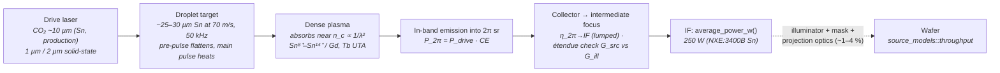

# Laser-produced plasma

**Status:** ✅ Implemented (🔶 CE defaults, étendue; 🧪 Gd/Tb power) — in-band spectrum, pupil fill and the drive → CE → intermediate-focus power chain are live and tested on the published NXE:3400B numbers; 250 W in band at intermediate focus; no plasma dynamics, debris or collector degradation · [matrix](../capability-matrix.md#light-sources)

<p class="huv-lead">Laser-produced plasma is the light source of production EUV lithography: tin droplets of around 25–30 µm leave a generator at 70 m/s, a pre-pulse flattens each one and the main pulse of a ~10 µm CO₂ laser heats it, 50 000 times a second, into a plasma whose Sn⁸⁺–Sn¹⁴⁺ transition arrays emit into the 2 % band that Mo/Si mirrors reflect. The NXE:3400B source ran a 21.5 kW drive at 6 % conversion efficiency and delivered 250 W in band at the intermediate focus — the hand-off to the scanner's illuminator and the plane every HVM figure is quoted at.</p>

<div class="huv-physics" markdown>

<figure markdown="span">


<figcaption><strong>Mechanism.</strong> LPP: a CO₂ (or 1–2 µm solid-state) drive laser hits 25–30 µm tin droplets 50 000 times a second, the Sn⁸⁺–Sn¹⁴⁺ plasma emits in band into 2π sr, and a normal-incidence Mo/Si collector brings the light to the intermediate focus where the model states its power. DPP/LDP: a capacitor bank pinches Xe gas or Sn vapour into a millimetre column, grazing shells with a debris trap collect it, and the étendue cut f_G = min(1, G_ill/G_src) decides what reaches IF. Both default to the spatially incoherent top-hat pupil (σ 0.9). <em>Schematic, not to scale; no model badge.</em></figcaption>
</figure>

<figure markdown="span">


<figcaption><strong>From the drive laser to the wafer, six LPP chains.</strong> Each bar is a number the code reports: drive power × conversion efficiency gives the in-band emission into 2π sr, × η₂π→IF × f_étendue the power at intermediate focus, × the model's Mo/Si (or La/B) column the power on the wafer. η = 250/1290 is calibrated so the NXE:3400B chain lands on its published 250 W; the 2 µm conversion efficiency and the Gd/Tb powers are projections, the 500 W chain assumes a doubled drive. <em>Model: Laser-produced plasma ✅ (🔶 CE defaults, étendue; 🧪 Gd/Tb power) · Dose-limited wafer throughput 🔶.</em></figcaption>
</figure>

<!-- huv-table: stack -->

| What is modeled | Grade | Dominant approximation | Details |
|---|---|---|---|
| In-band spectrum, pupil fill, the drive → CE → IF power chain, the étendue check | ✅ Implemented (🔶 CE defaults, étendue; 🧪 Gd/Tb power) | Gaussian line inside the mirror band; CE defaults are order-of-magnitude; η lumped and calibrated; uniform phase-space density in an assumed NXE-like geometry | [Key equations](#key-equations) |
| The usable band: Mo/Si and La/B multilayer mirrors | ✅ Implemented | Parratt recursion with CXRO constants; the plasma UTA structure is not modelled | [Materials](../materials.md) |
| Wafers per hour from the IF power | 🔶 Simplified | ten 0.70 mirrors and a 0.65 mask, lumped overheads | [throughput](index.md#dose-limited-throughput) |
| Pulse-to-pulse jitter, plasma hydrodynamics, debris, collector lifetime | not modelled | out of scope (`shot_to_shot_rms = 0`) | [What the model does](#what-the-model-does) |

**Same thing elsewhere:** Python `SourceConfig.lpp_sn_13nm5(sigma=0.9)` · TOML `[source] type = "lpp"` · CLI `highuvlith sources --family lpp` · GUI Source panel · physics → [Pipeline](../pipeline.md#stage-1--source)

</div>

<p class="huv-lead">The model keeps that chain live and calibrated to the published 250 W, keeps the étendue check explicit, and extrapolates the same architecture to gadolinium and terbium plasmas at 6.x nm — where the usable band collapses to ~0.6 %, the best measured conversion efficiency is 0.54–0.8 % and no watt-level in-band source has been demonstrated, so the Gd/Tb powers are projections and are labelled so. Plasma hydrodynamics, debris and collector degradation are out of scope.</p>

<div class="huv-glance" markdown>

| Property | Value |
|---|---|
| Wavelength | 13.5 nm (Sn), 6.7 nm (Gd), 6.5 nm (Tb) — emission bands fixed by the fuel |
| Band / class | the mirror-selected band: 2 % ≈ 270 pm (Mo/Si), ~0.6 % ≈ 40 / 39 pm (La/B); laser-driven droplet plasma |
| Coherence → pupil | incoherent plasma, trait default 0 → top-hat σ 0.9 |
| Power | Sn 250 W in band **at intermediate focus** (NXE:3400B chain: 21.5 kW CO₂ × 6 % × η 250/1290); 500 W (NXE:3800E class, assumed doubled drive); Gd 13.6 W, Tb 11.6 W at IF — projections |
| Presets | `lpp_sn_13nm5(sigma, drive_laser=…)`, `lpp_sn_13nm5_500w()`, `lpp_gd_6nm7()`, `lpp_tb_6nm5()` |
| Grade | ✅ Implemented (🔶 CE defaults, étendue; 🧪 Gd/Tb power) |
| Compare with | [DPP](dpp.md) · [XFEL](xfel.md) · [SSMB](ssmb.md) · history: [The road to EUV](../history/euv.md#the-source-problem-20012013) · future: [Beyond EUV](../future/beyond-euv.md) |

</div>

<details markdown="1">
<summary>How the light is made (flowchart)</summary>



</details>

## Key equations

The plasma emits broadband unresolved-transition-array radiation; the **multilayer mirror train, not the plasma, defines the usable band**: 2 % ≈ 270 pm around 13.5 nm for Mo/Si, ~0.6 % ≈ 40 pm for La/B near 6.65 nm, just longward of the boron K edge (188 eV = 6.595 nm) — the 6.7 nm Gd preset sits slightly off that peak.

<figure markdown="span">


<figcaption><strong>Multilayer mirrors from Parratt recursion with CXRO/Henke constants.</strong> (a) Mo/Si 40 × 6.9 nm (Mo fraction 0.4, ideal interfaces) against the best reported measured reflectance; (b) La/B<sub>4</sub>C and La/B with periods tuned to 6.7 / 6.65 nm sit well above the 64.1 % La/B record (Opt. Lett. 40, 3778, 2015) because interdiffusion and roughness are off; (c) Mo/Si at 13.5 nm against the angle of incidence, s and p. <em>Model: EUV/BEUV multilayer mirrors ✅ (matches the CXRO calculator within 3·10⁻³; no interdiffusion layers by default).</em></figcaption>
</figure>

In-band power at intermediate focus follows the live power chain, where η₂π→IF (the `transport_efficiency` field) lumps collector solid angle, collector reflectance and debris / buffer-gas / spectral-purity losses, and f_étendue is the étendue-limited usable fraction:

```math
\begin{aligned}
P_\text{2π} &= P_\text{drive}\,\mathrm{CE}, \\
P_\text{IF} &= P_\text{2π}\;\eta_{2\pi\to\text{IF}}\;f_\text{étendue}, \\
E_\text{pulse} &= \frac{P_\text{IF}}{f_\text{rep}}
\end{aligned}
```

For the NXE:3400B chain, 21.5 kW × 6 % = 1290 W into 2π sr; the presets use η₂π→IF = 250/1290 ≈ 0.194, **calibrated** so the chain lands on the published 250 W at IF (5 mJ per droplet at 50 kHz). A drive laser of wavelength λ_L cannot propagate beyond the plasma critical density and deposits its energy near it,

```math
n_c = \frac{\varepsilon_0 m_e \omega_L^2}{e^2} = \frac{1.115\times10^{21}}{\lambda_L^2[\mu\text{m}]}\ \text{cm}^{-3}
```

— ~100× lower for CO₂ light than for 1 µm, so the energy goes into a lower-density, optically thinner plasma and less of the Sn array is lost to opacity broadening, the standard explanation for the highest conversion efficiencies being CO₂-driven [1]. In the model the drive laser only sets the CE default at construction (`Co2` 6 %, reported; `SolidState1um` 3 %, reported laboratory class; `Thulium2um` 4.5 %, a projection) and the reported critical density; plasma physics itself is not simulated. Étendue (area × solid angle) is conserved, so the illuminator accepts only a source whose étendue fits its budget; for a small isotropic emitter of diameter d collected over Ω:

```math
\begin{aligned}
G_\text{src} &= \frac{\pi d^2}{4}\,\Omega, \\
f_\text{étendue} &= \min\!\left(1,\ \frac{G_\text{ill}}{G_\text{src}}\right)
\end{aligned}
```

With the assumed NXE-like geometry (`LppGeometry::nxe_like()`: d = 200 µm, Ω = 5 sr, G_ill = 3.3 mm²·sr — a commonly quoted illuminator budget, but scanner-specific), G_src = 0.157 mm²·sr, a margin of 21, so the LPP loses nothing; a DPP-like 1 mm emitter would keep only 84 % — one reason larger discharge plasmas are harder to use ([DPP](dpp.md)).

## Real machines

<!-- huv-table: stack -->

| Machine / measurement | Value | Plane / provenance | Reference |
|---|---|---|---|
| Cymer LPP with pre-pulse (2013) | passed 10 W after years "stuck in the watt range" | at IF, demonstrated | history accounts |
| NXE:3400B source (end-2017) | 250 W; 21.5 kW CO₂, CE 6 %, 50 kHz, ~5 mJ/pulse; ≥ 125 wph at 20 mJ/cm², 140 wph measured at 246 W | at IF, production | Fomenkov [2]; Miyazaki & Yen [3] |
| NXE:3800E source (2024) | 500 W | at IF, production | ASML Investor Day [4] |
| Industrial source (2026) | ~600 W | plane not stated, reported shipping | Reuters, 23 Feb 2026 |
| Research sources | 740 W (2024); 1 kW at ~100 kHz with two-burst droplet shaping (April 2025); roadmap 1.5–2 kW | at IF, demonstrated / projected | ASML [4], [5] |
| Gd plasma, 0.6 % band (2011–2015) | CE 0.54 % (Higashiguchi; = 1.8 % in a 2 % band), 0.4 % (Cummins), 0.7 % (CO₂-driven), 0.8 % (Yoshida, best per O'Sullivan's review) | measured | [7], [8] |
| Gd plasma, 1064 nm drive (2010) | CE 1.3 %, bandwidth not stated | measured | Otsuka [9] |
| Endo kW-class BEUV concept (2012) | 1 kW at IF from CE 1.5 % and a 160 kW CO₂ drive | design | 2012 EUVL workshop |

The HVM band for charts is therefore ~250 W → ~1 kW at IF. Each 13.5 nm photon carries 91.84 eV against 6.42 eV at 193 nm — 14.3× fewer photons per mJ/cm², which is what couples source power to stochastics so tightly ([the stochastic frontier](../future/stochastic-frontier.md)). The preset chains — Sn CO₂, 500 W class, 1 µm, 2 µm, Gd, Tb — are the Physics Strip figure above; Russia's separate 11.2 nm programme (Xe plasma, Ru/Be mirrors) is on [Beyond EUV](../future/beyond-euv.md).

## What the model does

`LppSource` in [`lpp.rs`](../../crates/highuvlith-core/src/source_models/lpp.rs) models both regimes behind one struct selected by `LppFuel` (`Sn`, `Gd`, `Tb`), with the drive-laser technology (`LppDriveLaser`) and the source/collector geometry (`LppGeometry`).

- **`wavelength_nm()` / `bandwidth_pm()`** — the in-band centre (13.5 / 6.7 / 6.5 nm) and the *mirror-selected* FWHM (270 / 40 / 39 pm); the in-band spectrum is a Gaussian within the band.
- **`spectral_weights()`** — five samples by default; the narrow-band path is an approximation for these 0.6–2 % bands, `compute_multiwavelength` (`[imaging] spectrum = "per_wavelength"`) rebuilds the kernels at every sample.
- **`intensity_at()`** — plasma emission is spatially incoherent: `transverse_coherence()` stays 0 and the default pupil is `Conventional { sigma: 0.9 }` (σ validated in (0, 1]).
- **Power chain (live)** — `in_band_emission_w() = drive × CE` (2π sr); `in_band_power_w()` = × transport × étendue fraction is the power **at IF**, reported by `average_power_w()`; `pulse_energy_j()` divides by `rep_rate_hz`. Sn CO₂: 1290 W into 2π → 250 W at IF, 5 mJ per droplet, 1.70 × 10¹⁹ photons/s.
- **Presets** — `sn_13nm5` (= `sn_with_drive_laser(σ, Co2)`), `sn_13nm5_500w` (NXE:3800E class: 500 W at IF is ASML's stated source power; the preset reaches it by an **assumed** doubling of the drive to 43 kW at the same efficiencies), `gd_6nm7`, `tb_6nm5` (10 kW 1 µm drive and 10 kHz assumed; the Sn-calibrated collection, optimistic for La/B collectors; `in_band_power_at_if` labelled a projection).
- **Not modelled** — pulse-to-pulse energy jitter (`shot_to_shot_rms = 0`, so pulses per point has no stochastic effect for LPP today), plasma hydrodynamics, UTA opacity, debris, collector degradation.

<!-- huv-table: stack -->

| Field | Unit | Consumed by | Status |
|---|---|---|---|
| `fuel` | enum | preset selection; gates the Sn CE report and the Gd/Tb projection label | stored (construction-time) |
| `wavelength_nm`, `bandwidth_pm` | nm, pm | imaging, photon energy and density; `spectral_weights()` → polychromatic focus shifts | live |
| `drive_laser_power_w`, `conversion_efficiency`, `transport_efficiency` | W, —, — | `in_band_emission_w()` → `in_band_power_w()` → `average_power_w()` (transport = 2π sr → IF) | live |
| `rep_rate_hz` | Hz | `pulse_energy_j()`; pulses per exposure point in the throughput model | live |
| `spectral_samples`, `spectral_shape`, `illumination`; `drive_laser`, `geometry` | count, enum, enum; options | sampling density, line shape, `intensity_at()` pupil fill; Sn CE default and critical density, étendue-limited fraction | live |
| pulse jitter; hydrodynamics, opacity, debris, collector lifetime | — | — | not modelled |

## Derived quantities

`LppSource::derived_quantities()` (Python `SourceConfig.derived_quantities()` / `derived_quantity(name)`; printed by `highuvlith simulate`). Values for the presets:

<!-- huv-table: stack -->

| Name | Unit | Meaning | Sn (CO₂) | Sn (2 µm, projected CE) | Gd 6.7 nm | Tb 6.5 nm |
|---|---|---|---|---|---|---|
| `photon_energy` | eV | hc/λ | 91.84 | 91.84 | 185.05 | 190.75 |
| `in_band_emission_2pi` | W | P_drive × CE | 1290 | 967.5 | 70 | 60 |
| `conversion_efficiency_default` | — | Sn CE default for the laser (+ provenance) | 0.06 (reported) | 0.045 (projection) | — | — |
| `etendue_margin` | — | G_ill / G_src | 21.0 | 21.0 | 21.0 | 21.0 |
| `in_band_power_at_if` | W | = `average_power_w()` (Gd/Tb labelled projection) | 250 | 187.5 | 13.57 | 11.63 |
| `pulse_energy_at_if` | J | per droplet | 5.0 × 10⁻³ | 3.75 × 10⁻³ | 1.36 × 10⁻³ | 1.16 × 10⁻³ |
| `drive_watts_per_if_watt` | — | P_drive / P_IF | 86 | 115 | 737 | 860 |
| `hvm_power_ratio` | — | P_IF / 250 W | 1.00 | 0.75 | 0.054 | 0.047 |

<details markdown="1">
<summary>The remaining rows</summary>

`drive_laser_wavelength` 10.6 / 2.0 / 1.064 / 1.064 µm; `critical_density` 9.92 × 10¹⁸ / 2.79 × 10²⁰ / 9.85 × 10²⁰ / 9.85 × 10²⁰ cm⁻³; `source_etendue` 0.157 mm²·sr and `etendue_limited_fraction` 1 for all four; `photon_rate_at_if` 1.70 × 10¹⁹ / 1.27 × 10¹⁹ / 4.58 × 10¹⁷ / 3.80 × 10¹⁷ photons/s (Sn CO₂ / Sn 2 µm / Gd / Tb). The 1 µm-driven Sn variant: CE 3 %, 645 W into 2π sr, 125 W at IF, ratio 0.50. From IF to the wafer the [throughput model](index.md#dose-limited-throughput) applies ten 0.70 mirrors and a 0.65 mask (1.84 %): 4.59 W on the wafer for the 250 W preset, ≈ 154 wafers/h at 30 mJ/cm² (≈ 166 at 20 mJ/cm²; ≈ 154 with the specification's 96 fields), ≈ 170 pulses per point and 5 219 photons per (16 nm)² (1.4 % Poisson noise); the overheads cap the model near 196 wph, whereas the NXE:3800E reaches ≥ 220 wph with faster stages that are not modelled. Through record La/B mirrors (0.641¹¹ ≈ 0.75 %) the 13.6 W Gd projection delivers 0.10 W, ≈ 15 wph.

</details>

## Use it

### Python

Factories from [`py_config.rs`](../../crates/highuvlith-py/src/py_config.rs):

<!-- verify-example -->
```python
import highuvlith as huv

src = huv.SourceConfig.lpp_sn_13nm5(sigma=0.9)                # NXE:3400B chain, CO2 drive
tm = huv.SourceConfig.lpp_sn_13nm5(drive_laser="thulium_2um")  # projected 4.5 % CE
gd = huv.SourceConfig.lpp_gd_6nm7()                           # 13.6 W at IF (projection)
print(f"{src.average_power_w:.3g} W at IF, etendue margin {src.derived_quantity('etendue_margin'):.3g}; "
      f"2 um drive {tm.average_power_w:.3g} W; Gd {gd.average_power_w:.3g} W")
r = src.wafer_throughput(dose_mj_cm2=30.0, cd_nm=16.0)        # simplified scanner model
rg = gd.wafer_throughput(dose_mj_cm2=30.0, optics_transmission=0.641**10, mask_efficiency=0.641)
print(f"{r['power_at_wafer_w']:.3g} W at the wafer, {r['wafers_per_hour']:.3g} wph, "
      f"{r['pulses_per_point']:.3g} pulses per point; Gd through La/B: {rg['wafers_per_hour']:.3g} wph")
mask = huv.MaskConfig.line_space(cd_nm=27.0, pitch_nm=81.0)
engine = huv.SimulationEngine(src, huv.OpticsConfig.euv_nxe(), mask,   # NA 0.33 EUV projection pupil
                              grid=mask.commensurate_grid(size=128, target_pixel_nm=2.0))
aerial = engine.compute_aerial_image(focus_nm=0.0)
```

???+ success "Output"

    ```text
    250 W at IF, etendue margin 21; 2 um drive 188 W; Gd 13.6 W
    4.59 W at the wafer, 154 wph, 170 pulses per point; Gd through La/B: 14.8 wph
    ```

`highuvlith simulate --config examples/sim_lpp_sn.toml` prints the derived quantities in a "Derived source physics" block and includes them in the JSON output.

## TOML keys

The keys the CLI reads for `type = "lpp"` (`LPP_KEYS` in [`config.rs`](../../crates/highuvlith-cli/src/config.rs)); every field is optional and defaults to the fuel preset. Power at IF = drive × CE × transport × étendue fraction.

| Key | Default | Units | Notes |
|---|---|---|---|
| `type`, `fuel` | —, `"sn"` | — | `"lpp"`; `sn` (13.5 nm), `gd` (6.7 nm), `tb` (6.5 nm) |
| `preset` | `"nxe3400b"` | — | Sn only: `nxe3400b` (250 W at IF) or `nxe3800e` (500 W; the 43 kW drive behind it is an assumed scaling) |
| `drive_laser` | CO₂ (Sn) | — | `co2`, `solid_state_1um` (`1um`, `nd_yag`), `thulium_2um` (`2um`, `thulium`); sets the Sn CE default |
| `sigma` | 0.9 | — | top-hat pupil radius, (0, 1]; not with `[illumination]` |
| `wavelength_nm`, `bandwidth_pm`, `spectral_samples` | fuel preset, 5 | nm, pm, — | override the preset band; polychromatic samples |
| `drive_laser_power_w`, `conversion_efficiency`, `transport_efficiency`, `rep_rate_hz` | preset | W, —, —, Hz | `transport_efficiency` is in-band 2π sr → IF |
| `source_diameter_um` / `source_diameter_mm`, `collection_solid_angle_sr`, `illuminator_etendue_mm2_sr` | NXE-like geometry when any is given | µm / mm, sr, mm²·sr | turn on the étendue check; give the diameter once (1 mm = 1000 µm) |

Examples: [`sim_lpp_sn.toml`](../../examples/sim_lpp_sn.toml), [`sim_lpp_gd.toml`](../../examples/sim_lpp_gd.toml).

<details markdown="1">
<summary>Validation — 12 tests</summary>

| Claim | Test | Tolerance |
|---|---|---|
| 13.5 nm ⇒ 91.84 eV and exactly the 2 % band; 21.5 kW × 6 % = 1290 W into 2π sr, η = 250/1290, 250 W at IF, 5 mJ per droplet, `hvm_power_ratio` 1 (the 500 W class: 500 W, 10 mJ, ratio 2); G_src = 0.1571 mm²·sr, margin 21.008, a 1 mm source keeps 0.8403, no geometry ⇒ no limit | `lpp.rs::test_sn_preset_band_and_energy`, `test_power_chain_is_live`, `test_etendue_check` | exact / 1e-4 |
| CE ordering sets the IF-power ordering and the critical densities for CO₂ and 1.064 µm; Gd 6.7 nm → 13.57 W at IF labelled a projection, Tb 11.63 W; weights sum to one, incoherent plasma, σ validation; a pre-`drive_laser` TOML parses (68.75 W with its legacy 25 kW / 5.5 % / 0.05) | `test_drive_laser_options`, `physics.rs::test_plasma_critical_density_fixture`, `test_beuv_presets_in_band`, `test_spectral_weights_sum_to_one`, `test_incoherent_plasma`, `test_invalid_sigma_rejected`, `test_legacy_toml_without_new_fields_parses` | fixtures |
| 0.641¹¹ = 0.75 %, the EUV column inside 1–4 %, ≈ 166 wph at 250 W and 20 mJ/cm²; CLI presets, drive-laser and étendue fields, the legacy 0.05 factor → 64.5 W; Python `TestLpp`, `TestThroughput` and the NA 0.33 imaging smoke test | `throughput.rs::test_beuv_column_transmission`, `test_euv_hvm_like_fixture`; `config.rs::test_lpp_nxe3800e_preset`, `test_lpp_drive_laser_and_etendue_fields`, `test_legacy_family_tomls_unchanged_by_new_fields`; `tests/python/test_sources_physics.py` | — |

</details>

<details markdown="1">
<summary>Changes</summary>

- **Power is quoted at intermediate focus.** The first versions documented `transport_efficiency` as a "collector-to-wafer" factor (0.05) and reported 68.75 W "at the wafer" (25 kW × 5.5 % × 0.05), contradicting the ~250 W at IF the page quoted and double-counting optics losses. `average_power_w()` now follows every other family and the industry convention — usable power into the illuminator, in band at IF — in two steps: `transport_efficiency` became 2π sr → IF (lumped 0.18 → 247.5 W), then the Sn preset adopted the published chain (21.5 kW, 6 %, η = 250/1290 → 250 W). Gd/Tb moved from 3.5 / 3.0 W "at the wafer" to 13.6 / 11.6 W at IF (projections). A TOML that sets only `transport_efficiency = 0.05` on the Sn preset now gives 64.5 W at IF; a fully serialised legacy source still gives 68.75 W (pinned by `test_legacy_family_tomls_unchanged_by_new_fields`).
- The `Dipole` illumination shape placed both poles at one point until 2026-09-30; the LPP presets never use it.

</details>

## See also

[Discharge-produced plasma](dpp.md) (the same power-chain conventions, the HVM runner-up) · [XFEL](xfel.md) and [SSMB](ssmb.md) (the kilowatt-class accelerator alternatives) · [Materials](../materials.md) (multilayer mirrors) · history: [The road to EUV](../history/euv.md) · future: [Beyond EUV](../future/beyond-euv.md), [Accelerator light sources](../future/accelerator-light-sources.md#the-bar-to-clear-power-at-intermediate-focus), [The stochastic frontier](../future/stochastic-frontier.md) · [Throughput, stated once](index.md#dose-limited-throughput) · [configuration](../configuration.md) · [`examples/sim_lpp_sn.toml`](../../examples/sim_lpp_sn.toml)

## References

1. O. O. Versolato, "Physics of laser-driven tin plasma sources of EUV radiation for nanolithography," *Plasma Sources Sci. Technol.* **28**, 083001 (2019), doi:10.1088/1361-6595/ab3302.
2. I. Fomenkov, NXE:3400B source parameters, 2017 Source Workshop, https://www.euvlitho.com/2017/S1.pdf; I. Fomenkov et al., *Adv. Opt. Technol.* **6**, 173 (2017), doi:10.1515/aot-2017-0029; Miyazaki & Yen (2019), doi:10.2494/photopolymer.32.195 [3].
3. ASML Investor Day, 14 November 2024 (SEC exhibit 99.4): NXE:3800E "500W EUV Source", 740 W demonstrated [4]; ASML Annual Report 2025, p. 31 — 1 kW EUV source demonstrated (April 2025) [5].
4. Gd/Tb emission optima (6.775 nm / 6.515 nm), doi:10.1063/1.3506520 [6]; T. Higashiguchi et al., *Appl. Phys. Lett.* **99**, 191502 (2011), doi:10.1063/1.3660275 — 0.54 % CE in the 0.6 % band [7].
5. CO₂-laser-driven Gd plasma, 0.7 % CE in the 0.6 % band, *Opt. Express* **21**, 31837 (2013) [8]; T. Otsuka et al., *Appl. Phys. Lett.* **97**, 111503 (2010) — 1.3 % CE with a 1064 nm drive [9].

**Where next:** ← [VUV excimer](vuv-excimer.md) · [Discharge-produced plasma](dpp.md) → · Related: [The road to EUV](../history/euv.md) · [Beyond EUV](../future/beyond-euv.md) · [Capability matrix](../capability-matrix.md#light-sources)
