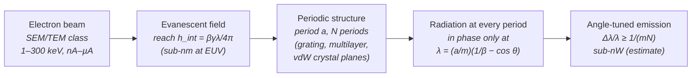

# Smith–Purcell

**Status:** 🧪 Theoretical — dispersion, tuning range and interaction height are exact kinematics; EUV emission is undemonstrated (measured only to ~230 nm); the power is an order-of-magnitude estimate with an assumed ε = 10⁻³: sub-nW at the source, ≥ 10¹¹ below HVM · [matrix](../capability-matrix.md#light-sources)

<p class="huv-lead">An electron moving past — or through — a periodic structure radiates at every period; the contributions add in phase only at the Smith–Purcell wavelength, set by the electron velocity, the period and the observation angle (Smith &amp; Purcell 1953). One device is therefore tunable by angle, beam energy or period, with no resonator and no population inversion. Pushing this "free-electron grating" into the EUV with the keV beams of electron microscopes requires nanometre and sub-nanometre periods.</p>

<div class="huv-physics" markdown>

<figure markdown="span">


<figcaption><strong>Mechanism.</strong> Synchrotron: the ring's electrons radiate a broad bending-magnet spectrum (the LIGA white beam) or, in an undulator of N periods, the sinc² line at λ_n with first zeros at ±λ/(nN); the emittances against λ/4π give the coherent fraction that becomes a coherent-core pupil. LPA-FEL: a 100 TW-class pulse drives a wakefield, the 100–500 MeV bunch enters an undulator and lases (SASE) only while σ_δ &lt; ρ. Smith–Purcell: an electron skimming a grating of period a radiates in phase at λ = (a/m)(1/β − cos θ). <em>Schematic, not to scale; no model badge.</em></figcaption>
</figure>

<figure markdown="span">


<figcaption><strong>The kinematics are exact; the reach is the problem.</strong> (a) <code>smith_purcell(…).wavelength_nm</code> over the observation angle for the preset's derived 4.433 nm period: 13.5 nm at 90° from 30 keV electrons, tunable from 9.1 to 17.9 nm, and 8.1 nm at 90° from 100 keV. (b) The emitted intensity falls as exp(−h/h<sub>int</sub>) with the electron's distance from the structure, h<sub>int</sub> = βγλ/4π = 0.37 nm here (0.028 nm for the 1.02 nm van-der-Waals case), so a beam 5 nm above the grating loses a factor 10⁶. <em>Model: Smith–Purcell free-electron grating 🧪 (✅ kinematics; the sub-nW power estimate with its assumed coupling is not drawn).</em></figcaption>
</figure>

<!-- huv-table: stack -->

| What is modeled | Grade | Dominant approximation | Details |
|---|---|---|---|
| Smith–Purcell free-electron grating | 🧪 Theoretical | α·ε·N·exp(−h/h_int) photons per electron with ε = 10⁻³ assumed; no grating-efficiency theory, no angular pattern | [Key equations](#key-equations) |
| Machine-parameter physics layer | ✅ Implemented | the dispersion relation, tuning limits, h_int and the quadrature line width, fixture-tested | [Derived quantities](#derived-quantities) |
| Illumination pupil fills | ✅ Implemented | a user-chosen top-hat fill; the source's coherence is not modeled | [What the model does](#what-the-model-does) |
| Dose-limited wafer throughput | 🔶 Simplified | 13.5 nm selects the EUV-like optics train; the sub-nW estimate gives ≈ 2×10⁻⁹ wafers per hour | [Use it](#use-it) |

</div>

<p class="huv-lead">The measured anchors set the scale: Smith–Purcell emission has been demonstrated only down to ~230 nm (Ye et al. 2019), and free-electron X-rays from the atomic planes of van-der-Waals crystals at ~80 photons/s per nA (Huang et al. 2023). The obstacle is power — the electron's field at EUV frequencies reaches only a fraction of a nanometre from its path, beam currents are nA–µA, and even ideal coupling yields of order α photons per electron per period — so `SmithPurcellSource` makes the kinematics exact and the power gap explicit. The Smith–Purcell lane of the mechanism drawing is this page's.</p>

<div class="huv-glance" markdown>

| Property | Value |
|---|---|
| Wavelength | 13.5 nm at 90° from 30 keV electrons and a derived 4.433 nm period; tunable 9.1–17.9 nm by angle |
| Band / class | accelerator EUV concept · Δλ/λ = 1.05 % (quadrature of 1/(mN), collection angle, energy spread) |
| Coherence → pupil | top-hat σ 0.7 (user choice); coherence not modeled (ζ = 0) |
| Power | 0.67 nW **emitted at the structure** for 10 nA with ε = 10⁻³ (assumed); 0.67 µW at ideal coupling; gap to 250 W ×3.7×10¹¹ |
| Presets | `smith_purcell()` (13.5 nm, 30 keV, 90°), `smith_purcell(grating_period_nm=0.335)` (vdW-crystal period, 1.02 nm) |
| Grade | 🧪 Theoretical |
| Compare with | [Inverse Compton](inverse-compton.md) · [SSMB](ssmb.md) · [Synchrotron](synchrotron.md) |

**Same thing elsewhere:** Python `SourceConfig.smith_purcell()` · TOML `[source] type = "smith_purcell"` · CLI `highuvlith sources --family smith_purcell` · GUI Source panel

</div>

<details markdown="1">
<summary>How the light is made (flowchart)</summary>



</details>

## Key equations

Smith–Purcell condition for diffraction order m and observation angle θ from the electron direction (γ = 1 + T/m_ec², β = √(1 − γ⁻²)), with the angular tuning range from the forward limit (a/m)(1/β − 1) to the backward limit (a/m)(1/β + 1) and slope dλ/dθ = (a/m) sin θ:

```math
\lambda = \frac{a}{m}\left(\frac{1}{\beta} - \cos\theta\right)
```

**Evanescent coupling.** The electron's field component at frequency ω decays transversely as exp[−ωx/(βγc)], so the intensity radiated from a structure at impact height h scales as exp(−h/h_int) with

```math
h_\text{int} = \frac{\beta\gamma\lambda}{4\pi}
```

— 0.37 nm for 13.5 nm from 30 keV electrons. EUV emission from a beam passing *above* a grating is therefore exponentially suppressed (h = 5 nm costs ~10⁻⁶); practical short-wavelength schemes traverse the structure instead. **Power — an order-of-magnitude estimate, not a grating-efficiency calculation:**

```math
Y = \alpha\,\varepsilon\,N\,e^{-h/h_\text{int}}, \qquad P = \frac{I}{e}\,Y\,\frac{hc}{\lambda}
```

The α photons per electron per period is what order-unity coupling gives (the same α-scale yield per period as an undulator with K ~ 1); ε ≤ 1 lumps the grating form factor, absorption and beam overlap. The default ε = 10⁻³ is an **optimistic assumption**: it gives ~4.6×10⁶ photons/s per nA, about 5×10⁴ times the measured van-der-Waals X-ray yield, and realistic EUV couplings are unknown. ε = 1, h = 0 is reported as the ideal-coupling value *of this estimate* (a heuristic scale, not a rigorous limit).

<details markdown="1">
<summary>Full formulas</summary>

Line width, a quadrature of the finite number of periods, the collection angle Δθ and the electron energy spread ΔT/T:

```math
\frac{\Delta\lambda}{\lambda} = \sqrt{\left(\frac{1}{mN}\right)^2 + \left(\frac{\sin\theta\,\Delta\theta}{1/\beta - \cos\theta}\right)^2 + \left(\frac{1}{\beta^2\gamma^2}\,\frac{\gamma-1}{\gamma}\,\frac{\Delta T}{T}\,\frac{1/\beta}{1/\beta - \cos\theta}\right)^2}
```

As β → 1 at θ = 90°, λ → a/m. The vdW-crystal anchor (~80 photons/s per nA) is about 1.3×10⁻⁸ photons per electron.

</details>

## Real machines

<!-- huv-table: stack -->

| Quantity | Typical range | provenance |
|---|---|---|
| Electron energy | 1–30 keV (SEM), 60–300 keV (TEM) | instrument classes |
| Beam current | nA to µA | order of magnitude |
| Structure period | ≳ tens of nm (nanofabricated gratings); ~0.3 nm (crystal planes, e.g. graphite 0.335 nm) | order of magnitude |
| Shortest demonstrated Smith–Purcell wavelength | ~230 nm | measured (Ye et al. 2019) |
| vdW-crystal free-electron X-ray yield | ~80 photons/s per nA | measured (Huang et al. 2023) |

For the preset `euv_13nm5` (30 keV, β = 0.328, derived period 4.433 nm, m = 1, θ = 90°, N = 100) every power number is the estimate with the assumed ε = 10⁻³: 7.3×10⁻⁴ photons per electron, 0.67 nW at 10 nA, 0.67 µW at ideal coupling, ×3.7×10¹¹ short of 250 W. The vdW-scale case `new(30, 0.335, 1, 90)` emits 1.020 nm (1.2 keV) with h_int = 0.028 nm: 8.9 nW at 10 nA, 8.9 µW ideal, ×2.8×10¹⁰ short. The measured vdW anchor at that photon energy and 10 nA is ≈ 0.16 pW — about 5×10⁴ below the estimate and ~10¹⁵ below 250 W. Depending on the coupling the estimates span sub-pW to nW, i.e. **10¹¹–10¹⁵ below the HVM class**; even the ideal-coupling value is ~4×10⁸ below it.

<figure markdown="span">


<figcaption><strong>Sub-nanowatts, and the measured anchor is fifty thousand times lower still.</strong> The power estimate is photons per electron α·ε·N·exp(−h/h_int) × beam current × photon energy with ε = 10⁻³ assumed; the measured van-der-Waals-crystal X-ray yield (~80 photons/s per nA) sits about 5 × 10⁴ below the estimate at the crystal period. Smith–Purcell emission has been demonstrated only to ~230 nm. <em>Model: Smith–Purcell free-electron grating 🧪.</em></figcaption>
</figure>

## What the model does

`SmithPurcellSource` ([`source_models/smith_purcell.rs`](../../crates/highuvlith-core/src/source_models/smith_purcell.rs)) implements `LithographySource`:

- **Derived wavelength** — `wavelength_nm()` evaluates the Smith–Purcell condition at `observation_angle_deg`; `wavelength_at_angle_nm(θ)`, `tuning_range_nm()` and `tuning_slope_nm_per_deg()` expose the tuning; `for_wavelength(target, T, m, θ)` inverts the relation for the period (the derived direction, like [ICS](./inverse-compton.md)); `euv_13nm5()` is `for_wavelength(13.5, 30 keV, 1, 90°)`.
- `bandwidth_pm()` applies the quadrature line width; `spectral_weights()` samples a Gaussian line — narrow, so the imaging path is formally usable; the model's point is the power, not the image.
- **Power** — `interaction_height_nm()`, `coupling_factor()`, `photons_per_electron()`, `photon_rate()`, `emitted_power_w()` (= `average_power_w()`), `ideal_coupling_power_w()`.
- **Pupil** — a user choice (`Conventional { sigma: 0.7 }` by default); coherence is not modeled (`transverse_coherence()` = 0); no pulse structure, so no dose-jitter term.
- Not modeled: the grating-profile efficiency (van den Berg / surface-current theories), the angular emission pattern (one angle only), beam energy loss, scattering and absorption inside a penetrated structure, and crystal-lattice physics (coherent bremsstrahlung, parametric X-rays) beyond the shared kinematics.

| Field | Unit | Consumed by | Status |
|---|---|---|---|
| `electron_energy_kev` | keV | β, γ → wavelength, h_int, line width | live |
| `grating_period_nm`, `diffraction_order`, `observation_angle_deg` | nm, —, deg | wavelength, tuning, 1/(mN) and angular widths | live |
| `num_periods`, `beam_current_na` | count, nA | photon yield; photon rate and power | live |
| `impact_height_nm`, `coupling_efficiency` | nm, — | evanescent factor exp(−h/h_int); photon yield (ε assumed) | live |
| `collection_half_angle_mrad`, `electron_energy_spread_rel` | mrad, — | angular and energy-spread line-width terms | live |
| `spectral_samples`, `illumination` | count, enum | spectral sampling density; `intensity_at()` pupil fill | live |
| grating-profile efficiency, angular pattern | — | — | planned |

## Derived quantities

`derived_quantities()` (Python `derived_quantity(name)`; printed by `highuvlith simulate`) for the `euv_13nm5` preset:

| Name | Value | Unit | Meaning |
|---|---|---|---|
| `electron_beta` | 0.328 | — | v/c from the beam energy |
| `tuning_min_wavelength_nm`, `tuning_max_wavelength_nm` | 9.07, 17.9 | nm | forward and backward emission limits |
| `interaction_height_nm` | 0.373 | nm | evanescent 1/e height βγλ/4π |
| `photons_per_electron` | 7.30×10⁻⁴ | photons | order-of-magnitude α·ε·N·exp(−h/h_int), ε assumed |
| `photon_rate_per_na` | 4.55×10⁶ | photons/s/nA | its note carries the measured vdW and Smith–Purcell anchors |
| `emitted_power_w` | 6.70×10⁻¹⁰ | W | the estimate at the assumed coupling |
| `ideal_coupling_power_w` | 6.70×10⁻⁷ | W | ε = 1, h = 0 (heuristic scale, not a limit) |
| `hvm_power_gap` | 3.73×10¹¹ | × | 250 W / this estimate |

<details markdown="1">
<summary>The other 7 derived quantities</summary>

`emitted_wavelength_nm` 13.5 · `photon_energy_ev` 91.84 · `tuning_slope_nm_per_deg` 0.0774 · `evanescent_coupling_factor` 1 (h = 0) · `photon_rate` 4.55×10⁷ photons/s · `relative_bandwidth` 0.0105.

</details>

## Use it

### Python

<!-- verify-example -->
```python
import highuvlith as huv

sp = huv.SourceConfig.smith_purcell()          # 13.5 nm from 30 keV electrons, period derived
print(sp.wavelength_nm, f"{sp.average_power_w:.3g} W")   # estimate, assumed coupling
vdw = huv.SourceConfig.smith_purcell(grating_period_nm=0.335)   # graphite-like lattice period
print(f"{vdw.wavelength_nm:.3g} nm")
dq = {name: value for name, value, *_ in sp.derived_quantities()}
print(f"{dq['photon_rate_per_na']:.3g} {dq['ideal_coupling_power_w']:.3g} {dq['hvm_power_gap']:.3g}")
```

???+ success "Output"

    ```text
    13.5 6.7e-10 W
    1.02 nm
    4.55e+06 6.7e-07 3.73e+11
    ```

### TOML keys

Give either the target `wavelength_nm` (period derived) or `grating_period_nm` (wavelength derived and cross-checked against any given `wavelength_nm` within 5 %); the Python factory calls the target `target_wavelength_nm`, as the [ICS](./inverse-compton.md) factory does. Example: [`examples/sim_smith_purcell.toml`](../../examples/sim_smith_purcell.toml).

| Key | Default | Units | Notes |
|---|---|---|---|
| `type` | — | — | `"smith_purcell"` |
| `electron_energy_kev`, `diffraction_order`, `observation_angle_deg` | 30, 1, 90 | keV, —, deg | |
| `grating_period_nm` | derived for `wavelength_nm` | nm | Given: the wavelength (a/m)(1/β − cos θ) is derived and cross-checked (5 %). |
| `wavelength_nm` | 13.5 (without a period) | nm | |
| `num_periods`, `beam_current_na`, `impact_height_nm`, `coupling_efficiency` | 100, 10, 0, 1e-3 | —, nA, nm, — | Power is a theoretical projection (EUV emission undemonstrated). |
| `collection_half_angle_mrad`, `electron_energy_spread_rel` | preset | mrad, — | Line-width terms. |
| `spectral_samples` | preset | count | Spectral sampling density. |

<details markdown="1">
<summary>Validation — 10 tests</summary>

- [`smith_purcell.rs`](../../crates/highuvlith-core/src/source_models/smith_purcell.rs), fixtures from an independent NumPy evaluation: `test_electron_kinematics_fixture` (γ, β at 30 and 100 keV), `test_dispersion_relation_fixture` (period 4.433078 nm; λ(45°) = 10.36534 nm; second order halves λ; the 0.335 nm lattice gives 1.020171 nm), `test_tuning_range_and_limits`, `test_interaction_height_and_evanescent_suppression` (h_int = 0.373484 nm; exp(−5/h_int) < 2×10⁻⁶), `test_power_estimate_fixture_and_hvm_gap` (7.2974×10⁻⁴ photons/e⁻, 0.67019 nW, 0.67019 µW ideal, gap 3.7303×10¹¹, 4.5546×10⁶ photons/s per nA = 5.69×10⁴ × the vdW anchor), `test_bandwidth_fixture` (1.05255 %), `test_validation`.
- CLI: `test_smith_purcell_period_or_target`; Python: `tests/python/test_sources_new.py::TestSmithPurcell` and the imaging smoke test.

</details>

<details markdown="1">
<summary>Changes</summary>

No behaviour change is recorded for this family; dated entries, if any, live in the [capability matrix](../capability-matrix.md#audit-log) audit log.

</details>

## See also

[Inverse Compton](inverse-compton.md) and [SSMB](ssmb.md) (the other electron-beam concepts) · [Synchrotron](synchrotron.md) (the undulator, whose yield per period sets the α scale) · [Quantum and exotic lithography](../future/quantum-and-exotic.md) · [Sources index](index.md) (trait contract, throughput model) · [TOML configuration](../configuration.md) · [`examples/sim_smith_purcell.toml`](../../examples/sim_smith_purcell.toml)

## References

1. S. J. Smith and E. M. Purcell, "Visible light from localized surface charges moving across a grating," *Phys. Rev.* **92**, 1069 (1953).
2. Measured anchors (hedged, author + year): Ye et al. (2019) — shortest demonstrated Smith–Purcell wavelength ~230 nm; Huang et al. (2023) — van-der-Waals-crystal free-electron X-rays, ~80 photons/s per nA.

**Where next:** ← [Inverse Compton](inverse-compton.md) · [High-harmonic generation](hhg.md) → · [Sources](index.md) · [Quantum and exotic lithography](../future/quantum-and-exotic.md)
