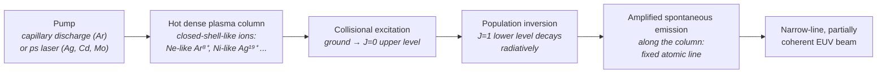

# Soft X-ray laser

**Status:** ✅ Implemented (🔶 output parameters) — fixed atomic lasing lines with exact photon number, coherence length and λ/4 limit; the presets reproduce reported average powers, but pulse durations, linewidth and coherent fraction are order-of-magnitude assumptions and gain is not modelled · [matrix](../capability-matrix.md#light-sources)

<p class="huv-lead">Plasma-based soft-X-ray lasers are the table-top route to laser light — narrow-line, partially coherent, directional — at EUV and soft-X-ray wavelengths. In the collisional-excitation scheme, electron collisions in a hot, dense plasma column pump a J = 0 level of a closed-shell-like ion straight from its ground state, the J = 1 lower level empties radiatively, and spontaneous emission is amplified along the column. Because the transition is fixed by atomic structure, the wavelength is set by the choice of ion, not by a machine parameter. Two pumping schemes are modelled: the capillary discharge (Ne-like Ar, 46.9 nm; Rocca et al. 1994) and transient collisional excitation of a laser-heated solid target (Ni-like Ag 13.9, Cd 13.2, Mo 18.9 nm).</p>

<div class="huv-physics" markdown>

<figure markdown="span">


<figcaption><strong>Mechanism.</strong> HHG: a femtosecond driver at ~10¹⁴ W/cm² tunnel-ionises the gas near each field crest, the freed electron gains up to 3.17 U_p and recombines, emitting one photon of I_p + KE every half-cycle, so the spectrum is an odd-harmonic comb with spacing 2ħω and cutoff I_p + 3.17 U_p that phase matching and absorption limit. Soft-X-ray laser: a capillary discharge or picosecond pump makes a hot column of closed-shell-like ions, collisions invert a J = 0 level, and amplified spontaneous emission along the column yields a fixed atomic line. Both reach the engine as coherent-core pupils. <em>Schematic, not to scale; no model badge.</em></figcaption>
</figure>

<figure markdown="span">


<figcaption><strong>Fixed lines, assumed widths.</strong> (a) The lasing wavelengths are atomic transitions (<code>sxrl(scheme).wavelength_nm</code>) and the stem heights the reported average powers the presets reproduce; the band is the reflectance FWHM of a 40-bilayer Mo/Si mirror computed by the materials module — Cd 13.2 nm falls inside it, Ag 13.9 nm just outside. (b) <code>coherence_length_um</code> is λ²/Δλ at any relative linewidth; the presets assume 10⁻⁴ (open markers), an order-of-magnitude input, while the λ/4 two-beam limit is exact. <em>Model: Plasma soft-X-ray laser ✅ (🔶 output parameters: powers reproduce reports, linewidth and durations assumed) · EUV/BEUV multilayer mirrors ✅.</em></figcaption>
</figure>

<!-- huv-table: stack -->

| What is modeled | Grade | Dominant approximation | Details |
|---|---|---|---|
| Plasma soft-X-ray laser (Ne-like Ar 46.9, Ni-like Ag 13.9 / Cd 13.2 / Mo 18.9 nm) | ✅ Implemented (🔶 output parameters) | fixed lines, exact photon bookkeeping; pulse energy, duration, linewidth and ζ are inputs, no gain or saturation model | [Key equations](#key-equations) |
| EUV/BEUV multilayer mirrors | ✅ Implemented | the Mo/Si band in the engine figure is Parratt reflectance of an ideal 40-bilayer stack | [Materials](../materials.md) |
| Illumination pupil fills | ✅ Implemented | the graded `CoherentGaussian` fill from the σ_core/√ζ bridge (a bookkeeping heuristic) | [What the model does](#what-the-model-does) |
| Dose-limited wafer throughput | 🔶 Simplified | the Ag preset through the EUV-like optics train: ≈ 3×10⁻⁴ wafers per hour; the CLI refuses the 46.9 and 18.9 nm lines outside every mirror band | [Use it](#use-it) |

</div>

<p class="huv-lead">Their narrow lines and partial coherence make them natural sources for interference-type lithography — table-top 46.9 nm capillary lasers have printed nanoscale periodic patterns by Lloyd's-mirror and Talbot exposure — but their reported average powers, ≈ 1 µW to a few mW, are five to eight orders of magnitude below the 250 W HVM class: pattern-demonstration and metrology sources, not production ones. `SxrlSource` keeps the line physics exact and the output numbers labelled as inputs. The soft-X-ray-laser lane of the mechanism drawing is this page's; the HHG lane has its own page.</p>

<div class="huv-glance" markdown>

| Property | Value |
|---|---|
| Wavelength | 46.9 nm (Ne-like Ar), 13.9 nm (Ni-like Ag), 13.2 nm (Ni-like Cd), 18.9 nm (Ni-like Mo) — set by the ion, not tunable |
| Band / class | table-top coherent EUV · Δλ/λ = 10⁻⁴ (assumed), pulsed (ns capillary, ps transient) |
| Coherence → pupil | coherent Gaussian from ζ = 0.3 (Ar) / 0.2 (Ag, Cd, Mo) through σ_core/√ζ (σ ≈ 0.09 / 0.11) |
| Power | 0.156 mW (Ar), 0.1 mW (Ag, Mo), 1 µW (Cd) **average laser output at the source**: pulse energy × rate, five to eight orders below 250 W |
| Presets | `sxrl_ar_46nm9()`, `sxrl_ag_13nm9()`, `sxrl(scheme=…)` (`ar_46nm9`, `ag_13nm9`, `cd_13nm2`, `mo_18nm9`) |
| Grade | ✅ Implemented (🔶 output parameters) |
| Compare with | [HHG](hhg.md) · [Synchrotron](synchrotron.md) · [Interference and two-photon lithography](../processes/interference-volumetric.md) |

**Same thing elsewhere:** Python `SourceConfig.sxrl_ar_46nm9()` · TOML `[source] type = "sxrl"` · CLI `highuvlith sources --family sxrl` · GUI Source panel

</div>

<details markdown="1">
<summary>How the light is made (flowchart)</summary>



</details>

## Key equations

| Scheme (`SxrlScheme`) | Ion | Transition | λ (nm) | Photon energy (eV) |
|---|---|---|---|---|
| `CapillaryNeLikeAr` | Ar⁸⁺ (Ne-like) | 3p ¹S₀ → 3s ¹P₁ | 46.9 | 26.44 |
| `NiLikeAg` | Ag¹⁹⁺ (Ni-like) | 4d ¹S₀ → 4p ¹P₁ | 13.9 | 89.20 |
| `NiLikeCd` | Cd²⁰⁺ (Ni-like) | 4d ¹S₀ → 4p ¹P₁ | 13.2 | 93.93 |
| `NiLikeMo` | Mo¹⁴⁺ (Ni-like) | 4d ¹S₀ → 4p ¹P₁ | 18.9 | 65.60 |

Photon bookkeeping with E_γ = hc/λ, and the temporal coherence length (order-unity line-shape factor omitted):

```math
N_\gamma = \frac{E_\text{pulse}}{E_\gamma}, \qquad P = E_\text{pulse}\, f, \qquad P_\text{peak} = \frac{E_\text{pulse}}{\tau},
\qquad l_c = \frac{\lambda^2}{\Delta\lambda} = \frac{\lambda}{\Delta\lambda/\lambda}
```

Two-beam interference at half-angle θ writes a period p = λ/(2 sin θ), so the minimum half-pitch is λ/4 (11.7 nm for Ar, 3.3 nm for Cd). The coherent fraction ζ maps to a mode count M ≈ 1/ζ and to a Gaussian pupil fill through the shared `sigma_from_coherence` heuristic.

## Real machines

<!-- huv-table: stack -->

| Laser | λ | Reported average output | provenance | Reference |
|---|---|---|---|---|
| Capillary-discharge Ne-like Ar (large amplifier) | 46.9 nm | 3.5 mW (0.88 mJ × 4 Hz) | measured | Macchietto et al., *Opt. Lett.* **24**, 1115 (1999) |
| Desk-top capillary-discharge Ne-like Ar | 46.9 nm | 0.16 mW (13 µJ × 12 Hz) | measured | Heinbuch et al., *Opt. Express* **13**, 4050 (2005) |
| Diode-pumped transient Ni-like Mo | 18.9 nm | ~0.1 mW at 100 Hz (~1 µJ) | measured | Reagan et al., *Opt. Express* **21**, 28380 (2013) |
| Transient Ni-like Ag | 13.9 nm | ~0.1 mW | reported order of magnitude (not independently verified here) | — |
| Transient Ni-like Cd | 13.2 nm | ~1 µW | reported order of magnitude (not independently verified here) | — |
| Transient Ni-like Sn (no preset) | 11.9 nm | ~20 µW | reported order of magnitude (not independently verified here) | — |

Other device parameters are order of magnitude: capillary pulses ~1 ns, transient pulses ~ps; relative linewidth ~10⁻⁴ class (assumed); partial spatial coherence that improves with column length (assumed ζ = 0.3 / 0.2). The presets' pulse energy × repetition rate reproduce the anchors: the Ar and Mo splits are the published ones, the Ag and Cd splits are assumptions matched to the reported orders of magnitude.

<figure markdown="span">


<figcaption><strong>Peak power is not average power.</strong> Pulse energy ÷ duration gives the kW–MW peaks; pulse energy × repetition rate the averages, which reproduce the reported orders of magnitude (the Ar and Mo pulse–rate splits are published; the Ag and Cd splits and all durations are assumptions). <em>Model: Plasma soft-X-ray laser ✅ (🔶 pulse splits, linewidth, no gain model).</em></figcaption>
</figure>

## What the model does

`SxrlSource` ([`source_models/sxrl.rs`](../../crates/highuvlith-core/src/source_models/sxrl.rs)) implements `LithographySource`; the scheme is selected by `SxrlScheme`:

- `wavelength_nm()` returns the scheme's fixed line — there is no free wavelength field to drift out of sync; the CLI rejects a `wavelength_nm` more than 1 % from the lasing line.
- `bandwidth_pm()` = `rel_linewidth` × λ; `spectral_weights()` samples a Gaussian line (the true line shape is not modelled). The narrow line makes polychromatic imaging honest.
- `transverse_coherence()` reports ζ; the default pupil is `CoherentGaussian` with σ = `sigma_from_coherence(ζ, 0.05)`, the approximate Gaussian–Schell bridge documented in [`source.rs`](../../crates/highuvlith-core/src/source.rs).
- `pulse_energy_j()`, `rep_rate_hz()`, `pulse_duration_s()` are live; `shot_to_shot_rms()` (10 % default, assumed) feeds the stochastic dose-jitter term.
- Presets `ar_46nm9()`, `ag_13nm9()`, `cd_13nm2()`, `mo_18nm9()`, `preset(scheme)` and `new(scheme, pulse_energy_uj, rep_rate_hz, pulse_duration_ps, coherence)`.
- Not modelled: the gain, saturation and refraction physics of the amplifier (the output energy is an input), the beam profile, the line shape, polarization.

| Field | Unit | Consumed by | Status |
|---|---|---|---|
| `scheme` | enum | wavelength (fixed atomic line), photon energy, the reported-power anchor in the derived-quantity note | live |
| `rel_linewidth` | — | `bandwidth_pm()`, coherence length | live |
| `pulse_energy_uj`, `rep_rate_hz`, `pulse_duration_ps` | µJ, Hz, ps | `pulse_energy_j()`, photons per pulse, average power; `rep_rate_hz()`; `pulse_duration_s()`, peak power | live |
| `transverse_coherence_fraction` | — | `transverse_coherence()`; pupil σ at construction | live |
| `shot_to_shot_rms` | — | `shot_to_shot_rms()` → stochastic dose jitter | live |
| `spectral_samples`, `illumination` | count, enum | spectral sampling density; `intensity_at()` pupil fill | live |
| gain / saturation model, beam profile, polarization | — | — | planned |

## Derived quantities

`derived_quantities()` (Python `derived_quantity(name)`; printed by `highuvlith simulate`) for the four presets; the `average_power_w` note carries the reported anchor for the scheme:

<!-- huv-table: stack -->

| Name | Unit | `ar_46nm9` | `ag_13nm9` | `cd_13nm2` | `mo_18nm9` |
|---|---|---|---|---|---|
| inputs: E_pulse × f, τ | µJ × Hz, ps | 13 × 12, 1200 | 10 × 10, 5 | 0.1 × 10, 5 | 1 × 100, 5 |
| `photon_energy_ev` | eV | 26.44 | 89.20 | 93.93 | 65.60 |
| `photons_per_pulse` | photons | 3.07×10¹² | 7.0×10¹¹ | 6.6×10⁹ | 9.5×10¹⁰ |
| `average_power_w` | W | 1.56×10⁻⁴ | 1×10⁻⁴ | 1×10⁻⁶ | 1×10⁻⁴ |
| `peak_power_w` | W | 1.08×10⁴ | 2×10⁶ | 2×10⁴ | 2×10⁵ |
| `coherence_length_um` | µm | 469 | 139 | 132 | 189 |
| `interference_min_half_pitch_nm` | nm | 11.7 | 3.5 | 3.3 | 4.7 |
| `coherent_mode_count` | — | 3.3 | 5 | 5 | 5 |
| `hvm_power_gap` | × | 1.6×10⁶ | 2.5×10⁶ | 2.5×10⁸ | 2.5×10⁶ |

## Use it

### Python

<!-- verify-example -->
```python
import highuvlith as huv

ar = huv.SourceConfig.sxrl_ar_46nm9()                  # desk-top capillary Ne-like Ar, 46.9 nm
ag = huv.SourceConfig.sxrl_ag_13nm9()                  # transient Ni-like Ag, 13.9 nm
mo = huv.SourceConfig.sxrl(scheme="mo_18nm9", pulse_energy_uj=2.0)
print(ar.wavelength_nm, f"{ar.bandwidth_pm:.3g} pm", f"{ar.average_power_w:.3g} W")
dq = {name: value for name, value, *_ in ar.derived_quantities()}
print(f"{dq['coherence_length_um']:.3g} um", f"{dq['interference_min_half_pitch_nm']:.3g} nm")
print(ag.wavelength_nm, f"{mo.average_power_w:.3g} W")   # 2 uJ x 100 Hz
```

???+ success "Output"

    ```text
    46.9 4.69 pm 0.000156 W
    469 um 11.7 nm
    13.9 0.0002 W
    ```

### TOML keys

Example: [`examples/sim_sxrl.toml`](../../examples/sim_sxrl.toml).

| Key | Default | Units | Notes |
|---|---|---|---|
| `type` | — | — | `"sxrl"` |
| `scheme` | `"ar_46nm9"` | — | `ar_46nm9`, `ag_13nm9`, `cd_13nm2`, `mo_18nm9` (fixed lasing lines). |
| `rel_linewidth` (`rel_bandwidth`) | preset | — | Δλ/λ; the shared key `rel_bandwidth` is accepted too. |
| `pulse_energy_uj`, `rep_rate_hz`, `pulse_duration_ps` | preset | µJ, Hz, ps | |
| `wavelength_nm` | the line | nm | Must be within 1 % of the scheme's line. |
| `spectral_samples` | preset | count | Spectral sampling density. |

<details markdown="1">
<summary>Validation — 10 tests</summary>

- [`sxrl.rs`](../../crates/highuvlith-core/src/source_models/sxrl.rs): `test_fixed_atomic_lines` (46.9 / 13.9 / 13.2 / 18.9 nm and their photon energies), `test_photon_number_and_power_fixture` (3.0693×10¹² photons per 13 µJ pulse at 46.9 nm; 0.156 mW; 10.8 kW peak; gap 1.60×10⁶; the Heinbuch anchor in the note; Mo preset 0.1 mW and 9.514×10¹⁰ photons/pulse; Cd preset 1 µW), `test_narrow_line_and_coherence_length` (4.69 pm; 469 µm; halving the linewidth doubles l_c; λ/4 limits), `test_partial_coherence_sets_gaussian_pupil`, `test_spectral_weights_sum_to_one`, `test_validation_and_names`.
- CLI: `test_sxrl_fixed_line_cross_check`, `test_lab_compact_key_names_aliases_and_fallbacks`; Python: `tests/python/test_sources_new.py::TestSxrl` and the imaging smoke test (Ag 13.9 nm and Ar 46.9 nm).

</details>

<details markdown="1">
<summary>Changes</summary>

No behaviour change is recorded for this family; dated entries, if any, live in the [capability matrix](../capability-matrix.md#audit-log) audit log.

</details>

## See also

[HHG](hhg.md) (the other table-top coherent EUV source) · [Interference and two-photon lithography](../processes/interference-volumetric.md) (where a 46.9 nm line prints) · [Materials](../materials.md) (the Mo/Si band) · [Alternatives to projection](../future/alternative-patterning.md) · [Sources index](index.md) (trait contract, coherence → σ heuristic, throughput model) · [TOML configuration](../configuration.md) · [`examples/sim_sxrl.toml`](../../examples/sim_sxrl.toml)

## References

1. J. J. Rocca et al., "Demonstration of a discharge pumped table-top soft-x-ray laser," *Phys. Rev. Lett.* **73**, 2192 (1994).
2. Macchietto et al., *Opt. Lett.* **24**, 1115 (1999) — 3.5 mW capillary-discharge Ne-like Ar laser (0.88 mJ × 4 Hz); Heinbuch et al., *Opt. Express* **13**, 4050 (2005) — desk-top capillary-discharge laser, 0.16 mW (13 µJ × 12 Hz).
3. Reagan et al., *Opt. Express* **21**, 28380 (2013) — diode-pumped Ni-like Mo 18.9 nm laser, ~0.1 mW at 100 Hz.

**Where next:** ← [High-harmonic generation](hhg.md) · [X-ray tube](xray-tube.md) → · [Sources](index.md) · [Alternatives to projection](../future/alternative-patterning.md)
