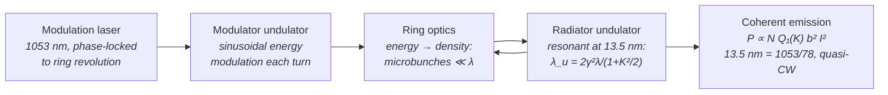

# SSMB

**Status:** 🧪 Theoretical — the integer-harmonic check is live and the coherent power is derived (∝ N·Q₁·b²·I²), but the 1 kW design point needs a bunching factor b ≈ 0.146 (≈ 4 nm microbunches every turn), undemonstrated at any EUV harmonic · [matrix](../capability-matrix.md#light-sources)

<p class="huv-lead">Storage rings carry amperes of average current but radiate incoherently at short wavelengths, because their bunches are vastly longer than the light; free-electron lasers radiate coherently (power ∝ N_e²) but throw the beam away after one pass. Steady-state microbunching proposes both at once: a modulation laser phase-locked to the ring imprints and sustains microbunching on the stored beam, so that every turn radiates coherently at a harmonic of the laser. If it worked at scale, kW-class average EUV power would remove the source-power bottleneck — several times the 250 W of production Sn LPP sources, with high coherence as a bonus.</p>

<div class="huv-physics" markdown>

<figure markdown="span">


<figcaption><strong>The SSMB concept.</strong> A phase-locked laser imprints an energy modulation in the modulator, the ring lattice turns it into microbunches at the radiator and re-forms them on every turn, so the beam radiates coherently at a laser harmonic (coherent power ∝ N²|bₙ|²). <em>Schematic, not to scale.</em></figcaption>
</figure>

<figure markdown="span">


<figcaption><strong>Every watt of the SSMB projection is a bunching factor nobody has sustained.</strong> <code>ssmb(bunching_factor=b).average_power_w</code> for the 400 MeV, 1 A design point with its 100-period K = 1.6 radiator: the power is P(b = 1)·b² exactly, so the 1 kW projection is the statement b ≈ 0.146 — 4.2 nm rms microbunches at harmonic 78, every turn — and 250 W needs b ≈ 0.073. The top axis is the Gaussian microbunch length that gives each b; the hatched range has no demonstration at any EUV harmonic (one-turn microbunching has been shown at 1064 nm). <em>Model: SSMB storage ring 🧪.</em></figcaption>
</figure>

<!-- huv-table: stack -->

| What is modeled | Grade | Dominant approximation | Details |
|---|---|---|---|
| SSMB storage ring | 🧪 Theoretical | coherent emission of a given b through Kim's central-cone spectral density; b itself is an input, never derived | [Key equations](#key-equations) |
| Machine-parameter physics layer | ✅ Implemented | `coherent_undulator_power_w`, `microbunch form factor`, Q₁(K) from Bessel functions, fixture-tested | [Derived quantities](#derived-quantities) |
| Illumination pupil fills | ✅ Implemented | the graded `CoherentGaussian` fill from the σ_core/√ζ bridge (a bookkeeping heuristic) | [What the model does](#what-the-model-does) |
| Dose-limited wafer throughput | 🔶 Simplified | 1 kW through the EUV-like optics train: ≈ 183 wafers per hour, already overhead-limited (ceiling ≈ 196) | [Use it](#use-it) |

</div>

<p class="huv-lead">`SsmbSource` enforces the one hard constraint the concept imposes — the radiated wavelength must be an integer harmonic of the modulation wavelength — and derives the coherent power from current, bunching factor and radiator, so the quadratic sensitivity to the bunching factor is explicit instead of hidden inside a projected number. The microbunching dynamics that would set an achievable b are not modeled: the model derives what a given b radiates, never that a b is reachable.</p>

<div class="huv-glance" markdown>

| Property | Value |
|---|---|
| Wavelength | 13.5 nm = 1053 nm / 78 (must be an integer harmonic of the modulation laser, ±0.2 %) |
| Band / class | accelerator EUV concept · quasi-CW storage ring, Δλ/λ = 10⁻³ (assumed), no pulse structure |
| Coherence → pupil | coherent Gaussian σ ≈ 0.056 from ζ = 0.8 (projected) through σ_core/√ζ |
| Power | 1 kW coherent power **at the radiator** = the stored projection, reached only with b = 0.146 (assumed); no collector or IF chain is modeled |
| Presets | `ssmb_euv_13nm5()` (Tsinghua design class), `ssmb(...)` (own radiator / b / stored power) |
| Grade | 🧪 Theoretical |
| Compare with | [Sn LPP](lpp.md) (the 250 W baseline) · [XFEL](xfel.md) (ERL, another kW-class projection) · [Inverse Compton](inverse-compton.md) |

**Same thing elsewhere:** Python `SourceConfig.ssmb_euv_13nm5()` · TOML `[source] type = "ssmb"` · CLI `highuvlith sources --family ssmb` · GUI Source panel

</div>

<details markdown="1">
<summary>How the light is made (flowchart)</summary>



</details>

## Key equations

The stored beam passes the modulator every revolution; the lattice converts the energy modulation into density microbunching that is re-formed each turn — the "steady state". Radiation occurs at integer harmonics of the modulation wavelength, and the radiator must be resonant there, which fixes its period from the ring energy and K:

```math
\lambda_r = \frac{\lambda_\text{mod}}{n} \quad \left(\frac{1053\ \text{nm}}{78} = 13.5\ \text{nm}\right),
\qquad
\lambda_u = \frac{2\gamma^2\lambda_r}{1 + K^2/2} = 7.27\ \text{mm} \quad (400\ \text{MeV},\ \gamma = 783.8,\ K = 1.6)
```

The field radiated by N_e electrons is the single-electron field times a phase sum, so the energy carries an incoherent term ∝ N_e and a coherent term ∝ N_e²|b|². With Kim's central-cone single-electron spectral density of a planar undulator at its line and I² replaced by ⟨I²⟩ = I_avg·I_pk for a beam with time structure:

```math
P_\text{coh} = 2\pi^2\,\alpha\,\hbar\,N\,Q_1(K)\,|b|^2\,\frac{I_\text{avg}}{e}\,\frac{I_\text{pk}}{e}
\;\approx\; 592\ \text{W} \times N\,Q_1(K)\,|b|^2\,I_\text{avg}[\text{A}]\,I_\text{pk}[\text{A}]
```

with Q₁(K) = K²[J₀(ξ) − J₁(ξ)]²/(1 + K²/2), ξ = K²/(4 + 2K²) (Q₁ = 0.795 at K = 1.6). For Gaussian microbunches of rms length σ_z the bunching factor is

```math
b = \exp\!\left[-\tfrac{1}{2}(k\sigma_z)^2\right], \qquad k = \frac{2\pi}{\lambda}
```

so power scales as b² and b depends exponentially on σ_z: shrinking the microbunches from 6.5 nm to 4.2 nm rms raises the power ~200×. With the design-point radiator (1 A DC-like beam, N = 100, K = 1.6):

| Bunching factor b at 13.5 nm | Coherent power | rms microbunch length | Enhancement over spontaneous |
|---|---|---|---|
| 0.01 | 4.7 W | 6.52 nm | 2.8 |
| 0.05 | 118 W | 5.26 nm | 70 |
| 0.073 | 250 W (HVM benchmark) | 4.92 nm | 149 |
| 0.1 | 470 W | 4.61 nm | 281 |
| **0.146** | **1000 W (design projection)** | **4.22 nm** | **597** |

<details markdown="1">
<summary>Full formulas</summary>

The phase sum: |Σ_j e^{iωt_j}|² = N_e + N_e(N_e − 1)|b(ω)|² with b(ω) = ⟨e^{iωt_j}⟩. For a quasi-CW beam of duration T bunched at ω₀, ∫|b(ω)|² dω = 2π|b|²/T, so the coherent term radiates P = 2π(I/e)²|b|² dW₁/dω with dW₁/dω = παNQ₁(K)ħ (X-ray Data Booklet §2.1). Assumptions stated in [`physics::coherent_undulator_power_w`](../../crates/highuvlith-core/src/source_models/physics.rs): transversely coherent emission (beam size well below the radiation mode), bunching constant along the radiator, no FEL gain or feedback on the bunching, and the radiator detuned for maximum angle-integrated emission — exactly on resonance the power is **half** this value. Relative to the spontaneous central-cone power παQ₁(I/e)E_ph of the same radiator, the enhancement is P_coh/P_inc = N|b|²(I_pk/e)(λ/c) — the electrons in one slippage length Nλ times |b|² (≈ 600 at the design point).

</details>

## Real machines

<!-- huv-table: stack -->

| Machine | provenance | Ring energy | Laser | Output | Citation |
|---|---|---|---|---|---|
| MLS proof of principle (Tsinghua/PTB, Berlin) | demonstrated (mechanism, one turn) | Metrology Light Source | 1064 nm, one-turn imprint | coherent radiation at the modulation wavelength one turn after modulation | Deng et al., *Nature* **590**, 576 (2021) |
| Follow-up mechanism test at the MLS | demonstrated (mechanism, one turn) | Metrology Light Source | 1064 nm | one-turn microbunching | Kruschinski et al., *Commun. Phys.* **7**, 160 (2024) |
| Tsinghua SSMB-EUV design | design | ≥ 400 MeV, ≥ 1 A | — | ≥ 1 kW in a 2 % band at 13.5 nm | *Acta Phys. Sin.* **71**, 152901; 2018 EUVL Workshop |
| SLAC SSMB design (Chao et al.) | design | — | — | 1.12 kW per tool at 13.7 nm | IPAC2016, TUXB01 |
| Ratner & Chao sample parameter set | projection | — | — | 4 kW at 13.5 nm | 2015 EUVL Workshop |
| This model's preset (`euv_1kw_13nm5`) | this model (projection) | 400 MeV, 1 A | 1053 nm, harmonic 78 | 13.5 nm, 1 kW (b ≈ 0.146 required) | Ratner & Chao, *PRL* **105**, 154801 (2010) |

Both experiments are one-turn **mechanism** tests at 1064 nm. Steady-state operation, EUV harmonics and kW power all remain to be shown, and no SSMB facility approval has been found (a Xiong'an site discussion is not an approval). The preset sits in the Tsinghua design class; its 1053 nm / harmonic-78 / 100-period K = 1.6 radiator numbers are this model's own choices, not a quoted design.

<figure markdown="span">


<figcaption><strong>1 kW rests on b² = 0.021.</strong> The radiator and current give 47 kW at full bunching; the stored 1 kW projection needs a bunching factor of 0.146 sustained every turn, which no SSMB experiment has shown at any EUV harmonic (the two one-turn tests were at 1064 nm). Without bunching the same radiator radiates 1.7 W incoherently. <em>Model: SSMB storage ring 🧪.</em></figcaption>
</figure>

## What the model does

`SsmbSource` ([`source_models/ssmb.rs`](../../crates/highuvlith-core/src/source_models/ssmb.rs)) implements `LithographySource`:

- **Harmonic consistency (live)** — `new(ring_energy_mev, modulation_wavelength_nm, target_wavelength_nm, average_power_w)` rejects any target that is not an integer harmonic within 0.2 % (1053/13.9 = 75.75 is rejected at construction); `harmonic()` returns the integer.
- **Derived coherent power** — `with_radiator(SsmbRadiator { average_current_a, peak_current_a, bunching_factor, num_periods, k })` (validated: positive currents, periods and K; b in [0, 1]; peak ≥ average) makes `average_power_w()` return `coherent_power_w()`; without a radiator the stored projection is returned. `bunching_required(radiator, P)` inverts the formula.
- `wavelength_nm()` returns the target; `bandwidth_pm()` = 10⁻³ λ; `spectral_weights()` samples a Gaussian at 5 points.
- Quasi-CW: `pulse_energy_j()` and `rep_rate_hz()` are `None`, so no shot-to-shot jitter enters the stochastic module — an absence of a model, not a validated stability claim.
- `transverse_coherence()` reports 0.8 and the pupil is `CoherentGaussian` with σ from `sigma_from_coherence(0.8, 0.05)` ≈ 0.056; the CLI `sigma` key is not consulted.
- The pipeline reads only the trait surface, so 13.5 nm drives the TCC and photon statistics like any other 13.5 nm source — there is no "SSMB bonus" beyond the narrow band and the coherent pupil.

| Field | Unit | Consumed by | Status |
|---|---|---|---|
| `ring_energy_mev` | MeV | γ → radiator period (derived quantities); not the power formula | live (derived quantities) |
| `modulation_wavelength_nm`, `target_wavelength_nm` | nm | harmonic check at construction; `wavelength_nm()` → imaging, photon energy, microbunch length | live |
| `average_power_w` | W | `average_power_w()` without a radiator; reference for `bunching_for_projection` | live (fallback) |
| `radiator` (`average_current_a`, `peak_current_a`, `bunching_factor`, `num_periods`, `k`) | A, A, —, —, — | derived coherent power → `average_power_w()` | live (optional) |
| `rel_bandwidth`, `spectral_samples`, `illumination` | —, count, enum | `bandwidth_pm()`, spectral sampling, `intensity_at()` | live |
| `transverse_coherence_fraction` | — | `transverse_coherence()`; pupil σ at construction | live |
| microbunching dynamics (laser power, lattice, IBS and quantum-excitation limits on σ_z) | — | — | planned |

## Derived quantities

`derived_quantities()` (Python `derived_quantity(name)`; printed by `highuvlith simulate`) for the `euv_1kw_13nm5()` design point:

| Name | Value | Unit | Meaning |
|---|---|---|---|
| `harmonic_number` | 78 | — | modulation / target wavelength |
| `radiator_period` | 7.27 | mm | resonant period 2γ²λ/(1 + K²/2) |
| `bunching_factor` | 0.1458 | — | assumed; must be sustained every turn |
| `microbunch_rms_length` | 4.22 | nm | Gaussian σ_z giving this b |
| `coherent_power` | 1000 | W | derived (= `average_power_w`) |
| `power_at_full_bunching` | 4.70×10⁴ | W | coherent power at b = 1; P = this × b² |
| `incoherent_power` | 1.67 | W | spontaneous central-cone power of the same radiator |
| `bunching_for_hvm` | 0.0729 | — | b needed for 250 W |

<details markdown="1">
<summary>The other 8 derived quantities</summary>

`photon_energy` 91.84 eV · `electron_gamma` 783.8 · `radiator_length` 0.727 m · `coherent_enhancement` 597 (= N|b|²(I_pk/e)λ/c) · `bunching_for_projection` 0.1458 · `projected_power` 1000 W (stored) · `photon_rate` 6.80×10¹⁹ photons/s · `hvm_power_ratio` 4.0 (against 250 W at IF).

</details>

## Use it

### Python

Factories from [`py_config.rs`](../../crates/highuvlith-py/src/py_config.rs): the preset derives its power with b set to what 1 kW requires; `ssmb(bunching_factor=…)` moves it as b², `ssmb(average_current_a=…, peak_current_a=…)` uses ⟨I²⟩ = I_avg·I_pk, and `ssmb(average_power_w=…)` without radiator fields reports the stored projection.

<!-- verify-example -->
```python
import highuvlith as huv

src = huv.SourceConfig.ssmb_euv_13nm5()
print(src.wavelength_nm)                                        # harmonic 78 of 1053 nm
print(f"{src.average_power_w:.3g} W")                           # derived with b = 0.146
print(f"{src.derived_quantity('bunching_factor'):.3g}")
print(f"{src.derived_quantity('microbunch_rms_length'):.3g} nm")
weaker = huv.SourceConfig.ssmb(bunching_factor=0.1)             # P scales as b^2
print(f"{weaker.average_power_w:.3g} W")
print(f"{src.wafer_throughput(dose_mj_cm2=30.0)['wafers_per_hour']:.3g} wph")  # overhead-limited
```

???+ success "Output"

    ```text
    13.5
    1e+03 W
    0.146
    4.22 nm
    470 W
    183 wph
    ```

### TOML keys

Field names from [`config.rs`](../../crates/highuvlith-cli/src/config.rs); a `wavelength_nm` that is not an integer harmonic of `modulation_wavelength_nm` is rejected before any simulation runs. Example: [`examples/sim_ssmb.toml`](../../examples/sim_ssmb.toml).

| Key | Default | Units | Notes |
|---|---|---|---|
| `type` | — | — | `"ssmb"` |
| `ring_energy_mev`, `modulation_wavelength_nm`, `wavelength_nm`, `average_power_w` | 400, 1053, 13.5, 1000 | MeV, nm, nm, W | The radiated wavelength must be an integer harmonic of the modulation (±0.2 %); the power is the stored projection without radiator fields. |
| `average_current_a`, `peak_current_a`, `bunching_factor`, `radiator_periods`, `radiator_k` | 1.0, = average, (required b), 100, 1.6 | A, A, —, —, — | Any of them derives the coherent power; without `bunching_factor` the b that `average_power_w` needs is used and reported. |
| `spectral_samples` | 5 | count | Spectral sampling density. |

<details markdown="1">
<summary>Validation — 15 tests</summary>

- [`ssmb.rs`](../../crates/highuvlith-core/src/source_models/ssmb.rs): `test_harmonic_consistency_enforced` (78 accepted, 75.75 rejected), `test_preset_is_78th_harmonic`, `test_cw_power_passthrough` (derived power = 1 kW; `pulse_energy_j()` / `rep_rate_hz()` are `None`; stored projection without a radiator), `test_derived_coherent_power_fixture` (b = 0.14580, σ_z = 4.216 nm, period 7.275 mm, b = 0.1 → 470.4 W, scipy fixtures), `test_radiator_validation`, `test_weights_sum_to_one`.
- [`physics.rs`](../../crates/highuvlith-core/src/source_models/physics.rs): `test_coherent_undulator_power_fixture` (591.77 W per N·Q₁·|b|²·I², quadratic in b and I), `test_microbunch_form_factor_round_trip` (4.61 nm ↔ b = 0.1), `test_undulator_harmonic_functions_fixture` (Q₁(1.6) = 0.7949).
- CLI `config.rs`: `test_ics_ssmb_entangled_machine_fields` (`bunching_factor = 0.1` → 470.4 W), `test_legacy_family_tomls_unchanged_by_new_fields`, `test_family_example_tomls_validate`; Python: `tests/python/test_sources_physics.py::TestSsmb`, `tests/python/test_sources.py::TestSsmbSource`, the imaging smoke test at NA 0.33.

</details>

<details markdown="1">
<summary>Changes</summary>

**Derived coherent power.** The preset's `average_power_w` used to be a stored 1000 W projection; it is now derived from the radiator with b set to the value the projection requires (0.1458), so the number is unchanged but its meaning is explicit, and configs without radiator fields keep the stored value (`test_legacy_family_tomls_unchanged_by_new_fields`). Dated entries live in the [capability matrix](../capability-matrix.md#audit-log) audit log.

</details>

## See also

[Inverse Compton](inverse-compton.md) (the other compact-EUV accelerator concept) · [Sn LPP](lpp.md) (the production baseline SSMB aims to beat) · [XFEL](xfel.md) (the ERL design point) · [Accelerator light sources](../future/accelerator-light-sources.md) · [Sources index](index.md) (trait contract, coherence → σ heuristic, throughput model) · [TOML configuration](../configuration.md) · [`examples/sim_ssmb.toml`](../../examples/sim_ssmb.toml)

## References

1. D. F. Ratner and A. W. Chao, "Steady-state microbunching in a storage ring for generating coherent radiation," *Phys. Rev. Lett.* **105**, 154801 (2010).
2. X. Deng et al., "Experimental demonstration of the mechanism of steady-state microbunching," *Nature* **590**, 576 (2021); Kruschinski et al., *Commun. Phys.* **7**, 160 (2024).
3. K.-J. Kim, "Characteristics of synchrotron radiation," X-ray Data Booklet §2.1 — central-cone undulator flux used for the single-electron spectral density.
4. Tsinghua SSMB-EUV design, *Acta Phys. Sin.* **71**, 152901; SLAC design, 1.12 kW per tool, IPAC2016 TUXB01, doi:10.18429/JACoW-IPAC2016-TUXB01.

**Where next:** ← [LPA-FEL](lpa-fel.md) · [Inverse Compton](inverse-compton.md) → · [Sources](index.md) · [Accelerator light sources](../future/accelerator-light-sources.md)
