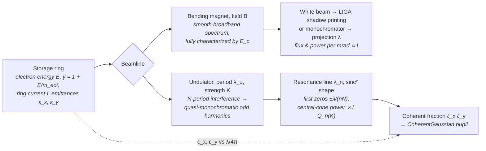

# Synchrotron

**Status:** ✅ Implemented (🔶 coherence bound) — wavelength, the sinc² undulator line, harmonic content and absolute flux and power are derived from machine parameters and fixture-tested; the emittance-derived coherent fraction is a matched-beta upper bound; 0.232 W central-cone line power at the source · [matrix](../capability-matrix.md#light-sources)

<p class="huv-lead">Storage-ring synchrotron radiation spans VUV to hard X-ray with high average power and sub-percent stability, which is why it anchors two very different lithographic roles: the bending-magnet white beam is the canonical exposure source for LIGA deep X-ray lithography (millimetre-thick PMMA, aspect ratios above 50), and undulator beamlines provide the quasi-monochromatic, partially coherent EUV used for actinic mask metrology and resist studies at PTB's BESSY II beamlines or PSI's XIL-II.</p>

<div class="huv-physics huv-physics--single" markdown>

<figure markdown="span">


<figcaption><strong>Mechanism.</strong> Synchrotron: the ring's electrons radiate a broad bending-magnet spectrum (the LIGA white beam) or, in an undulator of N periods, the sinc² line at λ_n with first zeros at ±λ/(nN); the emittances against λ/4π give the coherent fraction that becomes a coherent-core pupil. LPA-FEL: a 100 TW-class pulse drives a wakefield, the 100–500 MeV bunch enters an undulator and lases (SASE) only while σ_δ &lt; ρ. Smith–Purcell: an electron skimming a grating of period a radiates in phase at λ = (a/m)(1/β − cos θ). <em>Schematic, not to scale; no model badge.</em></figcaption>
</figure>

<figure markdown="span">


<figcaption><strong>What the synchrotron model derives from the machine.</strong> (a) The on-axis sinc² line of the compact preset (FWHM 119.65 pm) and the five samples the engine images with; (b) F_n(K) and Q_n(K) for n = 1, 3, 5 with the preset's K = 1 marked; (c) the per-plane coherent fraction (λ/4π)/(ε + λ/4π), an upper bound with matched beta functions, giving ζ = 0.089 for the illustrative compact ring; (d) the LIGA white beam: the bending-magnet shape S(E/E<sub>c</sub>) at the preset's E<sub>c</sub> = 6.23 keV (2.5 GeV, 1.5 T), the K<sub>5/3</sub> integral evaluated here and scaled to the engine's 8.0 × 10¹² photons/s/mrad/0.1 % BW at the 0.2 nm selection, which integrates back to its 19.8 W/mrad; the band is the [0.1, 8] E<sub>c</sub> window the LIGA module samples. Undulator flux values are filament-beam figures. <em>Model: Synchrotron (bending magnet / undulator) ✅ (🔶 coherence bound) · Machine-parameter physics layer ✅.</em></figcaption>
</figure>

<!-- huv-table: stack -->

| What is modeled | Grade | Dominant approximation | Details |
|---|---|---|---|
| Undulator resonance, sinc² line, F_n/Q_n harmonics, Kim central-cone flux and power | ✅ Implemented (🔶 coherence bound) | filament-beam (on-axis, zero-emittance) flux formulas; emittance and energy spread reported, not folded in | [Key equations](#key-equations) |
| Bending-magnet E_c, S(E/E_c), flux and power per mrad | ✅ Implemented | Kostroun evaluation of the K₅/₃ integral, h = 0.25 (10⁻¹⁴ relative) | [Full formulas](#key-equations) |
| Coherent fraction and the coherent-core pupil | 🔶 Simplified | matched-beta convolution (an upper bound) and the Gaussian–Schell σ bridge | [From coherence to pupil fill](index.md#from-coherence-to-pupil-fill) |
| The LIGA white beam | ✅ Implemented | `XraySpectrum::from_synchrotron` samples S(E/E_c) from the critical energy | [LIGA deep X-ray](../processes/liga-deep-xray.md#spectrum-and-absolute-flux) |

**Same thing elsewhere:** Python `SourceConfig.synchrotron_compact_euv()` · TOML `[source] type = "synchrotron"` · CLI `highuvlith sources --family synchrotron` · GUI Source panel · physics → [Pipeline](../pipeline.md#stage-1--source)

</div>

<p class="huv-lead"><code>SynchrotronSource</code> is the simulator's live-physics showcase: the wavelength is computed from electron energy, undulator period, K and harmonic, the line shape is the true on-axis sinc², the absolute flux and power follow from the ring current, and with ring emittances the coherent fraction is derived too — change the machine and the light changes. The flip side is derived as well: one compact-ring undulator delivers 0.23 W in its usable line, three orders of magnitude below a 250 W production EUV source. Flux values are filament-beam figures, and the coherent fraction is an upper bound.</p>

<div class="huv-glance" markdown>

| Property | Value |
|---|---|
| Wavelength | undulator: **derived** from the resonance (compact preset 13.51 nm); bending magnet: a monochromator selection (0.2 nm) on a white beam with derived E_c = 6.23 keV |
| Band / class | sinc² line, FWHM 0.8859 λ/(nN) = 119.65 pm for the compact preset; the bending magnet a 0.2 pm Gaussian passband; storage-ring undulator / bending magnet |
| Coherence → pupil | undulator: emittance-derived ζ = 0.089 (compact ring) → coherent-core σ 0.168; bending magnet 0 → top-hat σ 0.8 |
| Power | undulator 0.232 W **central-cone line power at the source** (200 mA); bending magnet reported per mrad only (19.8 W/mrad white beam), `average_power_w()` = `None` |
| Presets | `synchrotron_undulator(...)`, `synchrotron_compact_euv()`, `synchrotron_liga_bending_magnet()` |
| Grade | ✅ Implemented (🔶 coherence bound) |
| Compare with | [XFEL](xfel.md) (gap-tunable, so a set-point) · [SSMB](ssmb.md) · [LIGA deep X-ray](../processes/liga-deep-xray.md) · [X-ray tube](xray-tube.md) |

</div>

<details markdown="1">
<summary>How the light is made (flowchart)</summary>



</details>

## Key equations

On-axis interference over N undulator periods produces odd harmonics at the resonance wavelength, with the natural (filament-beam) line shape a sinc²:

```math
\begin{aligned}
\lambda_n &= \frac{\lambda_u}{2 n \gamma^2}\left(1 + \frac{K^2}{2}\right) \\
K &= 0.09337\, B_0\,[\mathrm{T}]\, \lambda_u\,[\mathrm{mm}] \\
I(\lambda) &\propto \mathrm{sinc}^2\!\left(\pi n N \frac{\Delta\lambda}{\lambda}\right) \\
\mathrm{FWHM} &= \frac{0.8859}{nN}
\end{aligned}
```

(first zeros at ±1/(nN); the side lobes carry ~10 % of the line energy). The harmonic strengths use the planar-undulator Bessel factor [JJ] in Kim's notation, and the central-cone power in the natural line is the flux × the natural width, so N cancels:

```math
\begin{aligned}
F_n(K) &= \frac{n^2K^2}{(1 + K^2/2)^2}\,[JJ]_n^2 \\
Q_n(K) &= \left(1 + \frac{K^2}{2}\right)\frac{F_n(K)}{n} \\
P_\text{line} &= \pi\alpha\, Q_n(K)\,\frac{I}{e}\, E_{\gamma,1}
\end{aligned}
```

An electron beam of geometric emittance ε convolved with the single-electron photon emittance λ/4π (Kim's convention), with optimally matched beta functions, has a transversely coherent fraction per plane — the smooth form of the textbook ratio, tending to 1 for a zero-emittance beam and an **upper bound** for real lattices (conventions using λ/2π give up to 2× larger fractions in the incoherent limit):

```math
\zeta_{x,y} = \frac{\lambda/4\pi}{\varepsilon_{x,y} + \lambda/4\pi}, \qquad \zeta = \zeta_x\,\zeta_y
```

A bending magnet's spectrum is universal once scaled by the critical energy (half the radiated power above it, half below):

```math
\begin{aligned}
E_c\,[\mathrm{keV}] &= 0.665\, E^2\,[\mathrm{GeV^2}]\, B\,[\mathrm{T}] \\
S(y) &= y \int_y^{\infty} K_{5/3}(x)\,dx \\
y &= E/E_c
\end{aligned}
```

<details markdown="1">
<summary>Full formulas</summary>

**Bessel factor and Kim's flux formulas.** ξ = nK²/(4 + 2K²), [JJ]_n = J_{(n−1)/2}(ξ) − J_{(n+1)/2}(ξ), with J_m from `physics::bessel_j` (power series for |x| ≤ 12, Miller backward recurrence above); even harmonics vanish on axis, and for n = 1 the central-cone power equals Attwood's πeγ²I/(ε₀λ_u) · K²/(1+K²/2)² [JJ]². In engineering units (X-ray Data Booklet §2.1): central-cone flux 1.431 × 10¹⁴ N Q_n I[A] photons/s/0.1%BW; on-axis angular flux density 1.744 × 10¹⁴ N² E²[GeV] I[A] F_n photons/s/mrad²/0.1%BW; total undulator power (all harmonics, all angles) 632.7 E²[GeV] B₀²[T] L[m] I[A] W. The ring energy spread broadens the line homogeneously by ~2nσ_E; the derived ratio 2nσ_E/(1/nN) says whether the natural sinc² line survives (≪ 1).

**Bending magnet.** S(y) peaks near y ≈ 0.29 (≈ 0.92) and integrates to 8π/(9√3) ≈ 1.61; the K₅/₃ integral uses the Kostroun exponential-sum algorithm with h = 0.25 (relative error below 10⁻¹⁴ for 0.01 ≤ y ≤ 3, ~3 × 10⁻¹² at y = 10 — see Changes). The absolute flux per mrad of horizontal angle (integrated over the vertical) and the radiated power per mrad are

```math
\int_y^{\infty} K_\nu(t)\,dt \approx h\left[\frac{e^{-y}}{2} + \sum_{r\ge1} \frac{e^{-y\cosh(rh)}\cosh(\nu r h)}{\cosh(rh)}\right], \qquad
\frac{d\dot F}{d\theta} = 2.457\times10^{13}\,E[\mathrm{GeV}]\,I[\mathrm{A}]\,G_1(y)\ \ \tfrac{\text{photons}}{\text{s·mrad·0.1\%BW}}, \qquad
\frac{dP}{d\theta} = \frac{e\,\gamma^4\,I}{6\pi\varepsilon_0\,\rho}\ \text{per rad}, \quad \rho = \frac{p}{eB}
```

(the energy loss per turn U₀ = e²γ⁴/(3ε₀ρ), 88.46 keV at 1 GeV and ρ = 1 m, times I/e, spread over 2π). **The presets, worked.** `liga_bending_magnet()` — 2.5 GeV, 1.5 T, 200 mA (KIT/ANKA-class): E_c = 0.665 · 2.5² · 1.5 = 6.234 keV (λ_c = 0.199 nm), ρ = 5.56 m, dP/dθ = 19.8 W/mrad, 8.04 × 10¹² photons/s/mrad/0.1%BW at the 0.2 nm setting (y = 0.994). `compact_euv_undulator()` — 538 MeV, λ_u = 20 mm, K = 1, N = 100, n = 1, 200 mA: γ = 1053.8, λ₁ = 13.51 nm, FWHM = 119.65 pm, B₀ = 0.535 T, F₁(1) = 0.368, Q₁(1) = 0.552, central-cone flux 1.58 × 10¹⁵ photons/s/0.1%BW → 1.58 × 10¹⁶ photons/s ≈ 0.232 W in the line out of 21.0 W radiated in total (1.1 %); the third and fifth harmonics carry 16 % and 3 % of the fundamental's central-cone flux per 0.1 % BW.

</details>

## Real machines

<!-- huv-table: stack -->

| Machine | E (GeV) | Field / undulator | Output | Plane / provenance | Role · reference |
|---|---|---|---|---|---|
| KARA (ex-ANKA), KIT | 2.5 | 1.5 T bend | E_c ≈ 6.2 keV white beam | at the source, reported | LIGA beamlines (LITHO 1/2/3) · Saile et al. (2009) |
| BESSY II (PTB), Berlin · ALS, Berkeley | 1.7 · 1.9 | undulator + mono · undulator | 13.5 nm, ~0.1 % bw · 13.5 nm coherent fraction | reported | EUV radiometry and mask metrology · Scholze et al. (2001); actinic inspection and interference-lithography heritage · Naulleau et al. (1999) |
| PSI SLS, XIL-II beamline | — | undulator | 13.48 nm; 3 × 10¹⁵ ph/s/cm² in a 4 % band at 0.3 A on 5 × 5 mm² ≈ 44 mW/cm², ≈ 11 mW delivered | at the sample, measured (derived power) | EUV interference lithography · [PSI XIL](https://www.psi.ch/en/sls/xil) |
| Compact EUV ring (model preset) | 0.538 | λ_u = 20 mm, K = 1, N = 100 | 13.5 nm; 0.232 W central-cone line power at 200 mA; ζ ≈ 0.089 | at the source, this model | study point for ring-based EUV illumination |

The XIL-II figure is power delivered to the sample after the beamline optics — a measured anchor for what a production undulator beamline puts onto a 5 × 5 mm² area at 13.5 nm (~10 mW), against the preset's 0.232 W central-cone line power at the source.

<figure markdown="span">


<figcaption><strong>A storage ring spends its watts across harmonics, angles and modes.</strong> The compact undulator preset radiates 21 W in all; 1.1 % sits in the natural line of the first harmonic and the matched-beta coherent fraction (an upper bound) keeps 21 mW; the diamond is PSI's XIL-II beamline, ≈ 11 mW delivered to a 5 × 5 mm² sample. The bending-magnet rows are per mrad of horizontal acceptance on a KARA-class ring. <em>Model: Synchrotron (bending magnet / undulator) ✅ (🔶 coherence bound).</em></figcaption>
</figure>

## What the model does

[`SynchrotronSource`](../../crates/highuvlith-core/src/source_models/synchrotron.rs) holds a `SynchrotronBeamline` enum (`BendingMagnet { electron_energy_gev, field_t, selected_wavelength_nm, mono_bandwidth_pm }` or `Undulator { electron_energy_gev, period_mm, k, num_periods, harmonic }`) plus `ring_current_ma`, `spectral_samples`, `illumination`, `transverse_coherence_fraction` and the optional `ring_beam: StorageRingBeam` (emittances, energy spread).

- **`wavelength_nm()` is derived** for undulators (γ from the ring energy, then `physics::undulator_resonance_nm`); the constructor rejects even harmonics and non-positive parameters, and the CLI rejects an explicit `wavelength_nm` that disagrees with the derived value by more than 5 % — the resonance condition owns the wavelength. A bending magnet's monochromator selection is used only when it feeds the projection pipeline; LIGA takes the white beam. **`spectral_weights()`** samples `SpectralShape::SincSquared` for undulators with `bandwidth_pm()` = 0.8859 λ/(nN); bending magnets keep a Gaussian monochromator passband.
- **`average_power_w()`** is the central-cone power of the selected harmonic in its natural line (undulators); `None` for bending magnets, whose usable power depends on the beamline's horizontal acceptance — the per-mrad figures are derived quantities instead.
- **`transverse_coherence()`** is the derived ζ_xζ_y when `ring_beam` is set (the compact preset carries an illustrative ring: ε_x = 10 nm·rad, ε_y = 0.1 nm·rad, σ_E = 5 × 10⁻⁴ — assumed values of the right order, not a machine), rebuilding the `CoherentGaussian` pupil through `sigma_from_coherence`; without emittances the stored constant 0.2 is used. Bending magnets stay incoherent (`Conventional`, σ 0.8).
- **Quasi-CW** — MHz bunch rates with sub-percent stability: pulse metadata `None`, `shot_to_shot_rms()` = 0, no dose jitter, correctly; the engine's memory guard (`PupilSamplingTooDense`, [pipeline](../pipeline.md)) applies. **LIGA coupling** — `XraySpectrum::from_synchrotron` in [`deep_xray.rs`](../../crates/highuvlith-core/src/deep_xray.rs) reads `critical_energy_kev()` (Some for bending magnets) and samples S(E/E_c) through `physics::bm_universal_flux`; `bm_spectral_flux(E)` and `bm_flux_per_mrad(E)` serve direct callers.

<!-- huv-table: stack -->

| Field | Unit | Consumed by | Status |
|---|---|---|---|
| `BendingMagnet.electron_energy_gev`, `field_t` | GeV, T | E_c → LIGA via `XraySpectrum::from_synchrotron`; γ and ρ → flux and power per mrad | live |
| `BendingMagnet.selected_wavelength_nm`, `mono_bandwidth_pm` | nm, pm | `wavelength_nm()` for projection imaging; `bandwidth_pm()` → spectral weights; mono photon rate | live |
| `Undulator.electron_energy_gev`, `period_mm`, `k`, `num_periods`, `harmonic` | GeV, mm, —, —, — | derived resonance wavelength, B₀, F_n / Q_n → flux and power, line width 0.8859/(nN), odd-only guard | live |
| `ring_current_ma`; `ring_beam` (`emittance_x_nm_rad`, `emittance_y_nm_rad`, `energy_spread_rel`) | mA; nm·rad, — | central-cone flux and power → `average_power_w()`, BM flux and power per mrad; derived coherent fraction → `transverse_coherence()` and pupil, broadening ratio | live |
| `transverse_coherence_fraction`, `spectral_samples`, `illumination` | —, —, — | pupil σ at construction (when `ring_beam` is `None`); sample count; `intensity_at()` | live |
| emittance / energy-spread broadening of the flux and line | — | reported only | planned |

## Derived quantities

`derived_quantities()` (Python `SourceConfig.derived_quantities()` / `derived_quantity(name)`; printed by `highuvlith simulate`). Undulator values for `compact_euv_undulator()`:

<!-- huv-table: stack -->

| Name | Unit | Meaning | Value |
|---|---|---|---|
| `photon_energy` | eV | hc/λ | 91.80 |
| `undulator_field` | T | B₀ = 2π m_e c K/(e λ_u) | 0.535 |
| `harmonic_factor_fn` / `harmonic_factor_qn` | — | F_n(K) / Q_n(K) | 0.368 / 0.552 |
| `central_cone_flux` | photons/s/0.1%BW | πα N Q_n I/e | 1.58 × 10¹⁵ |
| `central_cone_power` | W | = `average_power_w()` | 0.232 |
| `total_undulator_power` | W | all harmonics, all angles | 21.04 |
| `coherent_fraction` | — | ζ_x ζ_y = `transverse_coherence()` (0.0971 × 0.915) | 0.0888 |
| `hvm_power_ratio` | — | line power / 250 W | 9.3 × 10⁻⁴ |

<details markdown="1">
<summary>The remaining rows, and the bending magnet</summary>

Undulator: `electron_gamma` 1053.8; `natural_bandwidth_first_zero` 1/(nN) = 0.01; `harmonic3_over_1` / `harmonic5_over_1` 0.162 / 0.0299; `on_axis_flux_density` 3.72 × 10¹⁶ photons/s/mrad²/0.1%BW; `photon_rate` 1.58 × 10¹⁶ photons/s; `line_power_fraction` 0.011; `coherent_fraction_x` / `_y` 0.0971 / 0.915; `coherent_power` 0.0206 W; `energy_spread_broadening_ratio` 2nσ_E/(1/nN) = 0.1. Bending magnet (`liga_bending_magnet()`): `photon_energy` 6199 eV at the mono selection; `critical_energy` 6.234 keV and `critical_wavelength` 0.1989 nm; `bending_radius` 5.56 m; `power_per_mrad` 19.80 W/mrad (all energies); `flux_per_mrad_at_selection` 8.04 × 10¹² photons/s/mrad/0.1%BW; `mono_photon_rate_per_mrad` 8.04 × 10¹² photons/s/mrad and `mono_power_per_mrad` 7.98 × 10⁻³ W/mrad. Through the [throughput model](index.md#dose-limited-throughput) the undulator's 0.232 W gives 0.67 wafers per hour at 30 mJ/cm².

</details>

## Use it

### Python

Factories in [`py_config.rs`](../../crates/highuvlith-py/src/py_config.rs):

<!-- verify-example -->
```python
from highuvlith import SourceConfig

src = SourceConfig.synchrotron_undulator(      # wavelength, line, flux, coherence: all derived
    electron_energy_gev=0.538, period_mm=20.0, k=1.0, num_periods=100, harmonic=1,
    ring_current_ma=200.0, emittance_x_nm_rad=10.0, emittance_y_nm_rad=0.1, energy_spread_rel=5e-4,
)
print(f"{src.wavelength_nm:.4g} nm computed, {src.bandwidth_pm:.3g} pm sinc^2 FWHM")
print(f"{src.average_power_w:.3g} W in the line of {src.derived_quantity('total_undulator_power'):.3g} W radiated")
print(f"coherent fraction {src.transverse_coherence_fraction:.3g} (an upper bound)")
compact = SourceConfig.synchrotron_compact_euv()        # the same machine as a preset
liga = SourceConfig.synchrotron_liga_bending_magnet()   # 2.5 GeV, 1.5 T, E_c = 6.23 keV
print(f"{liga.derived_quantity('power_per_mrad'):.3g} W/mrad of white beam; usable power {liga.average_power_w}")
```

???+ success "Output"

    ```text
    13.51 nm computed, 120 pm sinc^2 FWHM
    0.232 W in the line of 21 W radiated
    coherent fraction 0.0888 (an upper bound)
    19.8 W/mrad of white beam; usable power None
    ```

`highuvlith simulate --config examples/sim_synchrotron.toml` prints the derived quantities in a "Derived source physics" block and includes them in the JSON output.

## TOML keys

The keys the CLI reads for `type = "synchrotron"` (`SYNCHROTRON_UNDULATOR_KEYS` and `SYNCHROTRON_BM_KEYS` in [`config.rs`](../../crates/highuvlith-cli/src/config.rs)); `beamline` selects which set is accepted.

<!-- huv-table: stack -->

| Key | Default (undulator / bending magnet) | Units | Notes |
|---|---|---|---|
| `type`, `beamline` | —, `"undulator"` | — | `"synchrotron"`; `"undulator"` or `"bending_magnet"` |
| `electron_energy_gev` | 0.538 / 2.5 | GeV | both beamlines |
| `period_mm`, `undulator_k`, `num_periods`, `harmonic` | 20, 1.0, 100, 1 | mm, —, —, — | undulator only; wavelength derived from the resonance (odd harmonics) |
| `emittance_x_nm_rad`, `emittance_y_nm_rad`, `electron_energy_spread_rel` | 10, 0.1, 5e-4 (when the beam is given) | nm·rad, nm·rad, — | undulator only; derive the coherent fraction and pupil; the spread is read only with an emittance |
| `field_t`, `bandwidth_pm` | 1.5, 0.2 | T, pm | bending magnet only: the field and the monochromator passband |
| `wavelength_nm` | derived / 0.2 | nm | undulator: cross-checked against the resonance (> 5 % is an error); bending magnet: the monochromator selection |
| `ring_current_ma`, `spectral_samples` | preset / 200, preset | mA, — | absolute flux and power; polychromatic samples |

Examples: [`sim_synchrotron.toml`](../../examples/sim_synchrotron.toml) (undulator), [`liga.toml`](../../examples/liga.toml) (bending magnet, `highuvlith deep`).

<details markdown="1">
<summary>Validation — 30 tests</summary>

| Claim | Test | Tolerance |
|---|---|---|
| 13.5 nm from 538 MeV (doubling the energy quarters λ); FWHM 0.8859 % = 119.65 pm, first zero at 1/(nN), the line ≈ 0 there and half-maximum at ±FWHM/2; even harmonics rejected; E_c = 6.234 keV; 19.797 W/mrad and 8.036 × 10¹² at 0.2 nm, linear in current; 0.2324 W central cone, 21.04 W total, Q₃/Q₁ = 0.1623; ζ = 0.08879, pupil σ 0.1678, legacy 0.2, broadening ratio 0.1 | `synchrotron.rs` (12 tests: `test_undulator_wavelength_is_derived` … `test_legacy_toml_without_ring_beam_parses`) | 1e-3 and fixtures |
| the physics layer: resonance, K, Bessel branches, F_n/Q_n, weak-field limits (F₁ → K², F₃ ∝ K⁶), Kim's constants, 632.69 W per GeV² T² m A, U₀ = 88.46 keV, E_c, S(y) peak / asymptote 2.1495 y^{1/3} / mpmath fixtures, the coherent-fraction limits; the sinc² sampler | `physics.rs` (15 tests); `source.rs::test_sinc_squared_line_shape` | scipy / mpmath fixtures |
| CLI type accepted, the 5 % cross-check, emittance fields, legacy and example TOMLs; Python `TestSynchrotron` (derived coherence, absolute flux and sinc² line, BM power per mrad) | `config.rs` (5 tests); `tests/python/test_sources_physics.py::TestSynchrotron`, `test_sources.py` | — |

</details>

<details markdown="1">
<summary>Changes</summary>

- **Line shape, flux and power.** The undulator line used to be a Gaussian of FWHM λ/(nN); it is now the true sinc² with FWHM 0.8859 λ/(nN), so the compact preset's bandwidth moved from 135 pm to 119.65 pm. `ring_current_ma`, previously documentary, now sets the central-cone flux and power, and `average_power_w()` returns the line power for undulators (previously `None`).
- **Derived coherence.** `compact_euv_undulator()` gained the illustrative compact-ring beam, so its coherence changed 0.2 → 0.0888 and its pupil σ 0.112 → 0.168; `SynchrotronSource::undulator(...)` and the Python `synchrotron_undulator()` without emittances keep 0.2 (struct literals must set `ring_beam: None`; the fields LIGA reads are unchanged). **Kostroun accuracy.** This page used to claim ~10⁻¹⁰ accuracy for the step h = 0.5; checked against 30-digit mpmath quadrature it was ~10⁻⁸ near the peak and 7 × 10⁻⁴ at y = 10. The step is now h = 0.25 (relative error below 10⁻¹⁴ for 0.01 ≤ y ≤ 3); LIGA spectra moved by < 10⁻⁷ for y ≤ 1 and < 10⁻⁶ at y = 3.

</details>

## See also

[XFEL](xfel.md) (the deliberate contrast: a gap-tunable set-point instead of a fixed-K resonance) · [SSMB](ssmb.md) and [LPA-FEL](lpa-fel.md) (the other accelerator concepts) · [LIGA deep X-ray](../processes/liga-deep-xray.md) (what the white beam exposes) · [X-ray tube](xray-tube.md) and [Betatron](betatron.md) (the laboratory white beams) · future: [Accelerator light sources](../future/accelerator-light-sources.md#the-bar-to-clear-power-at-intermediate-focus), [Beyond EUV](../future/beyond-euv.md) · [Throughput, stated once](index.md#dose-limited-throughput) · [configuration](../configuration.md) · [`examples/sim_synchrotron.toml`](../../examples/sim_synchrotron.toml)

## References

1. V. O. Kostroun, "Simple numerical evaluation of modified Bessel functions of fractional order," *Nucl. Instrum. Methods* **172**, 371 (1980).
2. K.-J. Kim, "Characteristics of synchrotron radiation," *AIP Conf. Proc.* **184**, 565 (1989); X-ray Data Booklet (LBNL), section 2.1; D. Attwood, *Soft X-Rays and Extreme Ultraviolet Radiation* (Cambridge University Press, 1999); J. A. Clarke, *The Science and Technology of Undulators and Wigglers* (Oxford Univ. Press, 2004).
3. V. Saile et al. (eds.), *LIGA and its Applications*, Advanced Micro & Nanosystems vol. 7 (Wiley-VCH, 2009).
4. F. Scholze et al., PTB EUV radiometry at BESSY II, *Proc. SPIE* (2001); P. Naulleau et al., EUV interferometry at the Advanced Light Source (1999).

**Where next:** ← [Discharge-produced plasma](dpp.md) · [XFEL](xfel.md) → · Related: [LIGA deep X-ray](../processes/liga-deep-xray.md) · [Accelerator light sources](../future/accelerator-light-sources.md) · [Capability matrix](../capability-matrix.md#light-sources)
