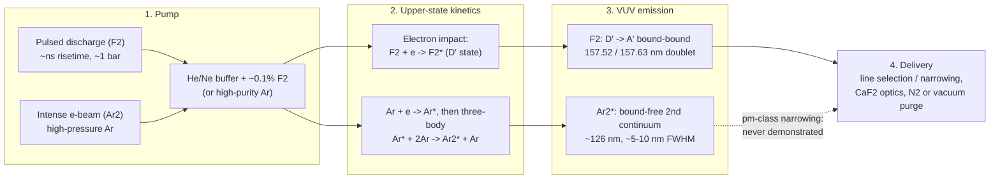

# VUV excimer

**Status:** ✅ Implemented (🧪 Ar₂) — the F₂ line shape, pupil fill, pulse-metadata power arithmetic and photon budget are live and test-pinned; the Ar₂ 126 nm preset is a hypothetical line-narrowed laser and says so; 40 W is laser output · [matrix](../capability-matrix.md#light-sources)

<p class="huv-lead">VUV lithography (120–160 nm) is the deepest optical regime reachable with refractive projection optics, and it is the framework's founding use case. The F₂ molecular-fluorine laser at 157.63 nm was the industry's post-193 nm candidate until 2003, when water-immersion ArF displaced it; the Ar₂ excimer at 126 nm marks the practical short end of transmissive optics — as a what-if only, because 126 nm lithography never left laboratory discussion.</p>

<div class="huv-physics" markdown>

<figure markdown="span">


<figcaption><strong>Mechanism.</strong> The excimer-laser lane: a pulsed discharge in Kr, Ar or F₂ with a buffer gas forms the excimer, whose free-running band a prism-and-grating module narrows to the picometre-class E95 bandwidth the model parameterises before a silica or CaF₂ lens column. The mercury-lamp lane: a high-pressure arc and an interference filter isolate the g, h or i line as one 3 nm Gaussian sample. Both lanes end in the engine's default top-hat pupil (σ 0.7). <em>Schematic, not to scale; no model badge.</em></figcaption>
</figure>

<figure markdown="span">


<figcaption><strong>Why a single lens material makes bandwidth matter.</strong> The page's bandwidth example, swept: each of the 7 spectral samples per line is focused at a different depth by the default chromatic coefficient of a CaF<sub>2</sub> lens at 157 nm, so contrast falls with FWHM; the exact path (<code>compute_multiwavelength</code>) and the narrow-band approximation (<code>compute_polychromatic</code>) agree at Δλ/λ ~ 10<sup>−5</sup>. Default 2 % flare. <em>Model: broadband imaging ✅ · narrow-band approximation 🔶 · refractive optics ✅ (linear axial chromatic coefficient).</em></figcaption>
</figure>

<!-- huv-table: stack -->

| What is modeled | Grade | Dominant approximation | Details |
|---|---|---|---|
| F₂ line, pupil fill, pulse-metadata power, photon budget | ✅ Implemented (🧪 Ar₂) | only the 157.63 nm line of the doublet; Ar₂ is a hypothetical 5 pm line | [Key equations](#key-equations) |
| Chromatic blur through a CaF₂ singlet | ✅ Implemented | linear axial chromatic coefficient (15 nm per pm by default) in the optics, not the source | [Optics](../optics.md) |
| Wafers per hour from laser output | 🔶 Simplified | one refractive-column transmission, lumped overheads | [throughput](index.md#dose-limited-throughput) |
| Excimer coherence, dose jitter, the Ar₂* continuum | not modelled | trait defaults 0; no line-narrowing physics | [What the model does](#what-the-model-does) |

**Same thing elsewhere:** Python `SourceConfig.f2_laser(sigma=0.7)` · TOML `[source] type = "vuv"` + `preset = "f2"` · CLI `highuvlith sources --family vuv` · GUI Source panel · physics → [Pipeline](../pipeline.md#stage-1--source)

</div>

<p class="huv-lead">Why the regime is hard is why the simulator treats it specially: at 157 nm every lens element is CaF₂, no second material exists for achromatisation, so laser bandwidth turns directly into axial chromatic blur and polychromatic simulation is the point rather than an option. CaF₂ is also intrinsically birefringent at 157 nm, O₂ and water absorb below ~185 nm (vacuum or N₂ purge everywhere, no workable organic pellicle), conventional resists are opaque (fluoropolymers were needed) and the 7.9 eV photon opens new photochemistry. The model gets the F₂ line, its sampling and its photon budget right and leaves excimer coherence and dose jitter at the trait defaults.</p>

<div class="huv-glance" markdown>

| Property | Value |
|---|---|
| Wavelength | 157.63 nm (the strong line of the F₂ doublet, fixed); 126.0 nm (Ar₂* second-continuum centre) |
| Band / class | Lorentzian 1.1 pm FWHM (F₂; E95 13.98 pm); 5 pm (Ar₂, never demonstrated); discharge-pumped excimer lasers |
| Coherence → pupil | multimode, trait default 0 → top-hat σ (your choice; 0.5–0.8 typical) |
| Power | F₂ 10 mJ × 4 kHz = 40 W **laser output**; Ar₂ 5 mJ × 1 kHz = 5 W (what-if) |
| Presets | `f2_laser(sigma)`, `ar2_laser(sigma)`, `SourceConfig(wavelength_nm=…, sigma_outer=…, bandwidth_pm=…)` for a custom VUV line |
| Grade | ✅ Implemented (🧪 Ar₂) |
| Compare with | [DUV/UV heritage](duv-heritage.md) · [LPP](lpp.md) · [history: the 157 nm detour](../history/157nm-detour.md) |

</div>

<details markdown="1">
<summary>How the light is made (flowchart)</summary>



</details>

## Key equations

Both lasers are pulsed gas-discharge devices, but the emitting species differ: F₂ lases on a **bound–bound** molecular transition (a narrow doublet), while Ar₂* is a true excimer whose ground state is repulsive — population inversion is automatic because the lower state dissociates in picoseconds, but the emission is a broad continuum (~5–10 nm FWHM). Photon energy follows from the wavelength:

```math
E_\gamma = \frac{hc}{\lambda} = \frac{1239.84\ \text{eV·nm}}{157.63\ \text{nm}} = 7.87\ \text{eV},
\qquad
\frac{1239.84}{126.0} = 9.84\ \text{eV}
```

Spectral weights come from the shared `evaluate_spectral_weights` helper: N samples over λ₀ ± 2.5 Δλ_FWHM, weighted by the line shape and normalised to sum to 1. The Lorentzian default matches excimer line profiles, and its heavy tails are why the vendor E95 of the 1.1 pm preset is 13.98 pm (12.7 × FWHM; a Gaussian would give 1.66 ×, the convention the [heritage presets](duv-heritage.md#key-equations) use):

```math
w(\lambda) \;\propto\; \frac{\gamma^2}{(\lambda-\lambda_0)^2 + \gamma^2},
\qquad \gamma = \tfrac{1}{2}\,\Delta\lambda_{\mathrm{FWHM}}
```

<figure markdown="span">


<figcaption><strong>Why a vendor E95 is not the model's FWHM.</strong> (a) At equal FWHM the 95 %-energy interval is 1.66 FWHM for a Gaussian, 4.68 for the undulator sinc² and 12.7 for a Lorentzian — the ratios the derived quantity <code>e95_bandwidth</code> reports. (b, c) The spectral weights <code>spectrum()</code> hands the imaging engine: five samples over ±2.5 FWHM, each line sampled at its stated FWHM — the ArF preset's 0.2 pm Gaussian (σ = FWHM/2√(2 ln 2)) and the F₂ preset's 1.1 pm Lorentzian. Line shapes as parameterized in the model, not measured laser spectra. <em>Model: excimer sources ✅.</em></figcaption>
</figure>

**Why the Ar₂ preset is hypothetical.** Laser action on the Ar₂* second continuum has only been demonstrated with intense relativistic electron-beam pumping of high-pressure argon, as a broad, low-repetition-rate emitter; discharge- and barrier-pumped Ar₂* sources are incoherent excimer *lamps*. A kHz, mJ-class Ar₂ laser line-narrowed from a ~5–10 nm continuum to 5 pm — a factor of order 10³ — has never been built. The preset is a what-if for imaging studies at 126 nm, and the model says so: its `relative_bandwidth` carries that caveat and it reports `demonstrated = 0`.

## Real machines

<!-- huv-table: stack -->

| Machine / measurement | Wavelength | Value | Plane / provenance | Reference |
|---|---|---|---|---|
| MIT Lincoln Laboratory 157 nm demonstration (1997) | 157.63 nm | features down to 80 nm | measured | Bloomstein et al. [1] |
| F₂ Micrascan VII (2003), NA 0.75 | 157.63 nm | CD 100 nm; the only step-and-scan class reached | reported | Bruning (2007) |
| Lithography-class F₂ laser | 157.63 nm | ~1 pm line-selected single line | reported | Bloomstein; Ishchenko et al. [2] |
| Ar₂* second continuum (e-beam-pumped laser; DBD lamps) | ~126 nm | ~5–10 nm FWHM; no rep-rated laser | measured | Kogelschatz [3] |
| `f2_laser` · `ar2_laser` presets | 157.63 · 126.0 nm | 1.1 pm Lorentzian, 10 mJ × 4 kHz = 40 W · 5 pm, 5 mJ × 1 kHz = 5 W | this model, laser output · this model, what-if | — |

The programme that followed the 1997 demonstration reached step-and-scan hardware, but Intel dropped 157 nm from its roadmap in May 2003, TSMC cancelled its orders in October 2003 and backed water immersion (193 nm in water has an effective wavelength of ~134 nm), and 157 nm work stopped in 2004 — the story is told on [the 157 nm detour](../history/157nm-detour.md); the 157 nm materials layer, the mature VUV n,k database (126–160 nm), is on [materials](../materials.md).

<figure markdown="span">


<figcaption><strong>The F₂ chain, and a laser that does not exist.</strong> Pulse energy × repetition rate gives the output; the refractive column (optics 0.3 × mask 0.9, an assumption) the power on the wafer. The Ar₂ preset is hollow: a line-narrowed Ar₂ laser has never been built. <em>Model: VUV excimer ✅ (🧪 Ar₂) · Dose-limited wafer throughput 🔶.</em></figcaption>
</figure>

## What the model does

`VuvSource` in [`source.rs`](../../crates/highuvlith-core/src/source.rs) deliberately gained **no new fields** in the source-physics overhaul (struct literals in the CLI, GUI, bindings and imaging tests construct it directly), so everything new is derived from `wavelength_nm`, `bandwidth_pm`, `spectral_samples`, `spectral_shape`, `pulse_energy_mj`, `rep_rate_hz` and `illumination`. Factories `f2_laser(sigma)` and `ar2_laser(sigma)` validate σ ∈ (0, 1]; the same struct carries the [heritage presets](duv-heritage.md).

- **`wavelength_nm()` / `bandwidth_pm()`** — the stored line and its FWHM; only the 157.63 nm line of the F₂ doublet is modelled.
- **`spectral_weights()`** — five Lorentzian samples by default (`SpectralShape::Lorentzian`; Gaussian, Tabulated and SincSquared available — use `Tabulated` with a measured spectrum to model a broadband Ar₂* lamp and expect severe chromatic blur).
- **`intensity_at()`** — the shared `evaluate_illumination`: binary top-hat fills for conventional, annular, quadrupole and dipole shapes. Excimer beams are highly multimode, so `transverse_coherence()` keeps the trait default 0 — correct physics, represented by a wide fill whose σ is your model choice.
- **`pulse_energy_j()` × `rep_rate_hz()`** → `average_power_w()` = 40 W, live arithmetic, the input of the [throughput model](index.md#dose-limited-throughput); `rep_rate_hz = 0` is the CW convention of the lamp presets.
- **`shot_to_shot_rms()`** keeps the default 0: real excimer dose jitter (~1 %) is not modelled — set `StochasticParams::dose_jitter_rms` yourself.
- **Imaging** is scalar by default ([vector imaging](../vector-imaging.md) on request); the narrow-band path shifts focus per spectral sample with centre-wavelength kernels, honest at Δλ/λ ≈ 7 × 10⁻⁶ where only the chromatic focus term matters; `compute_multiwavelength` is the exact per-wavelength sum.

<!-- huv-table: stack -->

| Field | Unit | Consumed by | Status |
|---|---|---|---|
| `wavelength_nm` | nm | TCC pupil scaling, photon energy and density, resist exposure, photon budget | live |
| `bandwidth_pm` | pm FWHM | polychromatic sampling range; chromatic defocus span; `relative_bandwidth`, `e95_bandwidth`, `coherence_length` | live |
| `spectral_samples`, `spectral_shape` | count, enum | number and weighting of the polychromatic samples | live |
| `pulse_energy_mj`, `rep_rate_hz`, `illumination` | mJ, Hz, enum | `average_power_w()` → throughput, `photons_per_pulse`, `0` marks a CW source; pupil `intensity_at` during TCC construction | live |
| coherence / jitter; Ar₂ continuum and line-narrowing physics | — | trait defaults 0; not modelled | planned |

## Derived quantities

`derived_quantities()` (Rust trait method; Python `SourceConfig.derived_quantities()` / `derived_quantity(name)`; printed by `highuvlith simulate`) — informational, never read by the imaging pipeline.

<!-- huv-table: stack -->

| Name | Unit | Meaning | F₂ preset | Ar₂ preset |
|---|---|---|---|---|
| `photon_energy` | eV | hc/λ (the note names the line) | 7.866 | 9.840 |
| `relative_bandwidth` | — | Δλ_FWHM/λ (Ar₂: carries the "never demonstrated" caveat) | 6.98 × 10⁻⁶ | 3.97 × 10⁻⁵ |
| `e95_bandwidth` | pm | width holding 95 % of the line energy for the configured shape | 13.98 | 63.5 |
| `coherence_length` | µm | λ²/Δλ | 22 588 | 3 175 |
| `photon_density_per_dose` | photons/nm² per mJ/cm² | incident photons per nm² at 1 mJ/cm² | 7.935 | 6.343 |
| `photons_vs_13nm5` | — | photons per dose relative to 13.5 nm (λ/13.5 nm) | 11.68 | 9.33 |
| `average_power` | W | pulse energy × rep rate (laser output) | 40 | 5 |
| `demonstrated` | bool | only in the Ar₂* band (120–132 nm): 0 = no line-narrowed Ar₂ laser exists | — | 0 |

<details markdown="1">
<summary>The remaining rows</summary>

`photons_per_mj` 7.935 × 10¹⁴ / 6.343 × 10¹⁴ photons; `photons_per_pulse` 7.94 × 10¹⁵ / 3.17 × 10¹⁵; `photon_rate` 3.17 × 10¹⁹ / 3.17 × 10¹⁸ photons/s (F₂ / Ar₂); `continuous_wave` appears only for CW sources (`rep_rate_hz = 0`, the Hg lamps) and replaces the pulse rows. Through a refractive-like scanner at 30 mJ/cm² the [throughput model](index.md#dose-limited-throughput) puts 10.8 W on the wafer and gives ≈ 172 wafers/h, overhead-dominated, ≈ 23 pulses per exposure point and ~4.8 × 10⁵ photons on a (45 nm)² area (0.14 % shot noise) — the same row as KrF, because both presets are 40 W lasers.

</details>

## Use it

### Python

Factory names from [`py_config.rs`](../../crates/highuvlith-py/src/py_config.rs):

<!-- verify-example -->
```python
import highuvlith as huv

f2 = huv.SourceConfig.f2_laser(sigma=0.7)      # 157.63 nm preset
ar2 = huv.SourceConfig.ar2_laser(sigma=0.7)    # 126.0 nm preset (hypothetical)
print(f2.kind, f2.wavelength_nm, f2.average_power_w)                # vuv 157.63 40.0
print(f"{f2.derived_quantity('photons_per_pulse'):.3g} photons per pulse, "
      f"E95 {f2.derived_quantity('e95_bandwidth'):.3g} pm for the 1.1 pm Lorentzian")
print(f"Ar2 demonstrated = {ar2.derived_quantity('demonstrated'):.3g}")
tp = f2.wafer_throughput(dose_mj_cm2=30.0, optics_transmission=0.30,
                         mask_efficiency=0.90, slit_height_mm=8.0, cd_nm=45.0)
print(f"{tp['wafers_per_hour']:.3g} wph, {tp['pulses_per_point']:.3g} pulses per point")
```

???+ success "Output"

    ```text
    vuv 157.63 40.0
    7.94e+15 photons per pulse, E95 14 pm for the 1.1 pm Lorentzian
    Ar2 demonstrated = 0
    172 wph, 23.1 pulses per point
    ```

`highuvlith simulate` prints the derived quantities and writes them into its JSON output.

## TOML keys

The keys the CLI reads for `type = "vuv"` (`VUV_KEYS` in [`config.rs`](../../crates/highuvlith-cli/src/config.rs)). Omitting `type` defaults to `"vuv"` for back-compat; without `preset` the legacy explicit-wavelength source is built (Lorentzian 1.1 pm, `spectral_samples` 5 and 10 mJ fixed), with `preset` the preset is built and explicit `wavelength_nm` / `bandwidth_pm` / `rep_rate_hz` override it.

| Key | Default | Units | Notes |
|---|---|---|---|
| `type` | `"vuv"` | — | optional: an absent tag also means `vuv` |
| `preset` | none (legacy source) | — | `f2`, `ar2` (the hypothetical 126 nm laser), `arf`, `krf`, `hg_i`, `hg_h`, `hg_g` |
| `wavelength_nm` | 157.63 | nm | the line; overrides the preset |
| `sigma` | 0.7 | — | top-hat pupil radius, (0, 1]; not with `[illumination]` |
| `bandwidth_pm` | 1.1 | pm FWHM | overrides the preset shape width |
| `rep_rate_hz` | 4000 | Hz | overrides the preset rate; pulse energy stays the preset's |
| `spectral_samples` | 5 | — | polychromatic samples |

```toml
[source]
preset = "f2"          # type "vuv" implied; "ar2" is the hypothetical 126 nm laser
sigma  = 0.7
```

Example: [`sim.toml`](../../examples/sim.toml) (the canonical 65 nm / 180 nm run, implicit F₂).

<details markdown="1">
<summary>Validation — 14 tests</summary>

| Claim | Test | Tolerance |
|---|---|---|
| preset wavelengths; F₂ photon energy ≈ 7.9 eV; Lorentzian sampling normalised and peaked at the centre; binary pupil boundary; σ validation; 10 mJ × 4 kHz → 40 W through the trait, coherence 0 | `source.rs::test_f2_laser_wavelength`, `test_ar2_laser_wavelength`, `test_photon_energy_ev`, `test_spectral_weights_sum_to_one`, `test_spectral_weights_centered`, `test_conventional_source_inside/outside`, `test_invalid_sigma_rejected`, `test_pulse_metadata_live_through_trait` | exact |
| photons per pulse 7.935 × 10¹⁵, photon rate, coherence length 22 588 µm, the Ar₂ `demonstrated = 0` flag; E95/FWHM 1.6646 / 12.706 / 4.680; the CW convention; the heritage presets | `test_vuv_derived_quantities`, `test_e95_bandwidth_conventions`, `test_hg_lamps_are_cw_single_sample`, `test_heritage_presets_photon_budget` | scipy fixtures |
| type-erased dispatch and the `type = "vuv"` serde tag; absent tag → VUV; the `preset` field and overrides; photon budget and the Ar₂ flag through the bindings | `test_source_kind_trait_dispatch`, `test_source_kind_toml_roundtrip`, CLI `test_toml_back_compat_without_type_tag`, `test_vuv_heritage_presets`; `tests/python/test_sources_physics.py::TestVuv` | — |

</details>

<details markdown="1">
<summary>Changes</summary>

- `rep_rate_hz = 0` became the continuous-wave convention when the Hg-lamp presets were added: `pulse_energy_j()` and `rep_rate_hz()` return `None`, so `average_power_w()` is `None`; pulsed F₂ and Ar₂ configurations behave exactly as before. The F₂ and Ar₂ presets use the Lorentzian line; both samplers treat `bandwidth_pm` as the FWHM (bandwidth conventions on [DUV/UV heritage](duv-heritage.md#key-equations)).

</details>

## See also

[DUV/UV heritage](duv-heritage.md) (the same struct: ArF, KrF, Hg lines) · [Laser-produced plasma](lpp.md) (what replaced 157 nm) · history: [The 157 nm detour](../history/157nm-detour.md) · [Materials](../materials.md) (the VUV n,k database) · [Throughput, stated once](index.md#dose-limited-throughput) · [configuration](../configuration.md) · [`examples/sim.toml`](../../examples/sim.toml)

## References

1. T. M. Bloomstein et al., "Lithography with 157 nm lasers," *J. Vac. Sci. Technol. B* **15**, 2112 (1997), doi:10.1116/1.589230.
2. V. N. Ishchenko, S. A. Kochubei, A. M. Razhev, "High-power efficient vacuum ultraviolet F₂ laser," *Sov. J. Quantum Electron.* (1986).
3. U. Kogelschatz, "Dielectric-barrier discharges: their history, discharge physics, and industrial applications," *Plasma Chem. Plasma Process.* **23**, 1 (2003) — rare-gas excimer emission.
4. Burnett, Levine & Shirley, *Phys. Rev. B* **64**, 241102(R) (2001), doi:10.1103/PhysRevB.64.241102 — intrinsic birefringence of CaF₂; Switkes & Rothschild, *J. Vac. Sci. Technol. B* **19**, 2353 (2001), doi:10.1116/1.1412895 — immersion lithography.
5. Ronse, *C. R. Physique* **7**, 844 (2006), doi:10.1016/j.crhy.2006.10.007 — the end of 157 nm; J. H. Bruning, "Optical Lithography … 40 years and holding," *Proc. SPIE* **6520**, 652004 (2007).

**Where next:** ← [DUV/UV heritage](duv-heritage.md) · [Laser-produced plasma](lpp.md) → · Related: [The 157 nm detour](../history/157nm-detour.md) · [Capability matrix](../capability-matrix.md#light-sources)
