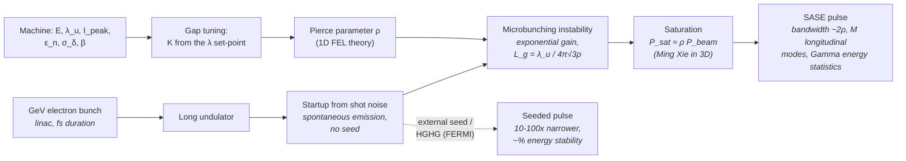

# XFEL

**Status:** ✅ Implemented (🧪 CW-SC and ERL presets) — SASE bandwidth from a machine-derived Pierce parameter, Gamma mode statistics and the resulting dose jitter are live; gain length and saturation are 1D + Ming-Xie estimates; 0.1 W FEL output for the FLASH-class preset · [matrix](../capability-matrix.md#light-sources)

<p class="huv-lead">Linac-driven free-electron lasers (FLASH, FERMI, LCLS, the European XFEL, SwissFEL) deliver femtosecond pulses of extreme peak power from the EUV to hard X-rays. For lithography their interest is threefold: single-shot full-field exposure studies, statistics — a SASE FEL starts from electron shot noise, so its spectrum and pulse energy fluctuate shot to shot and that jitter propagates into dose jitter and LER — and average power, because superconducting CW linacs and energy-recovery linacs push the repetition rate to the MHz–100 MHz range, the route by which FEL-based EUV sources are proposed to reach the kilowatt class.</p>

<div class="huv-physics" markdown>

<figure markdown="span">


<figcaption><strong>Energy-recovery-linac FEL: accelerate, lase, then decelerate the same beam in the same cavities.</strong> The spent beam returns half an RF period late and hands its energy back before a low-energy dump, so the beam current — and the average FEL power — can far exceed what single-pass RF power would allow. <em>Schematic, not to scale.</em></figcaption>
</figure>

<figure markdown="span">


<figcaption><strong>SASE jitter, and how the scanner averages it away.</strong> (a) A pulse of M longitudinal modes has a Gamma(M) energy distribution with σ_E/⟨E⟩ = 1/√M — 57 % for the FLASH-class preset, 42 % and 25 % for the CW-SC and ERL projections; the seeded FERMI-class preset keeps a residual 2 %. (b) The throughput model's pulses per exposure point divide that jitter by √N to the 0.01–0.6 % level. These are the model's statistics, not measured FLASH shot statistics. <em>Model: XFEL (SASE / seeded) ✅ (🧪 CW-SC and ERL presets) · Dose-limited wafer throughput 🔶.</em></figcaption>
</figure>

<!-- huv-table: stack -->

| What is modeled | Grade | Dominant approximation | Details |
|---|---|---|---|
| Gap-tuned K, the Pierce parameter ρ and the SASE bandwidth 2ρλ | ✅ Implemented (🧪 CW-SC and ERL presets) | 1D FEL theory on illustrative machine parameters, not FLASH or KEK specifications | [Key equations](#key-equations) |
| Gamma(M) pulse-energy statistics → live dose jitter | ✅ Implemented | ensemble statistic; the spike realisation is a Rust-only research mode | [What the model does](#what-the-model-does) |
| Gain length and saturation | 🔶 Simplified | 1D + the Ming Xie fit (≈ 10–20 % inside its range) | [Full formulas](#key-equations) |
| Wafers per hour from the FEL output | 🔶 Simplified | ten 0.70 mirrors and a 0.65 mask, lumped overheads (the ERL sits at the ceiling) | [throughput](index.md#dose-limited-throughput) |

**Same thing elsewhere:** Python `SourceConfig.xfel_flash_13nm5()` · TOML `[source] type = "xfel"` · CLI `highuvlith sources --family xfel` · GUI Source panel · physics → [Stochastics in the pipeline](../pipeline.md#stage-1--source)

</div>

<p class="huv-lead"><code>XfelSource</code> computes the fluctuation magnitude from first principles and feeds it to the stochastic module: with machine parameters attached (all presets) the undulator K is derived from the wavelength set-point and the Pierce parameter ρ from the electron beam, so bandwidth, mode count and jitter follow from the machine. The deliberate contrast with the synchrotron page: XFEL undulators are gap-tunable and operators dial a photon energy, so the wavelength here is an honest set-point, whereas a storage-ring undulator's wavelength follows from its fixed K. The kilowatt presets are projections of what the FEL physics allows, not machines.</p>

<div class="huv-glance" markdown>

| Property | Value |
|---|---|
| Wavelength | 13.5 nm **set-point** (gap-tunable; the undulator K is derived from it by inverse resonance) |
| Band / class | SASE 2ρλ = 62.5 pm (FLASH-class), seeded 0.675 pm (FERMI-class); linac-driven FEL, SASE or externally seeded |
| Coherence → pupil | 0.85 (SASE), 0.95 (seeded) → coherent-core σ through the Gaussian–Schell bridge |
| Power | FLASH-class 0.1 W, FERMI-class 1 mW **FEL output** (measured-class pulse energies); CW-SC ≈ 135 W and ERL ≈ 10.5 kW — design projections |
| Presets | `xfel_flash_13nm5()`, `xfel_fermi_seeded()`, `xfel_cw_sc_13nm5()`, `xfel_erl_13nm5()` |
| Grade | ✅ Implemented (🧪 CW-SC and ERL presets) |
| Compare with | [Synchrotron](synchrotron.md) · [LPA-FEL](lpa-fel.md) · [SSMB](ssmb.md) · future: [Accelerator light sources](../future/accelerator-light-sources.md#the-bar-to-clear-power-at-intermediate-focus) |

</div>

<details markdown="1">
<summary>How the light is made (flowchart)</summary>



</details>

## Key equations

SASE (self-amplified spontaneous emission) amplifies the noise within the FEL gain bandwidth, set by the Pierce parameter ρ; a pulse of duration T is a train of temporally coherent spikes and contains M independent longitudinal modes, each exponentially distributed, so the total pulse energy follows a **Gamma distribution of order M** (Saldin, Schneidmiller & Yurkov):

```math
\frac{\Delta\lambda}{\lambda} \simeq 2\rho, \qquad t_{\mathrm{coh}} = \frac{\lambda^2}{c\,\Delta\lambda}, \qquad M = \max\!\left(1,\ \frac{T}{t_{\mathrm{coh}}}\right), \qquad p(E) = \frac{M^M}{\Gamma(M)} \left(\frac{E}{\langle E\rangle}\right)^{M-1} \frac{e^{-M E/\langle E\rangle}}{\langle E\rangle}, \qquad \frac{\sigma_E}{\langle E\rangle} = \frac{1}{\sqrt{M}}
```

Seeding (self-seeding at LCLS and the European XFEL, the HGHG cascade at FERMI) replaces the noise start with a coherent seed: the bandwidth narrows 10–100× and the energy stabilises to the percent level. **Gap tuning (inverse resonance):** for an undulator of period λ_u and a beam of Lorentz factor γ, the K that puts the fundamental at the set-point λ is unreachable — `undulator_k()` returns `None`, the CLI errors — when λ is shorter than the K = 0 limit λ_u/2γ²:

```math
K = \sqrt{2\left(\frac{2\gamma^2\lambda}{\lambda_u} - 1\right)}
```

**1D FEL theory** (planar undulator, [JJ] = J₀(ξ) − J₁(ξ), ξ = K²/(4+2K²), I_A = 17 045 A, k_u = 2π/λ_u, σ_x = √(ε_nβ/γ)):

```math
\rho = \left[\frac{1}{16}\,\frac{I}{I_A}\,\frac{K^2[JJ]^2}{\gamma^3\sigma_x^2k_u^2}\right]^{1/3}, \qquad L_g = \frac{\lambda_u}{4\pi\sqrt3\,\rho}, \qquad P_\mathrm{sat} \approx \rho\,\frac{\gamma m_ec^2 I}{e}, \qquad L_\mathrm{sat} \approx \frac{\lambda_u}{\rho}
```

**Ming Xie 3D fit** (PAC'95): with the scaled parameters η_d = L_g/(2kσ_x²) (diffraction), η_ε = (L_g/β)(4πε/λ) (emittance) and η_γ = 4π(L_g/λ_u)σ_γ/γ (energy spread),

```math
\Lambda = a_1\eta_d^{a_2} + a_3\eta_\varepsilon^{a_4} + a_5\eta_\gamma^{a_6} + a_7\eta_\varepsilon^{a_8}\eta_\gamma^{a_9} + a_{10}\eta_d^{a_{11}}\eta_\gamma^{a_{12}} + a_{13}\eta_d^{a_{14}}\eta_\varepsilon^{a_{15}} + a_{16}\eta_d^{a_{17}}\eta_\varepsilon^{a_{18}}\eta_\gamma^{a_{19}}, \qquad L_{g,3D} = L_g(1+\Lambda), \qquad P_\mathrm{sat,3D} \approx 1.6\,\rho\left(\frac{L_g}{L_{g,3D}}\right)^2 P_\mathrm{beam}
```

with the nineteen coefficients a₁ … a₁₉ = 0.45, 0.57, 0.55, 1.6, 3, 2, 0.35, 2.9, 2.4, 51, 0.95, 3, 5.4, 0.7, 1.9, 1140, 2.2, 2.9, 3.2 — an empirical fit (≈ 10–20 % inside its range of order-unity scaled parameters; Λ ≳ 5 only means "no practical gain"). Worked FLASH-like numbers (13.5 nm; illustrative 680 MeV / 31.4 mm / 2.5 kA / 1.5 µm / β = 6 m beam, T = 30 fs): K = 1.025, ρ = 2.31 × 10⁻³, Δλ = 62.5 pm, t_coh = 9.73 fs, M ≈ 3.1, σ_E/⟨E⟩ ≈ 57 %.

## Real machines

<!-- huv-table: stack -->

| Machine / concept | λ | Mode | Pulse energy, duration, rate | Plane / provenance | Reference |
|---|---|---|---|---|---|
| FLASH (DESY) | 4.2–52 nm | SASE | 10–500 µJ / 30–200 fs; 10 Hz bursts (up to ~5 kHz in-burst); 20 mW at 13.7 nm (2007), 0.35 W at 18.2 nm (2015) | FEL output, measured | Ackermann [5]; Schreiber & Faatz [10] |
| FERMI (Trieste) | 100–4 nm | HGHG seeded | FEL-2: 10–30 µJ at 10–20 nm / 20–100 fs; 10 or 50 Hz → ~0.1–1.5 mW | FEL output, measured | Allaria [6] |
| LCLS · European XFEL · SwissFEL | 0.13–4.4 · 0.05–4.7 · 0.1–5 nm | SASE / seeded | mJ-class / fs–100 fs; 120 Hz · 27 kHz effective · 100 Hz | FEL output, measured | Emma [7]; Decking [8]; Prat [9] |
| `xfel_flash_13nm5()` / `flash` preset | 13.5 nm set-point | SASE | 100 µJ (stored), 30 fs, 1 kHz → 0.1 W; ρ = 2.31 × 10⁻³, Δλ = 62.5 pm, M ≈ 3.1, jitter 57 % | this model; illustrative 680 MeV, λ_u 31.4 mm, 30 m; 2.5 kA, 1.5 µm, σ_δ 7 × 10⁻⁴, β 6 m | — |
| `xfel_fermi_seeded()` / `fermi` preset | 13.5 nm set-point | seeded (Δλ/λ = 5 × 10⁻⁵) | 20 µJ (stored), 50 fs, 50 Hz → 1 mW; ρ = 1.78 × 10⁻³, 0.675 pm, jitter 2 % | this model; illustrative 1.2 GeV, λ_u 35 mm, 15 m; 700 A, 1 µm, σ_δ 1.25 × 10⁻⁴, β 10 m | — |
| `xfel_cw_sc_13nm5()` / `cw_sc` preset | 13.5 nm set-point | SASE | 135 µJ (derived), 50 fs, 1 MHz → **135 W**; ρ = 2.54 × 10⁻³, L_sat,3D 18.8 m, 50 kW beam power | this model, projection; 1 GeV, λ_u 39 mm, 30 m; 1 kA, 0.5 µm, σ_δ 10⁻⁴, β 10 m | — |
| `xfel_erl_13nm5()` / `erl` preset | 13.5 nm set-point | SASE | 64.8 µJ (derived), 200 fs, 162.5 MHz → **10.5 kW**; ρ = 1.78 × 10⁻³, L_sat,3D 22.8 m, 7.8 MW beam power to recover | this model, projection; 800 MeV, λ_u 28 mm, 30 m; 300 A (60 pC, 200 fs), 0.6 µm, σ_δ 5 × 10⁻⁴, β 5 m | — |
| KEK ERL EUV-FEL · DESY FLASH-technology EUV FEL · fab-scale FEL · xLight | 13.5 nm | SASE | 800 MeV, 60 pC, 9.75 mA → 9–13.7 kW (cERL has run ~1 mA and lased at 20 µm) · 1.7 kW · 500–1000 W per scanner · 120 kW → 38 kW at 16 scanners, prototype targeted for 2028 | design · design · proposed · announced | Nakamura [11]; Schneidmiller; Hosler [12]; company announcements |

The HVM requirement band at intermediate focus is ~250 W rising to ~1 kW ([LPP](lpp.md)). The machine parameters inside the presets are **illustrative** values in the class of each machine — not FLASH, FERMI, LCLS-II or KEK specifications: the CW-SC preset scales the LCLS-II CW superconducting-linac architecture to 13.5 nm, the ERL preset follows the KEK design (energy, charge and repetition rate) and its derived 10.5 kW falls inside KEK's 9–13.7 kW. **No 13.5 nm machine of either kind exists**; the model does not cover energy-recovery stability, beam loss, the 7.8 MW the ERL must recover or the 50 kW beam dump of the CW-SC case.

<figure markdown="span">


<figcaption><strong>The beam power that a kilowatt FEL would need.</strong> FEL efficiency ≈ ρ at saturation turns 51 W of average beam power into FLASH's 0.1 W and would turn 7.8 MW into the ERL design's 10.5 kW; the CW-SC and ERL presets are projections drawn hollow, their machine parameters illustrative of each class, not specifications. <em>Model: XFEL (SASE / seeded) ✅ (🧪 CW-SC and ERL presets) · Dose-limited wafer throughput 🔶.</em></figcaption>
</figure>

## What the model does

[`XfelSource`](../../crates/highuvlith-core/src/source_models/xfel.rs) stores an `XfelMode` (`Sase { pierce_parameter }` or `SelfSeeded { rel_bandwidth }`), the wavelength set-point, pulse metadata, `transverse_coherence_fraction`, `spectral_samples`, `illumination`, `sase_spike_seed` and an optional `machine: FelMachine` (energy, undulator period and length, and the beam's peak current, normalised emittance, energy spread and β).

- **`wavelength_nm()`** is a stored set-point; with a machine, `undulator_k()` derives the gap-tuned K by inverse resonance and `pierce_parameter()` the ρ of 1D theory (`physics::fel_estimate`); the presets store the derived ρ as the fallback, so both agree at construction.
- **`bandwidth_pm()`** — SASE: 2ρλ through `physics::sase_bandwidth_pm`; seeded: the imposed relative bandwidth.
- **`shot_to_shot_rms()`** — `longitudinal_modes()` evaluates M from the pulse duration and bandwidth; SASE returns 1/√M, seeded a residual 2 %. `StochasticParams::from_source` copies it into `dose_jitter_rms`, `from_source_multi_pulse(source, n)` divides it by √n (use the throughput model's `pulses_per_point`), and the LER/LWR Monte Carlo multiplies each realisation's dose by a Gamma(k, 1/k) factor with k = 1/rms².
- **`spectral_weights()`** — the ensemble average by default (a smooth Gaussian envelope of the SASE or seeded bandwidth, honest for multi-shot exposures); `sase_spike_seed` (Rust API only) draws M spikes with Exp(1) amplitudes under the envelope, deterministic per seed.
- **`pulse_energy_j()`** — FLASH and FERMI keep measured-class pulse energies (100 / 20 µJ) and report the ratio to the derived saturation estimate; CW-SC and ERL initialise it from the Ming-Xie saturation power × pulse duration. When a TOML changes the machine, the set-point or `pulse_duration_fs` without giving `pulse_energy_uj`, the CLI calls `rescale_pulse_energy_from(&preset)`, keeping the preset's `pulse_energy_over_saturation` ratio (ERL with `peak_current_a = 600`: 195 µJ, 31.7 kW); an explicit `pulse_energy_uj` always wins, and an explicit `pierce_parameter` drops the machine.
- **Imaging** — the narrow-band path is fine at SASE's ~0.5 % bandwidth (`compute_multiwavelength` is exact); scalar by default, [vector imaging](../vector-imaging.md) on request; the pupil is a tight `CoherentGaussian` from the stored coherence through `sigma_from_coherence`.

<!-- huv-table: stack -->

| Field | Unit | Consumed by | Status |
|---|---|---|---|
| `mode::Sase.pierce_parameter` / `mode::SelfSeeded.rel_bandwidth` | — | bandwidth → spectral weights, M, `shot_to_shot_rms()` — the stored ρ only without a machine; seeded: 2 % residual jitter | live |
| `wavelength_nm` | nm | imaging wavelength, photon energy, t_coh; gap-tuned K | live (set-point) |
| `pulse_energy_uj`, `pulse_duration_fs`, `rep_rate_hz` | µJ, fs, Hz | `average_power_w()` → throughput; M → jitter; saturation pulse energy; pulses per point | live |
| `transverse_coherence_fraction`, `spectral_samples`, `illumination`, `sase_spike_seed` | —, —, —, — | pupil σ at construction; sample count; `intensity_at()`; one deterministic spike realisation (Rust API only) | live |
| `machine.electron_energy_mev`, `undulator_period_mm`, `undulator_length_m`, `beam.*` | MeV, mm, m; A, µm, —, m | γ → K, ρ (→ bandwidth → M → jitter), Ming Xie Λ, saturation, beam power; undulator / saturation-length ratio | live |
| time-domain pulse structure, slippage, start-up noise beyond the Gamma statistic | — | — | planned |

## Derived quantities

`derived_quantities()` (Python `derived_quantities()` / `derived_quantity(name)`; printed by `highuvlith simulate`) — informational; the imaging pipeline reads only the bandwidth and jitter consequences above.

<!-- huv-table: stack -->

| Name | Unit | Meaning | FLASH-like | FERMI-like | CW-SC | ERL |
|---|---|---|---|---|---|---|
| `average_power` | W | pulse energy × rep rate | 0.1 | 0.001 | 135.0 | 10 537 |
| `hvm_power_ratio` | — | power / 250 W (13.5 nm HVM at IF) | 4 × 10⁻⁴ | 4 × 10⁻⁶ | 0.54 | 42.1 |
| `longitudinal_modes` | — | M = T/t_coh | 3.08 | 1 | 5.65 | 15.8 |
| `undulator_k` | — | gap-tuned K (or `wavelength_reachable = 0`) | 1.025 | 2.553 | 1.819 | 1.653 |
| `pierce_parameter_1d` | — | 1D ρ | 2.31 × 10⁻³ | 1.78 × 10⁻³ | 2.54 × 10⁻³ | 1.78 × 10⁻³ |
| `sase_bandwidth_from_rho` | pm | 2ρλ | 62.5 | 48.1¹ | 68.7 | 48.2 |
| `saturation_length_3d` | m | (λ_u/ρ)(1+Λ) | 17.3 | 23.7 | 18.8 | 22.8 |
| `beam_power_average` | W | E_kin × (I_peak T) × f_rep | 51 | 2.1 | 5.0 × 10⁴ | 7.8 × 10⁶ |

¹ Seeded start-up: the SASE saturation length and 2ρλ bandwidth are upper bounds (flagged by a `seeded_note` quantity); imaging uses the imposed seed bandwidth.

<details markdown="1">
<summary>The remaining rows</summary>

`photon_energy` 91.84 eV; `photon_rate` 6.8 × 10¹⁵ / 6.8 × 10¹³ / 9.2 × 10¹⁸ / 7.2 × 10²⁰ photons/s; `coherence_time` 9.73 / 901 / 8.85 / 12.6 fs; `electron_gamma` 1332 / 2349 / 1958 / 1567; `beam_size_rms` 82.2 / 65.2 / 50.5 / 43.8 µm; `gain_length_1d` 0.624 / 0.902 / 0.704 / 0.721 m and `gain_length_3d` 0.794 / 1.088 / 0.865 / 1.049 m; `ming_xie_lambda` 0.274 / 0.205 / 0.228 / 0.454; `energy_spread_over_rho` 0.30 / 0.07 / 0.04 / 0.28 (< 1 required); `emittance_over_photon_emittance` 1.05 / 0.40 / 0.24 / 0.36; `beam_power_peak` 1.70 × 10¹² / 8.4 × 10¹¹ / 1.0 × 10¹² / 2.4 × 10¹¹ W; `saturation_power_1d` 3.94 / 1.50 / 2.55 / 0.428 GW and `saturation_power_3d` 3.88 / 1.65 / 2.70 / 0.324 GW; `saturation_pulse_energy_3d` 116 / 82 / 135 / 64.8 µJ; `undulator_over_saturation_length` 1.73 / 0.63¹ / 1.59 / 1.31; `pulse_energy_over_saturation` 0.86 / 0.24 / 1 / 1; `fel_efficiency` 2.0 × 10⁻³ / 4.8 × 10⁻⁴ / 2.7 × 10⁻³ / 1.4 × 10⁻³ (FLASH-like / FERMI-like / CW-SC / ERL). Through the [throughput model](index.md#dose-limited-throughput) at 30 mJ/cm² the CW-SC preset gives ~130 wafers/h and the ERL ~194 — 42× the LPP preset's power buys only ~26 % more wafers because per-field and per-wafer overheads dominate (ceiling ≈ 196); each ERL exposure point integrates ~1.3 × 10⁴ pulses, so its 25 % single-pulse SASE jitter averages to ~0.2 % in dose.

</details>

## Use it

### Python

Factories in [`py_config.rs`](../../crates/highuvlith-py/src/py_config.rs):

<!-- verify-example -->
```python
from highuvlith import SourceConfig

sase = SourceConfig.xfel_flash_13nm5()
print(f"FLASH-class: {sase.bandwidth_pm:.3g} pm (2 rho lambda), rms {sase.shot_to_shot_rms:.3g}, "
      f"{sase.average_power_w:.3g} W, 3D gain length {sase.derived_quantity('gain_length_3d'):.3g} m")
seeded = SourceConfig.xfel_fermi_seeded()
print(f"FERMI-class: {seeded.bandwidth_pm:.3g} pm seeded, rms {seeded.shot_to_shot_rms:.3g}")
erl = SourceConfig.xfel_erl_13nm5()      # projection
cw = SourceConfig.xfel_cw_sc_13nm5()     # projection
print(f"ERL {erl.average_power_w:.3g} W from {erl.derived_quantity('beam_power_average'):.3g} W of beam power; "
      f"CW-SC {cw.average_power_w:.3g} W at {cw.electron_energy_mev:.3g} MeV")
tp = erl.wafer_throughput(dose_mj_cm2=30.0)       # simplified dose-limited model
print(f"{tp['wafers_per_hour']:.3g} wph, {tp['pulses_per_point']:.3g} pulses per point")
```

???+ success "Output"

    ```text
    FLASH-class: 62.5 pm (2 rho lambda), rms 0.57, 0.1 W, 3D gain length 0.794 m
    FERMI-class: 0.675 pm seeded, rms 0.02
    ERL 1.05e+04 W from 7.8e+06 W of beam power; CW-SC 135 W at 1e+03 MeV
    194 wph, 1.31e+04 pulses per point
    ```

`highuvlith simulate` prints the derived quantities; ready-made configs are [`sim_xfel.toml`](../../examples/sim_xfel.toml) (FLASH-like SASE), [`sim_xfel_cw_sc.toml`](../../examples/sim_xfel_cw_sc.toml) and [`sim_xfel_erl.toml`](../../examples/sim_xfel_erl.toml) (the two projections).

## TOML keys

The keys the CLI reads for `type = "xfel"` (`XFEL_KEYS` with the `XFEL_MACHINE_KEYS` subset in [`config.rs`](../../crates/highuvlith-cli/src/config.rs)). Seeded mode rejects `pierce_parameter`, SASE rejects `rel_bandwidth`; an explicit `pierce_parameter` disables the machine derivation, so the machine keys are then rejected.

| Key | Default | Units | Notes |
|---|---|---|---|
| `type` | — | — | `"xfel"` |
| `xfel_preset` (alias `preset`) | `"flash"` | — | `flash`, `fermi` (`fermi_seeded`), `cw_sc` (🧪), `erl` (🧪); both spellings must agree |
| `mode`, `pierce_parameter`, `rel_bandwidth` | preset's; derived from the machine (3e-3 if `mode = "sase"` is forced without one); 5e-5 | —, —, — | `sase` or `seeded` (`self_seeded`); an explicit ρ disables the machine derivation; the seed bandwidth (seeded mode only) |
| `wavelength_nm` | 13.5 | nm | the set-point; K is gap-tuned to it (an error below the K = 0 resonance) |
| `pulse_energy_uj`, `pulse_duration_fs`, `rep_rate_hz` | preset | µJ, fs, Hz | an explicit `pulse_energy_uj` is kept; otherwise machine / set-point / duration overrides rescale it at the preset's saturation ratio |
| `electron_energy_mev`, `period_mm`, `undulator_length_m`, `peak_current_a`, `norm_emittance_um`, `electron_energy_spread_rel`, `beta_m` | preset machine | MeV, mm, m, A, µm, —, m | re-derive K, ρ, gain length, saturation and (unless given) the pulse energy |
| `spectral_samples` | preset | — | samples of the ensemble spectrum |

<details markdown="1">
<summary>Validation — 20 tests</summary>

| Claim | Test | Tolerance |
|---|---|---|
| derived ρ = 2.3137 × 10⁻³ and Δλ = 62.47 pm (81 pm with the stored ρ = 3 × 10⁻³ and no machine); K = 1.0247, a longer set-point opens K, sub-K=0 set-points unreachable; seeded > 50× narrower; M = 3.083, rms = 1/√M, longer pulse → lower jitter, seeded pinned at 2 % | `xfel.rs::test_sase_bandwidth_is_two_rho`, `test_gap_tuning_rederives_rho`, `test_seeded_much_narrower_than_sase`, `test_sase_jitter_from_mode_count` | scipy fixtures |
| spike realisation deterministic and normalised; ensemble weights sum to one (all presets); 0.1 W, 91.84 eV, 116 µJ saturation; CW-SC 135 µJ / 135 W and ERL 64.8 µJ / 10.5 kW / 7.8 MW saturate within 30 m; a machine-less TOML parses; the physics layer's SASE, inverse-resonance, ρ, Ming Xie, saturation and [JJ] fixtures | `test_spike_realization_deterministic_and_normalized`, `test_ensemble_weights_sum_to_one`, `test_pulse_metadata_live`, `test_machine_class_presets`, `test_legacy_toml_without_machine_parses`; `physics.rs` (6 tests) | fixtures |
| jitter reaches the stochastic module, 100 pulses → jitter / 10, dose jitter increases LWR; CLI presets and machine fields, explicit ρ → 81 pm, example TOMLs; Python `TestXfel`, `TestXfelSource` | `stochastic.rs` (3 tests); `config.rs::test_xfel_presets_and_machine_fields`, `test_legacy_family_tomls_unchanged_by_new_fields`, `test_family_example_tomls_validate`; `tests/python` | — |

</details>

<details markdown="1">
<summary>Changes</summary>

- **ρ is derived.** The FLASH-class preset's bandwidth moved from 81 pm (the old stored ρ = 3 × 10⁻³) to 62.5 pm when the `machine` field was added and ρ became a 1D-theory derivation; legacy configs with an explicit `pierce_parameter` keep their 2ρλ bandwidth (`test_legacy_family_tomls_unchanged_by_new_fields`).
- **Pulse energy follows the machine.** Machine, set-point or duration overrides without `pulse_energy_uj` now re-derive the pulse energy at the preset's `pulse_energy_over_saturation` ratio (previously the stored value was kept).
- The `Dipole` illumination shape placed both poles at one point until 2026-09-30; the XFEL presets never use it.

</details>

## See also

[Synchrotron](synchrotron.md) (fixed-K resonance, the contrast) · [LPA-FEL](lpa-fel.md) (the same FEL formulas on a laser-plasma beam; links the [key equations](#key-equations) above) · [SSMB](ssmb.md) and [Inverse Compton](inverse-compton.md) (the other accelerator routes) · [LPP](lpp.md) (the 250 W → 1 kW bar) · future: [Accelerator light sources](../future/accelerator-light-sources.md), [The stochastic frontier](../future/stochastic-frontier.md) · [Throughput, stated once](index.md#dose-limited-throughput) · [configuration](../configuration.md) · [`examples/sim_xfel.toml`](../../examples/sim_xfel.toml)

## References

1. E. L. Saldin, E. A. Schneidmiller, M. V. Yurkov, *The Physics of Free Electron Lasers* (Springer, 2000); P. Schmüser, M. Dohlus, J. Rossbach, C. Behrens, *Free-Electron Lasers in the Ultraviolet and X-Ray Regime*, 2nd ed. (Springer, 2014).
2. Z. Huang, K.-J. Kim, "Review of x-ray free-electron laser theory," *Phys. Rev. ST Accel. Beams* **10**, 034801 (2007); M. Xie, "Design optimization for an X-ray free electron laser driven by SLAC linac," *Proc. PAC'95*.
3. W. Ackermann et al., *Nat. Photon.* **1**, 336 (2007) — FLASH; S. Schreiber, B. Faatz, *High Power Laser Sci. Eng.* **3**, e20 (2015) — FLASH average SASE power. [5], [10]
4. E. Allaria et al., *Nat. Photon.* **6**, 699 (2012) — FERMI; P. Emma et al., *Nat. Photon.* **4**, 641 (2010) — LCLS; W. Decking et al., *Nat. Photon.* **14**, 391 (2020) — European XFEL; E. Prat et al., *Nat. Photon.* **14**, 748 (2020) — SwissFEL. [6]–[9]
5. N. Nakamura et al., ERL2015 (JACoW), doi:10.18429/JACoW-ERL2015-MOPCTH010 — the KEK ERL EUV-FEL design [11]; E. Hosler et al., *Proc. SPIE* **9422**, 94220D (2015) — FEL-based EUV lithography sources [12].

**Where next:** ← [Synchrotron](synchrotron.md) · [LPA-FEL](lpa-fel.md) → · Related: [Accelerator light sources](../future/accelerator-light-sources.md) · [Capability matrix](../capability-matrix.md#light-sources)
