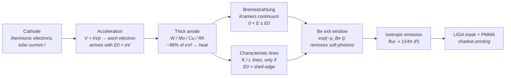

# X-ray tube

**Status:** 🔶 Simplified (✅ lines, edges, Duane–Hunt, Be window) — Kramers thick-target continuum (empirical η = 1.1×10⁻⁹ Z V, (U − 1)^1.67 line law; no anode self-absorption, heel effect or backscatter); a broadband LIGA source — the W preset gives 8.9 W after the Be window · [matrix](../capability-matrix.md#light-sources)

<p class="huv-lead">LIGA deep X-ray lithography normally needs a synchrotron bending magnet: hundreds of µm of PMMA are penetrated only by a hard, few-keV to tens-of-keV white beam. A laboratory X-ray tube produces the same kind of radiation — a broad continuum plus a few strong lines — from a kW-class electron beam stopped in a metal anode, and is the obvious route to lab-scale LIGA without a synchrotron. The price is flux: a tube is an isotropic point source with ~1 % conversion efficiency, orders of magnitude weaker per unit area at the mask than a beamline, so thick resists take days rather than hours.</p>

<div class="huv-physics" markdown>

<figure markdown="span">


<figcaption><strong>Mechanism.</strong> X-ray tube: thermionic electrons accelerated through the kVp strike a thick anode where about 99 % of the power becomes heat and the rest the Kramers continuum up to E₀ = eV plus the K and L lines the anode's edges allow; the Be window removes the soft photons and the flux spreads as 1/(4πd²) to the LIGA mask. Betatron: a 100 TW pulse blows out a plasma bubble, trapped electrons reach γ ≈ 400 and oscillate in the ion cavity at ω_β = ω_p/√(2γ), radiating a synchrotron-like femtosecond keV burst. Both are shadow-printed: no projection pupil. <em>Schematic, not to scale; no model badge.</em></figcaption>
</figure>

<figure markdown="span">


<figcaption><strong>What a laboratory tube offers LIGA.</strong> (a) <code>spectral_flux_density(100 mm)</code> of the four anode presets: Kramers bremsstrahlung ending at each Duane–Hunt limit, K lines where the tube voltage exceeds the K edge (Mo, Cu, Rh) and only L lines for tungsten at 60 kV (K edge 69.5 keV), the soft end cut by the 250 µm Be window. (b) The window transmission, obtained from the engine as the filtered over the unfiltered spectrum. <em>Model: Hard X-ray tube (W / Mo / Cu / Rh, 5–300 kV) 🔶 (✅ line energies, edges, Duane–Hunt limit and Be filtration; the Kramers continuum, line yields and absolute flux are simplified: no anode self-absorption, heel effect or backscatter).</em></figcaption>
</figure>

<!-- huv-table: stack -->

| What is modeled | Grade | Dominant approximation | Details |
|---|---|---|---|
| Hard X-ray tube (W / Mo / Cu / Rh, 5–300 kV) | 🔶 Simplified (✅ lines, edges, Duane–Hunt, Be window) | Kramers thick-target law without anode self-absorption, heel effect or backscatter; empirical η and (U − 1)^1.67 line yields (±×2) | [Key equations](#key-equations) |
| LIGA / deep X-ray depth dose and exposure time | ✅ Implemented | the relative spectrum feeds `highuvlith deep`; the absolute flux density is passed explicitly for an exposure time | [Real machines](#real-machines) |
| Machine-parameter physics layer | ✅ Implemented | exact Kramers bin integrals, NIST Be attenuation, fixture-tested against an independent re-implementation | [Derived quantities](#derived-quantities) |
| Illumination pupil fills | ✅ Implemented | not a projection source: the broadband, incoherent beam is shadow-printed | [What the model does](#what-the-model-does) |

</div>

<p class="huv-lead">`XrayTubeSource` computes the filtered photon spectrum from the operating point (anode, kVp, mA, Be window) and offers it to the LIGA module in two forms: `xray_spectrum(n_bins)`, the *relative* spectrum that `highuvlith deep` uses automatically for `[source] type = "xray_tube"` (depth dose and dose ratios, no exposure time), and `spectral_flux_density(distance_mm, n_bins)`, the *absolute* flux density at the mask plane, which is exposed but never consumed automatically — pass it yourself for an absolute exposure time. The tube lane of the mechanism drawing is this page's; the betatron lane has its own page.</p>

<div class="huv-glance" markdown>

| Property | Value |
|---|---|
| Wavelength | 0.153 nm mean photon wavelength (bookkeeping; mean energy 12.9 keV); Duane–Hunt limit 0.0207 nm at 60 kV |
| Band / class | lab white beam · Kramers continuum plus K/L lines, Δλ/λ ~ 1 — a LIGA / proximity source, not a projection one |
| Coherence → pupil | spatially incoherent (ζ = 0); `intensity_at()` is reached only if forced through projection imaging |
| Power | 8.86 W **after the Be window into 4π** (W, 60 kV × 30 mA = 1.8 kW of beam); 7.1 mW/cm² **at 100 mm** |
| Presets | `xray_tube(anode="W")` (60 kV / 30 mA), `"Mo"` (50 / 40), `"Cu"` (40 / 40), `"Rh"` (50 / 40); 250 µm Be |
| Grade | 🔶 Simplified (✅ lines, edges, Duane–Hunt, Be window) |
| Compare with | [Betatron](betatron.md) · [Synchrotron](synchrotron.md) (the bending-magnet alternative) · [LIGA deep X-ray](../processes/liga-deep-xray.md) |

**Same thing elsewhere:** Python `SourceConfig.xray_tube(anode="W")` · TOML `[source] type = "xray_tube"` · CLI `highuvlith sources --family xray_tube` · GUI Source panel

</div>

<details markdown="1">
<summary>How the light is made (flowchart)</summary>



</details>

## Key equations

**Continuum (Kramers' law).** For a thick target the energy spectrum is linear, I(E) ∝ Z(E₀ − E), so the photon-number spectrum per electron is

```math
\frac{dn}{dE} = \frac{2\eta}{E_0}\left(\frac{E_0}{E} - 1\right), \qquad 0 < E \le E_0 = eV,
\qquad \eta \approx 1.1\times10^{-9}\, Z\, V[\mathrm{V}]
```

normalized so that the energy spectrum integrates to ηE₀ (integrated exactly over each bin); η is the empirical thick-target efficiency — 0.49 % for W at 60 kV, 0.81 % at 100 kV, textbook constants differ by ~20 % — and P = ηVI is the bremsstrahlung power into 4π. No photon exceeds the electron energy (**Duane–Hunt**: λ_min[nm] = 1.23984/V[kV]). **Characteristic lines** appear only when E₀ exceeds the shell edge (overvoltage U = E₀/E_edge > 1), with the long-standing empirical thick-target yield per electron

```math
n_\text{line} = k\, M_s\, \omega_s\, \frac{r_\text{line}}{\sum_s r}\,(U - 1)^{1.67}, \qquad k = 7\times10^{-4}
```

(ω_s the fluorescence yield, M_L = 2, M_K = 1, r the relative line intensities within the series); k agrees within a factor of two with a Bethe-cross-section thick-target estimate for Cu, Mo and Rh K lines, so absolute K-line intensities are uncertain by ±×2 and W L lines by ±×3. **Filtration and flux density.** The Be window transmits T(E) = exp[−μ_Be(E) t] (NIST data from [`materials/attenuation.rs`](../../crates/highuvlith-core/src/materials/attenuation.rs)) and at distance d from an isotropic point focus in vacuum

```math
\Phi(E) = \frac{I}{e}\,\frac{dn}{dE}\,\frac{T(E)}{4\pi d^2}\quad[\text{photons s}^{-1}\,\text{mm}^{-2}\,\text{keV}^{-1}]
```

**What is missing (why the continuum is 🔶).** Photons are generated a few µm below the anode surface and attenuated on the way out (self-absorption, which also produces the heel effect), removing much of the soft continuum — real spectra are *harder* than the unabsorbed moments here, by an amount set by the take-off angle and not quantified; tens of percent of the electrons backscatter out of a high-Z anode before radiating fully; and Kramers' law is a thick-target approximation valid in the diagnostic range (≲ 150 kV).

<details markdown="1">
<summary>Full formulas — line energies and excitation edges (keV)</summary>

| Anode (Z) | Lines modelled | Edge(s) | ω (fluorescence yield) |
|---|---|---|---|
| W (74) | Kα1 59.318, Kα2 57.982, Kβ 67.244; Lα1 8.398, Lα2 8.335, Lβ1 9.672, Lβ2 9.962, Lγ1 11.286 | K 69.525; L3 10.207, L2 11.544 | ω_K 0.96, ω_L ≈ 0.26 |
| Mo (42) | Kα1 17.479, Kα2 17.374, Kβ 19.608 | K 20.000 | ω_K 0.76 |
| Cu (29) | Kα1 8.048 (1.5406 Å), Kα2 8.028, Kβ 8.905 | K 8.979 | ω_K 0.44 |
| Rh (45) | Kα1 20.216, Kα2 20.074, Kβ 22.724 | K 23.220 | ω_K 0.81 |

Values from the X-ray Data Booklet (Tables 1-1 and 1-2; Bearden 1967, Bearden &amp; Burr 1967). The Kβ group is one line at the Kβ1 energy carrying the whole group's intensity (Kβ3 lies a few tens of eV below for Mo and Rh, ~0.29 keV below for W; Kβ2 ~1.8 keV above for W) — negligible for the moments and the LIGA dose, since the W K lines carry < 1 % of the photons even at 100 kV. Mo and Rh L lines (2.3 / 2.7 keV, weak and absorbed by the window) and Cu L lines (0.93 keV, fully absorbed) are omitted.

</details>

## Real machines

<!-- huv-table: stack -->

| Tube class | Typical anodes | Voltage | Beam power | provenance |
|---|---|---|---|---|
| Sealed diffraction (XRD) tube | Cu (also Mo, Co, …) | ~30–60 kV; 40 kV × 40 mA is a common operating point | ~1–3 kW | typical ratings (order of magnitude) |
| Rotating-anode generator | Cu, Mo, W | ~40–60 kV | ~10 kW class | order of magnitude |
| Microfocus tube | W, Cu, Mo | ~20–150 kV | ~1–100 W (µm-scale spot) | order of magnitude |
| Exit window | Be | — | — | ~100–500 µm class (order of magnitude) |

More than 99 % of the beam power heats the anode — the thermal limit that caps tubes at the kW (sealed) to ~10 kW (rotating) class. The "after window" power can exceed the generated bremsstrahlung power because it includes the characteristic lines.

<figure markdown="span">


<figcaption><strong>Ninety-nine percent of the beam heats the anode.</strong> The thick-target efficiency η = 1.1 × 10⁻⁹ Z·V is an empirical law (±20 %), the characteristic lines follow the empirical (U − 1)^1.67 law (±×2), and the model neglects anode self-absorption, the heel effect and backscatter; the last row is the isotropic flux through 1 cm² at 100 mm, the plane LIGA exposure times are computed in. <em>Model: Hard X-ray tube 🔶 (✅ lines, edges, Duane–Hunt, Be window).</em></figcaption>
</figure>

**LIGA reality check** ([`examples/sim_xray_tube.toml`](../../examples/sim_xray_tube.toml): W 60 kV / 30 mA, 200 µm PMMA, 20 µm Au absorber on 2 µm Ti, bottom clearing dose 3 kJ cm⁻³). The relative CLI run gives a top/bottom dose ratio of 2.22 (top 6.65 kJ cm⁻³) with dose-weighted mean photon energies of 5.77 keV at the top and 8.13 keV at the bottom; feeding the absolute flux density at 100 mm gives an exposure time of ≈ 52 h (≈ 13 h at 50 mm) — model output with the 🔶 caveats above, likely optimistic.

<figure markdown="span">


<figcaption><strong>Days, not hours: the tube's flux sets the LIGA exposure time.</strong> <code>simulate_liga(flux_density=tube.spectral_flux_density(d))</code> for the W 60 kV / 30 mA preset through 20 µm Au on 2 µm Ti into 200 µm PMMA, scaled to 3 kJ/cm³ at the bottom: (a) the depth dose hardens with depth (top/bottom ratio 2.22) and stays under the 20 kJ/cm³ ceiling; (b) the time to reach it is 52 h at 100 mm and grows with the square of the distance. The continuum and absolute flux are simplified, so the time is model output and likely optimistic. <em>Model: LIGA / deep X-ray depth dose and exposure time ✅ · Hard X-ray tube (W / Mo / Cu / Rh, 5–300 kV) 🔶 (✅ lines, edges, Duane–Hunt limit, Be window).</em></figcaption>
</figure>

## What the model does

`XrayTubeSource` ([`source_models/xray_tube.rs`](../../crates/highuvlith-core/src/source_models/xray_tube.rs)) implements `LithographySource`:

- **Spectrum** — `binned_photon_rate(n)` returns filtered photons/s on n equal-width bins over [1 keV, kVp]: exact Kramers bin integrals times the window transmission at the bin centre, plus each excited line deposited in its bin (the 1 keV floor is below anything a practical Be window transmits).
- **Contract C5** — `xray_spectrum(n_bins)` gives `XraySpectrum::Tabulated`, photons per bin normalized to 1, so the whole spectrum up to kVp reaches the depth-dose model; `spectral_flux_density(distance_mm, n_bins)` gives (E_keV, photons s⁻¹ mm⁻² keV⁻¹) on equal-width bins including only the tube's own Be window — passed explicitly as `[deep] flux_density` (CLI), `simulate_liga(flux_density=…)` (Python) or `XraySpectrum::from_flux_density` (Rust).
- **Trait mapping** — `wavelength_nm()` is the photon-number-weighted mean wavelength; `bandwidth_pm()` a Gaussian-equivalent FWHM (2.3548 × the rms spread); `spectral_weights()` the filtered spectrum on 16 equal-energy bins; `average_power_w()` the filtered X-ray power (continuous, no pulse metadata); `photon_energy_ev()` and `photon_density_per_mj_cm2()` use the mean photon *energy* (the trait defaults would use hc/λ̄ and overcount photons per dose by ≈ 1.6 for the W preset). Bookkeeping values: the per-sample-focus polychromatic path is not valid for Δλ/λ ~ 1 and the source is spatially incoherent.
- Presets `w_60kv()`, `cu_40kv()`, `mo_50kv()`, `rh_50kv()`, `preset(anode)`, `new(anode, kvp, current_ma)` (250 µm Be).
- Not modelled (stated, not hidden): anode self-absorption and the heel effect, electron backscatter, focal-spot size and off-axis variation, air attenuation (vacuum/He path assumed), relativistic corrections to Kramers' law, filters other than the Be window (add LIGA beam filters in the LIGA module).

| Field | Unit | Consumed by | Status |
|---|---|---|---|
| `anode` | enum (`W`/`Mo`/`Cu`/`Rh`) | Z → η and Kramers amplitude; line table and edges | live |
| `kvp`, `current_ma` | kV, mA | E₀: continuum cutoff, η, line overvoltage; absolute photon rate I/e | live |
| `be_window_um` | µm | window transmission of continuum and lines | live |
| `spectral_samples`, `illumination` | count, enum | bins of `spectral_weights()`; `intensity_at()` (only if forced through projection imaging) | live |
| anode take-off angle / self-absorption / heel effect; electron backscatter, focal-spot size | — | — | planned |

## Derived quantities

`derived_quantities()` (Python `derived_quantity(name)`; printed by `highuvlith simulate`) for the four presets (250 µm Be, photons with E ≥ 1 keV, 4π-equivalent; the moments are unabsorbed-anode values, 🔶):

<!-- huv-table: stack -->

| Name | Unit | W 60 kV / 30 mA | Cu 40 kV / 40 mA | Mo 50 kV / 40 mA | Rh 50 kV / 40 mA |
|---|---|---|---|---|---|
| `bremsstrahlung_efficiency` | — | 4.88×10⁻³ | 1.28×10⁻³ | 2.31×10⁻³ | 2.48×10⁻³ |
| `bremsstrahlung_power_w` (generated) | W | 8.79 | 2.04 | 4.62 | 4.95 |
| `xray_power_w` (after the window) | W | 8.86 | 2.41 | 4.64 | 4.76 |
| `photon_rate` | photons/s | 4.28×10¹⁵ | 1.54×10¹⁵ | 2.22×10¹⁵ | 2.28×10¹⁵ |
| `mean_photon_energy_kev` | keV | 12.9 | 9.8 | 13.0 | 13.0 |
| `characteristic_photon_fraction` | — | 0.20 (W L) | 0.38 (Cu K) | 0.12 (Mo K) | 0.08 (Rh K) |
| `photon_flux_density_at_100mm` | photons s⁻¹ mm⁻² | 3.4×10¹⁰ | 1.2×10¹⁰ | 1.8×10¹⁰ | 1.8×10¹⁰ |
| `power_density_at_100mm` | mW/cm² | 7.1 | 1.9 | 3.7 | 3.8 |

<details markdown="1">
<summary>The other 6 derived quantities (W preset)</summary>

`beam_power_w` 1800 · `anode_heat_load_w` 1791 (the thermal limit) · `mean_photon_wavelength_nm` 0.1526 (the trait wavelength) · `duane_hunt_min_wavelength_nm` 0.02066 · `k_shell_overvoltage` 0.863 (K lines only for U > 1: W at 60 kV emits L lines only) · `photon_rate` as above per anode.

</details>

## Use it

### Python

Factory from [`py_config.rs`](../../crates/highuvlith-py/src/py_config.rs); `kvp` and `current_ma` default to the anode preset. The absolute LIGA exposure is obtained by handing the flux density over explicitly.

<!-- verify-example -->
```python
import highuvlith as huv

tube = huv.SourceConfig.xray_tube(anode="W", kvp=60.0, current_ma=30.0, be_window_um=250.0)
print(f"{tube.wavelength_nm:.3g} nm")              # mean photon wavelength (bookkeeping)
print(f"{tube.average_power_w:.3g} W")             # after the Be window
for name in ("bremsstrahlung_efficiency", "mean_photon_energy_kev", "power_density_at_100mm"):
    print(name, f"{tube.derived_quantity(name):.3g}")
spectrum = tube.xray_spectrum(n_bins=200)             # [(E_keV, photon fraction)], sums to 1
flux = tube.spectral_flux_density(100.0, n_bins=200)  # [(E_keV, photons/s/mm^2/keV)] at 100 mm
result = huv.simulate_liga(flux_density=flux, resist_thickness_um=200.0)
print(f"{result.exposure_time_s / 3600.0:.3g} h")     # absolute LIGA exposure at 100 mm
```

???+ success "Output"

    ```text
    0.153 nm
    8.86 W
    bremsstrahlung_efficiency 0.00488
    mean_photon_energy_kev 12.9
    power_density_at_100mm 7.05
    52.3 h
    ```

### TOML keys

Field names from [`config.rs`](../../crates/highuvlith-cli/src/config.rs); example [`examples/sim_xray_tube.toml`](../../examples/sim_xray_tube.toml). With `[deep] mode = "liga"` the relative spectrum gives dose ratios and no exposure time; for an absolute time give `[deep] source_distance_m` (point source, inverse square) or a `flux_density` table at the mask — see [LIGA deep X-ray](../processes/liga-deep-xray.md).

| Key | Default | Units | Notes |
|---|---|---|---|
| `type` | — | — | `"xray_tube"` |
| `anode` | `"w"` | — | `w` (60 kV / 30 mA), `mo` (50 / 40), `cu` (40 / 40), `rh` (50 / 40). |
| `kvp` | anode preset | kV | = maximum photon energy (keV). |
| `current_ma` (`tube_current_ma`) | anode preset | mA | |
| `be_window_um` | preset | µm | |
| `wavelength_nm` | derived (photon-weighted mean) | nm | Cross-check, 5 %; rejected if inconsistent. |
| `spectral_samples` | 16 | count | Bins of `spectral_weights()`. |

<details markdown="1">
<summary>Validation — 19 tests</summary>

- [`xray_tube.rs`](../../crates/highuvlith-core/src/source_models/xray_tube.rs), fixtures from an independent NumPy re-implementation (NIST Be μ/ρ nodes, log-log interpolation, exact Kramers bin integrals): `test_bremsstrahlung_efficiency_fixture` (η = 4.884×10⁻³, P = 8.7912 W), `test_efficiency_scales_with_z_and_voltage`, `test_kramers_continuum_fixture_and_energy_normalization`, `test_duane_hunt_limit`, `test_characteristic_lines_gated_by_edges` (no W K lines below 69.5 kV; Mo K absent at 19 kV, present at 21 kV; W Lβ1 absent at 11 kV while Lα1 is present), `test_line_energies_fixture` (Cu Kα1 = 1.54060 Å, Mo Kα1 = 0.70932 Å), `test_line_yield_overvoltage_scaling`, `test_be_window_transmission_fixture`, `test_window_hardens_the_spectrum`, `test_moments_fixture_w60` (4.2796713×10¹⁵ s⁻¹, line fraction 0.1999, 12.9214 keV, 0.1525608 nm, 8.8599 W), `test_moments_fixture_cu40`, `test_spectral_flux_density_fixture_and_scaling` (1.85110236×10⁷ ph s⁻¹ mm⁻² keV⁻¹ at 20.5 keV and 500 mm; inverse square), `test_photon_density_uses_mean_photon_energy` (12 921.38 eV; ⟨E⟩⟨1/E⟩ = 1.5900), `test_anode_presets`, `test_xray_spectrum_is_normalized_tabulated`, `test_spectral_weights_sum_to_one`, `test_validation_rejects_bad_parameters`, `test_derived_quantities_cover_key_physics`.
- CLI: `test_toml_xray_tube_anode_presets_and_overrides`, `test_lab_compact_key_names_aliases_and_fallbacks`, `test_liga_from_xray_tube_and_betatron_sources`; Python: `tests/python/test_sources_new.py::TestXrayTube` including `test_absolute_flux_feeds_liga_manually`.

</details>

<details markdown="1">
<summary>Changes</summary>

No behaviour change is recorded for this family; the shared tube-and-betatron spectra chart that this page and the betatron page used to embed is replaced by the per-family figures above. Dated entries, if any, live in the [capability matrix](../capability-matrix.md#audit-log) audit log.

</details>

## See also

[LIGA deep X-ray lithography](../processes/liga-deep-xray.md) (depth dose, exposure time, the `[deep]` keys) · [Synchrotron](synchrotron.md) (the bending-magnet alternative) · [Betatron](betatron.md) · [Beyond EUV](../future/beyond-euv.md) · [Sources index](index.md) (sources for LIGA and proximity printing) · [TOML configuration](../configuration.md) · [`examples/sim_xray_tube.toml`](../../examples/sim_xray_tube.toml)

## References

1. H. A. Kramers, "On the theory of X-ray absorption and of the continuous X-ray spectrum," *Phil. Mag.* **46**, 836 (1923).
2. X-ray Data Booklet, Center for X-ray Optics, LBNL — Tables 1-1 (electron binding energies) and 1-2 (emission-line energies); J. A. Bearden, *Rev. Mod. Phys.* **39**, 78 (1967); J. A. Bearden and A. F. Burr, *Rev. Mod. Phys.* **39**, 125 (1967).
3. M. O. Krause, "Atomic radiative and radiationless yields for K and L shells," *J. Phys. Chem. Ref. Data* **8**, 307 (1979).
4. J. H. Hubbell and S. M. Seltzer, NIST X-ray mass attenuation coefficients (physics.nist.gov/PhysRefData/XrayMassCoef), as tabulated in [`materials/attenuation.rs`](../../crates/highuvlith-core/src/materials/attenuation.rs).

**Where next:** ← [Soft X-ray laser](soft-xray-laser.md) · [Betatron](betatron.md) → · [Sources](index.md) · [LIGA deep X-ray](../processes/liga-deep-xray.md)
